import pbtClip from './property-based-testing.mp4';
import pbtPoster from './property-based-testing-poster.jpg';

好，先自我介绍一下：我叫 poteto，在 SpaceXSI 做 <Term tip="Grok Bot：讲者团队做的 Agent 产品（x.ai/bot）。它有一个桌面客户端，是 Electron 应用；也能作为全团队共用的 Bot，接收 Slack、Linear 等地方来的事件">Grok Bot</Term>。

先请大家举个手：有多少人看过别人写的代码，心里想“这全是 <Term tip="slop：原意是泔水、残羹剩饭，现在泛指 AI 大批量生成、看着像回事、实际质量低劣的内容">slop</Term>”？

嗯，我也这么想过。

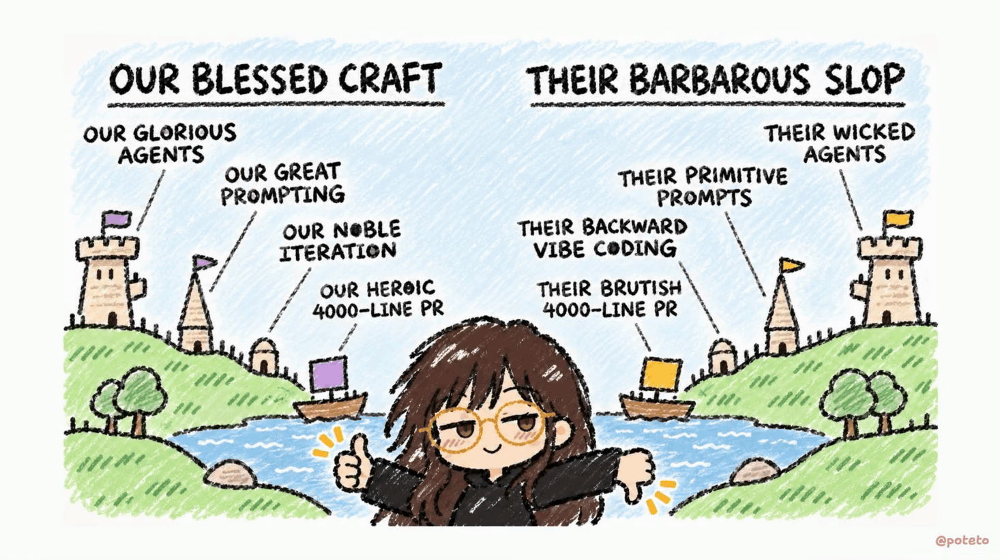

*左边是“我们的神圣手艺”：我们光荣的 Agent、我们高明的提示词、我们高贵的迭代、我们英勇的 4000 行 PR。右边是“他们的野蛮 slop”：他们邪恶的 Agent、原始的提示词、落后的 <Term tip="vibe coding：只用自然语言描述想要什么，让 AI 写代码，自己基本不看代码">vibe coding</Term>、粗野的 4000 行 PR。*

不过今天，我要说服大家：你们可以把这些 slop 变成金子。

{/* truncate */}

上个月我干了件疯狂的事：我往生产环境发了 3000 个 pull request（PR）。在有 Agent 之前，我们其实从来不太看重产出的数量，只有那几个产出高得出奇的人是例外。

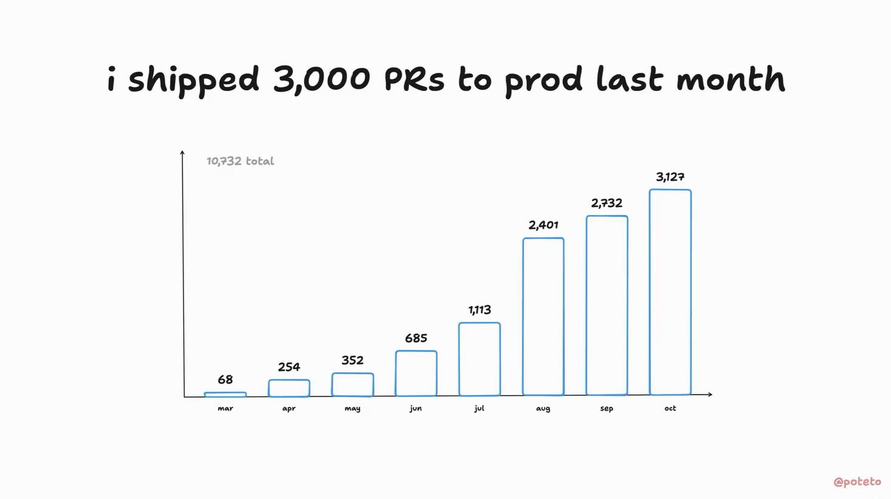

*“上个月我往生产环境发了 3000 个 PR”：3 月 68 个，4 月 254 个，5 月 352 个，6 月 685 个，7 月 1113 个，8 月 2401 个，9 月 2732 个，10 月 3127 个，合计 10732 个。*

在我上一家公司，我们管这种人叫“编码机器”。比如 <Term tip="Bret Taylor：Google Maps 的联合创建者，后来做过 Facebook 的 CTO、Salesforce 的联席 CEO">Bret Taylor</Term>，他有个出名的故事：一个周末就把整个 Google Maps 重写了一遍。就是这种生产力高得离谱的工程师。而现在有了 Agent，任何人都可以成为编码机器。

*“质量与数量：每个人都可以成为编码机器。”最下面一行小字：“新的玩法是快速交付，同时不在质量上妥协。”*

我的观点是：如今当软件工程师，核心玩法是想办法在大幅提高产出的同时，保住甚至提高代码的质量。

怎样做到？有人喜欢把这套做法叫作<Term tip="软件工厂：把写代码、测试、发布、部署整条链路都交给 Agent 自动运转的做法">“软件工厂”</Term>。我更喜欢简单一点的说法：在我看来，这件事归根到底是信任。不是盲目的信任，而是在 Agent 的工作环境上下功夫，让你能相信 Agent 会做正确的事。

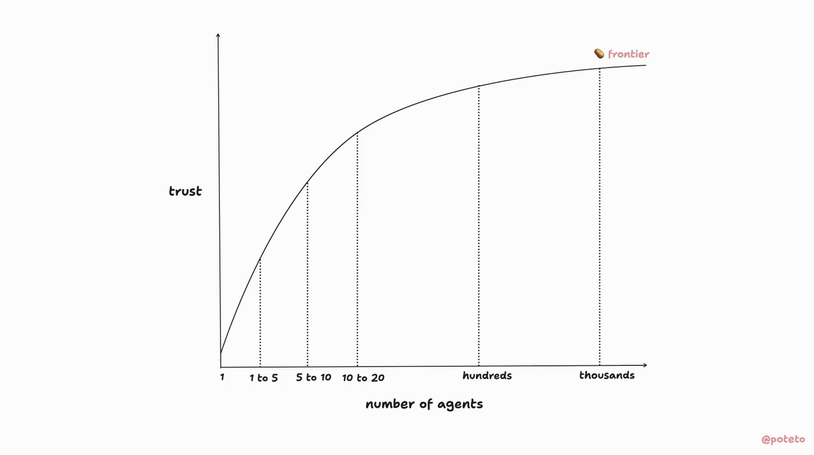

*信任和 Agent 数量：横轴从 1 个、1 到 5 个、5 到 10 个、10 到 20 个，一直到几百、几千个 Agent。曲线前段陡，到几百个以后变平。右上端的土豆图标就是讲者自己，标着“前沿”。*

走到这一步要下很大的功夫。我花了六个月，才走到能发出几千个 PR 的地步，其中很多是在我睡觉的时候发出去的。但这确实做得到，而且你们花的时间会比我少得多。所以，我们先来谈谈怎样把一个低信任的环境变成高信任的环境。

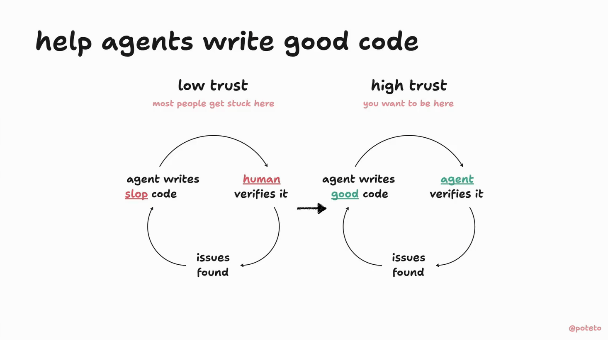

*“帮 Agent 写出好代码”。左边是低信任（大多数人卡在这里）：Agent 写出 slop 代码，人来验证，发现问题后再交回 Agent。右边是高信任（这是你想到达的地方）：Agent 写出好代码，Agent 自己验证，发现问题自己再改。*

## poteto 金字塔

该把时间花在 Agent 环境的哪一部分，我是照这个倒金字塔来想的。

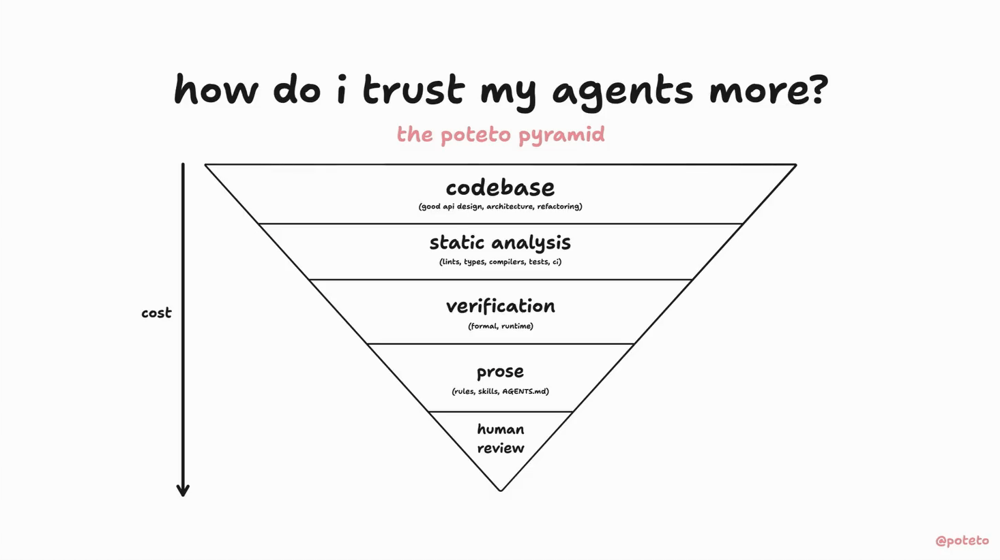

*“怎样才能更信任我的 Agent？”poteto 金字塔从上到下依次是：代码库（好的 API 设计、架构、重构），静态分析（lint、类型、编译器、测试、CI），验证（形式化验证、运行时验证），<Term tip="prose：散文、文字说明。这里指写给 Agent 看的自然语言规则，比如 rules、skills、AGENTS.md">文字规则（prose）</Term>（rules、skills、AGENTS.md），最底下的尖是人工审查。左侧的箭头表示越往下成本越高；越往上的层越宽，越值得多花时间。*

前两层是确定性的，也就是靠代码本身：比如好的 API 设计、架构、重构，或者 lint 规则、类型系统、编译器和各种测试。这两层可以一起用，用来约束 Agent 能做什么，逼它默认就做正确的事。

在这两层之外，再加一层验证，包括运行时验证和形式化验证。它们能找出 bug，检查系统里那些你希望始终成立的属性和不变量，还能帮你确认 Agent 有没有理解你的目标和意图。

最后，再叠上一点文字规则，也就是 <Term tip="rules、skills、AGENTS.md：写给编程 Agent 看的说明文件。rules 是规矩，skills 是某类任务的做法，AGENTS.md 是放在仓库里的总说明">rules、skills、AGENTS.md</Term> 这类要靠判断力去拿捏的东西。

## 代码库像一座花园

不过我们先从代码库说起。Agent 根据输入生成输出，所以输入的质量非常重要。而你的代码库恰恰是 Agent 最大的输入之一。所以每次纠正 Agent 的时候，想一想怎样把这次纠正变成一项确定性的检查，而不是往 rules 或 AGENTS.md 里再加一行。放进代码里可复现得多，你也就更能信任它。

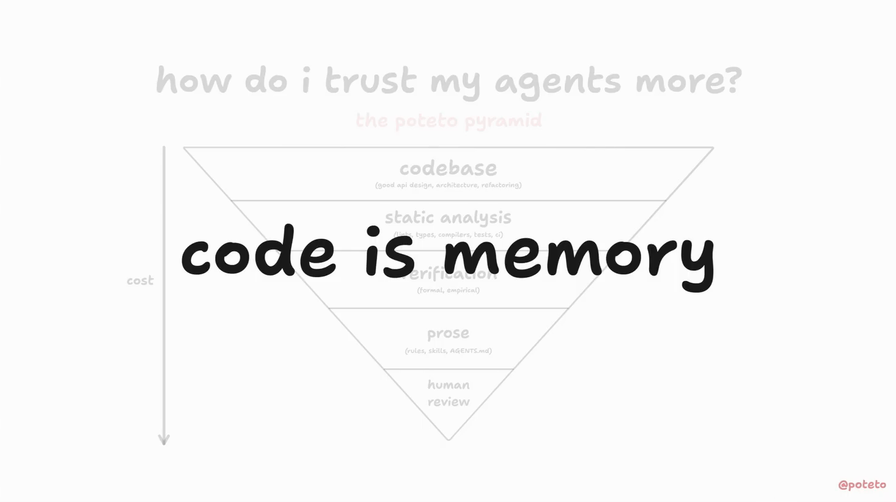

*“代码就是记忆”：Agent 不记得上一次你是怎么纠正它的，但代码库里留下的东西，它每次都会读到。（这句解释是译注，幻灯片上只有标题。）*

我喜欢用的类比是：代码库有点像一座花园。以前代码是一次来几个 PR。我记得 2024 年去上班，要审的是同事写的三个 PR；今天这个数字更像是 300 个。现在每个工程师都相当于一支由几百、甚至几千个 Agent 组成的团队。代码来得太快，几乎像一股连续不断的水流，甚至让人觉得它是有机的，像个活物。

*有机架构（organic architecture）：混凝土是骨架，植物围着它生长。*

在这个类比里，你的代码库、你施加的约束、你设下的护栏，就是混凝土地基，Agent 新写的代码就围着它生长，就像图里的楼一样。所以从很多方面看，软件工程师这份活越来越像园艺了。

代码既然是 Agent 最大的输入，任何变通写法、反模式、废弃代码、技术债，现在都很可能被下一个 Agent 照抄过去，因为它们看起来就是你代码库里的既定模式。这就像花园里长了杂草或害虫，你还没反应过来，它们就已经蔓延得到处都是。

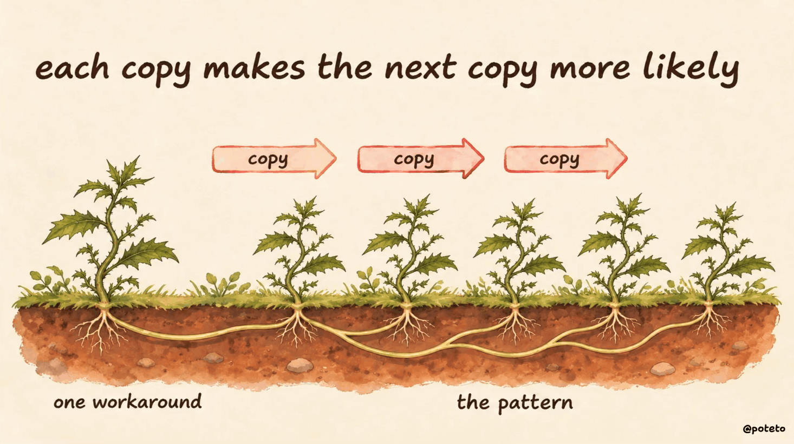

*“每多一份拷贝，下一份拷贝就更可能出现”：一个变通写法（one workaround）被复制了一次又一次，最后长成了“模式”（the pattern）。*

所以你要让代码库尽可能干净，这样 Agent 抄的永远是好东西。

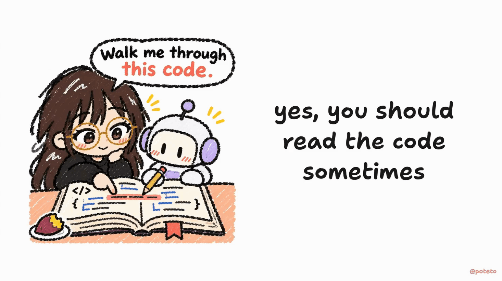

*“是的，你有时候还是应该读一读代码。”气泡里写着：“带我过一遍这段代码。”讲者没有展开这一页。*

## Dune：为 Agent 设计的框架

好，我们来看一些真实的例子。Dune 是我们为 Grok Bot 打造的客户端框架，用来落实有机架构这个想法。

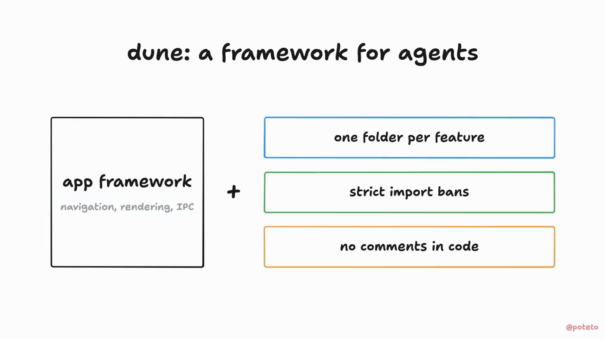

*“Dune：为 Agent 设计的框架”：应用框架（导航、渲染、<Term tip="IPC：进程间通信。Electron 应用里主进程和渲染进程靠它互相传消息">IPC</Term>），加上每个功能一个文件夹、严格的 import 禁令、代码里不写注释。*

技术上它其实没那么有意思，你可以大致把 Dune 理解成 <Term tip="Electron：用网页技术（HTML、CSS、JavaScript）写桌面应用的框架。应用分成两部分：主进程管窗口和系统功能，渲染进程负责画界面">Electron</Term> 应用版的 <Term tip="Next.js：基于 React 的网页应用框架，替你定好路由、渲染、目录这些约定">Next.js</Term>。Dune 有意思的地方在于它带着很多约束和 lint 规则，我们把开发桌面应用时学到的很多教训都写进了框架里。

其中一条教训是：凡是需要拿捏分寸才能用好的东西，往往都会产生 slop。

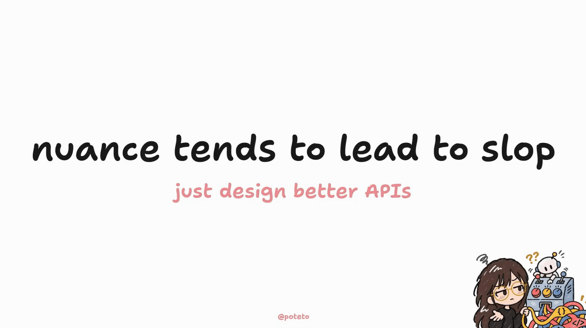

*“需要拿捏分寸的东西往往会产生 slop”，下面一行小字：“那就设计更好的 API。”*

最经典的例子是 React 里的 <Term tip="useEffect：React 里让组件在渲染之后执行副作用的 Hook，比如订阅事件、发请求。什么时候该用、依赖怎么写，都很容易弄错">useEffect</Term>。它有它的用武之地，但经常被误用。有人开玩笑说，得有个博士学位才能用好 useEffect。换句话说，它真的需要很多分寸感才能用好，而 Agent 不擅长这个。所以我们的办法就是直接在产品代码里禁用它，只在 Dune 的少数 API 内部允许使用。

这样一来，这个问题实际上就被一劳永逸地消除了，我们再也不需要在代码审查时抓它。

我们还常用另一个有意思的模式：用目录结构传递上下文。我们在 <Term tip="Cursor：基于 VS Code 改造的 AI 编程编辑器，也是 Electron 应用。讲者举的几个反面例子都来自它，她说起它的架构时用的是“我们”">Cursor</Term> 上见过一个反模式。Cursor 是个 Electron 应用，Agent 经常把主进程的代码 import 到渲染进程里，造成<Term tip="长任务：在主线程上一口气跑超过 50 毫秒的任务，期间界面没法响应输入">长任务</Term>和界面卡顿。

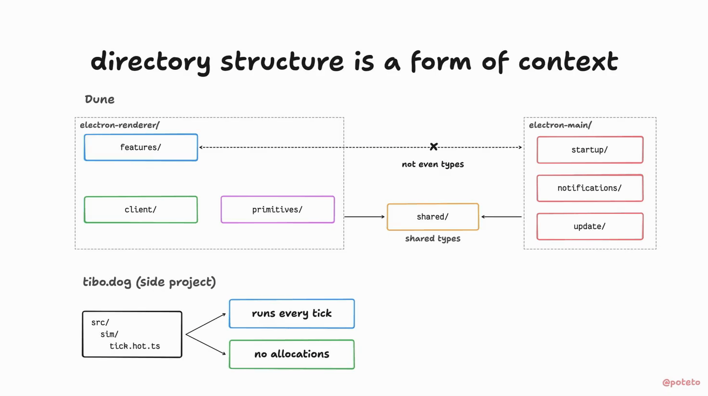

*“目录结构也是一种上下文”。上半部分是 Dune：electron-renderer/ 下有 features/、client/、primitives/，electron-main/ 下有 startup/、notifications/、update/。两边不能互相 import，连类型都不行；共享的类型统一放进中间的 shared/。下半部分是讲者的业余项目 tibo.dog：文件路径 src/sim/tick.hot.ts 本身就告诉 Agent，这段代码每个 tick（模拟循环的每一步）都会运行，不能分配内存。*

所以在 Grok Bot 和 Dune 里，我们把主进程和渲染进程的界线做成了非常固定的约定：我们有两个顶层目录，名字就叫 electron-renderer 和 electron-main，两者之间的 import 被我们的依赖图分析器和几条 lint 规则禁止。同样，这几条 lint 规则配起来很简单，却让代码审查时少了一件要看、要想的事。

## 别让 Agent 写不请自来的 Markdown

还有一件让我挺意外的事：Agent 会拿 Markdown 来用。文档、代码注释、rules、skills，都被它当成写理由的地方，替自己没做正确的事开脱。还有一种情况，不知道你们有没有见过：你随手做了个小纠正，Agent 却矫枉过正，把它当成一条永远不能打破的铁律写下来。

*“别让 Agent 写不请自来的 Markdown。”讲者问：“出处呢？”机器人答：“我瞎编的。”*

这里还有一个来自 Cursor 的例子。那时 Agent 特别爱拿命令式的定时器当快速修复，比如 setTimeout、requestAnimationFrame、requestIdleCallback。它们其实是在给一个架构冲突打补丁：VS Code 的代码是命令式风格，React 是声明式风格，两者合不来。

也就是说，我们当初选的架构，让客户端的性能和 Agent 的表现都差了很多。如果你在 JavaScript 里做过性能优化，就会知道：大量定时器被飞快地创建又销毁，会触发很多次 <Term tip="major GC：对整个堆做的完整垃圾回收，比只回收新对象的 minor GC 停顿长得多">major GC</Term>，带来大量延迟和卡顿。但最糟的是，Agent 还写了很多代码注释，就像下图里那行红色注释，解释为什么这个快速修复是合理的。你还没反应过来，定时器就已经蔓延得到处都是，应用的性能也大受影响。

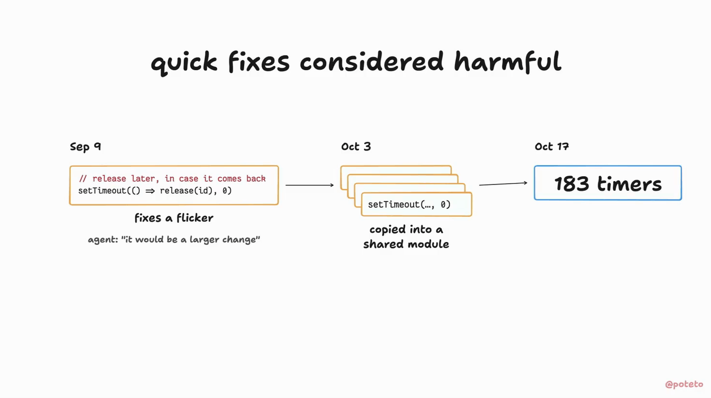

*“快速修复有害”：9 月 9 日，一行 setTimeout 修好了一处闪烁，上面的红色注释写着“晚点再释放，以防它又回来”，Agent 给的理由是“（正经修）改动会更大”。10 月 3 日，这段写法被复制进了一个共享模块。到 10 月 17 日，代码里已经有 183 个定时器。*

后来在 Grok Bot 里，我们吸取了教训，决定直接禁掉 99% 的注释。注释很容易过时；人反正也懒得读那些注释 slop；而且注释又给了 Agent 一条退路：正确的做法太难，它就在注释里给自己找理由。不过注释最糟的一点是它没法强制执行。写注释的出发点往往是好的，比如“我要提醒下一个 Agent 别这么干”，可到头来，它从来都不是你能信任的东西。所以在 Grok Bot 和 Dune 里，我们现在用 lint 规则给出清楚、真正有帮助的错误信息，告诉 Agent 去修根本原因、解决真正的问题，而不是绕着它打补丁。

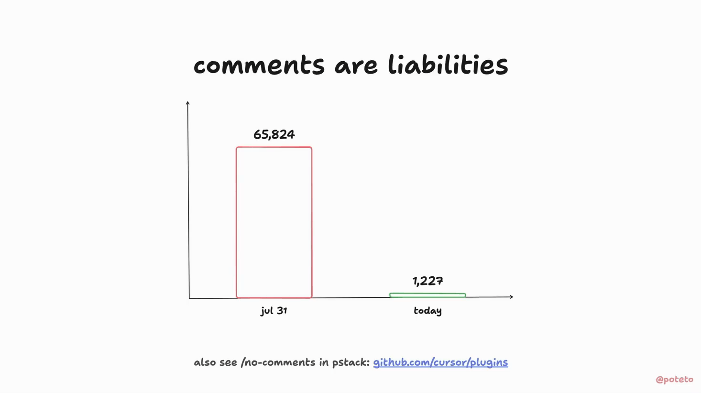

*“注释是负债”：7 月 31 日代码里有 65824 条注释，到今天只剩 1227 条。讲者自己的插件合集 pstack 里还有一个 /no-comments（github.com/cursor/plugins）。*

我们的总原则是：每纠正 Agent 一次，就把这次纠正变成一项确定性的检查，或者想想怎样通过更好的 API 设计、更好的架构，在代码里把这个问题一劳永逸地消除。这样做的次数够多，你会发现代码审查时要盯的东西越来越少。到了某个时候你会意识到，已经没什么可审的了，可以让 Agent 自己合并它们的大部分 PR。

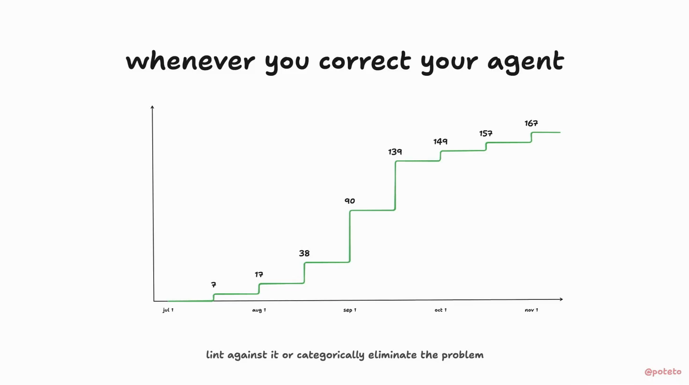

*“每当你纠正 Agent 时”：用 lint 规则拦住它，或者从根上消除这个问题。阶梯线从 7 月开始一级级往上走，台阶上的数字从 7 涨到 167。讲者没有说明这个数字；按图下这句话，应是这样一条条积累下来的检查。*

## 验证是最重要的一步

好，继续往下讲。验证同样是重头戏：它让 Agent 更自主，也让我们对 Agent 的工作更有信心、更信任。我们的代码审查流程现在已经缩减成主要看验证产物，比如视频、截图、图表、形式化验证。

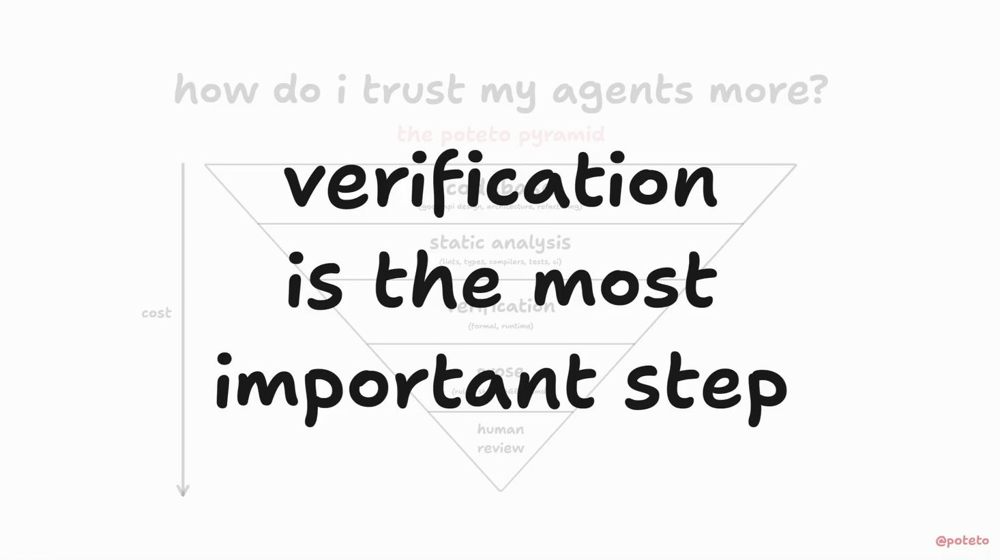

*“验证是最重要的一步。”*

最基础的例子是运行时验证。这只是个好听的说法，意思是给 Agent 一个自己运行代码的办法，让它用上人类开发者也在用的调试工具，比如 <Term tip="Chrome DevTools 协议：Chrome 开发者工具背后的接口，程序可以通过它点击页面、读取元素、抓性能数据">Chrome DevTools 协议</Term>。在我们的运行时验证 skills 里，有一样东西叫 <Term tip="feature map：从用户视角列出应用里所有功能的清单，像网站的站点地图，写明有哪些功能、用户怎样进到那里、怎样证明它能用">feature map</Term>。它基本上就像一份站点地图，从用户的角度列出应用里所有可用的功能。有了它，你说“左边侧边栏里那个东西”时，Agent 就不用去猜：feature map 让你和 Agent 有了一套共同的叫法。

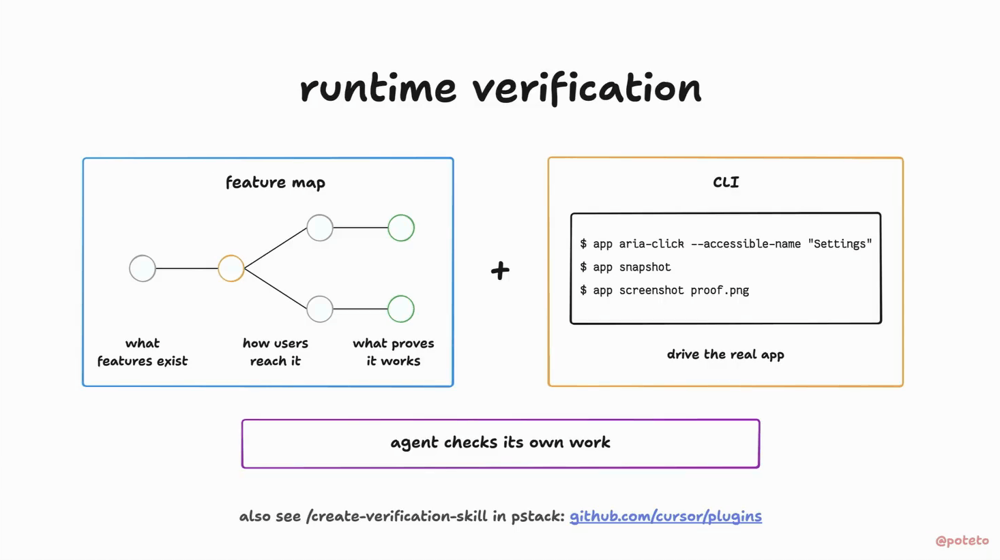

*“运行时验证”：feature map（有哪些功能、用户怎样进到那里、什么能证明它能用），加上驱动真实应用的 CLI（例如 `app aria-click --accessible-name "Settings"`、`app snapshot`、`app screenshot proof.png`），就能让 Agent 自己检查自己的工作。pstack 里还有一个 /create-verification-skill。*

我们还在这些 skills 里放了自定义 CLI，Agent 每次都用同一套 CLI 和驱动应用的程序，这样既省 token，这套 CLI 本身也可以测试。

最近我们还开始尝试形式化验证。我们现在用 <Term tip="TLA+：一种给系统行为建模的语言。把系统写成状态机后，工具会穷举所有可能的状态，检查规则是否始终成立，这叫模型检查">TLA+</Term> 对主要的用户流程做模型检查，比如跨多个设备和平台的通知。我们也用 <Term tip="Lean：一种定理证明语言，可以写出关于代码的数学证明，由机器逐步检查每一步推理">Lean</Term> 证明某些算法。比如，我们自己写了一个<Term tip="虚拟列表：长列表只渲染屏幕上看得见的那几行，滚动时再换上新的行，以免一次渲染成千上万个元素">虚拟列表</Term>库，用 Lean 检查它不会出现闪烁或抖动的问题。

我们还在试验这个方法。总体来看前景很好，我们已经靠形式化验证找到了不少 bug。但它当然不是银弹，我们把它当成又一件工具，Agent 环境里的又一层。

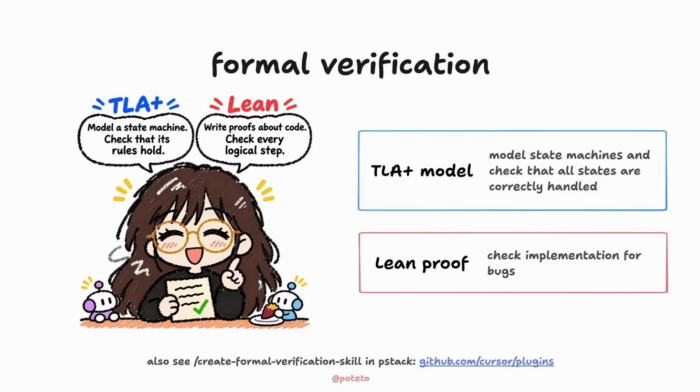

*“形式化验证”。两个气泡里写着，TLA+：“给状态机建模，检查它的规则成立”；Lean：“写关于代码的证明，检查每一步推理”。右边两个方框：TLA+ 模型给状态机建模，检查所有状态都被正确处理；Lean 证明检查实现里有没有 bug。pstack 里还有一个 /create-formal-verification-skill。*

接下来这段视频节奏很快。我们最近也刚开始在 UI 上尝试<Term tip="基于属性的测试（property-based testing）：不逐个写具体的测试用例，而是写出系统必须始终满足的属性，由工具自动生成大量随机输入或操作序列去找反例">基于属性的测试</Term>，用的库叫 Bombadil，它也已经帮我们抓到了几个 UI bug。

<VideoFigure loop width={1280} height={718} src={pbtClip} poster={pbtPoster} label="Bombadil 自动操作 Grok Bot 的界面：飞快地切换对话、输入消息、打开设置和各种弹窗" />

*“UI 基于属性的测试”：演讲里放的 Bombadil 录屏（github.com/antithesishq/bombadil），原速播放。*

把视角拉远一点。我看到过 <Term tip="Cindy Sridharan：长期写分布式系统、可观测性和测试的工程师，X 账号 @copyconstruct">Cindy</Term> 发的一条推文。六个月前，她说自己没法信任 Agent，因为总有一些隐蔽的 bug 被合并进去。

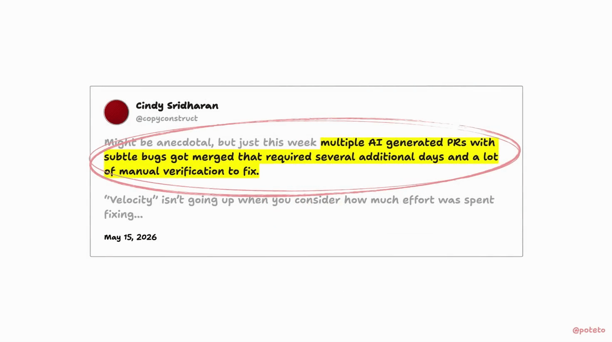

*Cindy Sridharan（@copyconstruct）2026 年 5 月 15 日的推文：“可能只是个例，但光这一周，就有好几个 AI 生成、带着隐蔽 bug 的 PR 被合并了，又花了好几天外加大量人工验证才修好。算上修 bug 花的力气，‘速度’并没有提高……”*

对她来说，要信任 Agent，真正缺的是验证流程。六个月后，她说自己每天的 token 有 70% 花在验证上。我觉得这和我看到的情况也对得上：我大部分的 token 也花在验证上。

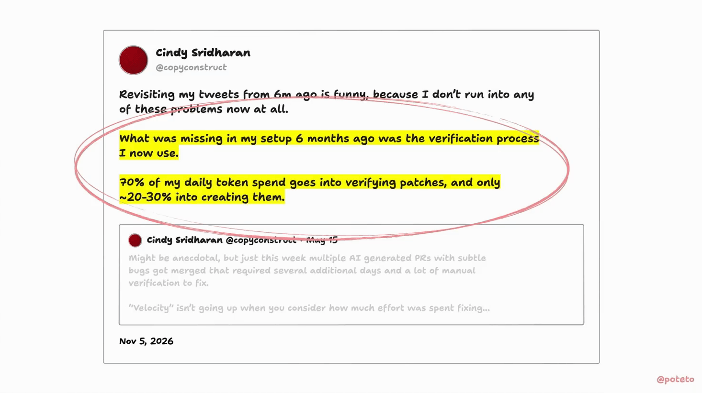

*同一个人 2026 年 11 月 5 日的推文，引用了上面那条：“回头看自己六个月前的推文挺好笑的，因为这些问题我现在一个都碰不到了。我六个月前的配置里缺的，正是我现在用的验证流程。我每天花的 token 有 70% 用在验证补丁上，只有大约 20% 到 30% 用在生成补丁上。”*

如果你仔细看我们的流程，会发现这里面没有一样是以前没有过的新技术。

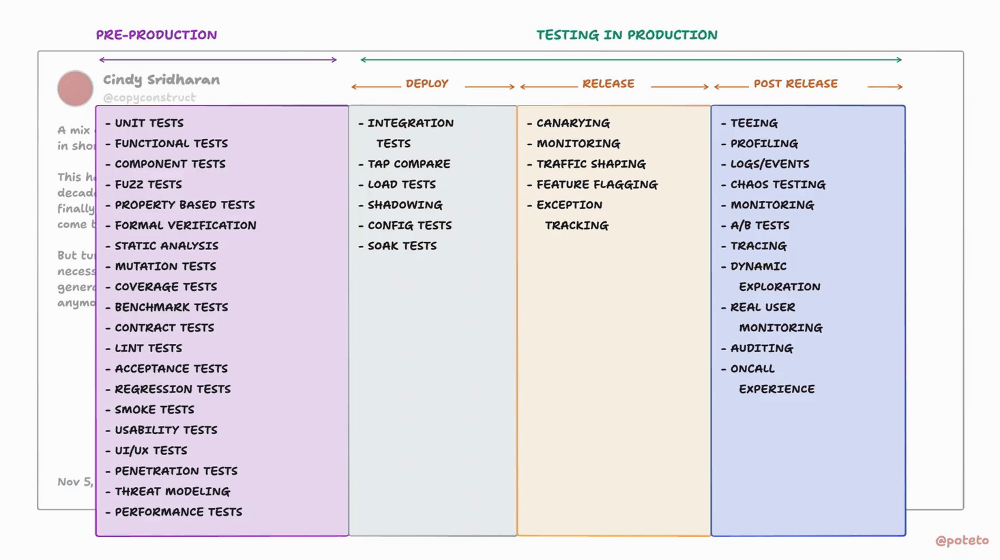

*测试手段全景图（来自 Cindy Sridharan）。上线前有二十种，从单元测试、模糊测试、基于属性的测试、形式化验证，到渗透测试、性能测试；生产环境里还分部署、发布、发布后三段，有负载测试、影子流量、金丝雀发布、功能开关、混沌测试、A/B 测试、真实用户监控等二十多种。讲者这一节提到的手段，大多能在这张图里找到。*

这些手段都是好的软件工程工具，只不过以前用起来可能贵得让人却步，因为它们难懂、难写，也难维护。但 Agent 把这个成本大大压低了。我们其实正在进入软件测试和验证的黄金时代，因为有了 Agent，我们能以过去不划算的深度去测试一切。

形式化验证还能帮你更好地推敲产品该怎样运作，以及 Agent 是否真的理解了你的意图和目标。我在自己的插件合集 pstack（poteto stack）里做了一个新 skill，叫 statechart，它能从用户的视角把状态机画出来。我发现，把它和我们交上来的视频、截图放在一起看，审起来要容易得多。这个效果非常好。

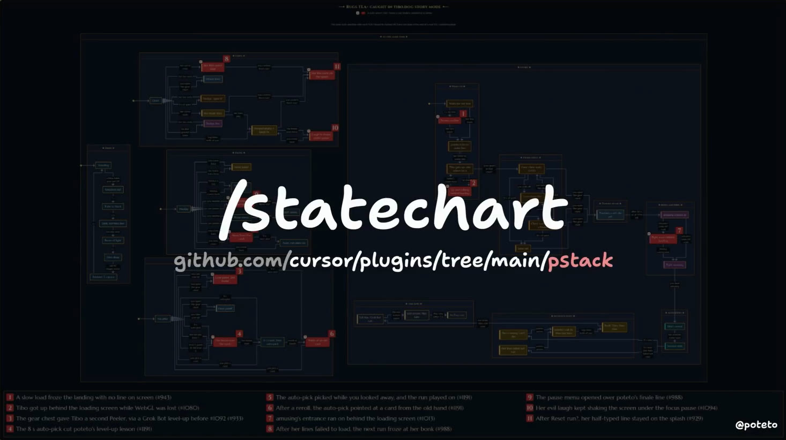

*/statechart：github.com/cursor/plugins/tree/main/pstack。背景是讲者的业余项目 tibo.dog 里“故事模式”的状态图，红色编号标出了 TLA+ 在这里抓到的 11 个 bug。*

*（下一页从这张深色幻灯片切回了白底，讲者说了句：“抱歉，闪到大家了。”）*

## 换来的回报：开发更快，质量没降

好，现在来看看“应许之地”是什么样子。这么多投入，你能换回来什么？

在 Grok Bot 团队，我们的开发速度正在起飞，而且还在快速提升。上个月，我们团队往生产环境合并了 11000 个 PR，这个数字太疯狂了。

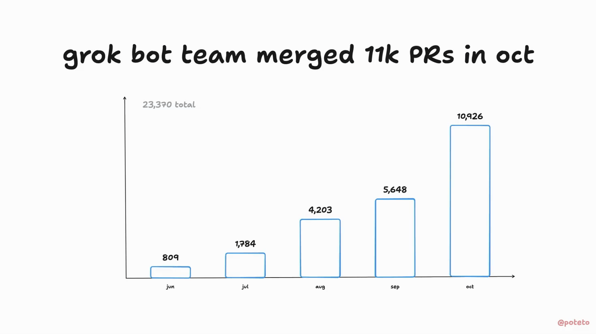

*“Grok Bot 团队 10 月合并了 1.1 万个 PR”：6 月 809 个，7 月 1784 个，8 月 4203 个，9 月 5648 个，10 月 10926 个，合计 23370 个。*

我们发布客户端的节奏也加快了，现在大约每天切一个新的稳定版本。

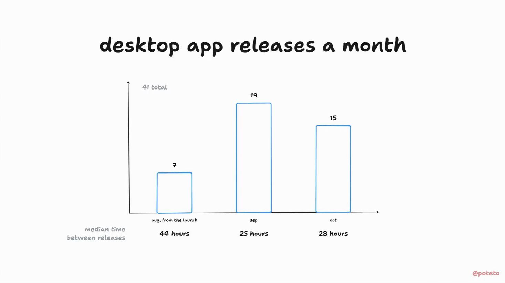

*“桌面应用每月发布次数”：8 月（从上线算起）7 次，9 月 19 次，10 月 15 次，合计 41 次；两次发布之间的中位时间分别是 44 小时、25 小时、28 小时。*

核心团队的产出也多了很多。偶尔来贡献、顺手提个 PR 的人也多了很多，他们不一定有很多上下文，但也在贡献代码。10 月份，大约有 227 人至少贡献了一个 PR。

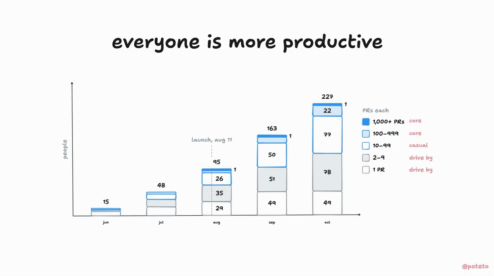

*“每个人都更高产了”：每月提交过 PR 的人数，6 月 15 人，7 月 48 人，8 月 95 人（8 月 11 日上线），9 月 163 人，10 月 227 人。10 月这 227 人里，核心成员 23 人（1 人提了 1000 个以上，22 人提了 100 到 999 个），偶尔贡献的 77 人（10 到 99 个），顺手贡献的 127 人（78 人提了 2 到 9 个，49 人只提了 1 个）。*

速度在加快，你可能会想：这难道不会变成一团乱麻吗？不会是一大堆 slop 吗？但实际上，被回滚的提交占比反而降低了，稳定在大约 0.5%。

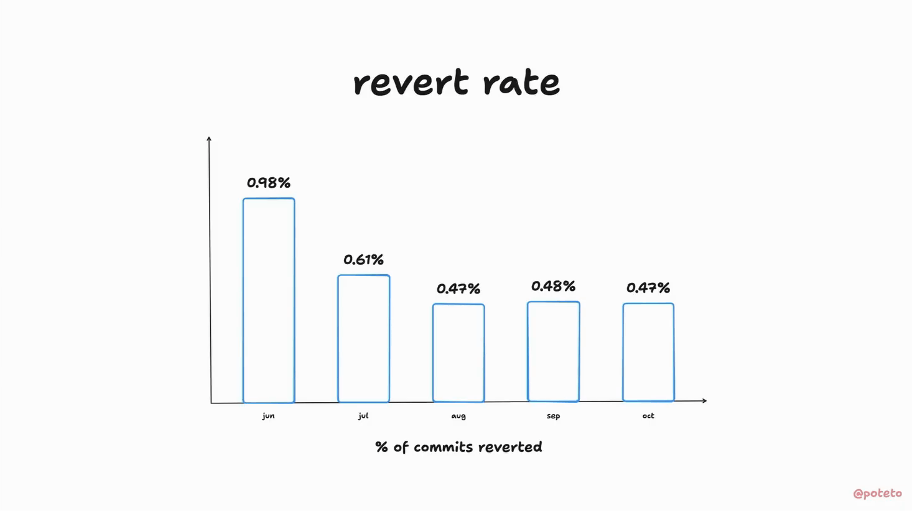

*“回滚率”（被回滚的提交占比）：6 月 0.98%，7 月 0.61%，8 月 0.47%，9 月 0.48%，10 月 0.47%。*

不过我觉得，这种发布节奏和 PR 数量背后真正有意思的是：Grok Bot 的性能不只保持稳定，和刚上线时相比，还在多个维度上有了提升。启动、打字、打开新对话、切换对话，全都变快了。别忘了，Grok Bot 目前还是个 Electron 应用，所以性能是有天花板的。但它已经比外面很多其他 Agent 界面快得多了。一个 Electron 应用，在这么快的开发速度、这么多人贡献的情况下还能这样，我觉得已经相当不错了。

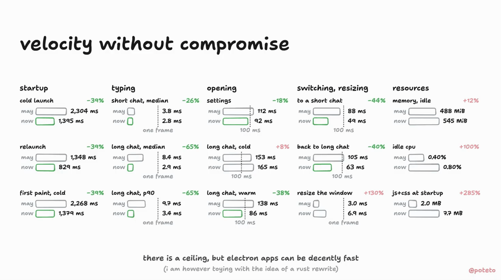

*“开发提速，性能不打折”，每项是 5 月 → 现在。变快的：冷启动 2304 → 1395 毫秒（−39%），长对话里打字的延迟中位数 8.4 → 2.9 毫秒（−65%），切到短对话 88 → 49 毫秒（−44%），切回长对话 105 → 63 毫秒（−40%），其余启动、打字、打开的指标也快了 18% 到 65%。变慢或变大的：冷打开长对话 153 → 165 毫秒（+8%），调整窗口大小 3.0 → 6.9 毫秒（+130%，仍在一帧以内），空闲内存 488 → 545 MiB（+12%），空闲 CPU 0.40% → 0.80%，启动时加载的 JS 和 CSS 2.0 → 7.7 MB。图下写着：“有天花板，但 Electron 应用也可以相当快。（不过我确实在琢磨用 Rust 重写。）”*

## 该不该建一座软件工厂

所以，在你一头扎进去搭软件工厂、把能自动化的都自动化之前，每次纠正 Agent 时，先试着通过改进代码库来纠正：先加一条 lint 规则，不让同样的坏写法再冒出来，再把那些旧写法清理掉，然后确保你的验证环节真的扎实。

*“我该建一座软件工厂吗？”星号注：也就是说，我该不该把写代码、发布、部署都自动化？讲这一段之前，屏幕上先回到了 poteto 金字塔。*

何况，这些工作很多本来就是自动化的前提。如果你的 <Term tip="inner loop：内循环，指 Agent 写代码、验证、发现问题再修改的那一圈">inner loop</Term> 产出的是 slop，那么把这个循环自动化，只会产出更多 slop。你就得往这个问题上砸越来越多的 token，而我们都知道，那非常贵。

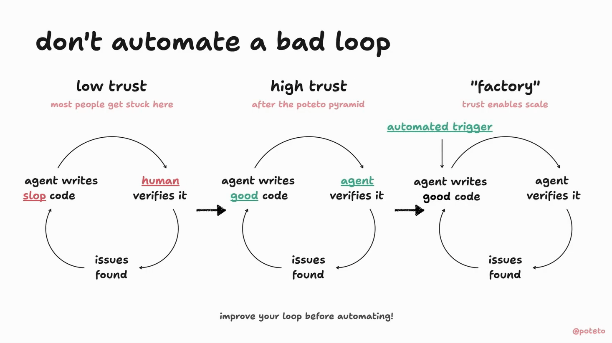

*“别把一个坏循环自动化”：低信任（大多数人卡在这里）→ 高信任（做完 poteto 金字塔之后）→ “工厂”（有了信任才能规模化），最后一步是给高信任的循环加上自动触发。图下写着：“先改进你的循环，再自动化！”*

一旦你在代码库、静态分析、运行时验证和形式化验证上做了这些投入，你会开始发现，有了这些地基，很多事情都变得可能，你可以很轻松地在上面搭起自己的工厂。

等你准备好了，Grok Bot 就是搭建 <Term tip="outer loop：外循环，决定什么时候、因为什么启动一轮 Agent 工作的那一层，比如收到用户反馈、新工单、新消息、定时任务或告警">outer loop</Term> 的好办法。我们有大量的连接器，还有 <Term tip="routines：按事件或定时自动执行的任务">routines</Term>，可以启动 Cursor 的云端 Agent 和 <Term tip="projects：Cursor 里把一大批云端 Agent 组织起来、一起完成一件事的方式">projects</Term>；projects 能让你编排几百、甚至几千个 Agent。

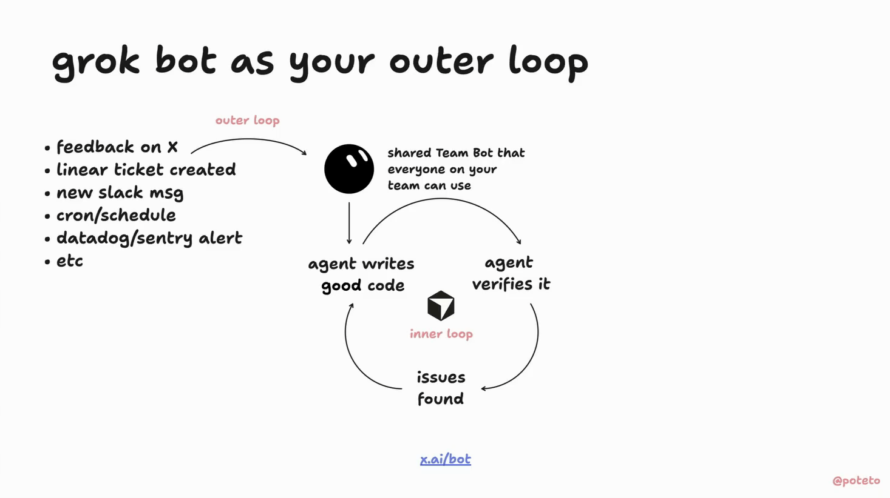

*“把 Grok Bot 当作你的 outer loop”：X 上的反馈、新建的 Linear 工单、新的 Slack 消息、cron 定时任务、Datadog 或 Sentry 告警等事件，触发一个全团队共用的 Bot（Team Bot），这一段就是 outer loop；Bot 再启动中间的 inner loop：Agent 写出好代码，Agent 自己验证，发现问题再修改。inner loop 中间的立方体是 Cursor 的标志。链接：x.ai/bot。*

举个简单的例子：现在每次我们切一个新版本，Grok Bot 都会自动为我们启动一个新的 Cursor project，对整个应用、整个构建做<Term tip="模糊测试（fuzzing）：自动生成大量随机或异常的输入和操作，看程序会不会出错">模糊测试</Term>。它会像真实用户一样运行和使用这个应用，从中找出 bug。然后，听起来很疯狂，它会为找到的每个 bug 分别开一个修复 PR，并且自动合并。之所以能这样，是因为我们的代码库足够好，PR 默认往往就是好的。我们合入的大部分产品代码，已经不再真正需要人深入审查了。

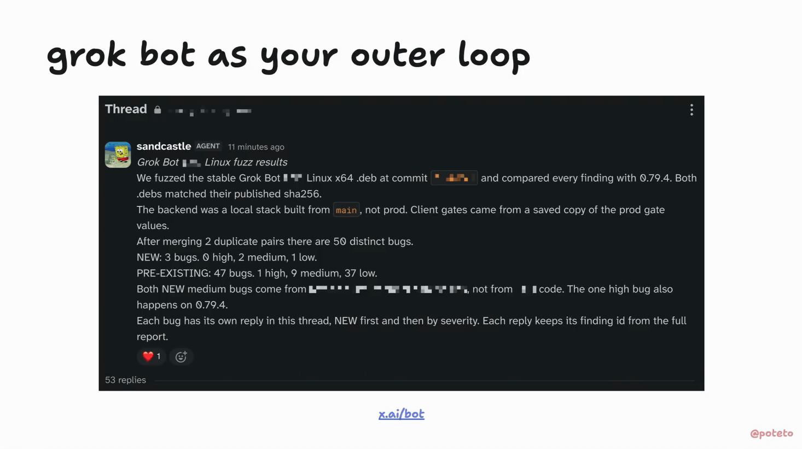

*同样是“把 Grok Bot 当作你的 outer loop”这一页：一次发版后，Agent（sandcastle）在讨论串里发的模糊测试报告。它对稳定版 Grok Bot 的 Linux 安装包做了模糊测试，合并重复项后共找到 50 个不同的 bug；和上一版 0.79.4 逐条对比，3 个是新出现的（2 个中危、1 个低危），47 个是原来就有的（1 个高危、9 个中危、37 个低危）。每个 bug 在讨论串里单独一条回复，新出现的排在前面，再按严重程度排序；讨论串下共有 53 条回复。*

所以，当你有了扎实的地基和良好的有机架构，你就能把 slop 变成金子，以很高的速度交付，又不牺牲质量。我叫 poteto，也叫 Lauren。再次感谢大家听我的演讲。

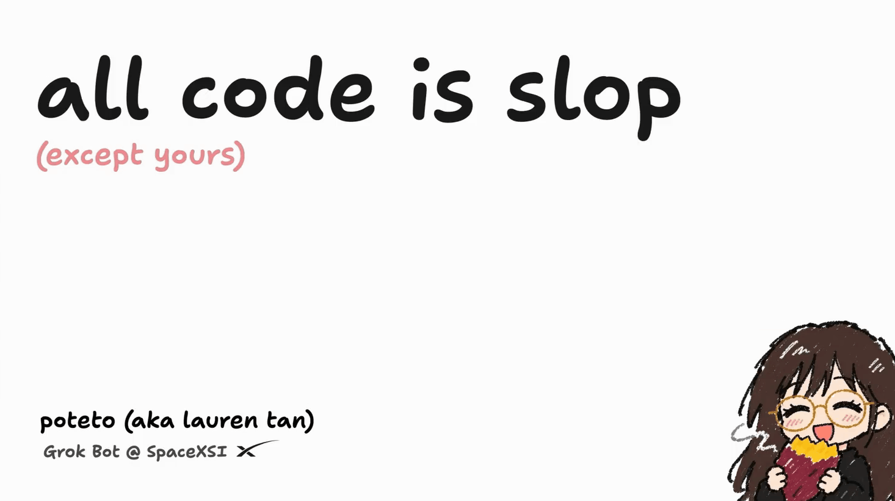

*最后一页，标题后面的括号从“除了我的”换成了“除了你们的”。*

---

*参考视频：[All Code Is Slop (Except Mine) — Lauren Tan, SpaceXSI](https://www.youtube.com/watch?v=O_zcc6Xl12g)（YouTube · AI Engineer）*
