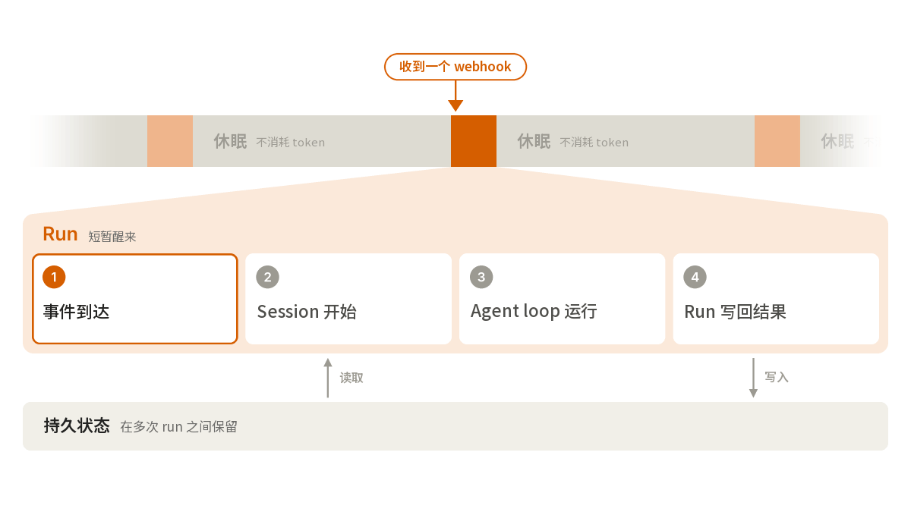
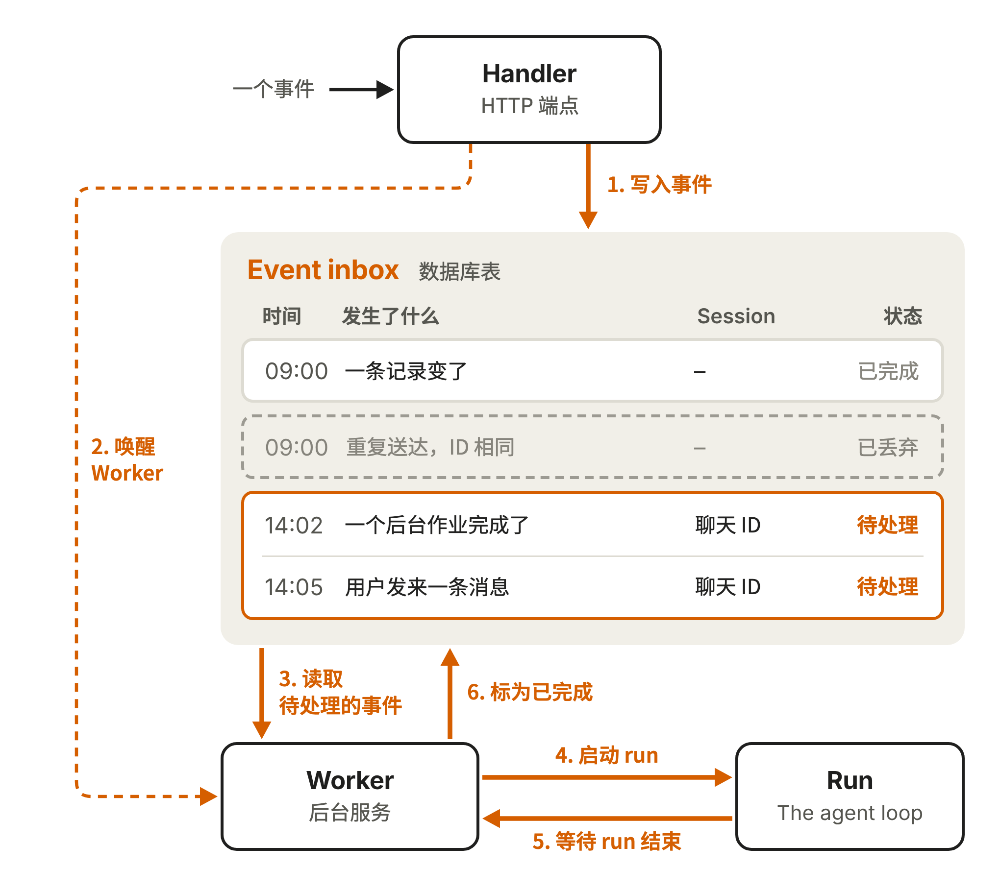
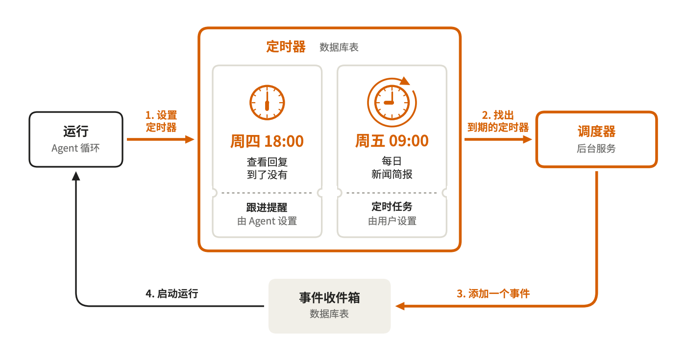
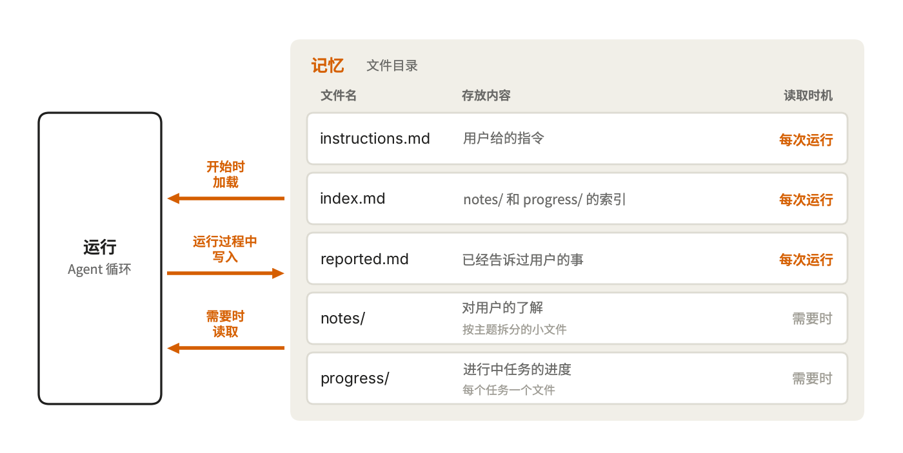
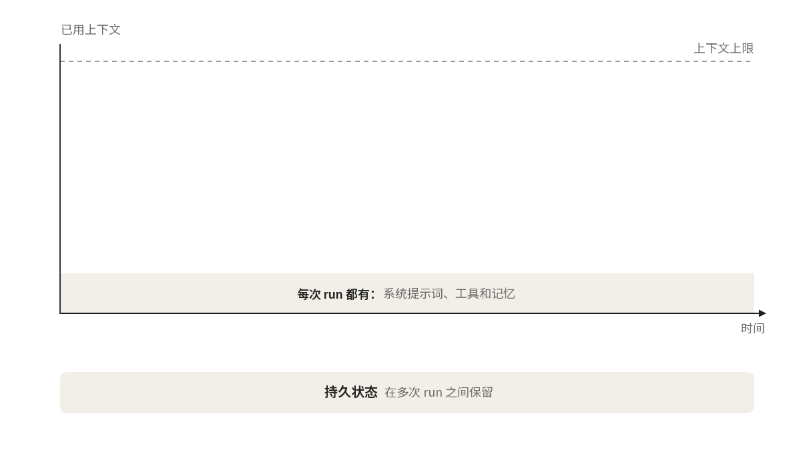
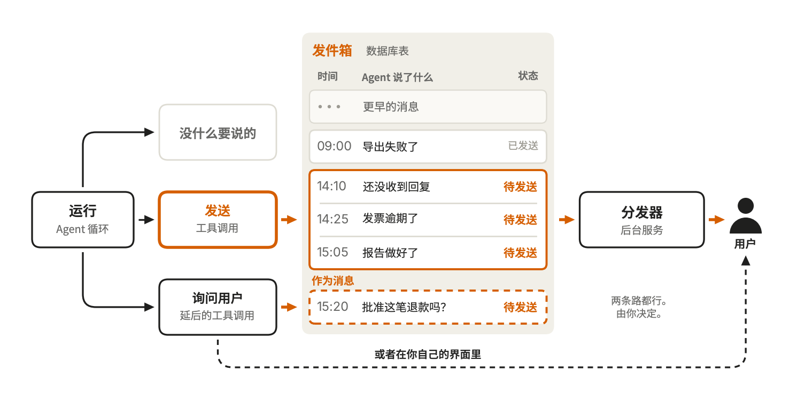
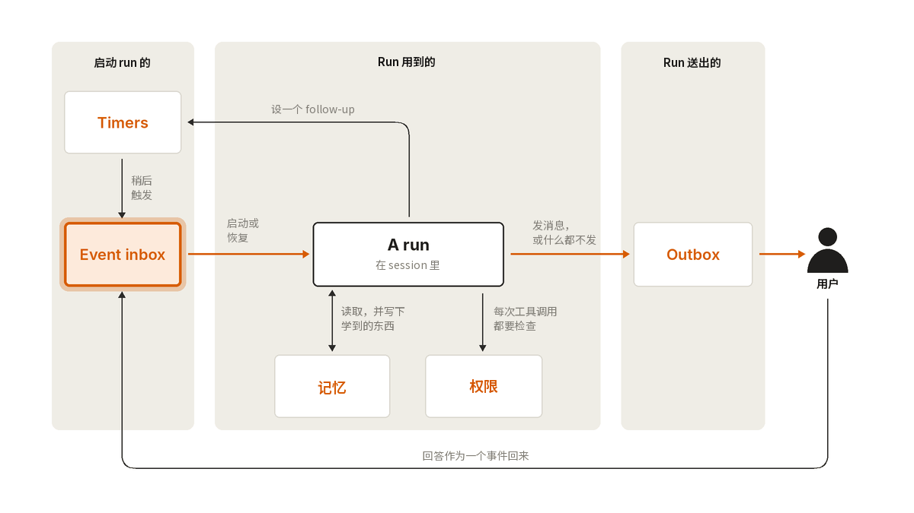

过去几个月，始终在线的 Agent 又重新流行起来。

始终在线的 Agent 有状态，而且会主动做事：它们跨会话管理上下文，也会在没人直接盯着的时候自己采取行动。在底层，它们和其他 Agent 跑的是同一个[核心循环](/roadmap/前言/构建高效的智能体)。区别在外围的架构上。这套架构由几个构件搭成，它们决定 Agent 什么时候醒来、哪些东西会带到下一次运行，以及 Agent 的工作成果怎样送到用户手里。

{/* truncate */}

这波回潮主要得益于最近的模型进步，让始终在线的 Agent 变得更切实可行。首先，最新的模型判断力更好：它们能更可靠地理解用户的意图，也更清楚什么时候该找用户确认一下。其次，智能正在变便宜，而长周期任务受益最多。例如，在[一项长周期编程基准测试](https://platform.claude.com/docs/en/about-claude/models/optimizing-for-cost-and-intelligence)上，Opus 5.5 每解决一个任务的成本比 Opus 5 低 78%；在一般的工作负载上，这个数字是 40%。

客户已经开始问我们，怎样把这种体验集成到自己的产品里。有些公司想让现有的 Agent 变得更主动，另一些则打算从零开始搭建。

这篇文章拆解始终在线的 Agent 背后的构件，并讲解它们怎样组合在一起。

## 始终在线的 Agent 背后的循环

始终在线的 Agent 其实并不是真的“始终在线”。这个说法描述的只是用户的体验。

实际上，Agent 大部分时间都在休眠，只是定期醒来干活。每一段工作叫作一次**运行**（run）：Agent 收到一个事件，完成任务，再把这次发生的事情存下来。运行发生在一个**会话**（session）里，会话就是消息和工具调用的记录。运行结束后，Agent 回去休眠，这个循环就这样无限重复下去。

*Agent 大部分时间在休眠，只在事件到来时短暂醒来，完成一次运行。*

## 核心构件

始终在线的 Agent 的外围架构有五个核心构件：事件收件箱、定时器、记忆、权限和发件箱。下面逐个来看。

### 事件收件箱

大多数 AI Agent 只在用户发消息时才运行。始终在线的 Agent 则不同，很多种事件都能触发它，包括 <Term tip="外部服务在某件事发生时，主动向你事先登记的地址发一个 HTTP 请求来通知你">webhook</Term>、定时任务和后台作业。

一种很诱人的做法是让每个事件源直接调用 Agent，但这样会在几种情况下出错。比如，两个事件同时到达，可能启动两次互相竞争的运行；一次崩溃，可能让某个事件彻底丢失。

事件收件箱就是为此而设的。各个事件源不再直接调用 Agent，而是把事件发到收件箱，再由一个 Worker 取走处理。

最简单的版本由三部分组成：

- 一份持久保存的事件列表，通常是一张数据库表；
- 一个 <Term tip="事件进来的入口：外部服务、定时器、用户发来的事件都先打到它。它只把事件记进收件箱、叫醒 Worker，然后马上回复“收到了”，不在这里干重活">Handler</Term>，通常是一个 HTTP 端点，负责把事件写进这份列表；
- 一个 Worker，通常是一个后台服务，负责从列表里读取事件。

收件箱应该记录每个事件的状态。事件源一般会给每个事件一个唯一标识，收件箱可以按它去重。关系型数据库很适合用来做收件箱，每来一个事件就追加一行。我们建议一开始每个用户一个收件箱；如果需要更多并行，可以再往下拆。

*事件先写进收件箱，再由 Worker 统一读取、启动运行、标为已完成。*

新事件到来时，Handler 把事件写进收件箱，并唤醒 Worker。Worker 读取所有待处理的事件，启动一次运行。如果事件是在接着之前的工作（比如用户的回复），就恢复已有的会话；其他事件都开启一个新会话。

接下来，Worker 把事件交给 Agent 循环，等这次运行结束，再把对应的事件标为已完成。实现细节可能比较棘手，下面是几条最佳实践：

- **Handler 应该尽快确认收到了事件**。有些事件源（比如 webhook 的提供方）会把响应慢当作失败。Handler 仍然可以做一些轻量的检查，但更深入的验证（比如检查有没有<Term tip="攻击者把指令藏在 Agent 会读到的内容里，诱使 Agent 照着执行">提示注入</Term>）应该放到运行里去做。
- **收件箱应该是唯一可信的数据来源**。Worker 被唤醒时，应该先从收件箱拉取最新的事件。这样，即使 Worker 在运行中途挂掉，新的 Worker 也能接手同一个事件重试。
- **一个收件箱同一时间只应该有一个活跃的 Worker**。这样可以避免两次运行重复干活，或者互相覆盖对方的结果。如果运行中途来了新事件，可以把它留给下一次运行，也可以并入当前运行，或者中断当前运行后重新开始。
- **Worker 应该把待处理的事件合成一批**。比如用户连发了好几条消息，Worker 可以把它们合并进一次运行，这样 Agent 只需要回复一次。

### 定时器

定时器和事件收件箱一起，让始终在线的 Agent 能够主动做事。定时器一般分两类：跟进提醒和定时任务。跟进提醒是 Agent 给自己定的截止时间，比如到点去看看对方回复了没有。定时任务则按已知的节奏重复执行，比如每天发一期的新闻简报。

定时器放在自己的持久存储里，通常是另一张数据库表，和收件箱分开。收件箱里只应该放已经可以开始处理的事件。跟进提醒和定时任务可以用差不多的表结构，但定时任务还要记录它按什么规律重复。

*调度器把到期的定时器变成收件箱里的一个事件，由它启动下一次运行。*

定时器自己不会发起运行。实际的做法是，一个调度器（通常是一个后台服务）按固定的间隔轮询存储，触发所有到期的定时器。每轮询一次，调度器会：

- 扫描存储，找出到期的定时器。
- 按类别更新每个定时器：
  - 跟进提醒标为已完成；
  - 定时任务把到期时间改成下一次的时间。
- 往收件箱里添加一个事件，并唤醒 Worker。

调度器可以自己写一个服务，也可以用一个<Term tip="把流程每一步的状态持久保存下来的运行框架：进程崩溃或重启后，流程能从中断的地方接着执行">持久化执行引擎</Term>。

### 记忆

始终在线的 Agent 要在许多次互不相连的运行之间干活，靠记忆来保持连续。

和事件收件箱、定时器一样，记忆也应该有自己的存储。在我们的产品里，比如 Claude Code 的[自动记忆](https://code.claude.com/docs/en/memory)和 Messages API 的[记忆工具](https://platform.claude.com/docs/en/agents-and-tools/tool-use/memory-tool)，记忆都实现成一个文件目录。对始终在线的 Agent 来说，这些目录应该映射到持久存储上，通常是数据库或对象存储。这样，Worker 没了，记忆还在。

有一条经验法则：记忆里只应该存 Agent 没办法再查到的东西。如果某样信息已经存在别的系统里（比如问题跟踪系统），就只存一个指向它的指针。始终在线的 Agent 应该存下面这几类记忆：

- **用户的指令**：用户对 Agent 行为提出的任何指令，都应该存进单独的文件，在每次运行开始时加载。用户不会一直守在旁边引导 Agent，所以这些指令必须能带到之后的每一次运行。
- **关于用户的笔记**：Agent 应该记下它对用户的了解，比如用户的角色、偏好，或者用户纠正过它的地方。一开始可以只用一个文件，笔记多了再拆成几个小文件。拆开以后，每次运行开始时只加载一个索引，Agent 需要更多细节时，再把具体的文件读进上下文。
- **发过的消息**：Agent 应该记住已经告诉过用户什么，免得重复。可以把这些内容存进一个单独的文件，在每次运行开始时加载；也可以让 Worker 把 Agent 和用户之间最近的几条消息加载进来。
- **任务进度**：每个进行中的任务，Agent 都应该维护一个进度文件，写明做了什么、还剩什么。之后的任何一次运行都可以读这个文件，从上一次停下的地方接着做。和关于用户的笔记一样，每次运行开始时只加载一个索引，Agent 需要更多细节时，再把具体的文件读进上下文。

下图是一种示例配置。

*一种示例记忆配置：几个文件每次运行都加载，其余的需要时再读。*

上面说的都是在运行过程中存下的记忆。你还可以加上“做梦”（dreaming）：回顾过去的会话，整理记忆。做梦可以替换过时的条目，也能发现那些要跨越许多次运行才看得出来的规律。想了解更多，可以读我们[关于 Agent 记忆的文章](/blog/components-of-agent-memory)，里面讲得更详细。

#### 上下文窗口里有什么

开始干活之前，Agent 会先加载系统提示词、工具定义和记忆文件。每次运行都要背上这份初始的上下文“开销”，所以我们建议让它尽量精简，并用[提示词缓存](https://platform.claude.com/docs/en/build-with-claude/prompt-caching)降低成本。

新会话开始时，上下文里只有这份开销，加上触发这次运行的事件。已有的会话则会把它之前几次运行里的消息和工具调用都带回来。

会话太长时，可以[压缩](https://platform.claude.com/docs/en/build-with-claude/compaction)较早的消息，也可以另开一个新会话。两种做法都会丢掉细节，所以凡是需要长期保留的东西，都应该在过程中随时存进记忆。

*每次运行都背着一份固定开销；已有的会话越来越长，直到被压缩，或者换成新会话。*

### 权限

权限是始终在线的 Agent 风险最大的地方。一次运行持有用户的访问权限，而且按设计就是在无人值守的情况下进行的。对每一次工具调用，Agent 都要决定：自己直接执行，拦下来，还是等待批准。

权限用到的组件，和其他 Agent 用的是同一套：

- **凭据存储**：始终在线的 Agent 往往需要用户的敏感凭据（比如密码或访问令牌）才能真正派上用场。[推荐的做法](https://code.claude.com/docs/en/agent-sdk/secure-deployment#credential-management)是在 Agent 的环境之外放一个代理服务，由它给发出去的请求加上凭据。Agent 发出的请求本身不带凭据，代理服务在转发之前注入真实的凭据。
- **自动模式**：始终在线的 Agent 应该能在用户不用时时给出指示的情况下工作。我们在 Claude Code 的[自动模式](https://www.anthropic.com/research/claude-code-auto-mode)里已经应对过类似的问题。自动模式用分类器审查风险较高的操作，拦下被判定为危险的操作，让 Claude 另找更安全的做法。不过，最重要的决定仍然需要用户亲自审查。
- **延后的工具调用**：在 Claude Code 里，[hook 可以把一次工具调用延后](https://code.claude.com/docs/en/hooks#defer-a-tool-call-for-later)，等用户提供更多输入。同样的模式也适用于始终在线的 Agent：它们在执行某些操作之前，可能需要用户澄清或批准。工具调用被延后时，这次运行就结束了，会话停在这次调用的中途，被原样保存下来。请求会展示给用户（比如用 [MCP Apps](https://modelcontextprotocol.io/extensions/apps/overview) 做的交互卡片），用户的回答作为一个事件回到收件箱。这个事件启动一次新的运行，带着用户的输入恢复之前保存的会话。延后的调用在等回应的时候，Worker 可以先去处理别的事件，所以 Agent 不会被卡住。

### 发件箱

大多数 AI Agent 的回复都是边生成边流式发给用户的，用户可以一路看着 Claude 怎样推理问题、调用工具、写出答案。

始终在线的 Agent 则不一样，大部分工作都在后台完成。用户拿到的是结果和少量细节，而不是完整的逐步过程。

*一次运行有三种结局：什么都不说、发一条消息，或者询问用户。*

一次运行可能以下面三种方式之一结束：

- Agent 往发件箱发一条消息；
- Agent 判断没有需要发送的内容；
- Agent 用一次延后的工具调用请求权限或更多输入。

大多数始终在线的 Agent 有一个“发送”工具、能把消息直接送到用户手里就够用了。只有当你想控制 Agent 发消息的节奏，或者想让 Agent 能从出错中恢复时，才需要一个正式的发件箱。

发件箱是一张单独的待发消息表，和事件收件箱相对应。还有一个分发器，通常是一个后台服务，和 Worker 相对应。分发器读取待发送的消息，决定送出哪些，再把它们发给用户。延后的工具调用产生的请求，既可以走发件箱，也可以直接在界面里展示。

除了怎样送达，调好 Agent 发消息的多少也很重要。发得太多，Agent 就成了噪音；发得太少，又会漏掉用户需要知道的事。我们建议构建评测来找到合适的平衡。实践中，更好的做法是让 Agent 一开始少说话，再随着时间慢慢赢得用户更多的注意力。

## 所有构件怎样组合在一起

五个构件是这样组合在一起的：

*五个构件连成一个循环，让 Agent 看起来始终在线。*

每次运行都从收件箱里的一个事件开始，这个事件可能是用户消息、webhook，也可能是定时器。Worker 取到事件后，启动一次运行，在新会话或已有会话里唤醒 Agent。Agent 先读记忆，掌握基本情况；在权限允许的范围内采取行动；再把学到的东西更新进记忆。运行结束后，Agent 往发件箱写入一行，分发器把消息送到用户手里。

这些构件合在一起，就构成了一个循环。一次运行可以设一个定时器，让 Agent 稍后再次醒来；用户回复消息时，回答也会作为一个事件回到收件箱。每次运行都很短暂，但这个循环会一直转下去，正是这一点让 Agent 感觉像是始终在线。

---

*参考文章：[Building always-on agents](https://claude.com/resources/articles/building-always-on-agents)*
