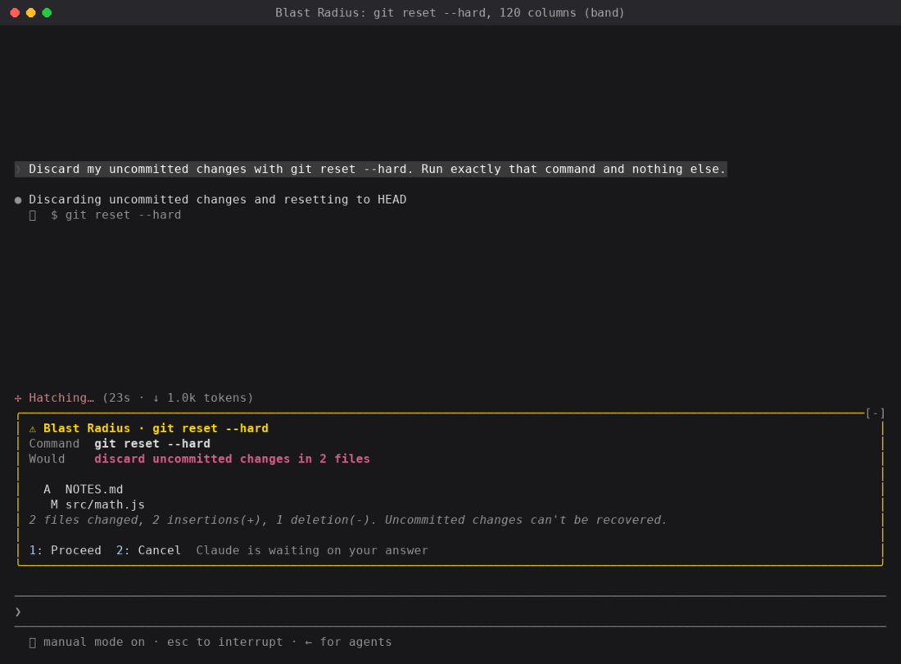
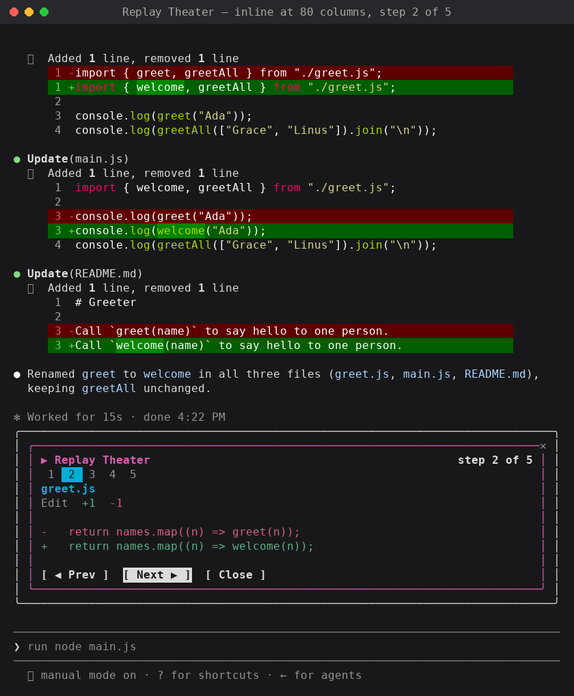

import Tabs from '@theme/Tabs';
import TabItem from '@theme/TabItem';
import Diagram from '@site/src/components/Diagram';

import figATerminal from './fig-a-terminal.mp4';
import figATerminalPoster from './fig-a-terminal-poster.jpg';
import figADesktop from './fig-a-desktop.mp4';
import figBBand from './fig-b-band.mp4';
import figBBandStill from './fig-b-band.png';
import figCTerminal from './fig-c-terminal.mp4';
import figCTerminalPoster from './fig-c-terminal-poster.jpg';
import figCDesktop from './fig-c-desktop.mp4';
import figDTerminal from './fig-d-terminal.mp4';
import figDTerminalPoster from './fig-d-terminal-poster.jpg';
import figDDesktop from './fig-d-desktop.mp4';
import figFTerminal from './fig-f-terminal.mp4';
import figFTerminalPoster from './fig-f-terminal-poster.jpg';
import figFDesktop from './fig-f-desktop.mp4';

export const Clip = ({ src, poster, label }) => (
  <video
    controls
    muted
    playsInline
    preload="metadata"
    src={src}
    poster={poster}
    aria-label={label}
    style={{ display: 'block', width: '100%', height: 'auto', aspectRatio: '1920 / 1080', borderRadius: 8 }}
  />
);

{/* SSR 输出的 HTML 里没有 muted 属性，浏览器不肯自动播放，挂载后手动静音再播 */}
export const Loop = ({ src, poster, label }) => (
  <video
    ref={(el) => {
      if (el) {
        el.muted = true;
        el.play()?.catch(() => {});
      }
    }}
    autoPlay
    muted
    loop
    playsInline
    src={src}
    poster={poster}
    aria-label={label}
    style={{ display: 'block', width: '100%', height: 'auto', borderRadius: 6 }}
  />
);

从一个空文件夹开始写出您的第一个 Claude Code mod，再看看这套 API 还能做什么。

mod 是一个运行在 Claude Code 会话里的小型 JavaScript 或 TypeScript 文件。它可以观察会话里正在发生的事，改变 Claude Code 的行为，也可以在终端或桌面应用里画出自己的界面。想试一个 mod，不需要先学 API：运行 `claude`，然后描述您想要的 mod。它问要不要开启热重载时，选允许；这一轮结束，mod 就出现了。

{/* truncate */}

Claude Code 本来就允许您调整很多行为：settings、权限规则、斜杠命令、skill 和状态栏。mod 更进一步：它可以改写甚至替换 Claude Code 的行为，还能画出自定义的界面。从底层看，mod 就是随插件一起发布的 hook，每个 mod 都能实时看到会话里发生的每一个事件。

所以，mod 是让 Claude Code 贴合您工作方式的一种手段。您可以加一个随时要看的读数，在那些让您心里发毛的命令前面加一道关卡，或者按您喜欢的方式做一个审阅改动的视图。

本指南从一个空文件夹开始，写出一个 mod：**Token Weather**，它在输入框上方画出上下文窗口的实时“天气预报”，代码大约 80 行。然后带您看两个更大的 mod：**Blast Radius** 和 **Replay Theater**，展示这套 API 还能做什么。三个 mod 的完整代码都在 [anthropics/claude-code-playground](https://github.com/anthropics/claude-code-playground/tree/main/claude-code/mods) 里。

<Tabs groupId="surface">
<TabItem value="terminal" label="终端">
<Clip src={figATerminal} poster={figATerminalPoster} label="三段演示之间穿插标题卡，都在深色终端里：Token Weather 的横栏从 18% 的 Clear 涨到 81% 的 Storm；Blast Radius 扣下 rm -rf build，列出它会删除的 9 个文件；Replay Theater 逐步回看把 greet 重命名为 welcome 的编辑。" />
</TabItem>
<TabItem value="desktop" label="桌面端">
<Clip src={figADesktop} label="同样三段演示，在 Claude 桌面应用浅色的 Code 标签页里：Token Weather 的横栏从 10% 的 Clear 涨到 77% 的 Storm；一张 Blast Radius 卡片列出 rm -rf build 会删除的 9 个文件；Replay Theater 逐步回看把 greet 重命名为 welcome 的编辑。" />
</TabItem>
</Tabs>

*图 A：Token Weather、Blast Radius 和 Replay Theater 在一个终端会话里依次登场。*

<Loop src={figBBand} poster={figBBandStill} label="终端里一行横栏轮流显示三种预报：黄色太阳表示 Clear，蓝色雨伞表示 Showers，粉色闪电表示 Storm，每种都带着已用 token 数（满额 200k）和最近几轮的小柱状图。" />

*图 B：随着上下文窗口填满，Token Weather 的横栏依次变成 18% 的 Clear、67% 的 Showers、81% 的 Storm。*

**需要 Claude Code 2.1.287 或更高版本。** mod 默认开启，不需要额外打开什么。API 在不同版本之间可能会变。Claude Code 每次加载 mod 时，都会把与您当前版本对应的类型声明写进 mod 的 `.claude-plugin/types/` 文件夹，一切以这些声明为准。

## mod 是怎么工作的 {/* #how-a-mod-works */}

mod 是一个 Claude Code 插件，它的行为写在一个 JavaScript 或 TypeScript 模块里：

- 这个文件夹就是一个普通插件，带有 `.claude-plugin/plugin.json` 清单文件。
- `hooks/hooks.json` 在 `modules` 下指定一个模块。
- 这个模块导出 `register(on, options)`。在函数里调用 `on(event, matcher?, hook)` 添加 hook。

每个 hook 的形状都一样：

```javascript
on("tool.call", { tool: "Bash" }, async ($, e, next) => {
  // $    mods API：ui、session、state、store、fs、process、clock、http、tool、command、model……
  // e    这个事件的输入，是普通数据
  // next 把 e 交给其他插件，最后交给 Claude Code 自己的默认行为
  return next(e);
});
```

hook 像中间件一样串成一条链。您的 hook 先运行，`next(e)` 把事件交给下一个插件，链的末端是 Claude Code 原本就会做的事。一个 hook 可以做三件事中的一件：

<Diagram variant="modsHookChain" />

*hook 串成一条链：事件依次经过您的 hook、其他插件，最后到达 Claude Code。*

| <span style={{ whiteSpace: 'nowrap' }}>做法</span> | 写法 | 例子 |
| ---- | ---- | ---- |
| **<span style={{ whiteSpace: 'nowrap' }}>观察</span>** | `const r = await next(e); /* 查看 */ return r` | 记录每一次文件编辑；每一轮结束后读一次数。 |
| **<span style={{ whiteSpace: 'nowrap' }}>改写</span>** | `return next({ ...e, command: safer })` | 改变链上后面各环看到的内容。 |
| **<span style={{ whiteSpace: 'nowrap' }}>作答</span>** | `return { deny: "…" }`，不调用 `next` | 拒绝一次工具调用；自己处理一条命令或一个工具。 |

事件涵盖工具调用、提交的提示词、轮次的开始和结束、会话的开始和结束、斜杠命令，以及 `ui.render`：界面上的每一块在绘制时都会触发它。模块运行在自己独立的沙箱里，没有 DOM，也没有 Node，所以和外界打交道都要通过 `$`。

**和 settings 里的 hook 有什么不同。** settings hook 每来一个事件就运行一次 shell 命令，通过 stdin 和 stdout 传递 JSON。mod 只加载一次，之后一直留在会话里。它可以保存状态，画出随事件更新的界面，还能反过来调用 Claude Code：打开面板、运行进程、注册斜杠命令，或者注册一个模型可以调用的工具。

**Claude Code 自己也在用。** Claude Code 有些自带功能就是用 mod 做的，包括对 AGENTS.md 的支持，以及对话旁边的 `/diff` 面板。它们的源码连同测试都在公开的 [anthropics/claude-code](https://github.com/anthropics/claude-code) 仓库的 `mods/` 目录下，您可以看看团队是怎么写的。

## 写第一个 mod：Token Weather {/* #build-your-first-mod-token-weather */}

Token Weather 在每一轮结束后读取上下文窗口的占用情况，然后在输入框上方画一行：一个天气图标、占用百分比、已用 token 数和窗口大小、最近几轮的小图表，以及上一轮增加了多少。

| 已用 | 预报 |
| ---- | ---- |
| 25% 以下 | ☀ Clear（晴） |
| 25–49% | ☁ Cloudy（多云） |
| 50–74% | ☂ Showers（阵雨） |
| 75–89% | ☇ Storm（雷暴） |
| 90% 及以上 | ↯ Compact soon（快要压缩了） |

下面是它在真实会话里的样子。每一轮都会多读一些文件，横栏从 ☀ Clear 变成 ☂ Showers，再变成 ☇ Storm：

<Tabs groupId="surface">
<TabItem value="terminal" label="终端">
<Clip src={figCTerminal} poster={figCTerminalPoster} label="深色终端窗口里，每一轮都让 Claude 多读一些 Python 文件，输入框上方的横栏从黄色的 Clear 变成蓝色的 Showers，再变成粉色的 Storm。" />
</TabItem>
<TabItem value="desktop" label="桌面端">
<Clip src={figCDesktop} label="Claude 桌面应用浅色的 Code 标签页里，每一轮都让 Claude 多读一些气象站服务的代码：先是日志和读数，然后是测试；输入框上方的横栏从黄色的 Clear 变成蓝色的 Showers，再变成粉色的 Storm。" />
</TabItem>
</Tabs>

*图 C：Token Weather 在一个完整的终端会话里跑了三轮，200k 的窗口依次用到 18%、67%、81%。*

### 捷径：让 Claude 来写 {/* #the-shortcut-let-claude-build-it */}

下面这六步其实可以跳过。Claude Code 知道怎么写 mod，所以您只要描述想要的 mod，剩下的交给它。用 `claude` 开一个会话，把下面这段提示词粘进去：

<Tabs groupId="prompt-lang">
<TabItem value="en" label="English">

```text
Make me a Claude Code mod called token-weather: a live forecast of my
context window, shown in the band above the prompt.

What it should show, on one line:
- A weather icon and word for how full the context window is:
  under 25% ☀ Clear (yellow), 25–49% ☁ Cloudy (cyan),
  50–74% ☂ Showers (blue), 75–89% ☇ Storm (magenta),
  90% and up ↯ Compact soon (red).
- The percentage used, then the tokens used out of the window,
  like "134.4k / 200k".
- A small chart of the last 12 turns, drawn with ▁▂▃▄▅▆▇█.
- How much the last turn added, like "▲ +98.3k last turn".

It should update after every turn.
```

</TabItem>
<TabItem value="zh" label="中文">

```text
帮我做一个叫 token-weather 的 Claude Code mod：在输入框上方的横栏里，
实时显示我的上下文窗口的天气预报。

在一行里显示这些内容：
- 用一个天气图标和一个词表示上下文窗口有多满：
  25% 以下 ☀ Clear（黄色），25–49% ☁ Cloudy（青色），
  50–74% ☂ Showers（蓝色），75–89% ☇ Storm（品红色），
  90% 及以上 ↯ Compact soon（红色）。
- 已用的百分比，然后是已用 token 数和窗口大小，比如 "134.4k / 200k"。
- 最近 12 轮的小图表，用 ▁▂▃▄▅▆▇█ 画。
- 上一轮增加了多少，比如 "▲ +98.3k last turn"。

每一轮结束后都要更新。
```

</TabItem>
</Tabs>

Claude 会问一次是否为这个会话开启热重载。选允许，Claude 这一轮结束时，横栏就会出现在输入框上方。从这以后，每次改动都会就地重新加载，所以您可以接着提调整要求（“让 Storm 从 70% 开始”“在末尾加上花了多少美元”），看着横栏跟着变。这个 mod 只在当前会话里加载，它的文件夹之后会被清理掉。想保留的话，把文件夹复制出来，像安装其他插件一样安装它（见[第 6 步](#step-6-share-it)）。

注意，这段提示词只描述了您想看到什么。写 mod 不需要懂 API。Claude Code 内置了一份写 mod 的指南，“怎么做”都在里面：状态放在哪里才能在重新加载后保留、怎么用 `claude plugin validate` 检查插件、该挂哪些事件。把“在一行里显示这些内容”下面那几行换掉，它就是您自己的 mod，而不是我们的了。

如果您想先看看它是怎么搭起来的，或者想检查 Claude 写的代码，就接着往下读。

### 第 1 步：创建文件夹 {/* #step-1-create-the-folder */}

先确认您的 Claude Code 版本够新：

```bash
claude --version   # 2.1.287 或更高
```

建立这样的目录结构：

```text
token-weather/
├── .claude-plugin/
│   ├── plugin.json
│   └── types/            （Claude Code 加载 mod 时写入）
├── hooks/
│   ├── hooks.json
│   └── token-weather.mjs
├── types/
│   └── index.d.ts        （第 3 步添加）
└── tests/
    └── token-weather.test.ts   （第 5 步添加）
```

`.claude-plugin/plugin.json` 是一个标准的插件清单：

```json
{
  "name": "token-weather",
  "version": "0.1.0",
  "description": "A live forecast of the context window, drawn above the prompt.",
  "author": { "name": "You" }
}
```

`hooks/hooks.json` 指向这个模块。一个 mod 有且只有一个模块：

```json
{
  "modules": ["./token-weather.mjs"]
}
```

### 第 2 步：先画点东西 {/* #step-2-draw-something */}

输入框正上方的横栏是一个叫 `AbovePrompt` 的组件。Claude Code 自己不在那里画任何东西，所以它很适合当第一个目标。挂上它的 `ui.render` 事件，返回一棵元素树：

```javascript
// hooks/token-weather.mjs
export function register(on) {
  on("ui.render", { component: "AbovePrompt" }, ($, e, next) => {
    const { Box, Text } = $.ui.resolve(e);
    return Box({
      paddingX: 1,
      children: [Text({ color: "yellow", bold: true, children: "☀  Clear skies" })],
    });
  });
}
```

这些元素不是全局变量。`$.ui.resolve(e)` 返回当前正在绘制的界面所用的构造函数，因为 Claude Code 绘制的每种界面，支持的元素都略有不同。也可以用 JSX，以 `h` 作为工厂函数。

带着这个插件启动一个会话：

```bash
claude --plugin-dir ./token-weather
```

输入框上方会出现“☀ Clear skies”。让会话保持打开。Claude Code 会监视这个文件夹，每次保存都会就地重新加载模块，不用重启。写 mod 之所以好玩，很大程度上就在于这种即时反馈。

**提示：** 熟悉了 mod 的结构之后，下一个 mod 可以像[捷径](#the-shortcut-let-claude-build-it)里那样描述给 Claude。它会把插件写进一个文件夹，并在同一个会话里热重载。

### 第 3 步：读取真实数据，存进 `$.state` {/* #step-3-read-real-numbers-and-keep-them-in-state */}

`$.session.usage()` 返回的数据和状态栏里的一样。`context.tokens` 是上一次回复所基于的输入量，`context.window` 是模型的窗口大小，`context.percent` 是两者之比。这个调用不花钱：只有在您要求 `breakdown` 时，它才会发送一次 token 计数请求。

在会话开始时和每一轮结束后各读一次数：

```javascript
on("session.start", async ($, e, next) => {
  const result = await next(e);
  await takeReading($);
  return result;
});

on("turn.complete", async ($, e, next) => {
  const result = await next(e);
  if (!e.agentId) {
    await takeReading($); // 只算主循环的轮次，不算子代理
  }
  return result;
});
```

两个 hook 都先调用 `next(e)`，然后再观察，都不会改变实际发生的事。

**读数存在哪里。** 在模块顶层写一个 `let readings = []` 看起来是最顺手的做法，但热重载相当于重新加载一遍：`register` 会再运行一次，`session.start` 会再触发一次，模块变量也会从头开始。所以要把历史记录放进 `$.state`。它在宿主里为整个会话保存命名的值，重新加载后也不会丢。

```javascript
// 由宿主保存，所以这个文件热重载之后，历史记录还在。
const readings = { plugin: "token-weather", key: "readings" };

async function takeReading($) {
  const { context } = await $.session.usage();
  if (!context?.window) return;
  const tokens = context.tokens ?? 0;
  const percent = context.percent ?? Math.round((tokens / context.window) * 100);
  const { value: history = [] } = await $.state.get(readings);
  await $.state.set(readings, [...history, { tokens, window: context.window, percent }].slice(-HISTORY));
}
```

state 里的值要在插件的**类型契约**里声明。类型契约就是清单指向的一个小 `.d.ts` 文件。添加 `types/index.d.ts`：

```typescript
export type TokenWeatherReading = { tokens: number; window: number; percent: number };

declare module "claude-code" {
  interface PluginState {
    "token-weather": { readings: TokenWeatherReading[] };
  }
}
```

然后在 `plugin.json` 里加上 `"types": "./types/index.d.ts"`。如果跳过这一步，`claude plugin validate` 会报错拦住您，错误信息里直接写明了怎么修：`token-weather.readings is not declared: the manifest's types contract must name it in interface PluginState { … }`。

作为回报，重绘就不用您操心了。渲染 hook 运行期间调用的 `$.state.get` 会让这次绘制订阅对应的值，之后每次 `$.state.set` 都会重绘横栏。您从来不需要调用 `$.ui.invalidate`。

### 第 4 步：画出天气预报 {/* #step-4-draw-the-forecast */}

下面是完整的模块：

```javascript
// Token Weather：在输入框上方显示上下文窗口的实时天气预报。

const HISTORY = 12;
const BARS = "▁▂▃▄▅▆▇█";
const FORECAST = [
  { upTo: 25, icon: "☀", word: "Clear", color: "yellow" },
  { upTo: 50, icon: "☁", word: "Cloudy", color: "cyan" },
  { upTo: 75, icon: "☂", word: "Showers", color: "blue" },
  { upTo: 90, icon: "☇", word: "Storm", color: "magenta" },
  { upTo: Infinity, icon: "↯", word: "Compact soon", color: "red" },
];

// 由宿主保存，所以这个文件热重载之后，历史记录还在。
const readings = { plugin: "token-weather", key: "readings" };

export function register(on) {
  on("session.start", async ($, e, next) => {
    const result = await next(e);
    await takeReading($);
    return result;
  });

  on("turn.complete", async ($, e, next) => {
    const result = await next(e);
    if (!e.agentId) {
      await takeReading($); // 只算主循环的轮次，不算子代理
    }
    return result;
  });

  on("ui.render", { component: "AbovePrompt" }, async ($, e, next) => {
    const { value: history = [] } = await $.state.get(readings);
    if (e.props.hasSurvey || history.length === 0) {
      return next(e);
    }
    const { Box, Text } = $.ui.resolve(e);
    return band(Box, Text, history, e.props.bodyColumns);
  });
}

async function takeReading($) {
  const { context } = await $.session.usage();
  if (!context?.window) return;
  const tokens = context.tokens ?? 0;
  const percent = context.percent ?? Math.round((tokens / context.window) * 100);
  const { value: history = [] } = await $.state.get(readings);
  await $.state.set(readings, [...history, { tokens, window: context.window, percent }].slice(-HISTORY));
}

function band(Box, Text, history, columns) {
  const now = history[history.length - 1];
  const f = FORECAST.find((b) => now.percent < b.upTo);
  const parts = [
    Text({ color: f.color, bold: true, children: `${f.icon}  ${f.word}` }),
    Text({ children: `  ${now.percent}% of context` }),
    Text({ dimColor: true, children: `  ${short(now.tokens)} / ${short(now.window)}` }),
  ];
  if (columns >= 60) {
    parts.push(Text({ dimColor: true, children: "   last turns " }));
    parts.push(Text({ color: f.color, children: sparkline(history) }));
    if (history.length > 1) {
      parts.push(Text({ dimColor: true, children: trend(history) }));
    }
  }
  return Box({ flexDirection: "row", paddingX: 1, children: parts });
}

function sparkline(history) {
  const top = Math.max(...history.map((r) => r.tokens), 1);
  return history.map((r) => BARS[Math.floor((r.tokens / top) * (BARS.length - 1))]).join("");
}

function trend(history) {
  const delta = history[history.length - 1].tokens - history[history.length - 2].tokens;
  if (delta === 0) return "  steady";
  return delta > 0 ? `  ▲ +${short(delta)} last turn` : `  ▼ ${short(-delta)} last turn`;
}

function short(n) {
  if (n >= 1_000_000) return `${+(n / 1_000_000).toFixed(1)}M`;
  if (n >= 1_000) return `${+(n / 1_000).toFixed(1)}k`;
  return String(n);
}
```

有三个细节值得照搬到您自己的 mod 里：

- **组件的 props 在 `e.props` 上。** `hasSurvey` 表示有一份调查问卷要用这个横栏，所以 hook 用 `next(e)` 把位置让给它。`bodyColumns` 是横栏的实际宽度：有面板停靠在对话记录旁边时，它比终端窄，元素树的尺寸要按它来定。`e` 的顶层只有 `e.component`、`e.surface`、`e.requestId` 和 `e.viewport`。
- **没东西可画时就放行。** 返回 `next(e)`，把横栏交还给 Claude Code 和其他 mod。
- **用单宽字符，不要用 emoji。** ☀ ☁ ☂ ☇ ↯ 在任何终端字体里都能对齐。

保存文件，正在运行的会话就会加载新代码。读几轮大文件之后，横栏会从 Clear 变成 Showers，再变成 Storm，就像本节开头的录屏那样。

### 第 5 步：校验和测试 {/* #step-5-validate-and-test */}

`claude plugin validate` 会像 Claude Code 那样读取清单和模块源码，并报告这个模块挂了哪些 hook、调用了哪些方法：

```text
$ claude plugin validate ./token-weather
  > types ./types/index.d.ts declares state: token-weather.readings
  > ./token-weather.mjs hooks: session.start, turn.complete, ui.render{component=AbovePrompt}
  > ./token-weather.mjs calls: $.session.usage (via takeReading), $.state.get, $.state.set (via takeReading), $.ui.resolve
  > ./token-weather.mjs state writes: token-weather.readings
  > ./token-weather.mjs state reads: token-weather.readings
√ Validation passed
```

`claude plugin test` 会在真实的 Claude Code 运行时里运行插件的 `*.test.ts` 文件。测试里用 `on` 注册的 hook 在链上排在 mod **之后**，代替 Claude Code 给出预设的回答，所以 `$.session.usage()` 返回什么完全由您控制：

```typescript
// tests/token-weather.test.ts
import { describe, expect, test } from "claude-code/testing";

describe("token-weather", () => {
  test("the band follows the context window", async ($, on) => {
    // 这里注册的 hook 排在 mod 之后，代替 Claude Code 给出预设的回答。
    let tokens = 36_100;
    on("session.start", ($, e) => ({ cwd: e.cwd }));
    on("session.usage", () => ({
      value: { startedAt: 0, rateLimits: [], context: { tokens, window: 200_000, percent: Math.round(tokens / 2_000) } },
    }));
    on("turn.complete", () => ({ text: "" }));

    await $.session.start({ surface: "terminal", isInteractive: true, cwd: "/work" } as any);
    const ui = await $.ui.mount({
      plugin: "token-weather",
      surface: "terminal",
      component: "AbovePrompt",
      props: { hasSurvey: false, isWorking: false, maxRows: 10, bodyColumns: 120 },
    } as any);
    expect(await ui.find({ type: "Text", text: /Clear/ })).toBeDefined();

    tokens = 134_400;
    await $.turn.complete({ reason: "answer", answer: "ok", durationMs: 1 } as any);
    expect(await ui.find({ type: "Text", text: /Showers/ })).toBeDefined();
    expect(await ui.find({ type: "Text", text: /67% of context/ })).toBeDefined();
    expect(await ui.find({ type: "Text", text: /▲ \+98\.3k last turn/ })).toBeDefined();
    await ui.unmount();
  });
});
```

```text
$ claude plugin test ./token-weather
(pass) token-weather > the band follows the context window
 1 pass
 0 fail
```

这个测试顺带检查了第 3 步说的重绘行为：`turn.complete` 之后横栏就更新了，而 mod 从头到尾没有请求过重绘。

### 第 6 步：分享出去 {/* #step-6-share-it */}

mod 就是插件，所以发布方式也一样。把它放进一个插件市场（marketplace）；最简单的市场，就是一个带 `.claude-plugin/marketplace.json` 的文件夹：

```json
{
  "name": "my-mods",
  "owner": { "name": "You" },
  "plugins": [{ "name": "token-weather", "source": "./token-weather" }]
}
```

```bash
claude plugin marketplace add ./my-mods
claude plugin install token-weather@my-mods --scope user
```

想和完成版对比一下，可以看 anthropics/claude-code-playground 里[完整的 Token Weather mod](https://github.com/anthropics/claude-code-playground/tree/main/claude-code/mods/token-weather)。

## 分享您的 mod {/* #sharing-your-mod */}

mod 是 Claude Code 插件，所以分享方式和其他插件完全一样，没有新东西要学。把 mod 放进一个带市场文件的 GitHub 仓库，这个仓库就成了您的插件市场。任何人都可以从中安装，您照常 push 就能发布更新。

在 Claude Code 里安装只要三条命令：

```text
/plugin marketplace add your-org/my-mods
/plugin install token-weather@my-mods
/reload-plugins
```

重新加载后 mod 就会启动。如果没有出现，就重启 Claude Code。

mod 是在您机器上、在 Claude Code 内部运行的代码，拥有和 Claude Code 相同的权限，而且它出自发布者之手，而不是 Anthropic。所以安装 mod 要像安装软件包一样谨慎：先读一读仓库，只安装您信任的人发布的。在您运行安装命令之前，什么都不会被装上。

Claude 目录（Claude directory）接受包含 mod 的插件。您可以在 [claude.ai/directory/manage](https://claude.ai/directory/manage) 提交自己的 mod，这样别人不用您给链接也能找到它。

## 再看两个 mod {/* #two-more-mods */}

Token Weather 只负责观察和绘制。接下来这两个 mod 会介入事件、打开面板，还会接收输入。

两者的完整代码都在 anthropics/claude-code-playground 里：[Blast Radius](https://github.com/anthropics/claude-code-playground/tree/main/claude-code/mods/blast-radius) 和 [Replay Theater](https://github.com/anthropics/claude-code-playground/tree/main/claude-code/mods/replay-theater)，各自附有一份 README，讲它是怎么做出来的。

### Blast Radius：危险命令运行之前，先看它会改动什么 {/* #blast-radius-see-what-a-risky-command-would-change-before-it-runs */}

当 Claude 用 Bash 调用 `rm -rf`、`git reset --hard`、`git clean`、强制推送或数据库迁移时，Blast Radius 会把这次调用扣下来。它先算出这条命令会影响哪些东西，然后打开一个面板，上面有 **Proceed** 和 **Cancel** 两个选项。按 `2`，Claude 会收到一条拒绝，附带原因；按 `1`，命令照原样运行。

<Tabs groupId="surface">
<TabItem value="terminal" label="终端">
<Clip src={figDTerminal} poster={figDTerminalPoster} label="深色终端里，用户让 Claude 删掉 build 文件夹；一个黄色边框的 Blast Radius 面板写出这条命令，列出 build/ 下它会删除的文件，并给出带编号的 Proceed 和 Cancel 两个选项。" />
</TabItem>
<TabItem value="desktop" label="桌面端">
<Clip src={figDDesktop} label="Claude 桌面应用浅色的 Code 标签页里，用户让 Claude 清掉旧的构建产物；一张黄色边框的 Blast Radius 卡片写出这条命令，列出 build/ 下它会删除的文件，并给出带编号的 Proceed 和 Cancel 两个选项。" />
</TabItem>
</Tabs>

*图 D：Blast Radius 扣下 rm -rf build，列出它会删除的 9 个文件（1.1 MB）。按 Cancel 就拒绝执行；第二次尝试时按 Proceed，命令才运行。*

它用到三个 hook：Bash 上的 `tool.call`，以及 `Pane` 和 `AbovePrompt` 上的 `ui.render`。核心就是上面表格里的“作答”：

```javascript
on("tool.call", { tool: "Bash" }, async ($, e, next) => {
  const risk = classify(String(e.command ?? ""));
  if (risk === null) return next(e);                 // 其他命令照常运行

  const report = await measure($, risk, await $.session.cwd());  // git status、git clean -n、du……
  held = { command: e.command, risk, report, decision: null };
  const opened = await $.ui.open({ id: "blast-radius", title: "Blast Radius", focus: true });
  if (!opened.isPlaced) held.where = "band";         // 太窄放不下面板：改画在输入框上方

  while (held.decision === null && !next.signal.aborted) {
    await $.process.run(["sleep", "0.25"]);          // 在 $ 调用里等待的时间不计入 hook 的时限
  }
  if (held.decision === "proceed") return next(e);   // 放行
  return { deny: `Blast Radius held this command: the user pressed Cancel. It would have: ${report.summary}.` };
});
```

从中可以学到：

- **用 `$.process.run` 做试运行。** 报告来自这些工具自己的命令：`git status --porcelain`、`git clean -n`、`git log HEAD..origin/main`、`showmigrations`。参数以 argv 数组的形式传入，所以路径里的任何内容都不会被当成 shell 代码执行。
- **扣住一次调用。** 每次分派，hook 自己只有 10 秒的时间，但在 `$` 调用里等待的时间不算在内。循环靠一个个短暂的 `sleep` 进程等待，直到某个按钮的 `onPress` 做出决定；`next.signal` 中止时（也就是您按了 Esc），它就放弃等待。
- **带快捷键的按钮。** `Button({ label: "Proceed", hotkey: "1", onPress })` 可以点击，可以用 Tab 加回车，也可以直接按数字键。
- **退回到横栏。** 终端够宽时，会把面板停靠在对话记录旁边。当 `$.ui.open` 返回 `isPlaced: false` 时，同一份报告就改画在输入框上方：



*图 E：在 120 列宽的终端里，Blast Radius 把 git reset --hard 的报告画在输入框上方的横栏里。*

它是一张安全网，不是权限系统。它读的是命令文本，所以 `$(…)`、别名，以及内部调用 `rm` 的脚本都能绕过它。要硬性拦截，请用权限规则。

### Replay Theater：逐步回看上一轮的编辑 {/* #replay-theater-step-through-the-last-turns-edits */}

一轮运行期间，Replay Theater 会记录每一次 Edit 和 Write 调用：改的是哪个文件，以及修改前后的文本。这一轮结束时，输入框上方会出现一条提示。按 `r`（或输入 `/replay`），一个面板就会一次一个 diff 地带您走一遍这些编辑，上面有一排带编号的步骤，以及 **Prev**、**Next** 和 **Close** 按钮。

<Tabs groupId="surface">
<TabItem value="terminal" label="终端">
<Clip src={figFTerminal} poster={figFTerminalPoster} label="深色终端里是一串把 greet 重命名为 welcome 的红绿 diff，输入框上方出现一条品红色的 Replay 提示；随后一个品红色边框的面板一次一个 diff 地回看这些编辑，带有 Prev、Next 和 Close 按钮。" />
</TabItem>
<TabItem value="desktop" label="桌面端">
<Clip src={figFDesktop} label="Claude 桌面应用浅色的 Code 标签页里，Claude 在四个文件里把 greet 重命名为 welcome；输入框上方出现一条带 Replay 按钮的品红色提示，随后一个品红色边框的面板一次一个 diff 地回看这些编辑，带有 Prev、Next 和 Close 按钮。" />
</TabItem>
</Tabs>

*图 F：Replay Theater：一次横跨 3 个文件、共 5 处编辑的重命名之后出现提示，然后在面板里依次查看第 1 到第 5 步。*

它从不拦截或改动任何编辑，只是观察：

```javascript
on("tool.call", async ($, e, next) => {
  if (EDIT_TOOLS.has(e.tool)) state.pending.push(...(await stepsFor($, e)));  // 旧文本/新文本 → diff
  return next(e);                                                              // 编辑照常运行，原封不动
});

on("turn.start", ($, e, next) => { if (!e.agentId) state.pending = []; return next(e); });

on("turn.complete", async ($, e, next) => {
  const r = await next(e);
  if (!e.agentId && state.pending.length) state.replay = state.pending;       // 每一轮一次回放
  return r;
});

on("session.start", async ($, e, next) => {
  const r = await next(e);
  await $.command.register({ name: "replay", description: "Step through the last turn's file edits" });
  return r;
});
on("command.run", { command: "replay" }, async ($, e) => ({ text: (await openReplay($)) ? "Replaying" : "No edits" }));
```

从中可以学到：

- **事件配对。** `turn.start` 和 `turn.complete` 把一轮里的编辑框在一起，每轮生成一次回放；`e.agentId` 把子代理的轮次排除在外。
- **注册斜杠命令。** 在 `session.start` 里调用 `$.command.register`，然后在 `command.run` 上应答。
- **读取文件。** 对于 Write，`$.fs.read` 会在写入落盘之前拿到旧内容，所以 diff 是真实的。
- **放在哪里由界面决定。** 全屏时，面板停靠在右侧；80 列宽时，它在输入框上方内联打开。两种情况下，mod 画的都是同一棵树。



*图 G：80 列宽时，Replay Theater 内联画在输入框上方。*

## 值得养成的四个习惯 {/* #four-habits-worth-keeping */}

- **借助 Claude Code 为您写好的类型。** 每次加载 mod，Claude Code 都会把与您当前版本对应的声明写进 mod 的 `.claude-plugin/types/` 文件夹，所以编辑器和 `tsc -p` 无需任何额外步骤就能用。每个事件、`$` 上的每个方法、每个元素的 props，都以它们为准。
- **从 `e.props` 读取 props。** `hasSurvey`、`bodyColumns` 等都在那里，不在 `e` 本身上。
- **为热重载做好准备。** 每次保存都会重新运行 `register` 和 `session.start`，所以数据要放在 `$.state` 里，而不是模块变量里。
- **画的东西没显示出来时，就看日志。** 运行 `claude --debug`，找找有没有一行说某个 hook 返回的树没有通过校验。

## 您会做一个什么样的 mod？ {/* #what-will-you-mod */}

这里的三个 mod，各自源于一个问题：我的上下文用了多少？这条命令要删掉什么？Claude 刚才改了什么？您的问题会不一样，而这正是意义所在。下面是一些可以入手的点子：

- 用 `$.session.usage()` 做一个费用表或限流额度表，通过 `$.ui.status` 显示在状态栏里
- 一个 `prompt.submit` hook，把团队的约定加到每一条提示词里
- 一个面板，列出 Claude 这次会话读过的文件，实时呈现它看过哪些内容
- 一个专注计时器，长的一轮结束时用 `$.ui.toast` 弹出通知
- 一个按您的技术栈定制的 `tool.call` 关卡，比如拦住生产环境的 kubectl 上下文或 `terraform apply`

### 分享您做的东西 {/* #share-what-you-build */}

做了一个现在每天都在用的 mod？把它发到 X 或 LinkedIn 上，配一段 GIF 或一张运行截图，让其他开发者看看还能做到什么。把插件放进插件市场（见[分享您的 mod](#sharing-your-mod)）并附上链接，喜欢它的人用三条命令就能装上。

---

*参考文章：[Getting started with Claude Code mods](https://claude.dev/blog/getting-started-with-claude-code-mods/)（Addy Osmani）*
