克尔凯郭尔说过，人生只能在回顾中理解，却必须向前去过。我们在为 AI Agent 设计记忆时，也遇到了类似的困境。

{/* truncate */}

人在生活中时时刻刻都在编码记忆。[海马体](https://stanford.edu/~jlmcc/papers/McCMcNaughtonOReilly95.pdf)在其中起核心作用：它在当下捕捉经历，让记忆迅速形成、马上可用。但只有[一部分经历](https://www.science.org/doi/10.1126/science.adk8261)会被巩固成长期知识。

这种巩固大多发生在大脑“离线”的时候。睡眠时，以及安静[休息](https://www.nature.com/articles/s41467-018-06213-1)时，海马体会回放我们最近的经历。一般认为，这个过程会逐步提炼[这些经历，并把它们整合](https://www.nature.com/articles/s41593-019-0467-3)进新皮层，也就是大脑里储存我们通常所说的“知识”的那部分。

Agent 的记忆也可以照这样分工。Agent 做过的事，大多会留在日志或会话记录里。Letta 和加州大学伯克利分校的研究者提出了[睡眠时计算](https://arxiv.org/abs/2504.13171)（sleep-time compute），让模型利用两次交互之间的空闲时间，重新整理已有的上下文。同样的思路也能帮 Agent 整理记忆：回顾日志，改正错误，或者写出新的笔记和<Term tip="把零散的记忆重新组织成的结构，比如互相链接的 wiki 页面">记忆表示</Term>。这个过程通常[被称为](https://platform.claude.com/docs/en/managed-agents/dreams)“[做梦](https://research.google/blog/the-sleep-framework-a-new-way-for-llms-to-retain-knowledge-in-continual-learning/)”（dreaming，图 1）。

我们发现，做梦是帮 Claude 建立有效记忆的好工具。这篇文章分享我们对 Agent 记忆的思考，并介绍我们用来研究 Agent 记忆的几项评测，包括做梦起了什么作用，以及每个组成部分在组织记忆时各自贡献了什么。

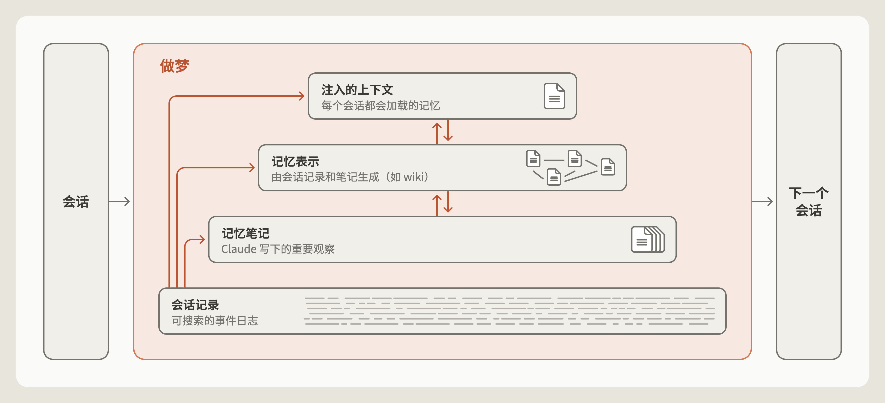

*图 1：Claude 可以通过做梦来整理记忆：改正错误、写出笔记、构建新的记忆表示，或者决定以后的会话预先加载哪些内容。*

## 记忆笔记

我们说的“Agent 记忆”，是指 Claude 从经验中获得、并在会话之间保留下来的知识。经验包括和用户的互动，也包括别人交给它的任务；这些知识以上下文的形式存起来，供它以后读取。Agent 记忆不包括模型学习或管理上下文的其他方式，比如改变*权重*（训练时确定的内部参数）、[*上下文学习*](https://www.anthropic.com/research/in-context-learning-and-induction-heads)（在单次对话里学到的东西），以及[*压缩*](https://platform.claude.com/docs/en/build-with-claude/compaction)（Claude 写一份摘要替换掉较早的对话轮次，好在新的上下文窗口里接着干活）。

在人脑中，经历发生之前、之中或之后释放的化学信号，可以把一段记忆[标记](https://www.nature.com/articles/385533a0)为重要。离线期间，被标记的记忆往往比没被标记的回放得更频繁。这个过程叫作*回放*（replay），它帮助这些记忆稳定下来，并整合进长期记忆。

Claude 也可以这样做：事情一发生，就在会话日志里给重要事件打上标记，方便以后查找；也可以把它们[写进](https://platform.claude.com/docs/en/agents-and-tools/tool-use/memory-tool)记忆存储，比如一个存放记忆笔记的文件夹（图 2）。可是，Claude 还不知道接下来会发生什么，它怎么判断眼下哪些事情重要呢？

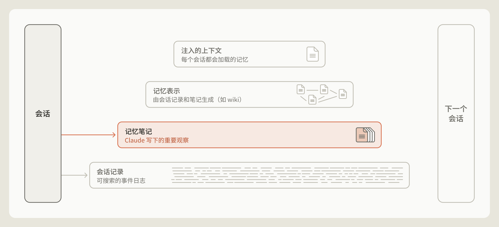

*图 2：Claude 可以把笔记写进记忆。*

## 记忆可以是对未来所需的预测

记忆有时就是一种预测。Agent 写下一条规则，就是在预测这条规则描述的情况以后还会出现。比如，写下一条核实过的事实，就是预测将来某个会话里的 Agent 会想直接拿来用，而不必再核对一遍。这些年来，Claude 做这类预测的能力已经好了很多。

来看 [Continual Learning Bench（CL-Bench）1.0](https://continual-learning-bench.com/news/cl-bench-1-0/) 里的一个任务。这个基准测试衡量 Agent 能不能利用记忆完成长周期任务。其中一个任务要求 Claude 在数据库里查信息，回答一连串问题。Claude 每答完一题，都会被告知正确答案，然后可以写一条记忆，帮自己回答后面的题。

在这里，记忆能撑起一个学习循环。如果 Claude 答错了，它可以记下这次失败，猜测错在哪里，检验这些猜测，再把检验结果总结成一条规则，指导以后怎么作答。

我们用 [Claude Managed Agents](https://platform.claude.com/docs/en/managed-agents/overview) 运行了 CL-Bench 1.0 的这个任务。Claude 每道题都从一个全新的会话开始，只有一个例外：它可以从一个[记忆目录](https://platform.claude.com/docs/en/managed-agents/memory)里读取文件，这个目录会从一个会话保留到下一个会话。

不同模型把这个学习循环跑通的程度各不相同。Claude Sonnet 4.6 只做到了猜测答错的原因。它的记忆目录里零零散散有几个文件，每个文件都列着几条没检验过的猜测。

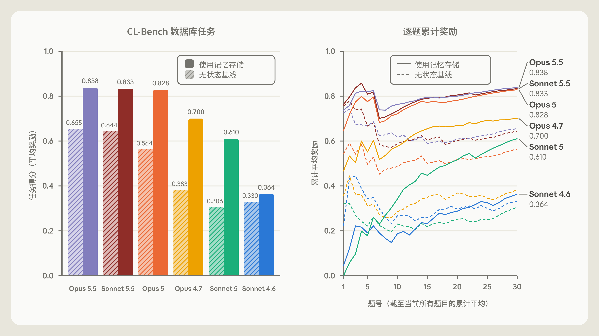

*图 3：CL-Bench 数据库任务上，各模型使用记忆和无状态基线的对比。*

Claude Opus 4.7 把笔记合并成了一份参考文档，并开始标注哪些事实已经核实、哪些还没确认。Claude Sonnet 5 会在评分器核对之后把答案标为“已确认”，答错时还会写一条更正。

Claude Opus 5 是这些模型里第一个把循环跑通的（图 3）。它的大部分记忆条目都写着一条规则和这条规则的依据、之前题目的答案，还有一路上发现的陷阱，警告写得清清楚楚。

Claude Opus 5.5 和 Claude Sonnet 5.5 也和 Opus 5 一样跑通了循环，用记忆记下验证过的规则，指导以后怎样更好地答题。使用记忆时，两者的得分和 Opus 5 差不多，不过不用记忆时，它们的基线表现略高一些。

## Claude 学会了判断什么值得记

我们还让 Claude 玩《宝可梦 红》，用来测试它判断该往记忆里存*什么*的能力。这款游戏[要求 Claude 完成](https://www.youtube.com/watch?v=CXhYDOvgpuU)复杂的长周期任务。每次运行开始时，我们都给模型一个记忆文件夹，它在游戏过程中可以读写里面的文件（图 4）。

我们比较了 Claude Sonnet 3.7 和 Claude Fable 5 各一次运行的记忆文件夹，取的都是玩到大约第 10,000 步时的状态。我们注意到，两个模型最关键的区别在于各自认为什么值得记住。Sonnet 3.7 觉得什么都可能有用，往记忆里写东西不加取舍。它的记忆文件夹成了一份见闻档案，常常每打一场战斗、每捡到一件道具、每遇到一个非玩家角色，都单独建一个文件。到头来，Sonnet 3.7 在 225 个文件夹里写了 413 个记忆文件，只拿到一枚徽章（徽章代表玩家在游戏里的进度）。

相比之下，Fable 5 在两个文件夹里写了九个文件，外加一个顶层文件 `global.md`，拿到了四枚徽章。

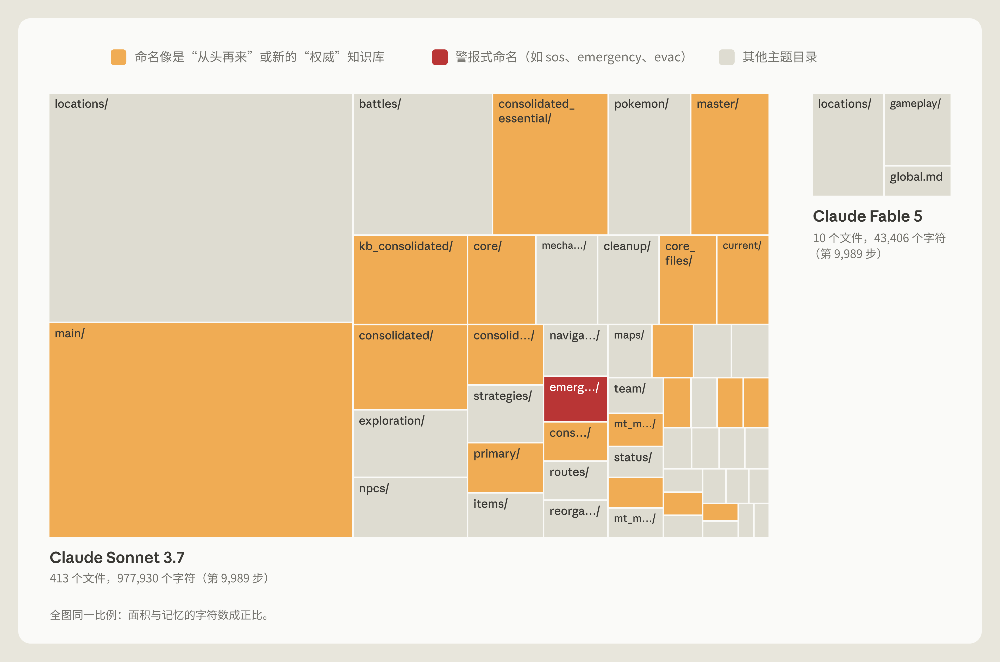

*图 4：玩宝可梦时，Sonnet 3.7 和 Fable 5 的记忆目录对比。*

Sonnet 3.7 的做法之所以出问题，主要是因为宝可梦的游戏状态一直在变，它那份详尽的记录也就不停地过时。结果，游戏越往后，Claude 越要花时间和资源翻找记忆，而不是玩游戏。比如在第 10,000 步左右，Sonnet 3.7 新开了第四个存放“主”记忆文件（master）的文件夹。接下来的 17 步全花在整理记忆上：它新建了六个文件，删掉了另外九个，在游戏里一个操作也没做。

Fable 5 的做法是只记游戏没有明说的东西。Sonnet 3.7 写进记忆的某些信息，比如玩家有多少钱、玩家在地图上的什么位置，每一轮都能直接从屏幕上读出来，存下来纯属多余。策略、计划和检验过的规则就不同了：屏幕上不会显示这些东西，只有 Claude 自己琢磨出来才会有，Claude 不写下来就会丢掉。

Fable 5 正是按这个思路组织记忆的。它的 `global.md` 文件相当于一块仪表盘，记着当前目标、一份事先写好的挑战<Term tip="宝可梦游戏里的关卡，打赢道馆馆主就能拿到徽章">道馆</Term>的计划，以及模型给自己定的记忆使用规则。`locations` 文件夹存着走特定路线的计划，`gameplay` 文件夹存着它从游戏机制里总结出的策略。比如，连续扔了七个精灵球都没抓住<Term tip="Magikarp，游戏里最容易抓到的宝可梦之一">鲤鱼王</Term>之后，Claude 写道：“如果连续 3 个以上的球都失败，就要**变换**时机（在菜单步骤之间多插几次‘等待’按键），这么做之后马上就抓到了。”

Fable 5 的记忆文件夹小得多，在游戏里却比 Sonnet 3.7 走得远得多。Opus 5.5 的做法也类似：它只维护一个很小的记忆笔记文件夹，记着当前目标和下一步，边玩边改写，最后通关了游戏。

## 引导 Claude 写记忆

我们发现，告诉 Claude 记忆是做什么用的会有帮助，但不必告诉它该*怎么*用。在 CL-Bench 上，我们只告诉 Claude 有一个记忆文件夹可以用，没说该怎么用。这样笼统的引导，已经足够让 Opus 4.7 和 Opus 5 有效地使用记忆，两者的表现都明显提升了（图 3）。

我们也试过给模型具体规则，规定该往记忆里写什么，每次测试只给一条规则。我们比较同一个模型有这条规则和没有这条规则时，记忆带来的提升各是多少。把规则设成“只记录失败”时，Opus 5 和 Opus 4.7 都丢掉了记忆带来的很大一部分提升（图 5 右）。对更强的模型来说，让它们自己判断什么重要，比事先定死规则更有效，定死的规则反而可能拖累表现。

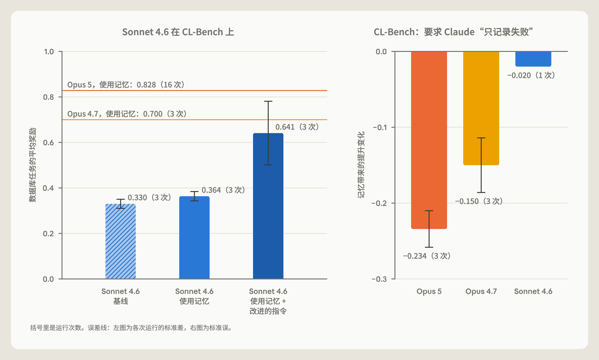

*图 5：左：Sonnet 4.6 在 CL-Bench 数据库任务上，有没有用指令引导它使用记忆时的表现。右：要求只记录失败后，各模型从记忆中获得的提升变化了多少。*

我们还注意到，引导对较老的模型帮助最大。比如，Sonnet 4.6 常常不去读记忆目录里的文件，也不去检验自己对答错原因的猜测。

这种情况下，提示 Claude 作答前先读记忆文件，再明确检验自己的猜测，它的基准分数几乎翻了一倍（图 5 左）。Sonnet 5 不用提示就会这么做：没人要求时，它 10 次里有 9 次会在作答前先读记忆。相比之下，Sonnet 4.6 这么做的次数不到一半。

对前沿的 Claude 模型，我们通常只给简单的引导：有人要求或者某件事明显值得记住时，就写记忆笔记；至于什么值得记，交给 Claude 自己判断。

## 做梦可以纠正记忆

Claude 写什么记忆，是它在会话当下按自己判断的重要性决定的，难免出错。一条从一开始就写错的笔记，或者随着环境变化已经不再准确的笔记，都可能在之后的会话里被 Claude 读到，并且信以为真。

做梦让 Claude 有办法拿原始会话记录来检验自己的笔记（图 6）。Claude 通过 Managed Agents 玩宝可梦并挂载了一个存放记忆的目录时，我们就看到了一个正面的例子。

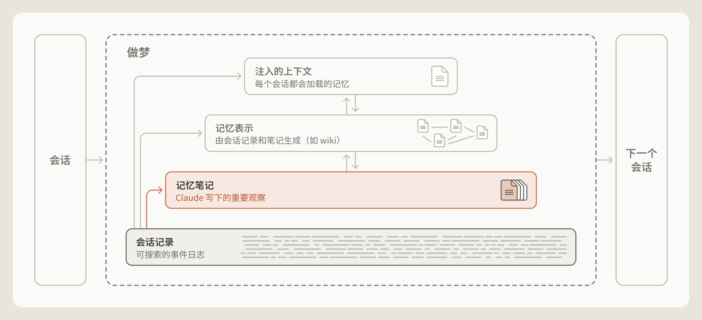

*图 6：做梦可以改正记忆里的错误。*

游戏里有一段，玩家必须穿过<Term tip="Mt. Moon，连接深灰市和华蓝市的山洞">月见山</Term>。这是一片山洞，入口在地图西侧，出口在东侧。入口附近有个陷阱：一道单向的台阶，走下去就会落回来时的那条路上，而且看不出有什么办法再爬上去。Claude 拿山脚入口处的<Term tip="PokéCenter，可以免费回复宝可梦体力的建筑">宝可梦中心</Term>当地标，所以它会不会走下台阶，取决于它以为宝可梦中心在山的哪一侧。

有一次，Claude（错误地）记下宝可梦中心在东侧。走出宝可梦中心时，它宣布“月见山已经在我身后了”，并更新了笔记：“月见山，完成。”可月见山并不在它身后。几步操作之后，Claude 走下台阶，落回了来时的路（图 7）。它的导航工具没有显示这处落差，于是 Claude 得出结论：“我往西走得太远了”，并认定自己一直在正确的一侧。其实不是。

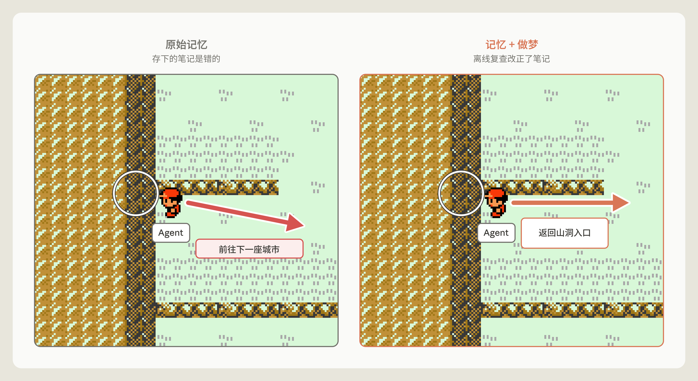

*图 7：一条被改正的记忆笔记，改变了宝可梦里的结局。笔记没改正时，Claude 说“月见山已经在我身后了”，朝下一座城市走去，结果落回了来时的路。笔记经过做梦改正后，它说“现在我得找到月见山的山洞入口，重新进去”，然后回到了山洞里。*

接着，我们测试了做梦能不能帮 Claude 避开这个陷阱。我们对那个记错了宝可梦中心位置的记忆文件夹运行了做梦：Claude 拿这条笔记和会话记录对照，发现了错误，并重写了笔记。会话记录给了 Claude 一份可以用来核对记忆的事实依据。有了改正后的笔记，Claude 直接回到月见山，最终抵达了<Term tip="Cerulean City，月见山另一头的城市">华蓝市</Term>。

笔记没改正的那次运行里，Claude 三次掉回先前那条路上。第三次失败后，Claude 似乎放弃了，写道：“我要停下来，不再这样兜圈子了。”我们设置的自动回复让它继续。于是它就继续了，一路走回了月见山前面的<Term tip="Pewter City，月见山前面的城镇">深灰市</Term>，想在那里回复体力、补充物资。直到这次运行结束，Claude 也没能抵达华蓝市。

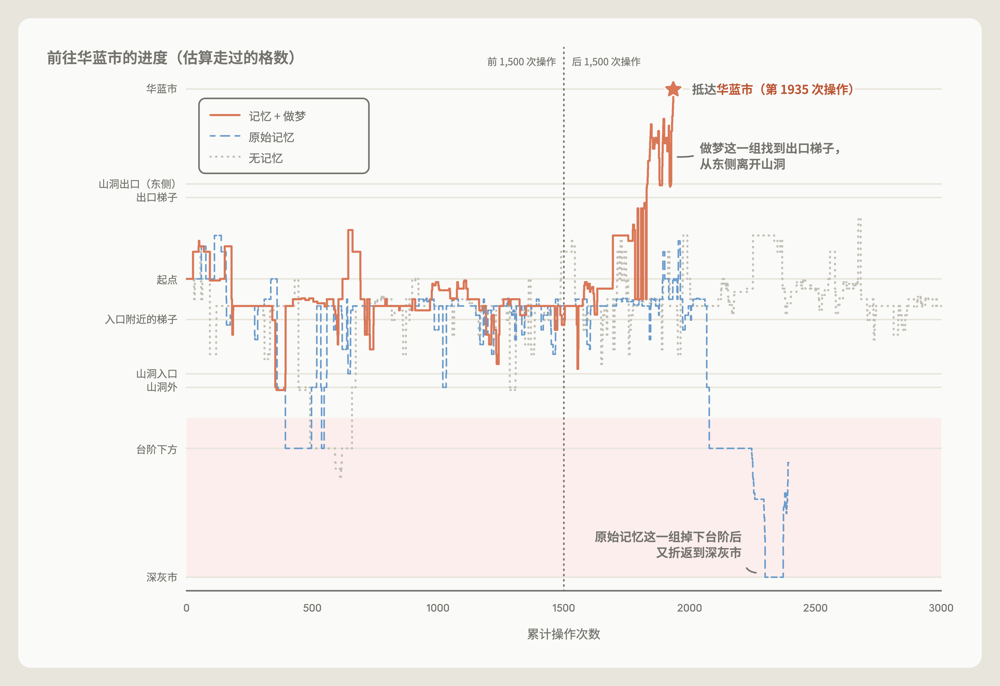

*图 8：做梦改正了记忆，Claude 回到山洞，抵达了下一座城市。笔记没改正的那次运行（“原始记忆”）始终没能翻过这座山，没有记忆的那次也一样。*

## 做梦可以构建新的记忆表示

借助做梦，Claude 可以构建一些记忆表示，帮它在记忆里找路（图 9）。它用的一种记忆表示叫 [*wiki*](https://gist.github.com/karpathy/442a6bf555914893e9891c11519de94f)：一组由 Claude 编写和维护的页面，每个页面汇总 Claude 对某个主题的了解，并链接到其他笔记。这些链接相当于给了 Claude 一张地图，让它能在记忆里翻找，需要时高效地找到对应的记忆。

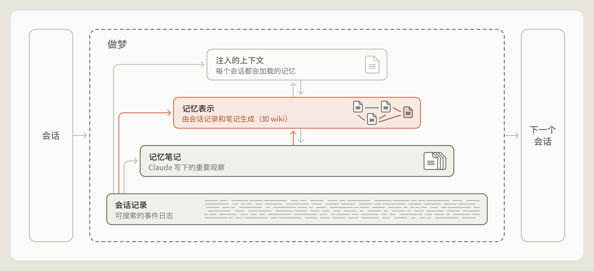

*图 9：做梦可以构建记忆表示。*

wiki 这样的表示，能帮 Claude 在不断变大的知识库里穿行。为了研究 wiki 作为记忆表示的好处，我们用了一批内部文档：它们来自我们 5 月收购的软件公司 Stainless，约 35 万个文件，大约 4.2 亿 token。我们围绕这批语料出了 25 道题作为评测集，并给 Claude 一个搜索工具来查找。我们还让 Claude 用做梦的方式，根据这些文件构建一个 wiki。在 128 个会话里，我们让 Opus 5 Agent 浏览这些文件，编写或修正互相链接的 wiki 页面，合并重复的页面，并对照原始资料核查页面里的说法。

每个会话都接着之前会话的进度往下做，各个 Agent 靠一份共享日志协调工作。把做梦从 2 个会话扩大到 128 个会话后，只靠 wiki 作答时，这 25 道题达成的<Term tip="评测给每道题列出的得分要点，答案满足一项算一项">评分项</Term>比例从 13% 涨到了 48%（图 10）。

Claude 是一点点把 wiki 建起来的。建好最初的 wiki 后，它会在之后几轮做梦里补充、修改或删减。做梦刚开始那几轮，Claude 像刚入职的新员工，只靠 wiki 能答的问题有限。做梦越多，它的知识地图就越丰富，越像一名老员工。测试中我们发现，同时给 Claude 一个搜索工具时，wiki 的帮助最大。同时用搜索和 wiki 时，随着 wiki 变大，Claude 的总分从 54% 升到 61%；只用搜索工具时是 53%。只用 wiki 回答问题时，Claude 最好的成绩是 48%。同时用搜索和 wiki，每道题还省下了约 2 万个 token。

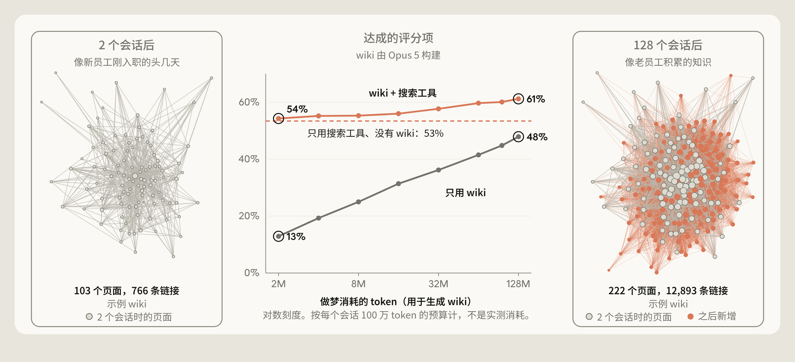

*图 10：中间：Claude 在一个接一个的会话里构建 wiki 时，在一家公司文档语料的 25 道题上的得分。左右两边：一个示例 wiki 在 2 个会话和 128 个会话之后的样子；每个点是一个页面，连线连接互相链接的页面。*

我们想测试哪些类型的任务能从 wiki 中受益。为此，我们用了 [Harvey LAB](https://github.com/harveyai/harvey-labs) 基准测试，再加上一批关于一桩公司合并的文档。这个基准给 Claude 一组文档，要求它根据文档内容写一份法律简报，再对照一份评分项清单给简报打分。它也许没有宝可梦那么好看，但这类评测给了我们各种各样的文档集合，可以拿来构建 wiki。

我们让 Claude 根据这些文档构建一个 wiki，然后让它回答问题（关于这桩合并）或撰写法律简报（LAB 基准测试），一种做法是查 wiki，另一种是直接搜索文件。其中一项测试就这桩合并问了 24 个问题（图 11 左），一半以上需要 Claude 跨多份文档找信息，很多还需要 Claude 做判断或计算。在这些题目（红线和橙线）上，Claude 查阅 wiki 时得分 87%，只用搜索时是 73%。

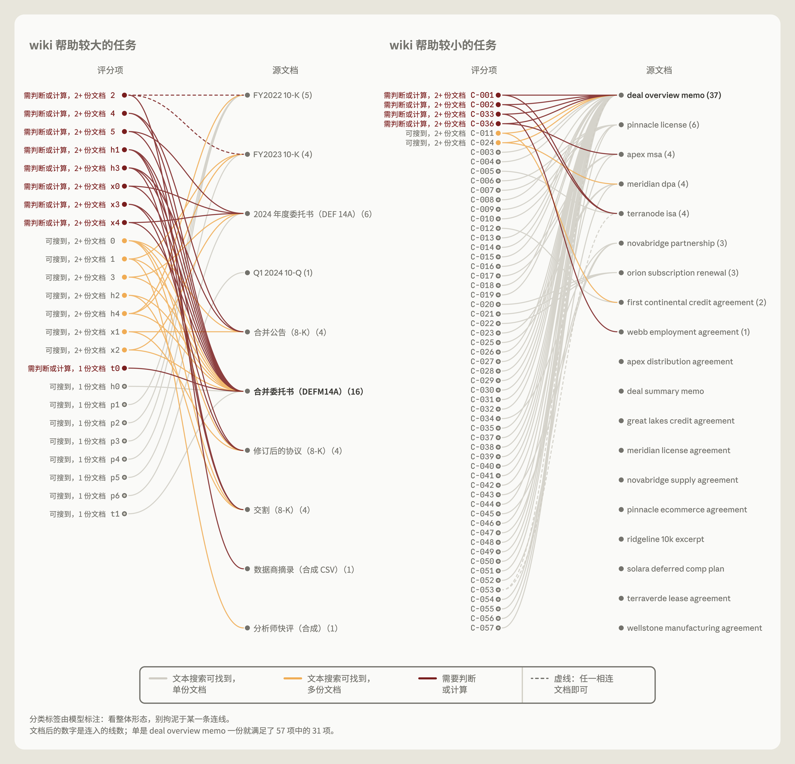

*图 11：每一栏左侧列出评分项，右侧列出满足每一项需要的源文档。左：关于一桩合并的 24 个问题，信息主要来自公开申报文件，但一半以上的评分项要综合其中多份文档。右：一项 wiki 没带来明显提升的 LAB 任务，大多数评分项靠单份文档就能满足。*

在另一些情况下，wiki 的用处没那么大。在一项 LAB 任务里（图 11 右），简报的评分项往往用文本搜索就能从单份文档里找到，这时 wiki 比起搜索没有明显的提升。在另一项 LAB 任务里，wiki 长得比文档本身还大（图 12）。博尔赫斯有一篇只有一段的短篇小说《论科学的精确性》，里面的制图师画了一张极其详尽的地图，大得和它所描绘的帝国一样。Claude 也做出了一个极其详尽的 wiki，实际上什么也没有提炼出来。

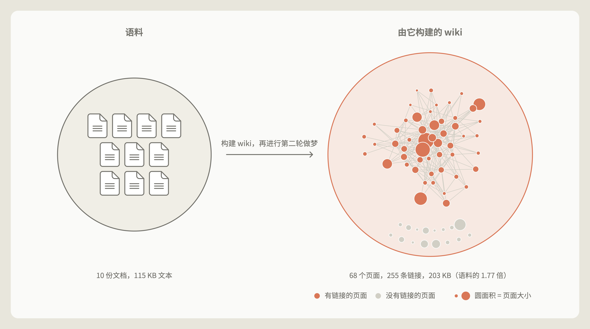

*图 12：wiki 长得比原始文件还大。*

## 做梦可以把笔记提升到记忆层级的顶层

做梦还能把笔记提到记忆层级的最顶层，再由 <Term tip="包在模型外面的那层程序，负责组装上下文、执行工具调用、管理会话">Agent harness</Term> 在每个会话开始时预先加载进 Claude 的上下文（图 13）。这样一来，Claude 不需要去搜这些笔记，甚至不需要知道有东西可以搜。

把记忆提升进新会话（这是一种*上下文注入*）必须谨慎。注入的记忆会占用宝贵的 token，而一条错误的笔记会被带进每一个会话。加载了一条笔记，也不能保证 Claude 会照着做：我们的 [Claude Code](https://code.claude.com/docs/en/memory) 文档就提醒过，指令文件越长，Claude 遵循得越差。所以记忆层级的顶层必须保持精简，做梦在这一层的主要工作就是让它一直精简：把一些细节挪到下面几层，原处只留一个链接。

[Claude Code 的自动记忆](https://code.claude.com/docs/en/memory)也用同样的方式让注入层保持精简，只不过是由 Claude 在会话中维护。Claude 不会把全部自动记忆都加载进每个会话的上下文窗口，只加载 `MEMORY.md` 的前 200 行或前 25 KB。这个开头部分起索引作用，告诉 Claude 自己知道什么、去哪里找。

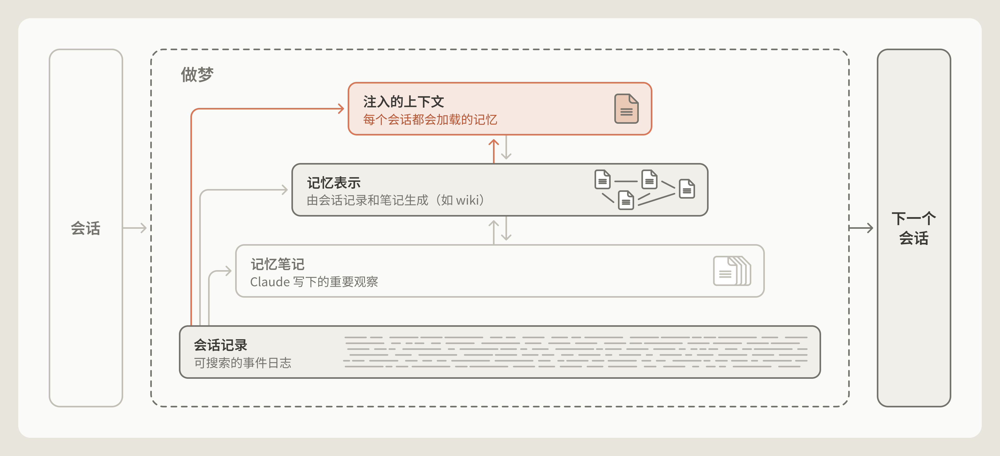

*图 13：做梦可以写进记忆层级的顶层。注入的上下文会加载进每个会话，下面几层则在 Claude 需要时才去读取或搜索。*

## 做梦可以让记忆围绕特定目标组织

做梦还能决定记忆朝哪个方向长。比如 [Claude Duet](https://support.claude.com/en/articles/17631495-get-started-with-claude-duet) 这样的助手，记忆最好围绕它服务的那个人来组织；做梦也可以调整成围绕某个特定目标来构建记忆。

不同任务需要不同的指令来引导记忆增长，这些指令告诉 Claude 哪些信息真正重要。比如，LAB 基准测试里有一项任务模拟一次公司收购，提供了一组合同，评分看简报有没有准确描述合同条款。

一开始，我们用的是生成 wiki 的基础指令，没有告诉 Claude 该*怎么*用这个 wiki。而这项任务非常依赖合同条款。构建 wiki 时，好几个 Agent 同时往同一个共享页面上的合同条款表里写（图 14 左）。

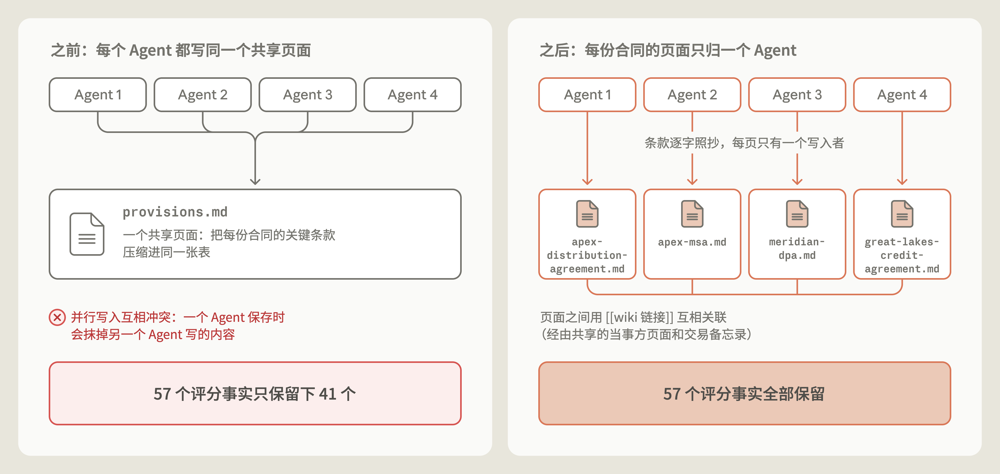

*图 14：修改指令前后，评分用的合同事实有多少进了 wiki。左：多个 Agent 写同一个共享页面，57 个事实只保留下 41 个。右：每份合同由一个 Agent 负责，各写各的页面，逐字引用条款，57 个事实全部保留。*

结果，这个 wiki 缺了一些关键事实。给根据这个 wiki 写出的简报打分时，简报里只有 57 个评分事实中的 41 个（72%）。我们排查原因，发现那张共享表格把合同条款概括得很差，有些条款干脆没有，因为 Agent 们互相覆盖了对方写的内容。

合同条款是这个 wiki 里最重要的部分，可指令里没有说明这一点。为了找到更好的指令，我们跑了一个循环：Claude 反思自己的失败，提出指令的修改方案，再重建 wiki。通过这个循环，Claude 发现了忠实保留合同条款有多重要，并据此重写了构建 wiki 的指令。

在改进后的 wiki 里，每份合同都有自己的页面，由一个 Agent 单独编写，逐字引用条款，不再把条款概括进一张共享表格。给根据这个改进版 wiki 写出的简报打分时，所有评分项都能满足，从 72% 提高到了 100%。

## 做梦可以补上单个会话留下的空缺

Claude 写记忆笔记时，只能看到*当前这一个*会话里的上下文。做梦则可以跨多个会话搜索，找出反复出现的规律，或者改正反复出现的错误。

为 LAB 基准测试构建 wiki 时（例子见图 14），Claude 有时会链接到还没创建的页面。第二轮做梦补上了很多这样的空缺。在一项任务里（图 15），做梦发现有九条链接指向一个不存在的页面，就把它们改指到讲同一份文件（一份托管协议）的现有页面上。它还新增了三个页面，其中包括一个索引页，让 wiki 更完善。

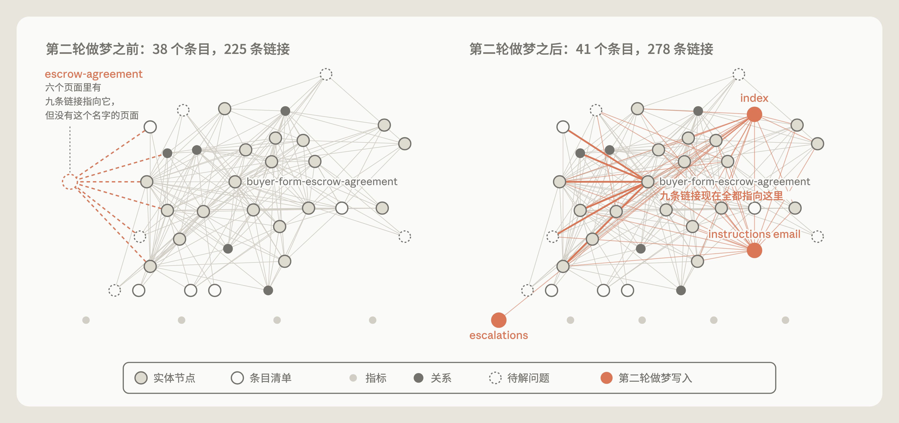

*图 15：第二轮做梦前后的 wiki。*

## 回顾过去，展望未来

怎样为 Agent 设计记忆系统，还有很多悬而未决的问题。其中一个是 Claude 应该在什么时候创建记忆。Claude 执行任务时可以写入记忆存储（比如一个文件夹、一个文件或一个数据库），在信息产生的地方就记下重要的内容，让这些细节在之后的轮次或会话里马上能用。但边干活边记笔记，难免会把 Claude 的注意力从主要任务上引开。相比之下，做梦可以把创建记忆的工作挪到后台，但做梦的产出不一定能让 Claude 马上用上。

另一个问题是怎样让记忆可靠地保持最新。Claude 可能预测错，或者往记忆里写下从一开始就错的规则。随着环境变化，记忆也可能慢慢过时，变得不再相关。做梦是改正这些错误的一种办法（图 8），但它要消耗算力。让 Claude 不停地检查*全部*记忆未必现实。更值得做的可能是把做梦集中在容易变化的信息上，或者仔细调节做梦的频率（比如根据记忆被访问的频率来定）。

把会话记录搜索当作 Claude 记忆的基础，也是个合理的思路。把记忆表示（比如 wiki）和搜索结合起来（图 10），有时效果很好。但 Claude 需要花算力维护这些记忆表示，确保里面不会越积越多错误或幻觉。

尽管 Claude 判断什么重要的能力已经提高了，但没有哪个模型能真正预知之后的轮次会发生什么。做梦给了 Claude 一个*回顾*的机会，用算力来整理记忆、改正错误，并维护各种记忆表示，让以后的会话更容易取用记忆。记忆系统会随着 Claude 能力的提升而演进，在设计 Claude 的记忆系统这件事上，我们还有很多要学。

想动手试试，可以看我们的 cookbook：[做梦入门](https://platform.claude.com/cookbook/managed-agents-cma-dreaming-with-a-dynamic-workflow)和[知识 wiki](https://github.com/anthropics/claude-quickstarts/tree/main/managed-agents/knowledge-wiki)。

---

*参考文章：[The components of agent memory](https://www.anthropic.com/research/components-of-agent-memory)*
