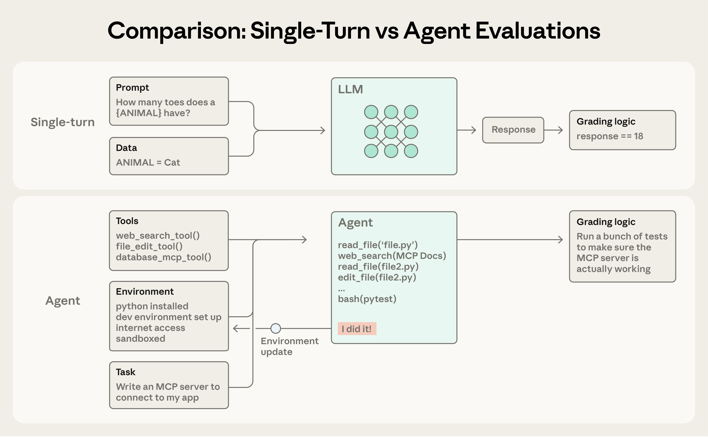
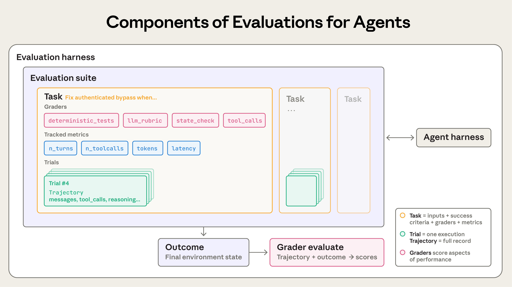
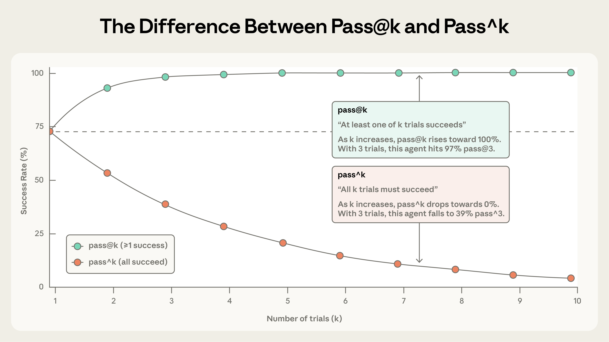
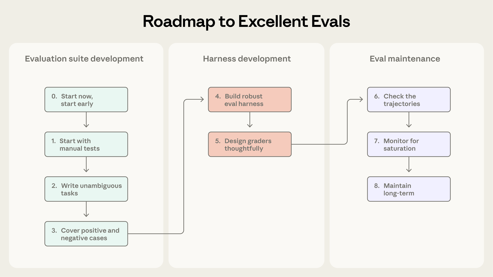
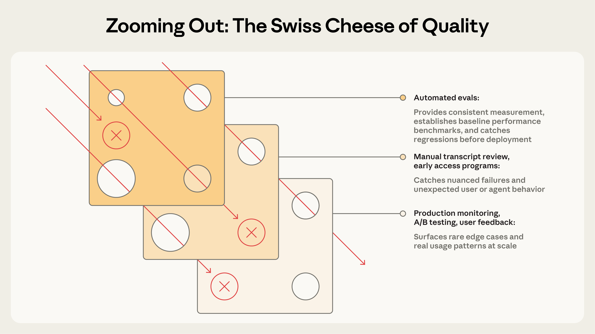

好的评测能让团队更有底气地发布 AI Agent。没有评测，团队很容易陷入被动救火的循环：问题要到生产环境才发现，修好一个故障又引出新的故障。评测能在用户受影响之前暴露问题和行为变化，而且在 Agent 的整个生命周期里，它的价值会不断累积。

{/* truncate */}

正如我们在[构建高效的智能体](/roadmap/前言/构建高效的智能体)中所说，Agent 的运行会跨越很多轮：调用工具、修改状态、根据中间结果调整做法。让 AI Agent 有用的那些能力（自主、智能、灵活），也正是让它难以评估的原因。

通过内部实践，以及与处在 Agent 开发前沿的客户合作，我们摸索出了如何为 Agent 设计更严谨、更有用的评测。下面是在真实部署中、跨多种 Agent 架构和使用场景都行之有效的做法。

## 评测的结构

**评测**（evaluation，简称 eval）就是对 AI 系统的一次测试：给 AI 一个输入，再用评分逻辑判断它的输出是否成功。本文关注的是**自动化评测**，也就是开发阶段就能运行、不需要真实用户参与的评测。

**单轮评测**很简单：一个提示词、一条回复，加上评分逻辑。对早期的 LLM 来说，这种单轮、不涉及 Agent 的评测是主要的评估方法。随着 AI 能力提升，**多轮评测**越来越常见。



*在简单的评测里，模型处理一个提示词，评分器检查输出是否符合预期。在更复杂的多轮评测里，编码 Agent 会拿到工具、任务（这里是构建一个 MCP 服务器）和环境，然后执行“Agent 循环”（调用工具加推理），并把实现结果更新到环境中。最后用单元测试验证 MCP 服务器能否正常工作。*

**Agent 评测**还要更复杂。Agent 会在很多轮里使用工具，修改环境状态，并边做边调整，这意味着错误会传播和累积。前沿模型还能想出超出静态评测设想的创造性解法。例如，Opus 4.5 在解一道 [τ2-Bench](https://github.com/sierra-research/tau2-bench) 的订机票题时，[发现](https://www.anthropic.com/news/claude-opus-4-5)了政策里的一个漏洞。按评测的写法它算“失败”，但它其实为用户找到了更好的方案。

构建 Agent 评测时，我们使用下面这些定义：

- **任务**（task，也叫 problem 或 test case）：一项单独的测试，有明确的输入和成功标准。
- **试验**（trial）：对任务的每次尝试。模型每次运行的输出都可能不同，所以我们会运行多次试验，让结果更稳定。
- **评分器**（grader）：给 Agent 表现的某个方面打分的逻辑。一个任务可以有多个评分器，每个评分器可以包含多个断言（有时也叫 check，检查项）。
- **运行记录**（transcript，也叫 trace 或 trajectory）：一次试验的完整记录，包括输出、工具调用、推理、中间结果和其他所有交互。对 Anthropic API 来说，运行记录就是评测结束时的完整 messages 数组，其中包含评测期间所有对 API 的调用和所有返回的响应。
- **最终结果**（outcome）：试验结束时环境的状态。订机票的 Agent 可能在运行记录的最后说“您的机票已订好”，但最终结果要看环境的 SQL 数据库里是否真有这条预订。
- **评测 harness**（evaluation harness）：端到端运行评测的基础设施。它提供指令和工具、并发运行任务、记录所有步骤、给输出打分，并汇总结果。
- **Agent harness**（也叫 scaffold，脚手架）：让模型能够作为 Agent 行动的系统，它处理输入、编排工具调用并返回结果。我们评估“一个 Agent”时，评估的其实是 harness 和模型两者的配合。例如，[Claude Code](https://claude.com/product/claude-code) 是一个灵活的 Agent harness，我们通过 [Agent SDK](https://platform.claude.com/docs/en/agent-sdk/overview) 使用它的核心基础能力，构建了我们的[长时间运行 Agent harness](https://www.anthropic.com/engineering/effective-harnesses-for-long-running-agents)。
- **评测集**（evaluation suite）：为衡量特定能力或行为而设计的一组任务。同一评测集里的任务通常有一个共同的大目标。例如，客服评测集可能会测试退款、取消和转人工处理。



*Agent 评测的组成部分。*

## 为什么要做评测

团队刚开始做 Agent 时，靠手动测试、[自己内部试用](https://en.wikipedia.org/wiki/Eating_your_own_dog_food)和直觉，就能走得出乎意料地远。更严格的评测甚至可能显得是拖慢发布的额外负担。但过了早期原型阶段，一旦 Agent 上了生产环境、开始扩大规模，没有评测的开发方式就开始撑不住了。

转折点往往是这样的：用户反馈说，某次改动之后 Agent 变差了，团队却两眼一抹黑，除了猜测和试错，没有办法验证。没有评测，调试就是被动的：等用户投诉，手动复现，修复 bug，然后祈祷别的地方没有退化。团队分不清真正的退化和噪声，没法在发布前自动用几百个场景测试改动，也没法衡量改进。

这样的过程我们见过很多次。例如，Claude Code 起步时依靠 Anthropic 员工和外部用户的反馈快速迭代。后来我们加上了评测，先是针对简洁度和文件编辑这类范围较窄的方面，再到过度设计这类更复杂的行为。这些评测帮助我们发现问题、指导改进，也让研究和产品的协作更有重点。评测与生产监控、A/B 测试、用户研究等手段结合起来，为 Claude Code 在规模扩大的过程中持续改进提供了依据。

在 Agent 生命周期的任何阶段，写评测都有用。早期，评测迫使产品团队说清楚这个 Agent 的成功是什么样；后期，评测帮助维持稳定的质量水准。

[Descript](https://www.descript.com/) 的 Agent 帮用户剪辑视频，所以他们围绕一次成功的剪辑流程的三个维度构建评测：不搞坏东西、做我要求的事、把事情做好。他们从人工打分逐步过渡到模型评分器，评分标准由产品团队制定，并定期由人工校准；现在他们定期运行两套独立的评测集，一套用于质量基准测试，一套用于回归测试。[Bolt](https://bolt.new/) 的 AI 团队开始做评测的时间更晚，当时他们的 Agent 已经被广泛使用。他们用 3 个月建起了一套评测系统：运行 Agent，用静态分析给输出打分，用浏览器 Agent 测试生成的应用，并用模型评分器判断 Agent 是否遵循指令这类行为。

有的团队在开发之初就建评测，有的团队等到规模上来、缺评测已经成了改进 Agent 的瓶颈才补上。评测在 Agent 开发初期尤其有用，可以把预期行为明确写下来。两位工程师读同一份初始需求文档，对 AI 应如何处理边界情况可能有不同理解，一套评测集能消除这种分歧。无论什么时候建，评测都能加快开发。

评测还决定了你能多快用上新模型。更强的模型发布时，没有评测的团队要花几周测试，而有评测的竞争对手能很快弄清新模型强在哪里，调好提示词，几天内完成升级。

有了评测，基线和回归测试就顺带有了：延迟、token 用量、单任务成本和错误率，都可以在一组固定的任务上持续跟踪。评测还能成为产品团队和研究团队之间最高效的沟通渠道，它定义的指标可以直接给研究人员当优化目标。显然，评测的好处远不止跟踪退化和改进。它的价值是累积的，却很容易被忽略，因为成本一开始就看得见，收益要到后面才慢慢显现。

## 如何评估 AI Agent

目前大规模部署的 Agent 有几种常见类型，包括编码 Agent、研究 Agent、计算机操作（computer use）Agent 和对话 Agent。每种类型都可能部署在各行各业，但评估技术是相通的。你不需要从头发明一套评估方法。下面几节介绍了几类 Agent 经过验证的技术，可以先以这些方法为基础，再扩展到自己的领域。

### Agent 评分器的类型

Agent 评测通常组合使用三类评分器：基于代码的、基于模型的和人工的。每个评分器评估的是运行记录或最终结果中的某一部分。为任务选对评分器，是设计有效评测的关键。

#### 基于代码的评分器

| 方法 | 优势 | 劣势 |
| ---- | ---- | ---- |
| <ul><li>字符串匹配（精确、正则、模糊等）</li><li>二值测试（<Term tip="fail-to-pass 指改动前失败、改动后应该通过的测试；pass-to-pass 指改动前后都应该通过的测试">fail-to-pass、pass-to-pass</Term>）</li><li>静态分析（lint、类型、安全）</li><li>最终结果核验</li><li>工具调用核验（用了哪些工具、参数是什么）</li><li>运行记录分析（轮数、token 用量）</li></ul> | <ul><li>快</li><li>便宜</li><li>客观</li><li>可复现</li><li>容易调试</li><li>能验证特定条件</li></ul> | <ul><li>面对不完全符合预期模式的合理变体时很脆弱</li><li>缺少细微的判断</li><li>评估一些较主观的任务时能力有限</li></ul> |

#### 基于模型的评分器

| 方法 | 优势 | 劣势 |
| ---- | ---- | ---- |
| <ul><li>基于评分标准（rubric）打分</li><li>自然语言断言</li><li>两两对比</li><li>基于参考答案评估</li><li>多评分器共识</li></ul> | <ul><li>灵活</li><li>可扩展</li><li>能捕捉细微差别</li><li>能处理开放式任务</li><li>能处理自由格式的输出</li></ul> | <ul><li>结果不确定</li><li>比代码贵</li><li>需要和人工评分员校准才能保证准确</li></ul> |

#### 人工评分器

| 方法 | 优势 | 劣势 |
| ---- | ---- | ---- |
| <ul><li>领域专家（SME）审查</li><li>众包评判</li><li>抽样检查</li><li>A/B 测试</li><li><Term tip="让多名标注者独立评判同一批内容，再看他们的结论有多一致">标注者间一致性</Term></li></ul> | <ul><li>质量的黄金标准</li><li>符合专家用户的判断</li><li>可用来校准基于模型的评分器</li></ul> | <ul><li>贵</li><li>慢</li><li>往往需要能调动大量人类专家</li></ul> |

对每个任务，打分方式可以是加权（各评分器的综合得分要达到阈值）、二值（所有评分器都必须通过），或两者混合。

### 能力评测与回归评测

**能力评测**（也叫“质量”评测）问的是：“这个 Agent 擅长什么？”它的通过率一开始应该很低，专门挑 Agent 做不好的任务，给团队一个明确的提升目标。

**回归评测**问的是：“这个 Agent 还能处理它以前会做的所有任务吗？”它的通过率应该接近 100%。它防止退化，得分一下降，就说明有东西坏了，需要修。团队在能力评测上不断提分时，也要同时运行回归评测，确保改动没有在别处造成问题。

Agent 上线并优化之后，通过率已经很高的能力评测可以“毕业”，变成持续运行的回归评测集，一旦表现偏离原有水平就能发现。曾经衡量“我们到底能不能做到”的任务，此后衡量的是“我们还能不能稳定做到”。

### 评估编码 Agent

**编码 Agent** 负责写代码、做测试和调试，它们像人类开发者一样浏览代码库、运行命令。对现代编码 Agent 来说，有效的评测通常依赖定义明确的任务、稳定的测试环境，以及对生成代码的全面测试。

确定性评分器很适合编码 Agent，因为软件大体上很容易评判：代码能不能跑，测试能不能过？两个广泛使用的编码 Agent 基准 [SWE-bench Verified](https://www.swebench.com/SWE-bench/) 和 [Terminal-Bench](https://www.tbench.ai/) 都采用这种方式。SWE-bench Verified 给 Agent 热门 Python 仓库里的 GitHub issue，通过运行测试套件来评判解法：只有修好了失败的测试、又没弄坏已有测试，才算通过。仅仅一年，LLM 在这项评测上的得分就从 40% 升到了 80% 以上。Terminal-Bench 走的是另一条路：它测试端到端的技术任务，比如从源码构建 Linux 内核，或者训练一个机器学习模型。

有了一组用来验证编码任务关键最终结果的通过/失败测试之后，通常也值得给运行记录打分。例如，基于启发式规则的代码质量检查可以不只看测试是否通过，还能从别的角度评判生成的代码；带有清晰评分标准的模型评分器可以评估 Agent 如何调用工具、如何与用户互动这类行为。

**示例：编码 Agent 的假想评测**

假设有这样一个编码任务：Agent 要修复一个绕过身份验证的漏洞。如下面这个示意性的 YAML 文件所示，可以同时用评分器和指标来评估这个 Agent。

```yaml
task:
  id: "fix-auth-bypass_1"
  desc: "Fix authentication bypass when password field is empty and ..."
  graders:
    - type: deterministic_tests
      required: [test_empty_pw_rejected.py, test_null_pw_rejected.py]
    - type: llm_rubric
      rubric: prompts/code_quality.md
    - type: static_analysis
      commands: [ruff, mypy, bandit]
    - type: state_check
      expect:
        security_logs: {event_type: "auth_blocked"}
    - type: tool_calls
      required:
        - {tool: read_file, params: {path: "src/auth/*"}}
        - {tool: edit_file}
        - {tool: run_tests}
  tracked_metrics:
    - type: transcript
      metrics:
        - n_turns
        - n_toolcalls
        - n_total_tokens
    - type: latency
      metrics:
        - time_to_first_token
        - output_tokens_per_sec
        - time_to_last_token
```

注意，这个示例为了说明问题，展示了所有可用的评分器。实际中，编码评测通常靠单元测试验证正确性，靠 LLM 评分标准评估整体代码质量，只在需要时才增加其他评分器和指标。

### 评估对话 Agent

**对话 Agent** 在客服、销售、辅导这类领域与用户互动。和传统聊天机器人不同，它们会维护状态、使用工具，并在对话中途采取行动。编码 Agent 和研究 Agent 也可能与用户进行多轮互动，但对话 Agent 有一个独特的难题：互动本身的质量就是评估对象的一部分。对话 Agent 的有效评测通常依赖可验证的最终状态，以及能同时覆盖任务完成情况和互动质量的评分标准。和大多数评测不同，这类评测往往需要第二个 LLM 来模拟用户。我们的[对齐审计 Agent](https://alignment.anthropic.com/2025/automated-auditing/) 就用这种方法，通过长时间的对抗性对话对模型做压力测试。

对话 Agent 的成功可以有多个维度：工单解决了吗（状态检查），是否不到 10 轮就完成（运行记录约束），语气是否得当（LLM 评分标准）？[τ-Bench](https://arxiv.org/abs/2406.12045) 和它的后继者 [τ2-Bench](https://arxiv.org/abs/2506.07982) 这两个基准都纳入了多维度考量。它们模拟零售客服、机票预订等领域的多轮互动：一个模型扮演某种用户角色，Agent 则在贴近现实的场景中应对。

**示例：对话 Agent 的假想评测**

假设有这样一个客服任务：Agent 要为一位恼火的客户办理退款。

```yaml
graders:
  - type: llm_rubric
    rubric: prompts/support_quality.md
    assertions:
      - "Agent showed empathy for customer's frustration"
      - "Resolution was clearly explained"
      - "Agent's response grounded in fetch_policy tool results"
  - type: state_check
    expect:
      tickets: {status: resolved}
      refunds: {status: processed}
  - type: tool_calls
    required:
      - {tool: verify_identity}
      - {tool: process_refund, params: {amount: "<=100"}}
      - {tool: send_confirmation}
  - type: transcript
    max_turns: 10
tracked_metrics:
  - type: transcript
    metrics:
      - n_turns
      - n_toolcalls
      - n_total_tokens
  - type: latency
    metrics:
      - time_to_first_token
      - output_tokens_per_sec
      - time_to_last_token
```

和编码 Agent 的示例一样，这个任务为了说明问题展示了多种评分器。实际中，对话 Agent 的评测通常用基于模型的评分器同时评估沟通质量和目标完成情况，因为很多任务（比如回答一个问题）可能有多个“正确”答案。

### 评估研究 Agent

**研究 Agent** 收集、综合和分析信息，然后产出答案或报告之类的结果。编码 Agent 有单元测试给出通过或失败的明确信号，研究质量却只能结合具体任务来判断。什么算“全面”“来源可靠”，甚至什么算“正确”，都取决于上下文：市场扫描、收购尽职调查和科学报告的标准各不相同。

研究类评测面临独特的挑战：专家可能对一份综述是否全面意见不一；参考内容不断变化，标准答案（ground truth）也跟着变；输出越长、越开放，出错的空间就越大。比如 [BrowseComp](http://arxiv.org/abs/2504.12516) 这样的基准，测试 AI Agent 能否在开放的网络上找到“草堆里的针”，题目设计得很容易验证、却很难解答。

构建研究 Agent 评测的一个策略是组合多类评分器：用依据检查验证每条论断是否有检索到的来源支持，用覆盖检查规定一份好答案必须包含哪些关键事实，用来源质量检查确认查阅的来源足够权威，而不只是最先搜到的。对于有客观正确答案的任务（“X 公司第三季度营收是多少？”），精确匹配就够了。LLM 既能标出缺乏依据的论断和覆盖上的缺口，也能检查开放式综述是否连贯、完整。

由于研究质量带有主观性，基于 LLM 的评分标准要经常对照人类专家的判断来校准，才能有效地评判这类 Agent。

### 计算机操作 Agent

**计算机操作 Agent** 通过和人一样的界面（截图、鼠标点击、键盘输入和滚动）与软件交互，而不是通过 API 或代码执行。它们能使用任何带图形界面（GUI）的应用，从设计工具到老旧的企业软件都可以。评估时要让 Agent 在真实或沙箱环境中运行，让它实际使用软件应用，再检查它是否达成了预期结果。例如，[WebArena](https://arxiv.org/abs/2307.13854) 测试基于浏览器的任务，用 URL 和页面状态检查来验证 Agent 是否正确导航；对于修改数据的任务，还要核验后端状态（确认订单真的下了，而不只是出现了确认页面）。[OSWorld](https://os-world.github.io/) 把范围扩展到对整个操作系统的控制，它的评估脚本会在任务完成后检查各种 <Term tip="任务留下的产出物，这里指文件、配置、数据这类可以事后查验的东西">artifact</Term>：文件系统状态、应用配置、数据库内容和 UI 元素属性。

浏览器 Agent 需要在 token 效率和延迟之间取得平衡。基于 <Term tip="网页的结构化表示，包含页面上的所有元素和文本">DOM</Term> 的交互执行得快，但消耗很多 token；基于截图的交互慢一些，但更省 token。例如，让 Claude 总结 Wikipedia 页面时，从 DOM 里提取文本更高效；在 Amazon 上找一款新的笔记本电脑保护套时，截图更高效（因为提取整个 DOM 非常耗 token）。在 Claude for Chrome 产品里，我们开发了评测来检查 Agent 是否针对不同情况选对了工具，这让 Agent 能更快、更准确地完成基于浏览器的任务。

### 如何看待 Agent 评测中的不确定性

无论哪种类型的 Agent，每次运行的行为都会有差异，这让评测结果比表面看上去更难解读。每个任务都有自己的成功率，可能这个任务是 90%，那个是 50%；这次评测通过的任务，下次可能失败。有时候，我们想知道的是 Agent 在一个任务上成功的频率，也就是多次试验中有多大比例成功。

有两个指标可以帮我们看清这一点：

[**pass@k**](https://proceedings.neurips.cc/paper/2019/file/7298332f04ac004a0ca44cc69ecf6f6b-Paper.pdf) 衡量 Agent 在 *k* 次尝试中至少得到一个正确解的可能性。*k* 越大，pass@k 分数越高：“射门”次数越多，至少进一球的几率就越大。50% 的 pass@1 表示模型第一次尝试就能完成评测中一半的任务。在编码场景中，我们通常最关心 Agent 能否一次解决，也就是 pass@1。在其他场景中，只要有一个方案可行，提出很多方案也是可以接受的。

[**pass^k**](https://arxiv.org/abs/2406.12045) 衡量 *k* 次试验全部成功的概率。*k* 越大，pass^k 越低，因为要求更多次试验都成功，门槛自然更高。如果 Agent 单次试验成功率是 75%，跑 3 次试验，三次全部通过的概率是 (0.75)³ ≈ 42%。这个指标对面向客户的 Agent 尤其重要，因为用户期望它每次都可靠。



*随着试验次数增加，pass@k 和 pass^k 逐渐分开。k=1 时两者相同（都等于单次试验的成功率）。到 k=10 时，它们讲的是相反的故事：pass@k 接近 100%，而 pass^k 跌到 0%。*

两个指标都有用，用哪个取决于产品需求：只要成功一次就够的工具看 pass@k，必须保持一致的 Agent 看 pass^k。

## 从零到一：做出优秀 Agent 评测的路线图

这一节给出我们在实践中检验过的建议，帮你从没有评测走到拥有值得信赖的评测。可以把它看作评测驱动 Agent 开发的路线图：尽早定义成功，清晰地衡量它，并持续迭代。

### 为初始评测集收集任务

**第 0 步：尽早开始**

我们看到不少团队迟迟不做评测，因为他们觉得需要几百个任务。其实，从真实故障中挑出 20 到 50 个简单任务，就是很好的开始。毕竟在 Agent 开发早期，系统的每次改动通常都有明显、清晰的影响，效应这么大，小样本就够用了。更成熟的 Agent 可能需要更大、更难的评测才能检测到较小的影响，但刚起步时，最好先花两成力气，拿下八成价值。评测拖得越久越难做。早期，产品需求可以自然地转化成测试用例；拖得太晚，你就得从已经上线的系统反推成功标准。

**第 1 步：从已经在手动测试的内容开始**

先从开发时做的手动检查入手，也就是每次发布前要验证的行为，以及最终用户常做的任务。如果已经上线，就去看 bug 跟踪系统和客服工单。把用户报告的故障转成测试用例，可以确保评测集反映实际使用情况；再按对用户的影响排优先级，能让精力花在刀刃上。

**第 2 步：写出无歧义的任务，并配上参考解法**

把任务质量做好比看上去难。好的任务是这样的：两位领域专家各自判断，会得出相同的通过或失败结论。还可以再问一句：让这两位专家自己来做，能通过吗？如果不能，任务就需要改进。任务描述里的歧义，会变成指标里的噪声。基于模型的评分器的标准也是如此：含糊的评分标准只会产生前后不一致的判断。

每个任务都应该让正确遵循指令的 Agent 能够通过。这一点有时并不明显。例如，审查 Terminal-Bench 时发现，如果任务要求 Agent 写一个脚本但没有指定文件路径，而测试又假定脚本在某个特定路径，Agent 就可能在没犯错的情况下失败。评分器检查的所有内容，都应该能从任务描述中看清楚；Agent 不该因为需求含糊而失败。如果前沿模型试了很多次都没有通过（也就是 pass@100 为 0%），往往说明任务本身有问题，而不是 Agent 能力不足，这时就该回头复查任务描述和评分器。为每个任务准备一个参考解法也很有用，也就是一份已知可行、能通过所有评分器的输出。它能证明任务可解，并验证评分器配置正确。

**第 3 步：构建均衡的评测集**

既要测应该出现某个行为的情况，也要测不该出现的情况。片面的评测会带来片面的优化。例如，如果只测试 Agent 在该搜索时有没有搜索，最后可能得到一个几乎什么都搜的 Agent。尽量避免[类别不均衡](https://developers.google.com/machine-learning/crash-course/overfitting/imbalanced-datasets)的评测。我们在为 [Claude.ai](http://claude.ai) 的网页搜索构建评测时，对此深有体会。难点在于既要防止模型在不该搜索时搜索，又要保留它在合适时做大量研究的能力。团队构建的评测覆盖了两个方向：模型应该搜索的查询（比如查天气），以及应该直接凭已有知识回答的查询（比如“谁创立了苹果公司？”）。要在触发不足（该搜时没搜）和触发过度（不该搜时搜了）之间取得平衡很难，我们对提示词和评测都改了很多轮。随着新的示例问题不断出现，我们还在继续往评测里添加，以提高覆盖率。

### 设计评测 harness 和评分器

**第 4 步：构建稳定环境下的健壮评测 harness**

评测中的 Agent 必须和生产环境中使用的 Agent 运行方式大致相同，环境本身也不能引入额外的噪声。每次试验都应该从干净的环境开始，彼此“隔离”。多次运行之间不必要的共享状态（残留文件、缓存数据、资源耗尽）可能让多次试验一起失败，而原因是基础设施不稳定，不是 Agent 表现不好。共享状态还可能让成绩虚高。例如，在一些内部评测中，我们发现 Claude 查看了之前试验留下的 git 历史，从而在某些任务上获得了不公平的优势。如果多次不同的试验都因为同一个环境限制（比如内存不足）而失败，这些试验就不是相互独立的，因为它们受同一个因素影响，评测结果也就不能可靠地衡量 Agent 的表现。

**第 5 步：用心设计评分器**

如前所述，优秀的评测设计要为 Agent 和任务选择最合适的评分器。我们建议：能用确定性评分器就用确定性评分器；必要时或需要更多灵活性时才用模型评分器；人工评分器则谨慎使用，作为额外的验证。

人们常有一种本能，想检查 Agent 是否遵循了非常具体的步骤，比如按正确顺序调用一系列工具。我们发现这种做法太死板，测试会过于脆弱，因为 Agent 经常会找到评测设计者没预料到的合理做法。为了不无谓地惩罚创造力，通常更好的做法是评判 Agent 产出了什么，而不是它走了哪条路。

对于包含多个部分的任务，要设置部分得分。一个客服 Agent 正确识别了问题并核实了客户身份，只是没能办理退款，这明显好过一上来就失败的 Agent。结果里要能体现这种成功程度上的差别。

模型评分往往需要仔细迭代才能验证准确性。模型评分器要和人类专家紧密校准，确保人工评分和模型评分之间分歧很小。为了避免幻觉，要给 LLM 留一条退路，比如指示它在信息不足时返回“Unknown”。另外，可以为任务的每个维度写清晰、结构化的评分标准，然后用独立的模型评分器分别评判每个维度，而不是让一个评分器评判所有维度。系统足够稳健之后，只需偶尔做人工审查。

有些评测的失败很隐蔽：Agent 其实做得不错，分数却很低，因为评分有 bug、Agent harness 有限制，或者任务本身有歧义，导致它没能完成任务。就连经验丰富的团队也可能漏掉这些问题。例如，[Opus 4.5 在 CORE-Bench 上最初只得了 42%](https://x.com/sayashk/status/1996334941832089732?s=46&t=c5pEvnVdVbMkcR_rcCHplg)，直到一位 Anthropic 研究员发现了多个问题：评分过于死板，标准答案是“96.124991…”时，回答“96.12”也会被扣分；任务描述有歧义；还有一些带随机性的任务根本无法精确复现。修复这些 bug，并换用限制更少的 Agent harness 后，Opus 4.5 的得分跳到了 95%。类似地，[METR 发现](https://x.com/metr_evals/status/2001473506442375645?s=46)其时间跨度（time horizon）基准中有几个配置错误的任务：任务要求 Agent 优化到指定的分数阈值，评分却要求超过这个阈值。这样一来，像 Claude 这样遵循指令的模型反而被扣分，而无视既定目标的模型得分更高。仔细复查任务和评分器有助于避免这些问题。

要让评分器不容易被绕过或钻空子。Agent 不应该能轻易在评测中“作弊”。任务和评分器的设计要确保：想通过，就必须真正解决问题，而不是利用意料之外的漏洞。

### 长期维护和使用评测

**第 6 步：查看运行记录**

不去读多次试验的运行记录和评分，你就不知道评分器工作得好不好。在 Anthropic，我们投入资源开发了查看评测运行记录的工具，也经常花时间去读。任务失败时，运行记录会告诉你，是 Agent 真的犯了错，还是评分器拒绝了一个合理的解法。它还经常能揭示 Agent 和评测行为的关键细节。

失败应该是公平的：能清楚看出 Agent 错在哪里、为什么错。分数上不去时，我们要有把握这是 Agent 表现的问题，而不是评测的问题。读运行记录就是验证评测是否衡量了真正重要的东西的方法，也是 Agent 开发的一项关键技能。

**第 7 步：监控能力评测是否饱和**

通过率 100% 的评测能跟踪退化，却给不出任何改进信号。**评测饱和**是指 Agent 通过了所有可解的任务，已经没有提升空间。例如，SWE-bench Verified 的分数<Term tip="这篇文章发表于 2026 年 1 月初，这里的“今年”和“如今”都是当时的说法，“今年”很可能指 2025 年">今年</Term>从 30% 起步，前沿模型如今已超过 80%，接近饱和。评测接近饱和时，进步也会放缓，因为只剩下最难的任务。这可能让结果具有欺骗性：能力的大幅提升，看上去只是分数的小幅上涨。例如，代码审查创业公司 [Qodo](https://www.qodo.ai/) 起初对 Opus 4.5 并不感冒，因为他们的编码评测只看一次（one-shot）能否做对，反映不出它在更长、更复杂任务上的进步。为此，他们开发了新的 Agent 评测框架，才更清楚地看到了进步。

我们的原则是：只要还没有人深入看过评测细节、读过一些运行记录，就不轻信分数。如果评分不公平、任务有歧义、合理的解法被扣分，或者 harness 限制了模型，就应该修改评测。

**第 8 步：通过开放贡献和持续维护，让评测集长期健康**

评测集是一个不断演进的 artifact，需要持续关注和明确的负责人才能保持有用。

在 Anthropic，我们尝试过多种评测维护方式。最有效的做法是成立专门的评测团队负责核心基础设施，而领域专家和产品团队贡献大部分评测任务，并自己运行评测。

对 AI 产品团队来说，负责和迭代评测应该像维护单元测试一样成为日常。团队可能白白花上几周开发 AI 功能，早期测试时“能用”，却达不到一些没人明说的期望；设计得好的评测，本可以早早把这些期望摆到台面上。定义评测任务，也是检验产品需求是否具体到可以开工的最好方法之一。

我们建议实践评测驱动开发：在 Agent 具备某项能力之前，先构建评测来定义这项计划中的能力，然后不断迭代，直到 Agent 表现良好。在内部，我们经常开发这样的功能：今天只算“够用”，真正押注的是模型几个月后的能力。从低通过率起步的能力评测能让这种押注看得见。新模型一发布，运行一遍评测集，很快就知道哪些押注押对了。

离产品需求和用户最近的人，最有资格定义成功。以现在的模型能力，产品经理、客户成功经理或销售人员都可以用 Claude Code 以 PR 的形式贡献评测任务。让他们来！更好的做法是主动帮他们做到。



*构建有效评测的过程。*

## 评测与其他方法如何配合，全面了解 Agent

自动化评测可以在数千个任务上运行 Agent，而不需要部署到生产环境，也不影响真实用户。但这只是了解 Agent 表现的众多方法之一。完整的图景还包括生产监控、用户反馈、A/B 测试、人工审查运行记录和系统化人工研究。

#### 了解 AI Agent 表现的各种方法

| 方法 | 优点 | 缺点 |
| ---- | ---- | ---- |
| **自动化评测**<br />不靠真实用户，用程序运行测试 | <ul><li>迭代更快</li><li>完全可复现</li><li>不影响用户</li><li>每次提交都能运行</li><li>不需要部署到生产环境就能大规模测试场景</li></ul> | <ul><li>前期搭建投入更大</li><li>产品和模型不断演进，需要持续维护才能避免偏离</li><li>如果和真实使用模式不符，会带来虚假的信心</li></ul> |
| **生产监控**<br />跟踪线上系统的指标和错误 | <ul><li>能大规模揭示真实用户行为</li><li>能发现自动化评测漏掉的问题</li><li>提供 Agent 实际表现的真实情况</li></ul> | <ul><li>被动：问题到了用户那里你才知道</li><li>信号可能有噪声</li><li>需要投入埋点</li><li>缺少用于评分的标准答案</li></ul> |
| **A/B 测试**<br />用真实用户流量比较不同版本 | <ul><li>衡量真实的用户结果（留存、任务完成情况）</li><li>能控制混淆因素</li><li>可扩展、成体系</li></ul> | <ul><li>慢：要几天或几周才能达到统计显著，而且需要足够的流量</li><li>只能测试已经部署的改动</li><li>如果不能彻底审查运行记录，就很难看出指标变化背后的“为什么”</li></ul> |
| **用户反馈**<br />点踩、bug 报告这类明确的信号 | <ul><li>能发现你没预料到的问题</li><li>附带来自真实用户的实际案例</li><li>反馈往往和产品目标相关</li></ul> | <ul><li>稀疏，而且是用户自己选择要不要反馈</li><li>偏向严重问题</li><li>用户很少解释失败的原因</li><li>不是自动化的</li><li>主要靠用户发现问题，可能对用户造成负面影响</li></ul> |
| **人工审查运行记录**<br />由人阅读 Agent 的对话 | <ul><li>能培养对失败模式的直觉</li><li>能发现自动检查漏掉的细微质量问题</li><li>有助于校准“好”的标准、掌握细节</li></ul> | <ul><li>耗时</li><li>无法扩展</li><li>覆盖范围不稳定</li><li>审查者的疲劳或人员差异会影响信号质量</li><li>通常只能给出定性信号，给不出明确的定量评分</li></ul> |
| **系统化人工研究**<br />由受过培训的评分员对 Agent 输出做结构化评分 | <ul><li>多名人工评分员给出黄金标准级的质量判断</li><li>能处理主观或有歧义的任务</li><li>能为改进基于模型的评分器提供信号</li></ul> | <ul><li>相对昂贵，周转也慢</li><li>很难频繁进行</li><li>评分员之间的分歧需要协调</li><li>复杂领域（法律、金融、医疗）需要人类专家来做研究</li></ul> |

这些方法对应 Agent 开发的不同阶段。自动化评测在上线前和 <Term tip="持续集成和持续部署：代码提交后自动构建、测试和发布的流水线">CI/CD</Term> 中尤其有用，每次改动 Agent、升级模型时都会运行，是质量问题的第一道防线。生产监控在上线后发挥作用，用来发现<Term tip="线上真实输入的分布逐渐偏离开发时用的数据">分布漂移</Term>和现实中未预料到的故障。流量足够时，A/B 测试用来验证重大改动。用户反馈和运行记录审查是持续的工作，用来填补空白：持续梳理用户反馈，每周抽样读运行记录，必要时再深挖。系统化人工研究留给校准模型评分器，或评估需要以人类共识作为参考标准的主观输出。



*就像安全工程里的[瑞士奶酪模型](https://en.wikipedia.org/wiki/Swiss_cheese_model)，没有哪一层评估能抓住所有问题。多种方法结合起来，从一层漏过去的故障会被另一层接住。*

最有效的团队会把这些方法结合起来：用自动化评测快速迭代，用生产监控获取真实情况，用定期的人工审查做校准。

## 总结

没有评测的团队会陷在被动循环里：修好一个故障，又造出另一个，分不清真正的退化和噪声。尽早投入的团队则恰好相反：故障变成测试用例，测试用例防止退化，指标取代猜测，开发速度越来越快。评测给整个团队一个清晰的努力目标，把“这个 Agent 感觉变差了”变成可以着手解决的问题。它的价值会不断累积，但前提是把评测当作核心组成部分，而不是事后才想起的补充。

具体做法因 Agent 类型而异，但这里讲的基本原则不变。尽早开始，不要等待完美的评测集。从见到的故障中收集贴近现实的任务。定义无歧义、稳健的成功标准。用心设计评分器，并组合多种类型。确保任务对模型来说足够难。不断迭代评测，提高它的信噪比。去读运行记录！

AI Agent 评估仍是一个刚起步、变化很快的领域。随着 Agent 承担更长的任务、在多 Agent 系统中协作、处理越来越主观的工作，我们也需要调整技术。随着了解的深入，我们会继续分享最佳实践。

## 附录：评测框架

有一些开源和商业框架可以帮助团队实施 Agent 评测，不必从零搭建基础设施。怎么选取决于 Agent 类型、现有技术栈，以及你需要离线评估、生产可观测性，还是两者都要。

[Harbor](https://harborframework.com/) 专为在容器化环境中运行 Agent 而设计，提供在各家云服务商上大规模运行试验的基础设施，以及定义任务和评分器的标准格式。Terminal-Bench 2.0 这样的热门基准通过 Harbor registry 发布，因此可以很方便地同时运行现成的基准和自定义评测集。

[Braintrust](https://www.braintrust.dev/) 是一个把离线评估、生产可观测性和实验跟踪结合起来的平台，适合既要在开发中迭代、又要监控生产质量的团队。它的 `autoevals` 库内置了事实性、相关性等常见维度的评分器。

[LangSmith](https://docs.langchain.com/langsmith/evaluation) 提供追踪、离线和在线评估以及数据集管理，并与 LangChain 生态紧密集成。[Langfuse](https://langfuse.com/) 提供类似的能力，是可自托管的开源替代方案，适合有数据驻留要求的团队。

[Arize](https://arize.com/) 提供两款产品：Phoenix 是用于 LLM 追踪、调试以及离线或在线评估的开源平台；AX 是在 Phoenix 基础上扩展的 SaaS 产品，增加了规模化、优化和监控能力。

很多团队会组合使用多种工具，自己写评测框架，或者先用简单的评估脚本起步。我们的看法是，框架确实能加快进度、统一做法，但框架的价值取决于用它运行的评测任务。通常最好的做法是很快选定一个适合自己工作流的框架，然后把精力投到评测本身，不断打磨高质量的测试用例和评分器。

---

*参考文章：[Demystifying evals for AI agents](https://www.anthropic.com/research/demystifying-evals-for-ai-agents)*
