众所周知，agent 就是个循环，看起来非常简单。但如果真要做一个 agent，要考虑的问题其实不少。如何适配多种模型，如何确保命令执行安全，以及在模型快速进化的现在，要如何设计 harness 来保持可扩展性。这篇文章将从零设计一个 agent 后端。你不仅能了解一个 agent 到底应该怎么设计，更重要的是，这套设计思路可以移植到任何系统上。

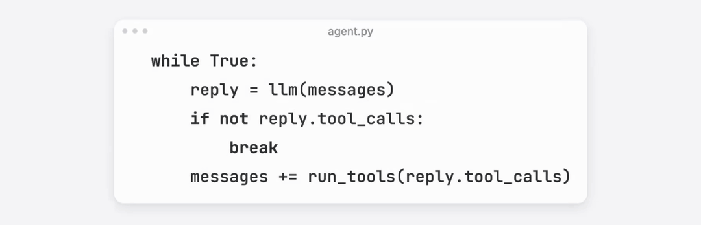

{/* truncate */}

## 一个 Agent 后端的工作流程

首先，让我们梳理一下一个 agent 后端的工作流程。第一步，开始一个新对话，或者继续之前的旧对话，然后收到前端发送的用户信息，接着将指令，可用工具，历史消息等信息组织成上下文，再将上下文发送给模型，收到模型回复。如果模型的回复中有工具调用，就另外调一次模型来审核工具调用是否合理。当然也需要另外组织一份上下文。接着，如果审核通过，就执行工具，并将执行结果，带着之前的上下文一起重新传给模型。如果审核不通过，就返回拒绝结果。

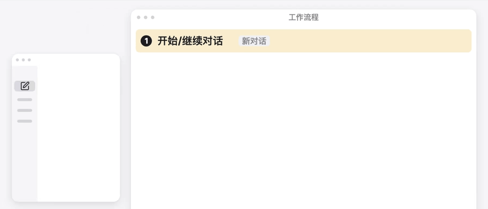

重复前面的步骤 3 到步骤 6，直到模型的响应中不再有工具调用，或者循环次数达到上限，就结束这轮对话，将信息返回给前端。这个过程中，每条信息产生的时候，都会做持久化存储。

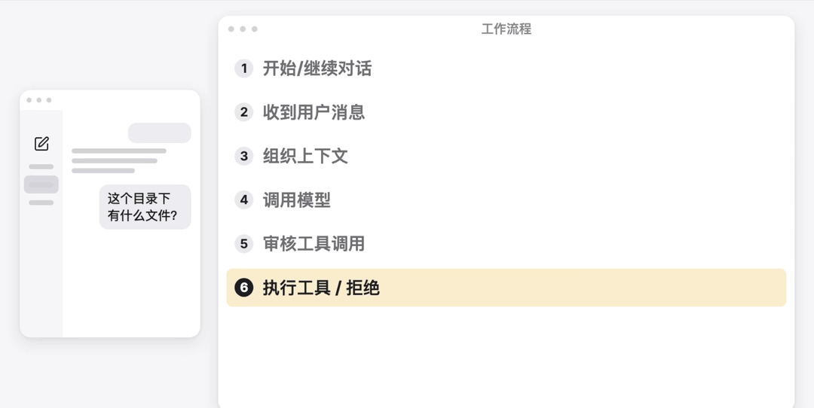

这个流程其实实现起来并不难。如果我们不带着任何设计去实现这个流程，大概就是一个函数负责其中一个步骤。但这样会让代码变得难以维护又难以测试。比如，想把使用的模型从 OpenAI 换成 Anthropic 的协议，得同时修改多个地方。又或者想要测试一下流程，却得真正调用模型，既花钱又很慢。

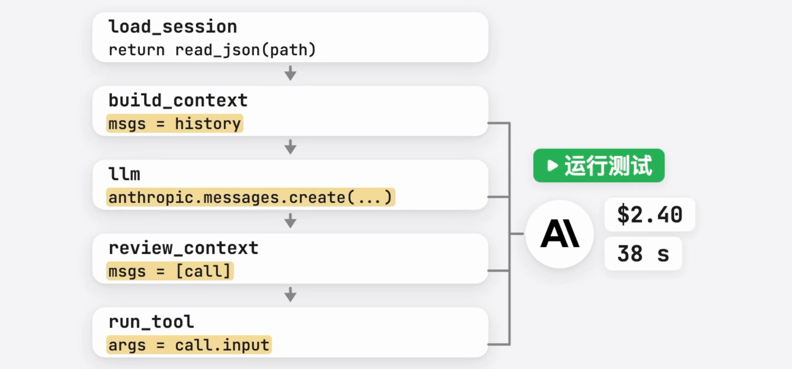

## 领域层、应用层与适配层

所以为了好维护，好测试，我们通常会将要做的事分为几层，每层都对应不同的工作性质。

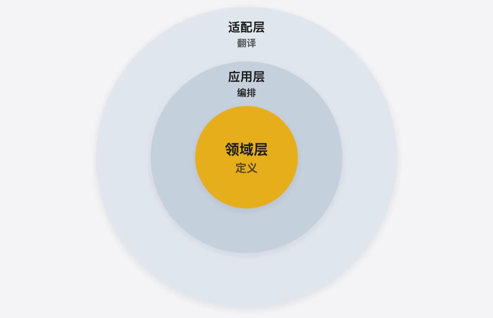

首先是领域层，它用来定义系统自己的语言。比如什么是对话，什么是工具，什么是上下文。每个系统都有自己对这些概念的理解。怎么定义这些概念，决定了这个系统会是什么样子的。

然后是应用层，将这些概念编排成完整的应用。它会调度领域层定义的各种概念，安排先做什么，后做什么，什么时候继续循环，什么时候结束。主要起到一个编排上的作用。

最后是适配层，适配层用于将系统外部的东西翻译成我们自己的语言。我们的系统需要使用外部的东西，比如外部的存储，外部的模型。而外部对概念的定义肯定和我们不一样。

举个例子，如果要存储对话，我们的对话是一个 `Session` 对象，而存到 JSONL 文件里是一行行的 JSON，存进数据库是表里一条条记录。我们需要做一个翻译的动作，才能让 `Session` 顺利地在我们的系统和外部之间流动。于是有了适配层。

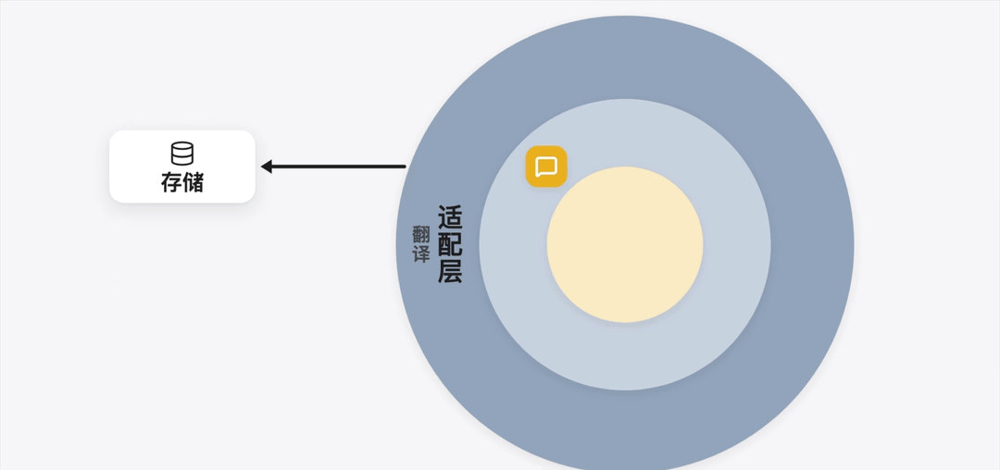

当我们要使用外部存储，它将我们的概念翻译成存储要用的格式。当我们要调用外部模型，它将我们的概念翻译成需要的参数，并将模型的回复翻译成我们定义的概念。

到这里，你应该有种感觉，就是适配层和应用层是为领域层而生的。的确如此，因为如何定义领域就是一个系统的本质。接下来我们看看都有哪些领域的概念，以及应用层和适配层要为这些概念做什么。

## 对话的定义与存取

首先我们需要定义对话，这是整个系统最重要的概念，因为整个系统的表现形式就是对话。在领域层，我们用一个叫 `Session` 的对象来定义对话。

那这个对象里面会装什么呢？首先是这次对话的 ID，方便我们之后复用这个对话。ID 的类型可以是字符串。然后是这次对话发送的信息 `messages`，类型是列表。因为信息会随着对话增长，所以我们需要一个方法来加入新的信息，于是有了 `append` 这个方法。

那么 `messages` 这个列表里面具体是什么呢？很容易想到有用户发的 `UserMessage`，和 AI 助手回复的 `AssistantMessage`。`UserMessage` 里面装文本，`AssistantMessage` 除了文本，还会有工具调用。

工具调用，我们定义一个 `ToolCall` 对象来包装，拥有 ID 和要调用的工具名称，以及调用工具的参数。既然对话里会记录工具调用，那调用工具的结果自然也要放入对话里。于是我们定义一个 `ToolResult` 对象，它需要拥有 `tool_call_id` 来说明是哪次工具调用的结果，以及 `content` 字段来说明调用结果。

那么 `Session` 的 `messages` 就是这三种类型：`UserMessage`，`AssistantMessage`，和 `ToolResult`。这样我们就完成了对话在领域层的定义。

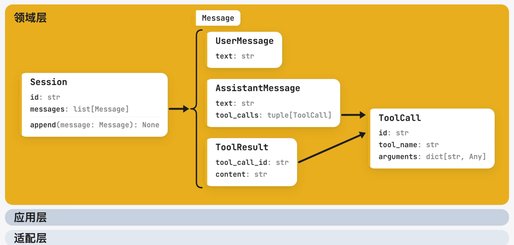

接下来是应用层，为了存取对话，我们需要定义一个 `SessionStore`，规定对话存储需要哪些方法，分别是列出对话，存对话和取对话等等。

我们之前不是说和外部的翻译，要放到适配层吗？怎么这个 `SessionStore` 放到应用层了？答案是 `SessionStore`，本身只是一个接口。它说明应用层需要什么。真正的实现放在适配层。

这样我们等会儿编排流程的时候，就可以直接依赖接口，而不用依赖具体的类。换技术实现的时候，会很方便。测试的时候，也可以换一个假的存储。这就是我们在[上一篇文章](/roadmap/前言/5分钟学会写架构设计)提过的依赖倒置。如果还是不太理解，没有关系，往后看，你会越来越理解这一点。

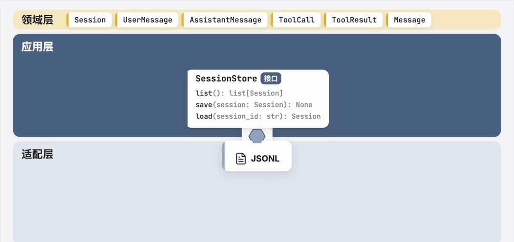

然后我们要在适配层实现 `SessionStore` 接口。我打算用 JSONL 来存对话，所以定义一个 `JsonlSessionStore`。相比起刚刚的接口，它多出了一个文件路径的字段。这样我们就完成了对话在领域层，应用层和适配层的定义。

## 工具与上下文

然后我们来定义工具。我们在组织上下文的时候，要告诉模型有哪些工具可用。同时在第六步，也需要执行工具。所以在领域层，我们用一个叫 `Tool` 的对象来定义工具。

模型需要指定工具，于是有了 `name` 字段。模型需要知道工具的用途，于是有了 `description` 字段。模型需要知道要传入什么参数，于是有了 `parameters` 字段。这些就够上下文使用了。

但别忘了，工具最重要的意义是它可以被执行。所以我们再加上一个 `execute` 方法，输入是模型返回的参数，输出是 `ToolResult` 里的 `content`。完成了工具在领域层的定义。适配层的具体工具直接实现它就行。我们来定义一个 `BashTool`，让模型能执行 Bash 命令。

搞定了工具，接下来我们来定义上下文。我们需要思考，调用模型时发送的上下文到底是什么？在领域层，我们用一个叫 `Context` 的对象来定义上下文。

上下文里，首先要有指令，告诉模型这次要做什么，遵守什么规则。然后是可用工具和历史信息。接着是输出类型，规定模型要返回什么样的对象。当然也还可以加入其他字段，比如说记忆，比如说 `AGENTS.md`，等等等等。我这个示范用例，我想尽可能简单一点，因此我们就只写这四种最基础的字段。

因为 `Context` 要用于不同的任务，输出类型也会不同。回复用户的时候，要的是 `AssistantMessage`。后面审核工具调用时，要的则是审核的结论。所以我使用了一个泛型来定义输出类型。这里我使用的是 Python 的泛型语法。如果你感兴趣的话，可以查看我之前的一期视频。

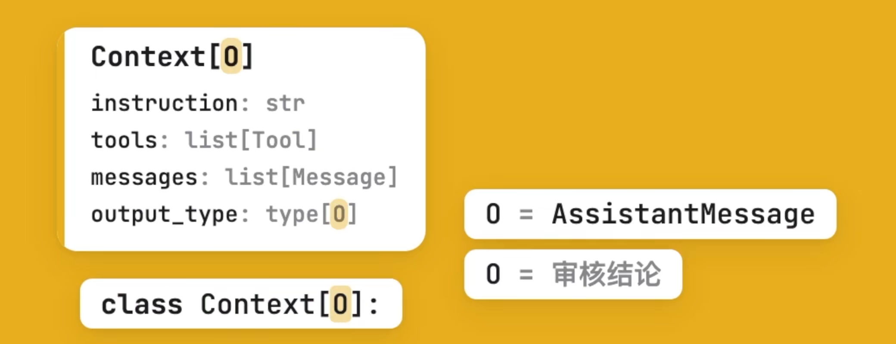

## 模型调用与协议翻译

那有了上下文之后，我们要怎么发给模型呢？和 `SessionStore` 一样，我们在应用层定义一个 `ModelClient` 接口，规定怎么调用模型，具体实现细节交给适配层。它只有一个方法，`generate`，传入 `Context` 和需要的模型参数，然后返回 `Context` 里 `output_type` 指定的类型。

模型参数指的是，用的哪个模型，思考多深，我们用一个叫 `ModelSettings` 的对象来包装。因为这两个参数总是成对出现，所以我将它们包在一起。这里的 `effort` 我们定义了六档，和实际的各个模型厂商会有差别，等会儿的适配层要进行翻译。

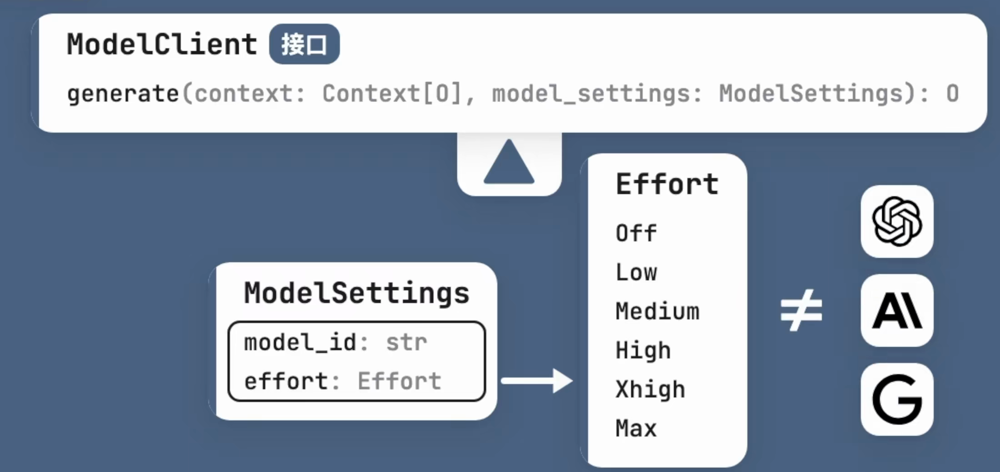

适配层我们实现三个主流协议，分别是 OpenAI，Anthropic 和 Google。这三家的请求格式都不太一样。就拿思考深度来说，在我们的系统里我们叫 `effort`，而 OpenAI 叫 `reasoning_effort`，Anthropic 叫 `output_config.effort`，Gemini 叫 `thinking_level`。所以我们必须有一个翻译的动作。之后如果出现了新的协议，再在适配层重新定义一个类即可。只要实现了 `ModelClient` 接口，我们的应用层都可以直接使用，而不用修改任何代码。

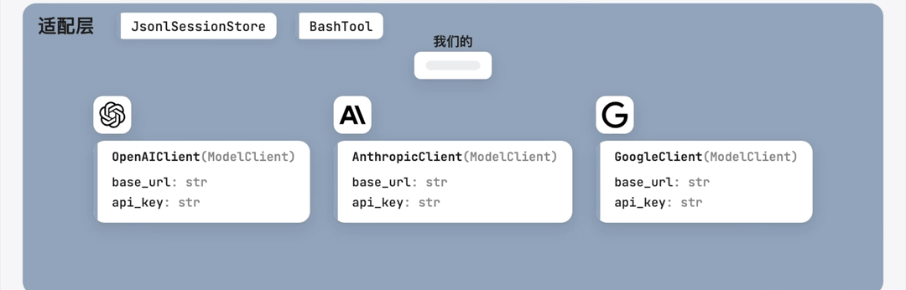

## 两个角色与审核结论

接下来的问题是，上下文是怎么产生的？回复用户和审核工具调用，这两次所需要的上下文并不一样。我们可以定义两个角色来包装这两次的上下文。

首先定义回复用户的角色，也就是产生 `AssistantMessage` 的角色，我们叫它 `Assistant`。它有自己的指令 `instruction`，和能用的工具 `tools`。它需要产生自己的 `Context`，输入是 `Session`，输出是一个 `Context` 对象，`Context` 里的 `output_type` 是 `AssistantMessage`。

然后是审核工具调用的角色，`ToolCallReviewer`，它有自己的指令 `instruction`，但不需要工具。同样有 `context` 方法，输入是 `Session` 和要审核的 `ToolCall`，输出一个 `Context`，`Context` 的 `output_type` 是 `Decision` 类型。这是我们新定义的一个类型，用来表示审核的结论。它应该包含两个东西，首先是这次调用能不能执行，然后是拒绝的原因。被拒绝时，这个原因会作为 `ToolResult` 的 `content` 交还给模型。

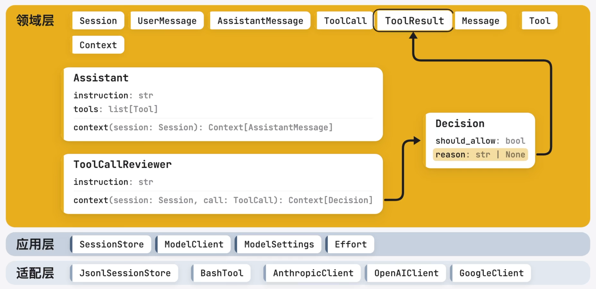

## AgentService 的流程编排

那么到这里，我们领域该定义的已经定义完了，我们可以编排整个流程了。在应用层定义一个 `AgentService` 来包装这个流程，它需要拥有 `ModelClient` 和 `SessionStore` 来使用外部服务。然后是两个角色 `assistant` 和 `reviewer`，还有两个角色各自的模型设置。这样两个角色就可以用不同的模型和思考深度。`reviewer` 可以考虑用一个更便宜更快的模型。最后是循环次数的上限 `max_iterations`，防止模型反复调用工具停不下来。

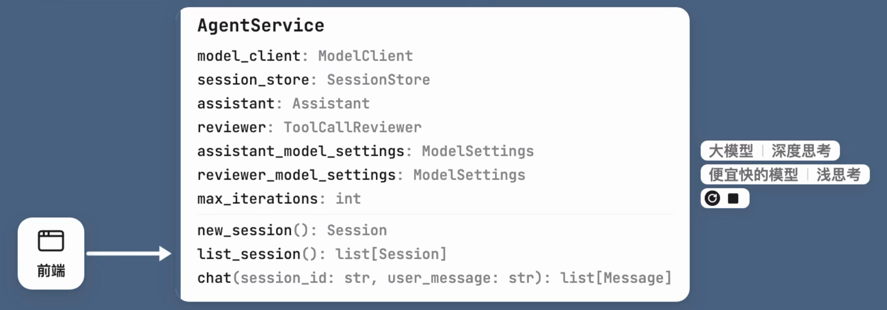

所有前端要调用的功能我们都需要在 `AgentService` 定义出来，像新建对话，列出对话和发送信息。至于这个前端是命令行还是网页，应用层并不关心，那是适配层该关心的事情。如果前端是网页，适配层就提供一个 HTTP 接口，将前端发来的请求转成对 `AgentService` 的调用。如果之后又新增了 CLI 的前端，就再新增一个适配器就可以了。

## 组装根与目录结构

写完了这三层，还差最后一步，把它们组装起来。现在各层还只通过抽象打交道，`AgentService` 只认识 `ModelClient` 和 `SessionStore`，不知道有 `AnthropicClient` 和 `JsonlSessionStore`。需要有一个地方把具体的类创建起来，接到一起。这个地方就叫组装根，也是启动服务的地方。它是整个系统里唯一知道所有具体类的地方。

以后换模型换存储，换入口，换任何具体实现，都只要改这一个文件。比如说我们想从 Claude 模型换成 GPT 模型，就只需要修改这一行。

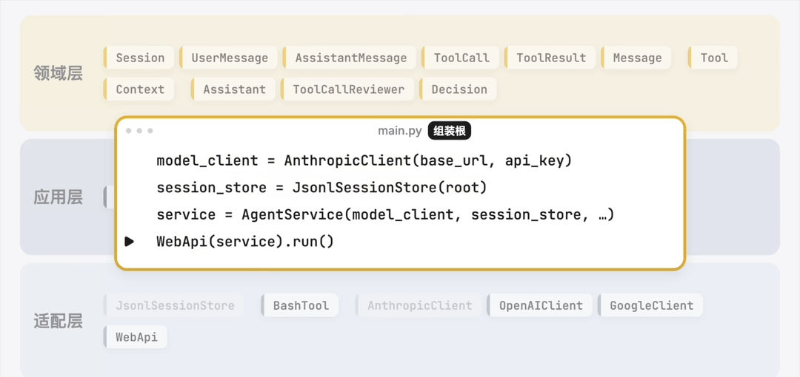

最后的目录差不多长这样。

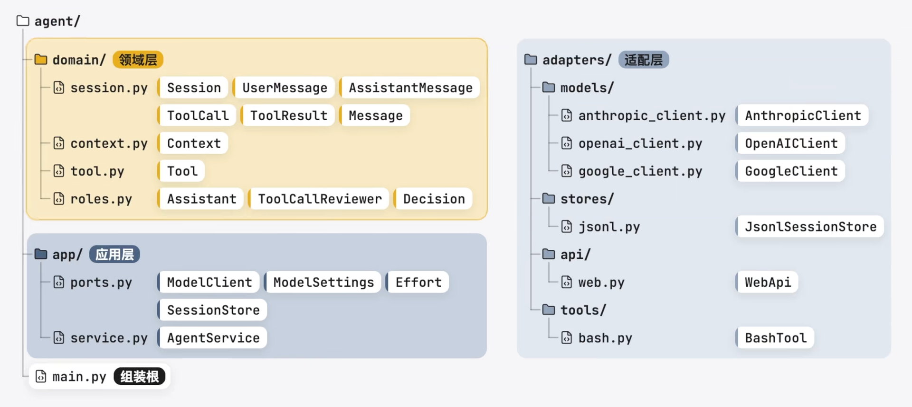

于是我们就完成了设计。

## AI 实现与设计思路

你可以把这一大堆我们的设计结论都放进和 AI 的对话框里，让它帮你实现。别忘了加上之前提过的 [TDD](/roadmap/前言/AI毁了我的代码直到我开始TDD) 的策略，让它写好测试再实现。当我们把接口都限定好了，AI 只需要实现功能，代码质量就绝对不会差到哪去。

看完这篇文章，你应该学会了一套设计思路，就是先梳理流程，建立一套系统自己的语言作为领域层。然后在应用层编排流程，外部服务在应用层定义接口，然后在适配层实现，最后在组装根把具体的类接起来。你可以将这一套思路用在任何系统上，而不只是 agent 的系统。

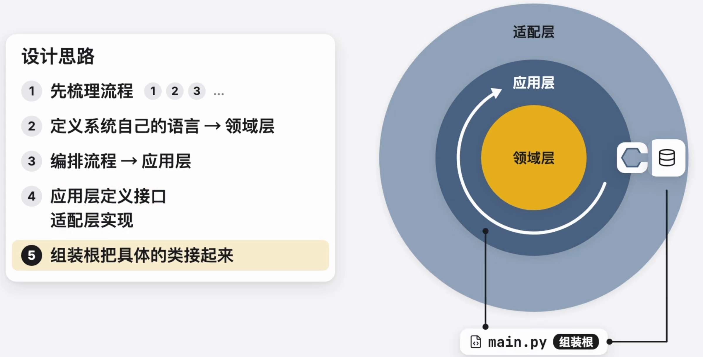

## 分叉对话与对话压缩的设计练习

如果你想继续沿着这个例子，锻炼自己的设计能力，我留下了几个现在流行的功能没有填进去。你可以尝试自己填一下，看看要怎么设计来完成。

首先是分叉对话。用户可以从一个已有对话的某条消息开始，分支出一个新的对话。新对话带着这条信息之前的全部历史，之后就各走各的互不影响。

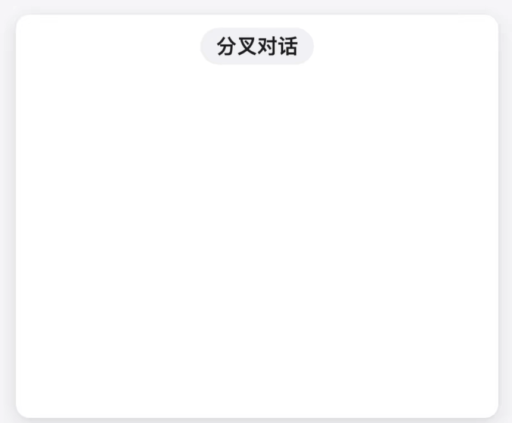

然后是对话压缩，对话越长，发给模型的上下文就越大，费用和延迟都会更高。压缩就是在对话变长之后，让模型把较早的消息总结成一段摘要。之后发给模型的就是这段摘要，加上最近的消息。

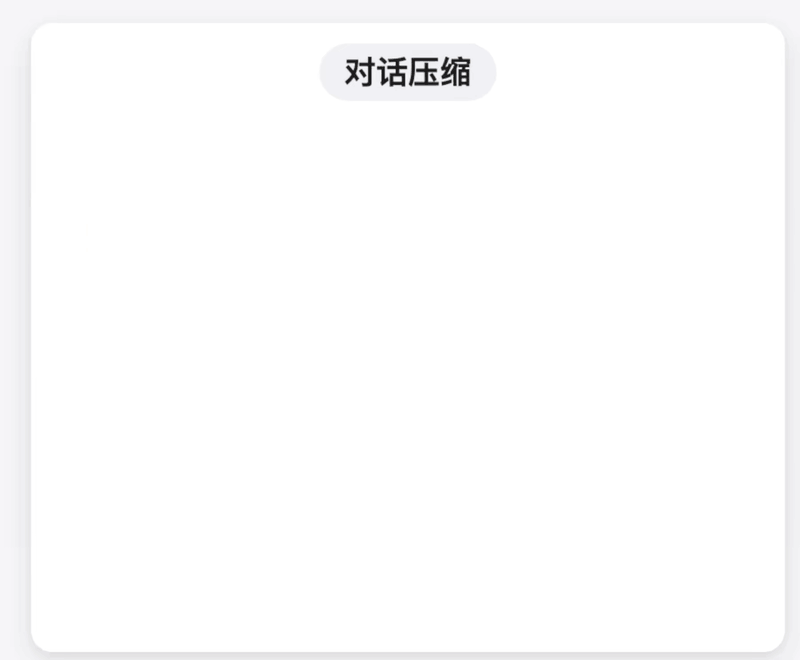

试试设计一下这两个功能吧。
