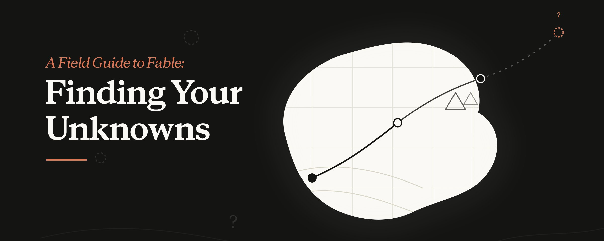

import Tabs from '@theme/Tabs';
import TabItem from '@theme/TabItem';



## 前言

不知道大家有没有和我一样的感觉，在和 Claude 或 Codex 的协作中，虽然我作为主要决策者，但是我时常感到空虚，我似乎没有得到技术的提升，当一个问题所有人都能让 AI 轻松解决，那我的竞争力到底是什么。

在未知领域中和AI协作，我发现，遇到问题和困难，始终是AI自己去面对，这样的情况对我来说很危险，我没有纠错学习的过程，没有自己思考的过程，没有对代码库的深入理解，只有看似参与的同意某个操作。

并且我不确定这么做是不是行业内的最佳标准，有没有更好的设计思路。

我很迷茫，这个奇幻的时代，应该怎么办。

我很幸运，这篇文章给出了完美的答案。

原文出自：[A Field Guide to Fable: Finding Your Unknowns](https://x.com/trq212/status/2073100352921215386)
{/* truncate */}

**文章的开头提到：**

和 Claude Fable 5 一起工作，让我一次次重新领会一个老道理：地图不是疆域。

地图描述的是要做的工作，也就是我交给 Claude 的提示词、<Term tip="Claude 的 Skills 功能：写好的一套说明和脚本，Claude 需要时会加载">技能</Term>和上下文。疆域是工作真正要发生的地方，也就是代码库和现实世界，连同它们的实际约束。

地图和疆域之间的差距，就是我说的未知因素。Claude 碰到未知因素时，就得尽量猜测我想要什么，再据此做决定。工作量越大，Claude 可能碰到的未知因素就越多。

Fable 是第一个让我有这种感觉的模型：工作质量的瓶颈在我，在于我能不能把它面对的未知因素讲清楚。

要注意的是，光靠提前规划并不总是够用。有些未知因素要到动手实施、做到很深的时候才会冒出来；还有些未知因素会让你意识到，手头的问题其实应该换一种完全不同的方式来解决。

我发现，和 Fable 一起工作，就是在实施之前、实施过程中和实施之后，反复发现自己的未知因素。

我做了一些用来发现未知因素的 <Term tip="Claude 做出来的成品文件，比如一个可以直接打开的 HTML 页面">artifact</Term> 示例，[放在这里](https://thariqs.github.io/html-effectiveness/unknowns/)。看完请一定回到这篇文章，这样才能建立直觉，知道什么时候该用它们。

## 了解你的未知因素

你的未知因素是什么？我带着问题找 Claude 时，通常会从 4 个方面来拆解这个问题：

- 已知的已知：基本上就是我提示词里写的内容。我告诉智能体，我想要什么？
- 已知的未知：哪些事我还没想明白，而且自己也清楚还没想明白？
- 未知的已知：哪些事对我来说太理所当然，我根本不会写下来，但一看到就能认出来？
- 未知的未知：哪些事我压根没考虑过？哪些知识我根本不知道？我知道一样东西最好能做到什么程度吗？

用智能体写代码最厉害的那些人，未知因素相对较少。看 [Boris](https://www.linkedin.com/in/bcherny) 或 [Jarred](https://www.linkedin.com/in/jarred-sumner-a8772425) 这样的人写提示词，我能明显看出他们清楚自己要什么，连细节都想好了。他们对代码库和模型的行为都了解得很透。

但他们也默认还存在未知因素。从很多方面看，减少未知因素、并提前为它们做好准备，正是用智能体写代码这门技能本身。好在这门技能可以练，和 Claude 一起工作就能提高。

## 帮助 Claude 帮助你

给 Claude 下指令，要把握好分寸。说得太具体，Claude 就会照着做，哪怕这时换个方向可能更合适。说得太模糊，Claude 往往会按行业最佳实践自己做选择、下假设，而这些做法可能并不适合你的任务。

如果没有把未知因素考虑进去，这两种错你都会犯：你不知道前面的路什么时候会障碍重重，也不知道什么时候路明明很顺，你却仍然希望 Claude 换个方向。

Claude 能帮你更快发现未知因素。它搜索代码库和互联网的速度极快，对一般话题的了解也比你多得多。失败之后，它也能更快调整、再试一轮。

在发现未知因素的过程中，最重要的是让 Claude 了解你的起点。比如，告诉它你想到哪一步了；说明你对这个问题和代码库有多少经验；然后让它像一起思考的伙伴那样和你合作。

我之前写过[使用 HTML 与 Claude 协作](/blog/html-effectiveness)的内容。在这类发现未知因素的场景里，把内容可视化、呈现出来的最好方式，几乎都是 HTML artifact。

本文接下来会详细介绍我用来找出这些未知因素的一些模式。这些技巧我不是每次都全用，但手里有这样一套，很有用。

## 实施前

### 盲区排查

开始工作时，最有用的做法之一就是了解自己的盲区。比如，你要在代码库里没接触过的部分写功能，或者要让 Claude 帮你做不熟悉的工作（如反复修改设计），这时你很可能有大量**未知的未知**。

<p><span style={{color: '#ff9900'}}>你可能不知道要问什么问题、不清楚理想状态该是什么样、不了解前人已做过哪些工作，也不明白该避开哪些陷阱。</span></p>

为此，你可以请 Claude 帮你找出“未知的未知”，并解释给你听。我喜欢在提示词里直接写“盲区排查”和“未知的未知”这两个词。告诉 Claude 你是谁、已经知道什么，通常也很重要。

示例提示词：

<Tabs groupId="prompt-lang">
<TabItem value="en" label="English">

```text
I'm working on adding a new auth provider but I know nothing about the auth modules in this codebase. Can you do a blindspot pass to help me figure out my relevant unknown unknowns and help me prompt you better.
```

</TabItem>
<TabItem value="zh" label="中文">

```text
我正在添加一个新的认证提供商，但对这个代码库里的认证模块一无所知。你能做一次盲区排查，帮我找出和这件事相关的“未知的未知”，也帮我把提示词写得更好吗？
```

</TabItem>
</Tabs>

<Tabs groupId="prompt-lang">
<TabItem value="en" label="English">

```text
I don’t know what color grading is but I need to grade this video. Can you teach me to understand my unknown unknowns about color grading, so that I can prompt better?
```

</TabItem>
<TabItem value="zh" label="中文">

```text
我不知道什么是调色，但我需要给这段视频调色。你能教教我，让我弄清楚自己在调色方面有哪些“未知的未知”，好把提示词写得更好吗？
```

</TabItem>
</Tabs>

### 头脑风暴与原型设计

有些工作涉及很多“未知的已知”，判断标准我要亲眼看到才说得出来。做这类工作时，我喜欢请 Claude 和我一起头脑风暴、做原型。

在做原型的早期就找出“未知的已知”并把它们说出来，价值极大，因为到实施阶段才发现，代价可能相对高昂。功能或规格上的一点小改动，可能让代码的写法完全不同，智能体要撤销之前的修改也可能更难。

比如，做原型时你可能只是想看看在界面上加一个按钮是什么样子，不用为此接后端路由，也不用在前端多维护一份状态。

视觉设计对我来说很难用语言说清楚，但一看到就知道自己想要什么。遇到这种情况，我会让 Claude 给同一个 artifact 出几种设计方案。

几乎每次开始编码，我都会先做一轮探索或头脑风暴。这样我一开始就能有意识地确定项目范围。Claude 常常能找到我自己会错过的高价值方法，但有时也会只见树木不见森林。头脑风暴能避免我把范围定得太窄或太宽。

示例提示词：

<Tabs groupId="prompt-lang">
<TabItem value="en" label="English">

```text
I want a dashboard for this data but I have no visual taste and don't know what's possible. Make me an HTML page with 4 wildly different design directions so I can react to them.
```

</TabItem>
<TabItem value="zh" label="中文">

```text
我想为这些数据做一个仪表盘，但我没什么审美，也不知道能做成什么样。请给我做一个 HTML 页面，放上 4 种截然不同的设计方向，我看了好给反馈。
```

</TabItem>
</Tabs>

<Tabs groupId="prompt-lang">
<TabItem value="en" label="English">

```text
Before wiring anything up, make a single HTML file mocking the new editor toolbar with fake data. I want to react to the layout before you touch the real app.
```

</TabItem>
<TabItem value="zh" label="中文">

```text
先别接任何真实功能。用假数据做一个单独的 HTML 文件，模拟新的编辑器工具栏。在你动真实应用之前，我想先看看布局、给出反馈。
```

</TabItem>
</Tabs>

<Tabs groupId="prompt-lang">
<TabItem value="en" label="English">

```text
Here's my rough problem: users churn after onboarding. Search the codebase and brainstorm 10 places we could intervene, from cheapest to most ambitious. I'll tell you which ones resonate.
```

</TabItem>
<TabItem value="zh" label="中文">

```text
我的问题大致是这样：用户走完新手引导后就流失了。请搜索代码库，头脑风暴出 10 个我们可以介入的地方，从成本最低的排到最有雄心的。我会告诉你哪几个让我有共鸣。
```

</TabItem>
</Tabs>

### 访谈

头脑风暴做够了之后，我很可能还是有未知因素。

这时，我会让 Claude 来访谈我，把未知因素和模糊的地方都问一遍。让 Claude 访谈你时，尽量把你手头问题的上下文告诉它，好引导它提问。下面是一些例子。

示例提示词：

<Tabs groupId="prompt-lang">
<TabItem value="en" label="English">

```text
Interview me one question at a time about anything ambiguous, prioritize questions where my answer would change the architecture.
```

</TabItem>
<TabItem value="zh" label="中文">

```text
就所有模糊的地方访谈我，一次只问一个问题。如果我的回答会改变架构，这样的问题优先问。
```

</TabItem>
</Tabs>

### 提供参考

有时你没法详细描述自己想要什么。比如，你可能缺少相应的术语，或者你要的东西太复杂，说清楚要花很长时间。

这种情况下，最好的办法是提供参考。你可以附上图表、文档或图片，但最好的参考无疑是源代码。

如果有个库用特定的方式实现了某个功能，或者有个设计组件你很喜欢，只要把所在的文件夹指给 Fable，告诉它该看什么就行，哪怕代码是用另一种语言写的。

Claude Design 也是这样工作的。你不必把文件交给它（当然也可以交）。你可以把它指向你喜欢的网站上的某个模块，它读的是底层代码，而不只是截图。这样它拿到的细节要丰富得多，包括 HTML 标记、结构，以及这个组件实际是怎么搭出来的。

示例提示词：

<Tabs groupId="prompt-lang">
<TabItem value="en" label="English">

```text
This Rust crate in vendor/rate-limiter implements the exact backoff behavior I want. Read it and reimplement the same semantics in our TypeScript API client.
```

</TabItem>
<TabItem value="zh" label="中文">

```text
vendor/rate-limiter 里的这个 Rust crate 实现的退避行为正是我想要的。请读一读，然后在我们的 TypeScript API 客户端里重新实现相同的语义。
```

</TabItem>
</Tabs>

### 实施计划

等我觉得可以开始实施了，我通常会让 Claude 写一份实施计划给我审阅。计划的重点放在最可能变动的部分，比如数据模型、类型接口或用户体验流程。这样 Claude 就能把我可能真正需要改动的地方提出来。

示例提示词：

<Tabs groupId="prompt-lang">
<TabItem value="en" label="English">

```text
Write an implementation plan in HTML, but lead with the decisions I'm most likely to tweak with: data model changes, new type interfaces, and anything user-facing. Bury the mechanical refactoring at the bottom, I trust you on that part.
```

</TabItem>
<TabItem value="zh" label="中文">

```text
用 HTML 写一份实施计划，开头先列我最可能调整的决策：数据模型的改动、新的类型接口，以及所有面向用户的部分。机械性的重构放到最后，那部分我信得过你。
```

</TabItem>
</Tabs>

## 实施过程中

### 实现说明

我对计划满意之后，会新开一个会话，把相关 artifact 都放进提示词。比如，我可能会放进一份规格文件和一个原型，然后让智能体照着实施。

但事实上，无论你规划得多周全，总有“未知的未知”藏在暗处。智能体干到一半，可能会在代码里发现一个边界情况，不得不换一种做法。

我会让 Claude Code 维护一个临时的 `implementation-notes.md`（或 `.html`）文件，记下它做的决定，这样我们下一次尝试时就能从中吸取经验。

示例提示词：

<Tabs groupId="prompt-lang">
<TabItem value="en" label="English">

```text
Keep an implementation-notes.md file. If you hit an edge case that forces you to deviate from the plan, pick the conservative option, log it under 'Deviations', and keep going.
```

</TabItem>
<TabItem value="zh" label="中文">

```text
维护一份 `implementation-notes.md` 文件。如果遇到边界情况，不得不偏离计划，就选保守的做法，把这件事记在“偏差”一节下，然后继续。
```

</TabItem>
</Tabs>

## 实施后

### 推介与说明

交付一样东西时，最重要的环节之一是争取别人的支持和审批。在最终文档里加上推介和说明这两类 artifact，有两个好处：

- 评审者一开始的未知因素和你当初一样时，能让他们更快看懂
- 专家想确认你考虑过他们预料得到的未知因素和常见失败点时，能让审批更快通过

示例提示词：

<Tabs groupId="prompt-lang">
<TabItem value="en" label="English">

```text
Package the prototype, the spec, and the implementation notes into a single doc I can drop in Slack to get buy-in. Lead with the demo GIF.
```

</TabItem>
<TabItem value="zh" label="中文">

```text
把原型、规格文件和实现说明打包成一份文档，我好直接发到 Slack 上争取大家支持。开头放演示 GIF。
```

</TabItem>
</Tabs>

### 测验

一个长会话结束后，Claude 做完的事可能比我以为的多得多。光看代码 diff，我只能大致了解发生了什么，因为很多行为取决于现有的代码路径。

让 Claude 先给我一大堆上下文，再就这次改动考考我，能帮我弄明白到底发生了什么。只有满分通过测验，我才会合并。

示例提示词：

<Tabs groupId="prompt-lang">
<TabItem value="en" label="English">

```text
I want to make sure I understand everything that's happened in this change. Give me a HTML report on the changes for me to read and understand with context, intuition, what was done, etc. and a quiz at the bottom on the changes that I must pass.
```

</TabItem>
<TabItem value="zh" label="中文">

```text
我想确保自己理解这次改动里发生的所有事情。给我一份关于这些改动的 HTML 报告，让我读懂：上下文、背后的直觉、具体做了什么等等。报告底部附一份关于这些改动的测验，我必须通过。
```

</TabItem>
</Tabs>

## 这些做法如何串起来：发布 Fable

Fable 的[发布视频](https://x.com/ClaudeDevs/status/2064399512664526853)完全由 Claude Code 剪辑。视频剪辑对我来说是全新的领域，我绝不是专家。

所以我从自己知道的部分入手。我知道 Claude 能用代码剪辑视频、转录语音，但不确定准确度够不够。于是我请 Claude 给我讲讲 Whisper 这类转录工具的原理，以及我能不能用 ffmpeg 精确剪掉“嗯”这样的语气词和长停顿。

我希望 Claude 做出来的 UI 能和我说的话对上时间，但不确定它能不能做到，于是让它用 <Term tip="用 React 代码生成视频的框架">Remotion</Term> 和转录文本做一段原型视频，看看行不行。

最后，视频本身看起来有点暗淡。我知道问题出在调色上，但其实并不懂调色是什么。我一开始想让 Claude 做几个不同版本让我挑，后来发现，调色做成什么样才算“好”，我根本不知道。于是我改让 Claude 教我调色，借此发现自己的未知因素。

你可以在[这里](https://x.com/trq212/status/2064826394589442448/video/1)看到这部分更深入的讲解。


## 地图与疆域相匹配

模型越强，方法对路时能做成的事就越多。如果一项跨度很长的任务交回来时做错了，很可能是你需要多花些时间明确未知因素，或者写一份实施计划，让 Claude 碰到这些未知因素时能随机应变。

说明、头脑风暴、访谈、原型和参考，每一样都是低成本的办法，能让你趁修复代价还不高，发现自己原本不知道的东西。

所以，开始下一个项目时，先让 Claude 帮你找出你的未知因素。