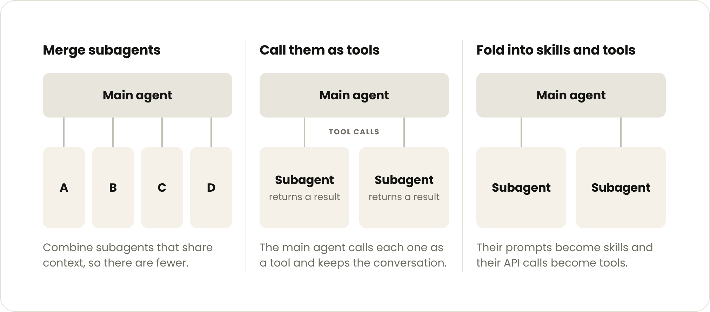

在 Claude Platform 上构建 Agent 时，少用子代理，改用渐进式披露的上下文和工具，往往能在提升质量的同时降低成本和延迟。本文讲什么时候该迁移、怎么迁移。

:::note
如果你在 Claude Platform 上构建的 Agent 包含多个子代理，可以用我们的[迁移工具包](https://github.com/anthropics/single-agent-loop-kit)看看其中哪些适合并入主 Agent 循环。它会以引导式工作流识别你在用的模式、评估替代方案，并验证哪种做法最好。工具包还附带一个演示，你可以先在模拟系统上试一试，再用到自己的 Agent 上。
:::

{/* truncate */}

子代理是拥有独立上下文窗口、工具和指令，[由协调者统一编排](https://claude.com/resources/articles/multi-agent-coordination-patterns)的 Agent，是 Agent 设计的核心组件。它们擅长做验证、并行处理和模块化的权限管理。我们自己用 Claude Platform 构建的很多 Agent 都用到了子代理，比如我们的[多 Agent 研究系统](https://www.anthropic.com/engineering/multi-agent-research-system)。

不过，Applied AI 团队最近发现了一个规律：不少企业的 Agent 部署，在把路由器、规划器和领域子代理并入主 Agent 循环之后，效果都变好了。[在我们对多个企业部署的比较中](https://claude.com/resources/articles/the-anatomy-of-effective-commerce-agents#:~:text=In%20our%20comparisons%20across%20several%20enterprise%20deployments,latency%20per%20task)，[带技能的单 Agent](https://claude.com/resources/articles/building-agents-with-skills-equipping-agents-for-specialized-work) 在质量上经常胜过“一个提示词包揽一切”的设计和子代理设计，而且每个任务的成本和延迟往往还更低。

举个例子，有一家公司发现，自家面向客户的 Agent 里有十几个专家子代理，品牌体验因此很难保持一致，增加的延迟也拖累了用户体验。

我们还经常看到一类 Agent 设计方案，沿着一条熟悉的路径层层叠加：意图分类器、固定的多步推理流水线、用户分群、各自独立的推荐分支，最上面再加一个多 Agent 编排器。

这种时候，反馈往往是：这些结构大多在替模型做它早已不需要别人代劳的事；一个清晰的系统提示词、4–5 个轻量的数据工具，再加上严格的输出护栏，就能覆盖大部分用例。

需要说明的是，子代理仍然有它的用武之地，在研究前沿也是如此。遇到下面这些情况时适合用子代理：

- 单个 Agent 循环因为上下文膨胀，出现了可以测量的性能下降；
- 多个任务需要并行处理，每个任务都用一个全新的上下文窗口，做完就可以丢弃；
- 单个 Agent 很难选对工具，或者系统提示词里有相互冲突的指令。

但我们太常看到企业给每个团队、每类问题都配一个子代理，最后 Agent 架构成了组织架构图的翻版（康威定律在起作用）。

本文结合我们在大型组织里构建 Agent 积累下来的最佳实践，讲讲什么时候该考虑把子代理并入主 Agent 循环。

## 大型组织构建 Agent 的常见失败模式

企业常常想构建一个 Agent，把多个产品和能力统一到同一个面向客户的界面里。

每项能力通常归不同的团队负责，所以企业一开始会让各团队各自构建自己的 Agent，再由一个中央平台团队在上面搭一个编排器。具体结构可以有好几种，比如编排器加子代理，或者由单个 Agent 把特定的 Agent 当作 MCP 工具来调用。

这看起来是最简单的方案，却会立刻在下面几个方面带来复杂性：

- **上下文管理**：你得决定 Agent 之间交换哪些上下文，而细节常常在来回传递中丢失。
- **子代理泛滥**：每个团队都交付自己的子代理，最后企业手里有几百个功能重叠的子代理，既没有强制执行的标准，也没有明确的负责人。
- **“缝合怪”提示词**：每个团队都往系统提示词里加一句话，结果规则相互冲突，口吻也不统一。
- **未经审核、过于局部的评测**：每个人都加自己的评测，而且都针对自己的子任务过度优化。没有人负责或维护整套评测，管理层只能依据被稀释、过于局部的分数做决策。
- **延迟**：多 Agent 架构的复杂性会增加延迟。有一位客户把自己的多 Agent harness（包裹模型的运行框架，负责拼装上下文、执行工具、把结果送回模型；下同）和单 Agent 循环做了对比，发现后者的运行速度大约快了一倍。

## 用渐进式披露的 Agent 循环

上面说的编排器加子代理设计，用来协调各团队分别构建的专家 Agent 是合理的，但更有效的做法往往是**通过技能渐进式披露上下文**，**通过工具搜索渐进式披露工具**。也就是说，Agent 平时只看到技能和工具的简短描述，真正需要时才完整加载。

这种做法行得通，有三个原因：

- **共享上下文带来更好的回答**：对于长时间运行的 Agent，我们希望多个不同任务的上下文都留在主上下文窗口里。一个看过前面每一步结果的 Agent，能把这些结果串起来，得出的输出更丰富、洞见更深，胜过子代理交回来的一堆摘要。这也意味着[更少的上下文窗口，更少有损的交接](https://claude.com/resources/articles/building-multi-agent-systems-when-and-how-to-use-them)。
- **渐进式披露避免了上下文膨胀**：有了这种技术，团队就能构建一个能完成各种任务的单 Agent，而不必一开始就把全部上下文塞进一个冗长的系统提示词。团队过去把工作拆给子代理的主要原因，也就不存在了。事实上，我们[为更先进的模型把 Claude Code 的系统提示词削减了 80% 以上](https://claude.dev/blog/the-new-rules-of-context-engineering-for-claude-5-generation-models/)，其中就有一部分是改成渐进式披露技能和工具后删掉的。
- **模型能力更强了**：从 Opus 4.5 开始，模型在单个循环里能处理的事情，就远远超出了大多数团队的预期。Opus 5.5 和 Fable 5.1 无法关闭思考，新近的模型也越来越多地边做边汇报进度、边做边检查，这让 harness 里的一些部分变得多余。每一代新模型都让你能把更多决策从 harness 挪到模型自己身上。循环越简单，也越容易迁移到下一代模型；在我们帮客户做过的迁移中，阻碍新模型多承担工作的，往往正是僵硬的多 Agent 结构。

单 Agent 循环设计需要自律：精心管理的系统提示词，能在合适时机触发的技能和工具描述，以及对上下文窗口、记忆和笔记的刻意处理。本文后面几节会深入讨论迁移和设计上的考量。

应该由一个中央团队负责端到端质量和系统提示词，每个新工具、新评测上线前都由它把关。让这个中央团队保持精简，能让迭代保持快速，也能降低大型组织里的协调成本。

如果你选择走多 Agent 路线，就从可能行得通的最简单模式开始（生成器-验证器、编排器-子代理，或者其他模式）。要划好边界，就**按上下文来拆：交给每个子代理的工作，应该很少依赖系统的其他部分，并让它交回一个精简的结果**（合适的候选有相互独立的研究方向、接口清晰的独立组件，或者黑盒验证）。如果按问题类型拆分 Agent，它们就会玩起“传话游戏”，信息来回传递，每交接一次就失真一分。

## 如何把子代理并入主 Agent 循环

很多团队已经有一个编排器和一组专家 Agent 在生产环境中运行。下面是我们建议逐步走向的单循环设计：

- 一个模型、一个上下文窗口，运行一个开放式的工具循环，由 harness 设定限制（轮次和成本预算、写操作关卡）。
- 每一轮，模型发出一批工具调用。harness 并行执行这些调用，把原始结果返回给同一个模型，由它决定下一步：再发一批调用、向用户提问，或者给出回答。
- 模型给出回答或者触及[预算](https://platform.claude.com/docs/en/build-with-claude/task-budgets)时，循环停止。回答之后还可以选择再跑一次目标检查或验证器检查。
- 模型在第一轮就把计划写进上下文，并随着结果陆续返回不断修订。这是和编排器加专家 Agent 架构相比最主要的变化：写计划的模型同时也是执行计划的模型，所以它能在一轮中途修改计划。
- 上下文照样会加载，只是改由 Agent 自己管理：
  - 不再需要一个按规则目录改写计划的代码步骤，因为每一步都由模型决定。
  - 执行顺序和领域流程移到**技能**里。
  - 硬性限制（校验、审批关卡）以及对话中途出现的其他需求（比如查询记忆）移到**工具**里。
  - 代码仍然可以用来加载成本低、又几乎总是用得上的内容（比如实体解析步骤），也可以在循环调用的工具内部处理机械性的部分（构造请求体、解析流、恢复一次澄清）。

这种单循环设计也有助于实现很多团队正在追求的最终状态：一个理解用户的高层目标、能代表用户行动的 Agent。因为它把 Agent 学到的一切都保留在同一个上下文里。

下面的建议讲的是，团队怎样分阶段从多 Agent 系统走到单 Agent 循环，以及多个团队在这个过程中怎样持续为这个 Agent 出力。

### 任务完成度评测

第一步是建一套评测集，帮你判断是否应该把某个子代理并入主 Agent 循环。我们见过行之有效的评测结构是：一套由中央团队负责的共享端到端评测集，再加上各技能的负责团队随技能一起交付的小评测集。哪怕只有 10 个黄金样例，也足够起步。

对照评分细则给 Agent 的最终消息打分，是追踪回答质量的好起点。还保留着编排器的时候，你还应该追踪路由准确率（它选对子代理了吗？）。某个子代理并入之后，就改为检查 Agent 有没有加载正确的技能、调用正确的工具。随着时间推移逐步做到任务完成度评测会很有帮助，因为比较不同架构时，最要紧的就是这一点。

如果内部系统难以回放、用户交互难以模拟，这件事就会比较复杂。我们内部用过一个行之有效的办法：给重要事件记下时间戳，之后就能回放这些事件，作为针对性的评测来运行。

### 逐步减少子代理

走向单 Agent 循环，就是把子代理逐步并入工具和技能。具体有三种做法：合并领域子代理、把子代理当作工具来调用，或者用技能和工具取代子代理。

### 合并领域 Agent

第一次合并之前，先建一个小的端到端评测。然后**按共享上下文来合并，从使用最多的子代理开始。**

[合并](https://claude.com/resources/articles/building-multi-agent-systems-when-and-how-to-use-them)这样的专家：会串联使用彼此的输出、操作同一份数据，或者经常被一起调用。比如，生产流量里有相当一部分都是先调用一个专家、紧接着调用另一个，那这就是一对紧密耦合的专家，适合合并成一个领域 Agent。

### 把子代理当作工具调用

如果前面说的三个条件之一成立，你决定保留某个子代理，那么让主 Agent 把子代理当作工具来调用会很有效，这样主 Agent 就能继续主持和用户的对话。

只有子代理需要直接和用户对话时，我们才建议完全移交，也就是让子代理接管对话。其他情况都可以做成主循环里的技能加工具。

这样做以后，你可以给子代理定义统一的响应结构，由主 Agent 对照真实数据核验它们的结论，并精简最后综合步骤的输入。这是很好的第一步，因为你不需要**重写**子代理。它还能让你在决定把任何子代理并入主 Agent 之前，先在任务完成度评测上拿到一个**基线**。

不过，有些失败模式依然存在：

- 每个专家都有自己的提示词、上下文、负责团队和评测
- 每次调用交回的仍然是有损的摘要
- 每次调用都是一个嵌套的模型循环，会增加延迟

### 通过技能和工具把子代理并入主 Agent

一次只并入一个子代理：把它的提示词变成技能，把它的 API 调用变成 MCP 工具。比较有它和没有它时的评测表现，再决定保留哪一种。

比较的时候别只看最终分数，还要看哪些任务的结果翻转了。我们在一个示例客服 Agent 上测试时，把一个子代理并入另一个之后，延迟降低了，却也弄坏了一个原本能通过的流程：主 Agent 手里拿着订单查询工具，就自己回答了，没有去问物流专家要送达日期。

每次改动之前，都要确保评测里覆盖了生产环境中每一条会一起运行的 Agent 链路，以及 Agent 绝不能违反的每一条规则；每个任务也要跑不止一次，因为像这样的问题，在两次运行里只出现了一次。

## 多个团队如何共建同一个 Agent

领域推理可以从知识库、技能和 MCP 工具中获取。各个团队可以把自己负责的对象从 Agent 换成技能和工具，再由一个小型中央团队继续负责系统提示词和端到端质量，包括在新技能、新工具和新评测上线之前把关。

### MCP 工具

当 Agent 需要执行操作、从系统读取实时数据，或者按固定格式返回结果时，适合用工具。迁移期间，你也可以借助工具继续调用子代理。我们建议按用户意图给工具分组（而不是一个 API 对应一个工具），因为系统提示词里的工具定义一旦超过 30–50 个，工具选择的准确度往往就会下降。

用带延迟加载的[工具搜索](https://platform.claude.com/docs/en/agents-and-tools/tool-use/tool-search-tool)，尽量少设硬性前置条件，必须有的前置条件就挪进工具里。比如 Y 需要 X 的输出，那就让 Y 的工具检查这一点，并返回一条模型可以照着做的指令。按用户区分的权限也是同样的做法：每个工具检查调用它的用户能看到什么、能做什么，并返回一条模型读得懂的简单拒绝信息。这样一个循环就能服务权限各不相同的用户，不必为每个权限级别单独配一个 Agent。

### 技能

当 Agent 需要知道某个团队是怎么做事的，比如原先写在专家子代理提示词里的步骤、规则和判断标准，就适合用技能。

我们扩充技能库的思路，是把维护工作交还给编写技能的人。重活可以交给 Claude 来干，用能够构建、测试和精简其他技能的技能来完成。

为了防止技能泛滥，可以让每个团队的 DRI（直接负责人）负责自己的技能，确保它们写得好、彼此不重复，并且附带合适的评测。

- **/skill-creator** 可以帮你编写一开始就结构良好的新技能，也可以审查已有技能，对它们做精简、去重和重组。
- **/skill-doctor** 可以让你看到技能库里每个技能的成本和实际使用频率，把没用的删掉。

### 知识库

知识库适合存放 Agent 只是偶尔才用得上的参考资料。事实和参考资料（政策、指标定义、产品规格）可以放在一个供模型调用的搜索或查询工具后面，也可以作为参考文件随技能一起交付。避免[用代码检索这些上下文，再贴进提示词](https://claude.com/resources/articles/seeing-like-an-agent)。

## 加速这项工作的工具

我们最近[发布](https://code.claude.com/docs/en/commands)了一组 Claude API 技能，上面提到的大部分工作都可以借助它们来完成。我们的[迁移工具包](https://github.com/anthropics/single-agent-loop-kit)把这些技能串成一个引导式工作流，用来评估多 Agent 系统，并把它迁移到单 Agent 循环。工具包附带一个演示，你可以先试一试，再用到真实系统上：

- **/claude-api build-eval**：帮你建立第一套由中央团队负责的端到端评测集，或者各团队随技能交付的小评测集。
- **/claude-api prompt-audit**：在你的提示词、技能和工具描述里标出为旧模型写的指令，并以 diff 的形式给出修改建议。你可以用它检查系统提示词，找出那些当初为早期模型添加、如今反而让 Agent 变慢或变死板的规则。各团队的 DRI 也可以用它检查自己的技能和工具描述。
- **/claude-api hillclimb**：对照已有的评测，迭代改进应用。可以用它做“并入还是保留”的比较（把一个子代理并入技能加工具之后，让它迭代技能和工具描述，看并入后的版本能否追平甚至超过原来的子代理），也可以用它改进系统提示词。
- **/claude-api cost-optimize**：分析你的调用都花在了哪里，并从提示词缓存、削减不必要的输入输出 token、effort 设置和模型选择等方面提出节省方案，一次只改一处。它能帮你在既定的设计上降低成本和延迟。

随着模型不断演进，我们对如何用好模型的理解、关于最佳实践的建议也在跟着演进。所以，任何一种具体的架构，都不如它背后的原则重要：先衡量，一次只改一处，留下经得起检验的部分。

这里就是这样一个例子。模型能力越来越强，Agent 运行的时间越来越长，越来越多的子代理都可以变成技能和工具。不过你不必一步到位。先建一个小的端到端评测，并入一个子代理，只有并入后的版本得分更低时，才把它保留为子代理。然后照这个办法一个个来。

---

*参考文章：[Building agents: When to fold subagents into your main agent loop](https://claude.com/resources/articles/building-agents-when-to-fold-subagents-into-your-main-agent-loop)*
