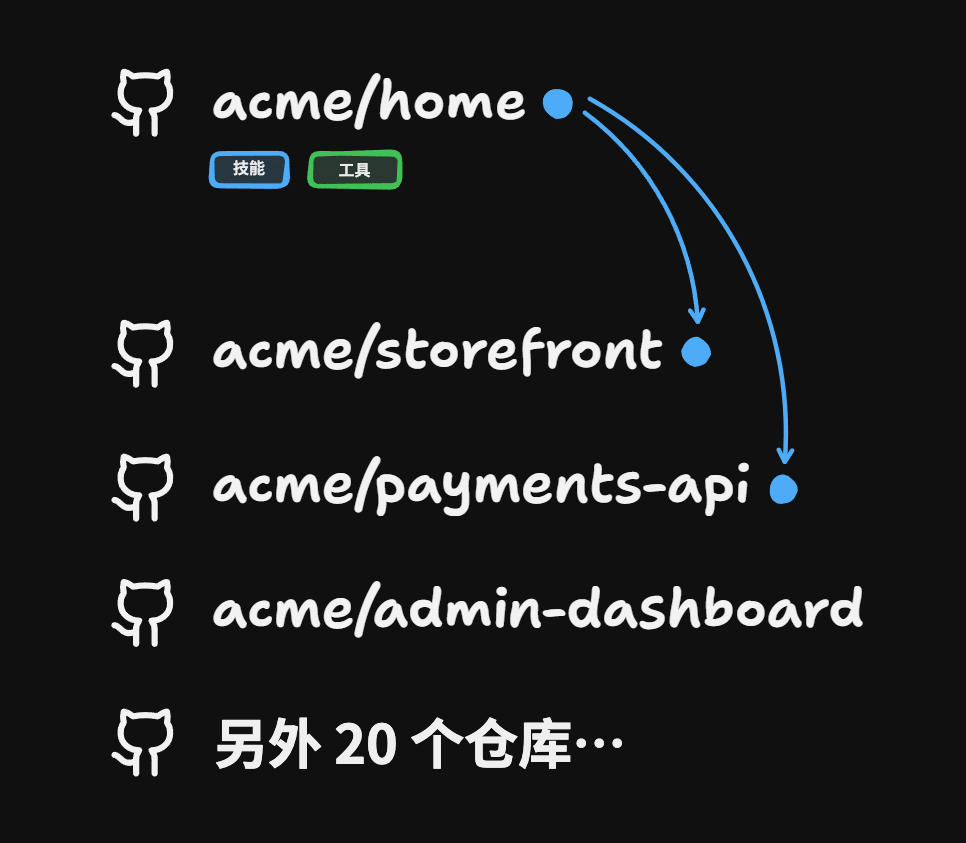

import Tabs from '@theme/Tabs';
import TabItem from '@theme/TabItem';

<Term tip="专门用来启动 Agent 的总仓库：放共用的技能和文档，再记下其他仓库在哪里">Home Repo</Term> 是一个仓库，里面放着你的<Term tip="Claude 的 Skills 功能：写好的一套说明和脚本，Claude 需要时会加载">技能</Term>、<Term tip="放在仓库根目录、编程 Agent 每次开会话都会先读的说明文件；Claude Code 读的是同类的 CLAUDE.md">AGENTS.md</Term> 和共用文档。你在 Home Repo 里运行 Agent。它的 AGENTS.md 给你的其他每个仓库各写一条<Term tip="AGENTS.md 里的一行文字，写明某个仓库在本地哪个路径、本地没有时从哪里克隆">导航指针</Term>，Agent 需要哪个仓库，就能打开或克隆哪个仓库。

{/* truncate */}

## 它解决什么问题

一个项目分散在几个仓库里时，在其中一个仓库里启动的 Agent 只看得到这一个仓库。于是每个仓库都得各存一份技能和 Agent 配置。要规划一个跨仓库的功能时，Agent 也看不到全貌，只能凭一个仓库的信息动手。

Home Repo 给你带来：

- 一个地方，放你所有的<Term tip="写给 Agent 看的说明文件，告诉它在项目里该怎么做事">引导文件</Term>和工具
- 一个地方，运行你所有的 Agent
- 在一次会话里，对多个仓库做大范围的修改



*Home Repo（这里是 acme/home）放着技能和工具，再用指针指向其他仓库。*

## 动手搭一个

在存放你各个仓库的那个文件夹里，给编程 Agent 开一个新会话，把下面这段提示词粘贴进去。Agent 会自己找出你的仓库和其中的技能，再分几轮<Term tip="Agent 反过来一轮轮向你提问，直到计划里每件要你定的事都有答案">盘问</Term>你，把要做的决定都问清楚；在你批准它的计划之前，它什么都不改。

<Tabs groupId="prompt-lang">
<TabItem value="en" label="English">

```markdown
Set up a Home Repo with me: one git repo that holds my shared skills,
AGENTS.md and shared docs, and points at my other repos. I'll run my agent
from it.

## How to work

- Look up every fact yourself (filesystem, git, gh), using subagents for
  wide searches. Bring me only decisions.
- Put decisions to me in rounds. Number each question, give your
  recommended answer, and word it so "yes" accepts it. A question that
  depends on one still open waits for a later round.
- Until I approve the plan in Step 3, only read.
- Secrets stay where they are: leave .env and other secret files unread.

## Step 1: Inventory the repos

Find every git repo under my home directory, skipping dependency folders.
For each, record its path, remote, visibility (public or private) and
last commit date.

In the first round, ask:
- which repos the Home Repo points at (recommend those with recent commits)
- where it lives, and whether it's new or an existing repo (recommend a
  new private repo beside the others)
- whether it's personal or shared with a team
- which file my harness loads at session start: AGENTS.md, CLAUDE.md or
  both (recommend what my setup shows)

Done when every repo found is marked in or out, and the other three
questions are answered.

## Step 2: Inventory the shared material

Across the chosen repos and my user-level skill folders (such as
~/.claude/skills), list every skill (a folder with a SKILL.md), every
AGENTS.md and CLAUDE.md, and every doc written for agents: coding
standards, glossaries, ADRs.

Sort each item into one bucket:
- shared: true across repos
- duplicate: the same item in several places; diff the copies and mark
  the newest
- repo-specific: about one repo's code, commands or domain
- installed: from a published skills repo or marketplace

Done when every item sits in exactly one bucket.

## Step 3: Agree the plan

Show a table of every item, where it is now, and its destination:
- shared and duplicate: move to the Home Repo, one copy, newest version
- repo-specific: stays in its repo
- installed: stays installed

Under it, show the Home Repo's AGENTS.md: a short intro, then an
"Other Repos" section with one pointer per repo:

  <name> (<what it is>): <local path>. Clone from <remote> if missing.

Add a hint where a repo needs one, such as "read its AGENTS.md first".
Past about 20 repos, group the pointers into one file per area and point
at those files instead.

Settle open items in further rounds. Done when I approve the table and
the AGENTS.md.

## Step 4: Apply the plan

1. Create the Home Repo and its AGENTS.md. If my harness loads a
   different file, add that file as a one-line pointer to AGENTS.md.
2. Copy each shared item in, keeping skill folders whole.
3. In each child repo, on a new local branch, remove the copies that
   moved. Repo-specific material stays.
4. Commit in the Home Repo. Pushing is my call.

Done when every row of the table is applied. Report each row's outcome,
the branches you created in each repo, and anything you skipped, with
the reason.
```

</TabItem>
<TabItem value="zh" label="中文">

```markdown
和我一起搭一个 Home Repo：一个 git 仓库，放我共用的技能、AGENTS.md
和共用文档，并指向我的其他仓库。我会在这个仓库里运行 Agent。

## 工作方式

- 每个事实都自己去查（文件系统、git、gh），范围大的搜索交给子代理。
  只把需要我做的决定带给我。
- 分轮向我提问。每个问题编号，给出你建议的答案，措辞要让我回答“是”
  就等于采纳。如果一个问题取决于另一个还没定的问题，就留到后面一轮。
- 在我批准第 3 步的计划之前，只读不改。
- 机密留在原处：不要读 .env 和其他存放机密的文件。

## 第 1 步：盘点仓库

找出我主目录下的每个 git 仓库，跳过依赖目录。逐个记下它的路径、
远程地址、可见性（公开或私有）和最近一次提交的日期。

第一轮问我：
- Home Repo 指向哪些仓库（建议选最近有提交的）
- Home Repo 放在哪里，是新建还是用现有的仓库（建议在其他仓库旁边
  新建一个私有仓库）
- 它是个人用，还是和团队共用
- 我用的编程 Agent 在会话开始时加载哪个文件：AGENTS.md、CLAUDE.md
  还是两个都加载（看我的配置实际用的是哪个，据此给建议）

完成标准：找到的每个仓库都标明了纳入或不纳入，另外三个问题都有了答案。

## 第 2 步：盘点共用材料

在选中的仓库和我的用户级技能目录（比如 ~/.claude/skills）里，列出
每个技能（含 SKILL.md 的文件夹）、每个 AGENTS.md 和 CLAUDE.md，以及
每份写给 Agent 的文档：编码规范、术语表、架构决策记录（ADR）。

把每一项归入一类：
- 共用：各个仓库都适用
- 重复：同一项出现在好几处；对比各份副本，标出最新的那份
- 仓库专属：只和某一个仓库的代码、命令或业务领域有关
- 已安装：来自公开发布的技能仓库或技能市场

完成标准：每一项都恰好归入一类。

## 第 3 步：商定计划

列一张表，写出每一项、它现在在哪里、要去哪里：
- 共用和重复：移到 Home Repo，只留一份，用最新版本
- 仓库专属：留在原仓库
- 已安装：保持安装

表下面给出 Home Repo 的 AGENTS.md：先是一段简短的介绍，然后是
“其他仓库”一节，每个仓库一条指针：

  <名称>（<它是什么>）：<本地路径>。本地没有的话，从 <远程地址> 克隆。

某个仓库需要提示时就加一句，比如“先读它的 AGENTS.md”。仓库超过
20 个左右时，按领域把指针分组，每个领域写一个文件，改为指向这些文件。

剩下没定的事项在后面几轮里定。完成标准：我批准了这张表和这份 AGENTS.md。

## 第 4 步：执行计划

1. 创建 Home Repo 和它的 AGENTS.md。如果我用的编程 Agent 加载的是
   另一个文件，就再建一个那个文件，内容只有一行：指向 AGENTS.md。
2. 把每个共用项复制进来，技能文件夹整个复制。
3. 在被指向的每个仓库里新建一个本地分支，在这个分支上删掉已经移走的副本。
   仓库专属的材料保留。
4. 在 Home Repo 里提交。推不推送由我决定。

完成标准：表里每一行都执行完毕。报告每一行的结果、你在每个仓库里建的
分支，以及跳过了哪些事项、为什么跳过。
```

</TabItem>
</Tabs>

## 常见问题

### 放什么、不放什么

**Home Repo 里放什么？** 你在多个仓库都用的技能、带指针的 AGENTS.md、引导文件，以及共用文档，比如编码规范、术语表和影响整个系统的决策。最先值得共用的文档是编码规范：一套通用的规范可以在各个项目之间沿用。Home Repo 还可以放一个由 Markdown 文件组成的小 wiki，以及各种工具。

**每个仓库里留什么？** 只适用于这个仓库的东西：它自己的 AGENTS.md、它的构建和测试命令、它专属的文档。Home Repo 只用一条指针指向这个仓库。代码留在原处，每个仓库保留自己的提交历史、远程地址和 issue 跟踪。

**为什么用一个仓库，而不是把技能放在用户目录（`~/.claude/skills`）里？** 理想的最终状态是每个人都用同一套技能，而且这套技能放在项目里。用户目录只是到那一步之前的权宜之计。Home Repo 本身就是一个项目：它的技能用 git 做版本管理，团队也能共用。

**用 AGENTS.md 还是 CLAUDE.md？** 本文写的是 AGENTS.md。指针写进你的编程 Agent 在会话开始时加载的那个文件就行。Claude Code 加载的是 CLAUDE.md。

### 导航指针

**指针长什么样？** 每个仓库一行，写明是哪个仓库、它在哪里：

```markdown
要用这些技能，把 mattpocock/skills 克隆到 ~/repos/skills。
要用 Sandcastle，把 mattpocock/sandcastle 克隆到 ~/repos/sandcastle。
```

某个仓库需要提示时，就在它那一行加一句：

```markdown
## 其他仓库

Storefront（Next.js 应用）：~/repos/acme/storefront。本地没有的话，从 git@github.com:acme/storefront.git 克隆。
Payments API：~/repos/acme/payments-api。改它之前先读它的 AGENTS.md。
AI Hero：~/repos/ai/ai-hero（先 git pull 看最新版本，本地这份多半已经过时）
```

**Agent 是克隆仓库，还是用磁盘上已有的副本？** 两种都会。仓库已经在指针写的路径上，Agent 就在那里工作；不在，Agent 就把它克隆到那里。也有的做法是把这些仓库克隆到 Home Repo 里面，再在 Home Repo 的 .gitignore 里忽略这些目录，免得它们被提交进 Home Repo。

### 跨仓库工作

**会话从哪里开始？** 从 Home Repo 开始，而不是从某一个仓库里开始。规划跨仓库的功能、让 Agent 盘问你，也都在这里进行。

**worktree 和 Home Repo 怎么配合？** 每个仓库只克隆一次。每个功能在这份克隆里建一个 <Term tip="git worktree：从同一个仓库再检出一个工作目录，切到另一个分支，和原目录共用提交历史">worktree</Term>，这样几个 Agent 可以同时在同一个仓库里工作。

**issue 提到哪里？** 交给 Agent 决定就行：它能看到每个仓库的 issue，能把它们放在一起看，再把新 issue 提到最合适的那个仓库。

**团队能共用一个 Home Repo 吗？** 能。团队共用一个 Home Repo，每个人在里面运行自己的 Agent。

### 规模和其他做法

**能管多少个仓库？** 20 个左右，每个仓库一条指针没问题。到 400 个左右，几百条指针摆在一起，Agent 要做的选择就太多了。这时改用<Term tip="先只给 Agent 一份简短的目录，需要哪部分再打开详细内容">渐进式披露</Term>：每个业务领域指向一个文件，在那个文件里列出这个领域的仓库。

```markdown
## 其他仓库

计费（发票、支付、税务）：见 repos/billing.md
店面（网页和移动应用）：见 repos/storefront.md
内部工具：见 repos/internal.md
```

到了几千个仓库，要用这些技能的项目太多，改用<Term tip="集中发布技能的目录，各个项目从这里按需安装，比如 Claude Code 的插件市场">技能市场</Term>来分发技能更合适。

**要不要用 <Term tip="git submodule：把另一个仓库固定在某个提交，挂进当前仓库的一个子目录">git submodules</Term>？** 可以用。5 到 10 个仓库时，用 submodules 这类做法把它们挂进 Home Repo 没问题。不用 submodules，普通的指针也能起到同样的作用。

**Home Repo 和 <Term tip="把多个项目的代码放进同一个 git 仓库的做法">monorepo</Term> 是什么关系？** 条件允许时，monorepo 很合适。用不了时，就用 Home Repo 代替，比如你的仓库有公开也有私有，或者团队不愿意迁到 monorepo。

### 工具和 CI

**需要 CLI 之类的工具吗？** 不需要。刚开始时，AGENTS.md 里的指针加上你手头已有的工具就够了。以后，Home Repo 很适合放工具，比如一个把 Agent 连到外部服务的 CLI，它需要的环境变量也放在同一个仓库里。

**在 <Term tip="持续集成：每次推送代码后自动跑构建和测试的服务，比如 GitHub Actions">CI</Term> 里能用吗？** 能。比如在<Term tip="让 Agent 在隔离的容器或虚拟机里自动完成开发任务的整套流水线">软件工厂</Term>里，把 Home Repo 放进沙箱，Agent 照着里面的指针，按需克隆其他仓库。运行软件工厂的代码可以放在 Home Repo 里，也可以放在它指向的某个仓库里。

---

*参考文章：[The Home Repo Pattern](https://www.aihero.dev/the-home-repo-pattern)*
