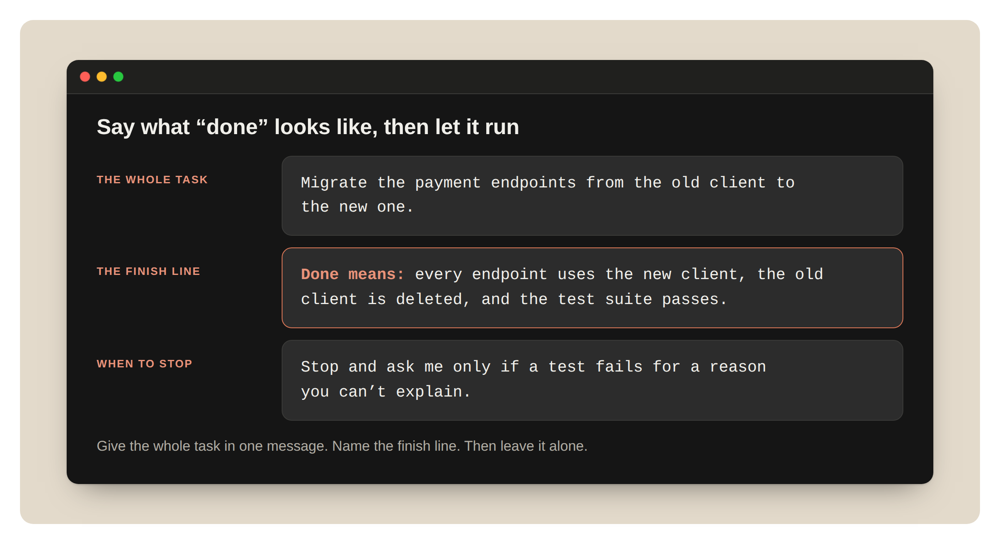
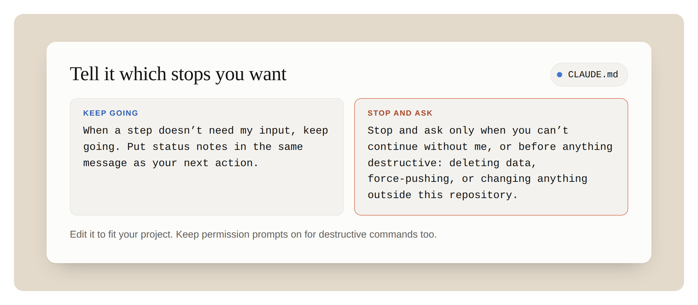
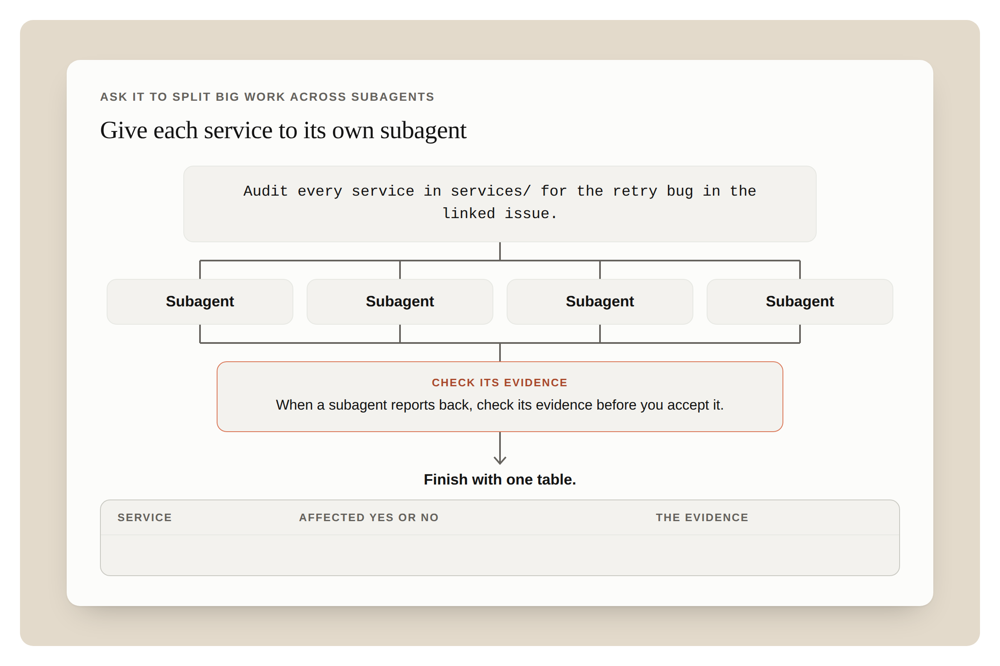
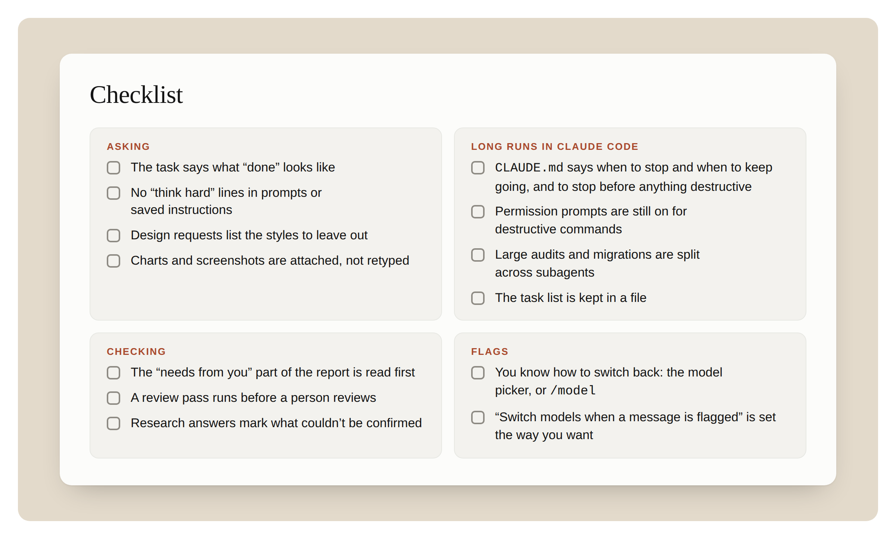

import Tabs from '@theme/Tabs';
import TabItem from '@theme/TabItem';

如何给 Opus 5.5 写提示词、引导一次长时间运行，以及在 Claude 应用和 Claude Code 中检查结果。

您现在怎么用 Claude，换成 Opus 5.5 后照样好用。不过，有几处表现不太一样：它能独立工作更长时间，会用平实的话告诉您它做了什么，并且每次回复前都会先思考。本指南介绍如何在 Claude 应用和 Claude Code 中与 Opus 5.5 协作，包括如何给它写提示词、如何引导长时间运行，以及如何检查结果。

{/* truncate */}

## 先试试这些

第一次使用 Opus 5.5 时，可以先试试这三件事：

- 把整个任务交给它。说清楚“完成”是什么样子，以及您希望它在什么时候停下来问您。然后放手让它做。
- 删掉“仔细思考”之类的语句。Opus 5.5 每次回复前本来就会思考。
- 长时间运行结束后，先看它需要您做什么。

## 1. 如何提问

### 说清楚“完成”是什么样子，然后放手让它做

**做法。** 在一条消息里交代整个任务。讲明终点线，比如“测试全部通过”或“每个接口都已迁移”。然后就让它自己干。

**为什么用 Opus 5.5 时要这样。** 面对耗时长、环节多的工作，Opus 5.5 比 Opus 5 更能一直做下去。与之前的 Opus 模型相比，它进步最大的是多步骤工作，比如在一个大型代码库里把一项改动一路推进，直到测试通过。早期测试者让它在几乎无人看管的情况下，连续几个小时跑长编程任务。有了清晰的终点线，它就知道做到哪里算完成。

**怎么做。** 以 Claude Code 为例：

<Tabs groupId="prompt-lang">
<TabItem value="en" label="English">

```text
Migrate the payment endpoints from the old client to the new one.
Done means: every endpoint uses the new client, the old client is
deleted, and the test suite passes.
Stop and ask me only if a test fails for a reason you can't explain.
```

</TabItem>
<TabItem value="zh" label="中文">

```text
把支付接口从旧客户端迁移到新客户端。
完成的标准是：每个接口都改用新客户端，旧客户端已删除，
并且测试套件全部通过。
只有当某个测试失败、而你又解释不了原因时，才停下来问我。
```

</TabItem>
</Tabs>



*图 A：一条消息，交代整个任务、终点线，以及何时停下。*

### 别再叫它“认真想想”

**做法。** 把“仔细思考”“一步一步思考”之类的语句，从您的提示词和保存的指令里删掉。

**为什么用 Opus 5.5 时要这样。** Opus 5.5 回复前总会先思考，想多少也由它自己决定。您不需要叫它思考。我们在一款聊天产品中测试时发现，删掉一行“仔细思考”之后，回复来得更快，质量也没有明显下降。

**怎么做。** 删掉这一行。如果只是想让它快速回答一个简单问题，就明说：“直接回答。”在 Claude Code 中，想调整它的思考量，改 effort 即可。

### 给正在运行的任务补充要求

**做法。** 如果中途想起了什么，可以趁它工作时直接输入补充消息。

**为什么用 Opus 5.5 时要这样。** 现在一次运行的时间更长，推倒重来的代价也更高。

**怎么做。** 在 Claude Code 中，趁 Claude 工作时输入消息并按回车，比如：“另外，把旧的接口名保留为别名。”

### 做设计时，列出您不想要的风格

**做法。** 让它做页面、应用或 artifact 时，列出您不想看到的那些惯用设计手法。

**为什么用 Opus 5.5 时要这样。** 如果不给设计方向，Opus 5.5 会套用几种默认风格。“避免千篇一律的样子”这类笼统的指令，多半只是让它从一种默认风格换到另一种。列出具体的样式，效果要好得多。

**怎么做。** 点名这些样式：

<Tabs groupId="prompt-lang">
<TabItem value="en" label="English">

```text
Build a personal website with placeholder content.
Don't use a cream or off-white background, italic accent words in
headings, numbered "01 / 02 / 03" section labels, monospace labels, or
pill-shaped buttons.
```

</TabItem>
<TabItem value="zh" label="中文">

```text
做一个带占位内容的个人网站。
不要用奶油色或米白色背景、标题里的斜体强调词、
“01 / 02 / 03”这样的编号章节标签、等宽字体标签，
也不要用药丸形按钮。
```

</TabItem>
</Tabs>

然后看看它改用了什么。如果还是不喜欢，就把它也加进清单，再让它做一次。

## 2. 在 Claude Code 中引导长时间运行

### 告诉它您希望在哪些地方停下

**做法。** 在 CLAUDE.md 文件里写一条简短的规则，说明什么时候该停下来问，什么时候该继续做。

**为什么用 Opus 5.5 时要这样。** Opus 5.5 工作时会不断向您汇报进展。在长任务中，它有时会停下来汇报，而不是接着往下做：给出一段总结，点出了下一步却没去做；主动问要不要继续；或者列出几个其实不影响工作推进的选项。只要指令里点名了这几种停顿，它就会遵守。您希望它在哪些地方停下，也一并写明。

**怎么做。** 把下面这段加进 CLAUDE.md，再按您的项目修改：

<Tabs groupId="prompt-lang">
<TabItem value="en" label="English">

```text
When a step doesn't need my input, keep going. Put status notes in the
same message as your next action.
Stop and ask only when you can't continue without me, or before anything
destructive: deleting data, force-pushing, or changing anything outside
this repository.
```

</TabItem>
<TabItem value="zh" label="中文">

```text
某一步不需要我参与时，就继续做。把进度说明和你的下一步操作
放在同一条消息里。
只有在没有我就进行不下去，或者要做破坏性操作（删除数据、强制推送、
改动这个仓库以外的任何东西）之前，才停下来问我。
```

</TabItem>
</Tabs>



*图 B：CLAUDE.md 里的规则：什么时候继续做，什么时候停下来问。*

如果运行停下来问“要我继续吗？”，就回复“继续”。如果经常这样，上面这条规则就能派上用场。

规则让它一直往下做，停顿自然就少了，所以在任何有风险或难以撤销的操作之前，要留一道您自己的检查。上面规则的最后一行就是起这个作用的。另外，破坏性命令的权限确认也要保持开启。

如果是结对编程，您可能想要相反的效果：开始前先给一行计划，结束时做个简短回顾。那就改在 CLAUDE.md 里这样写。两种写法 Opus 5.5 都会照做。

### 让它把大任务拆给多个子代理

**做法。** 在大型代码库里做审计、迁移或审查时，让 Opus 5.5 把工作分给多个子代理，并检查每一份结果。

**为什么用 Opus 5.5 时要这样。** 早期测试者曾让 Opus 5.5 在长时间的审计和迁移中协调多个并行子代理，几乎不需要人看管。

**怎么做。**

<Tabs groupId="prompt-lang">
<TabItem value="en" label="English">

```text
Audit every service in services/ for the retry bug in the linked issue.
Give each service to its own subagent. When a subagent reports back,
check its evidence before you accept it.
Finish with one table: service, affected yes or no, and the evidence.
```

</TabItem>
<TabItem value="zh" label="中文">

```text
针对关联 issue 里的重试 bug，审计 services/ 下的每一个服务。
每个服务交给一个单独的子代理。子代理汇报回来时，
先核查它的证据，再决定是否采纳。
最后给出一张表：服务、是否受影响、证据。
```

</TabItem>
</Tabs>



*图 C：分发给子代理，逐一核查各自的证据，最后汇总成一张表。*

### 把任务清单放在文件里

**做法。** 对于要跑一段时间的任务，让 Opus 5.5 把任务清单放在一个文件里，边做边更新。想知道运行到了哪一步，就去读这个文件，而不是往回翻终端输出。

**为什么用 Opus 5.5 时要这样。** 现在一次运行的时间更长。长时间运行会把上下文窗口填满，这时 Claude Code 会把较早的对话轮次压缩成摘要。清单放在文件里就不受影响，您也能一眼看出哪些做完了、哪些还没做。

**怎么做。** “在 TASKS.md 里维护一份清单。每完成一项就勾掉，发现新的事项也加进去。”

## 3. 检查结果

### 先看它需要您做什么

**做法。** 长时间运行结束后，先找找 Claude 有没有在等您处理的事，比如一个它留给您拍板的决定，或者一处等您批准的改动。然后再读总结的其余部分。

**为什么用 Opus 5.5 时要这样。** Opus 5.5 汇报工作比 Opus 5 更清楚。它的进展更新和最终总结会用平实的语言说明它做了什么、发现了什么，以及需要您做什么。

**怎么做。** 如果想改变总结的格式，就在 CLAUDE.md 里写明，比如：“每次运行结束时，用三个标题收尾：等我处理的、改了什么、发现了什么。”

### 让它审查代码

**做法。** 在人工审查之前，先让 Opus 5.5 审查一遍 diff 或 pull request。

**为什么用 Opus 5.5 时要这样。** 一位早期测试者说，最低 effort 下的 Opus 5.5 发现的 bug 比高 effort 下的 Opus 5 还多，误报也更少。它还会用平实的语言解释自己的改动，所以它写的 pull request 描述也更容易审查。

**怎么做。** 把这段提示词交给 Claude：

<Tabs groupId="prompt-lang">
<TabItem value="en" label="English">

```text
Review the diff on this branch against main.
List only problems you'd block the merge for. For each one, give the
file and line, why it's wrong, and how to show it fails.
```

</TabItem>
<TabItem value="zh" label="中文">

```text
对照 main 审查这个分支上的 diff。
只列出足以让你拦下这次合并的问题。每个问题都给出
文件和行号、错在哪里，以及怎样证明它确实会出错。
```

</TabItem>
</Tabs>

### 让它标出无法确认的内容

**做法。** 做调研和分析时，让它说明哪些内容没找到、哪些没法核实。

**为什么用 Opus 5.5 时要这样。** “我没找到这个”本身就值得一读；明确要求它写出来，您就很容易找到这些地方。

**怎么做。** 在请求里加上“标出所有你无法确认的内容，并说明你查了哪些地方”。这在 Claude 的调研报告和 Claude Code 里都管用。

## 4. 在 Claude 应用中

首先，确认模型选择器里显示的是 Opus 5.5。

### 直接分享图表或截图本身

**做法。** 把图表、示意图、截图或幻灯片作为附件上传。不要把数字重新敲一遍。

**为什么用 Opus 5.5 时要这样。** Opus 5.5 读图表、示意图和截图比 Opus 5 更准确，而且不需要您做任何额外处理。它也更擅长读懂那些取决于图中位置的信息：一个箭头连接的是哪两个框，同一张示意图的两个版本之间改了什么，或者日历截图里一个会议几点开始、几点结束。

**怎么做。** 附上图片，并提一个具体的问题：“这些服务里，哪些是直接调用计费 API 的？”

### 让它检查长文档

**做法。** 给它一份很长的计划、报告或演示文稿，让它找出错误。

**为什么用 Opus 5.5 时要这样。** 与之前的 Opus 模型相比，Opus 5.5 更注重细节。在我们的测试中，它在一个很长的规划讨论串里发现有个日期和星期几对不上，还在一份演示文稿里发现有张图表和文稿中的数字不符。

**怎么做。** 发送这段提示词：“检查这份演示文稿里有没有前后矛盾的地方：数字、日期和名字。每处问题都引用原文，并说明它在哪里。”

### 直接要成品文件

**做法。** 当您需要一份电子表格或文档时，直接要文件，而不是要大纲。

**为什么用 Opus 5.5 时要这样。** 与 Opus 5 相比，Opus 5.5 做出来的电子表格和文档，在分享之前需要改动的地方更少。

**怎么做。** “把这个做成一份我可以分享的电子表格：每个供应商一行，列为费用、合同到期日和负责人。”

### 在项目中，说明哪些回答已经定了

**做法。** 如果对话很长，追问之后的回复感觉变慢了，就加一条指令，说明之前的回答已经定了。

**为什么用 Opus 5.5 时要这样。** 在很长的对话里，Opus 5.5 思考一个简短的追问时，有时会回头重新推敲之前的回答。这会拖慢回复。

**怎么做。** 把这段加到项目的指令里：

<Tabs groupId="prompt-lang">
<TabItem value="en" label="English">

```text
Once you have answered something, treat that answer as done. Focus on
what I'm asking now, and don't go back over an earlier answer unless I
ask about it or point out a problem with it.
```

</TabItem>
<TabItem value="zh" label="中文">

```text
一个问题你回答过之后，就把那个回答当作已经了结。专注于
我现在问的内容；除非我问起之前的回答，或者指出其中有问题，
否则不要回头重新推敲。
```

</TabItem>
</Tabs>

用来做长篇分析的项目就别加这条，因为在那种项目里，后面的步骤可能会暴露前面某一步的错误。

## 5. 当消息被标记时

Opus 5.5 是第一个在发布时就配备 Fable 级别生物安全和网络安全防护的 Opus 模型。在 Claude 应用和 Claude Code 中，大多数被标记的消息会改由一个较早的模型处理，您的工作在那个模型上继续进行。在源代码中查找安全漏洞是允许的，日常的健康和教育类问题也应该不受影响。这些防护措施有时会误标正当的工作，我们正在调校，以减少误标。如果您的模型被切换了，下面说明您会看到什么，以及该怎么做。

### 在 Claude 应用中

**您会看到。** 一条以“Switched to”开头、后接某个较早模型名称的提示。Claude 会用那个模型回答，这个对话之后也会一直用它。

**该怎么做。**

- 要切回 Opus 5.5，在模型选择器里选中它。如果之前那条消息还在对话里，它可能会再次被标记。开一个新对话就能避免这种情况。
- 如果希望切换前先问过您，就依次进入“设置”→“功能”，关闭“消息被标记时切换模型”。之后您会看到一张“已暂停”卡片，上面列出了可选的操作。

检查范围是整个对话，包括文件和搜索结果。所以触发标记的可能是更早的内容，不一定是您最后一条消息。

### 在 Claude Code 中

**您会看到。** 一条写明较早模型名称的提示。会话会在那个模型上继续。

**该怎么做。**

- 运行 `/model` 切换回来。
- 按两次 Esc 编辑您的上一条消息，然后重试。
- 如果希望切换前先问过您，运行 `/config` 并修改“消息被标记时切换模型”。
- 如果标记有误，运行 `/feedback`。

### 不要让它在回复里展示推理过程

**做法。** 如果您的提示词和指令里要求它在回复中复述内部推理，把这些要求删掉。

**为什么用 Opus 5.5 时要这样。** 要求它在回复中复述内部推理，这类请求可能会被拒绝。它属于会被标记的类别之一。

**怎么做。** 改为直接向 Claude 要您需要的东西，比如：“用三句话解释你为什么选择这种做法。”

## 6. 速度

### 需要逐条等待回复时，开启快速模式

**做法。** 在 Claude Code 中做一来一回的工作时，使用快速模式。这类工作里，您会读完每条回复再发下一条消息。

**为什么用 Opus 5.5 时要这样。** Opus 5.5 一发布就支持快速模式，目前是研究预览版。模型还是同一个，只是文字出来得更快。使用它需要开启额外用量，每个 token 的价格也比标准模式高。

**怎么做。** 在 Claude 中输入 `/fast`。

## 您的 Opus 5.5 检查清单

在开始下一个长任务之前，把这份清单过一遍。



*图 D：清单一览。*

**提问**

- 任务里说明了“完成”是什么样子
- 提示词和保存的指令里没有“认真想想”之类的语句
- 设计请求里列出了要避开的风格
- 图表和截图直接作为附件上传，没有重新敲一遍

**Claude Code 中的长时间运行**

- CLAUDE.md 里写明了什么时候停下、什么时候继续，以及在任何破坏性操作前都要停下
- 破坏性命令的权限确认仍然开启
- 大型审计和迁移拆分给了多个子代理
- 任务清单放在文件里

**检查**

- 先读报告里“需要您做什么”的部分
- 在人工审查之前先让它审查一遍
- 调研回答标出了无法确认的内容

**标记**

- 您知道怎么切换回来：模型选择器，或者 `/model`
- “消息被标记时切换模型”已按您的需要设置好

---

*参考文章：[Getting the most out of Opus 5.5 in Claude and Claude Code](https://claude.dev/blog/getting-the-most-out-of-opus-5-5/)*
