import superAgentVideo from './super-agent.mp4';
import superAgentPoster from './super-agent-poster.jpg';

<video
  controls
  playsInline
  preload="none"
  width="1920"
  height="1080"
  poster={superAgentPoster}
  aria-label="原视频《Super-agent是什么》，7 分 48 秒，像素动画讲解，字幕已烧录在画面里"
  style={{ display: 'block', width: '100%', height: 'auto', aspectRatio: '16 / 9', borderRadius: 8 }}
>
  <source src={superAgentVideo} type="video/mp4" />
  <a href={superAgentVideo}>下载视频</a>
</video>

DeepSeek Super-agent 是什么？跟普通 agent 有什么区别？

这两年模型越来越能打，单个 agent 就能独立完成一些复杂任务，很少要你插手。于是，你一次开好几个，让它们同时干活，效率确实上去了。可你自己却得在几个窗口间来回切，挨个推进它们的工作。它们并行，你串行。时间长了，你就会发现，同时开三五个 agent 已经是极限，你的注意力成了整个流程里的瓶颈。

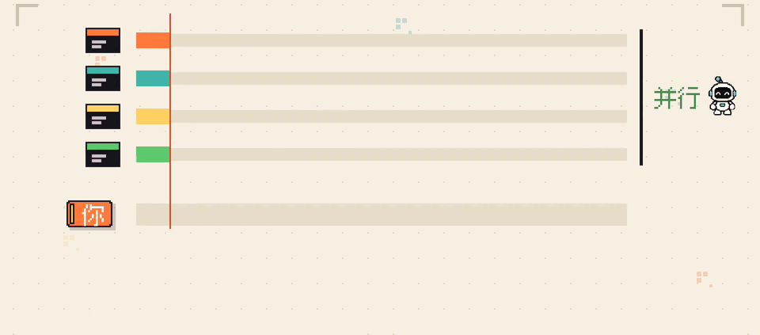

为了解决这个问题，DeepSeek 最近开源了下一代 agent 方案，[Super-agent](https://github.com/deepseek-ai/dsh-superagent-prototype)。今天我们就来看一下，它到底是什么。

{/* truncate */}

## 双层架构

同时开好几个 agent 干活时，你一个人顾不过来，怎么办呢？没有什么是加一层中间层不能解决的。如果有，那就再加一层。所以最简单的解法，就是在你和 agent 之间加一层中间层，负责承接你的需求，把任务交给下面干活的 agent。这有点像开公司，人少的时候你可以自己盯着，人一多你就可以招个主管替你管人，你只需要跟主管对接工作就行。

这个负责对接你、往下分发任务的中间层，就是所谓的 Router。下面那些真正干活的 agent 则叫 Worker。Worker 用最强的模型干活。Router 自己不写代码，主要做判断和分发，所以使用轻模型就够了。这上下两层就是双层架构。

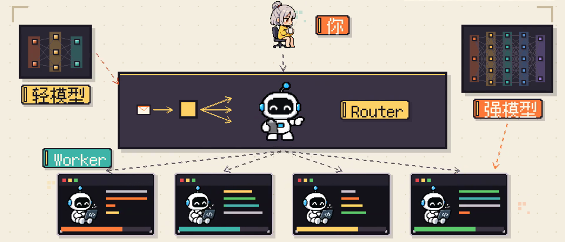

普通 agent 架构需要你自己来当这个主管。而在双层架构里，你就像始终有一个类似主管的角色，替你盯着底下好几个 Worker 同时工作。原先压在你身上的会话管理就由 Router 承接了。

那么问题就来了，这跟常见的[主 agent 加几个 subagent](/blog/fold-subagents) 有什么区别？最大的区别在于，主 agent 得吃透整个任务的逻辑，自己参与执行任务，并将其中几个步骤拆给 subagent 执行。主 agent 要不停协调并汇总结果。而 Router 则主要是分发任务，每个任务都交给一个 Worker 从头跟到尾。它只负责把 Worker 的结论转告给你。至于 Worker 内部要拆任务步骤，它自己也可以再开 subagent。

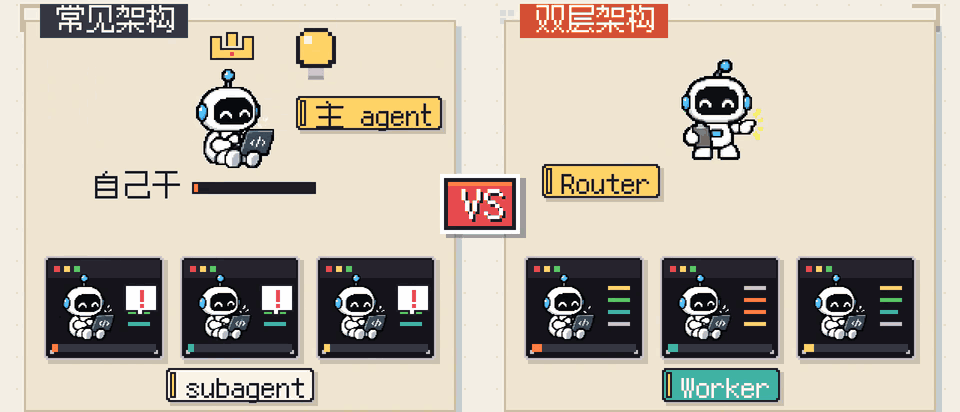

## 事件驱动

不过到这一步，agent 还是被动的，你不发话，它就不动。怎么让它自己找活干？最直接的办法，是把它接进你团队每天都在用的群、GitHub 和 CI 通知里，让它一直听着。但这些地方，一天几百上千条消息，大多跟它没关系，每条都让大模型判断一次又贵又慢。

所以这里分两层筛选，先用写死的规则，按来源、发消息的人和所在的群，把明显没用的挡掉。剩下的再交给大模型判断，值不值得动手。这些从群、GitHub、CI 传入的消息就叫 Trigger。用 Trigger 驱动 agent 干活的模式，就是事件驱动。

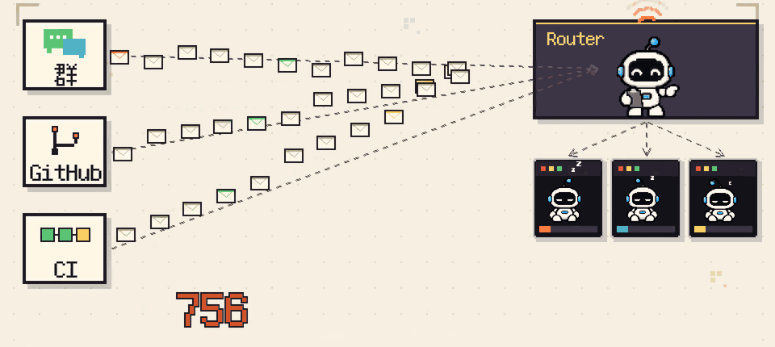

普通 agent 要等你打字才动。而在事件驱动里，有人在群里随口说了句，“某个功能好像挂了”，没 @ 任何人，过一会就有个 Worker 自己复现、修好，提了个 PR 上来。我们可以自定义新增不同类型的 Trigger，比如日程提醒或者一封会议邀约邮件，通过不同的方式，唤醒 AI 干活。

## 订阅和直通

就拿刚才那个修 PR 的 Worker 来说，PR 提上去之后，后面还会陆续来新评论、新的 CI 结果。要是每条都先回到 Router，让它判断该交给谁，Router 很快就成了卡点，所有消息堆积在它那里。所以 Router 把一条 Trigger 派给 Worker 时，就让这个 Worker 订阅和它同一串的后续 Trigger。同一个 PR 下的评论和 CI 结果，群里同一个话题的回复，同一串邮件都算同一串。

之后这一串再有新的 Trigger，程序直接送到这个 Worker 手里，不再经过 Router。这个让 Worker 认领一串 Trigger，后续直接送达的机制，就是所谓的订阅和直通。实测下来，它可以让 Router 少做 30% 的判断，也就省下 30% 的 token。

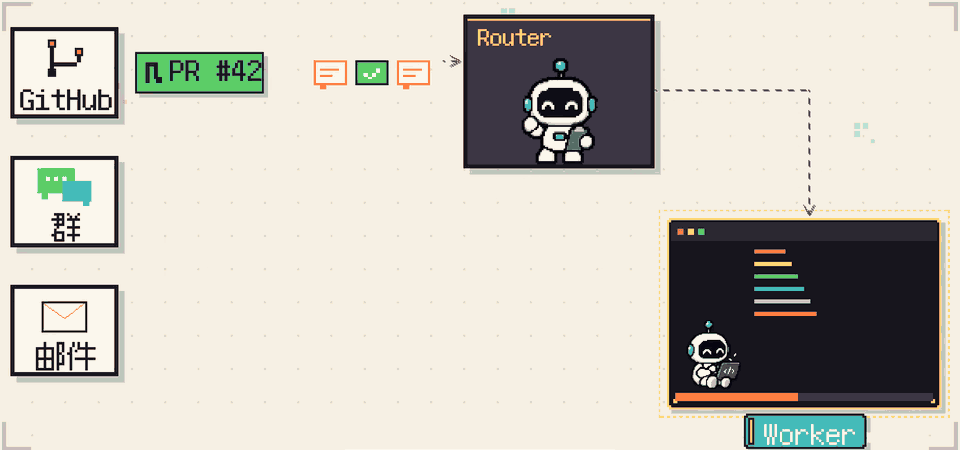

后续消息分走了，可新消息该派给谁，还得 Router 来判断。群里一下冒出几十条，它判断得过来吗？Router 的做法是：正忙的时候，新来的先攒着，等手上这批判断完，再把攒下的合进一次判断里，这就是批处理。

实测消息从一分钟一条，涨到 40 条，Router 单次耗时只从 2.5 秒涨到 3.9 秒。摊到每条消息上，反而从 6.4 秒降到了 1.6 秒。也就是说，消息越堆积，Router 处理每一条消息反而成本越低。

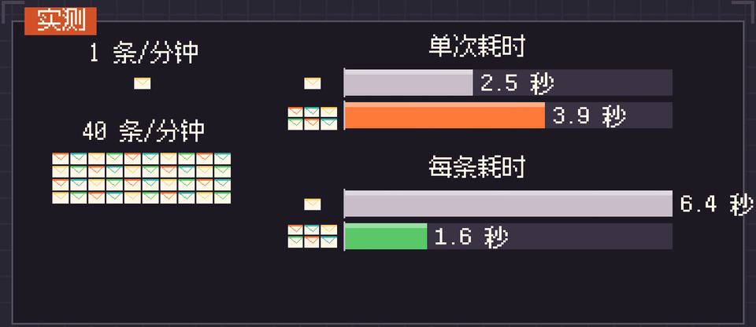

## 全双工

Router 把活派给 Worker，Worker 跑一整套测试，要十几分钟。要是 Router 派完就停在那等结果，这十几分钟里，你再跟它说什么，它都收不到。解法是把派活、跑命令这类耗时的操作，改成异步的。Router 把活派出去，马上收到一句“已经开始了”，接着就能听你说下一句。Worker 干完，结果作为一条新消息，送回 Router。

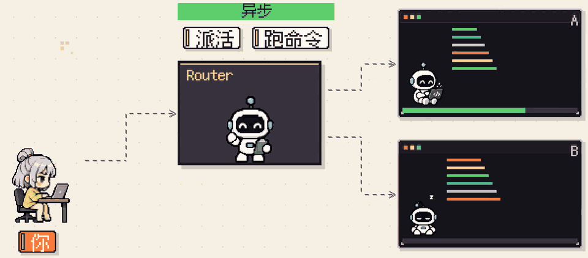

Worker 自己跑长命令也一样。测试在后台跑，这期间，PR 下面有人留言，它照样能收到。后台跑着任务，前台还能正常对话，两头同时进行，就是全双工。

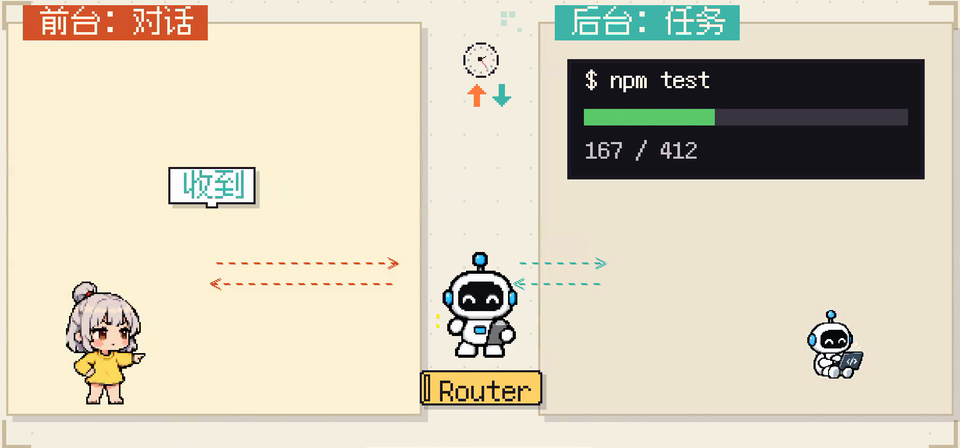

大多数 agent 跑长任务时，你想补句话、想叫停，只能等它跑完（或者 Ctrl+C 强行结束）。而在全双工里，你随时能插话，它也能随时把跑偏的任务停掉。

## 存算分离

agent 跑在你这台机器上，推着它一步步思考的循环、它的会话记录、它干活用的环境，全绑在这一台机器上。所以机器一停，它也就停了。前面提到的根据群里的消息触发 agent 任务的行为，也就停掉。本质原因是因为，它只能运行在一台机器上。

为了解决这个问题，我们可以把思考的循环搬上云，会话记录存进数据库。这样不管你的机器开没开，它都一直在线。

可思考搬上云了，命令最终还得在机器上跑。干活用的环境要是也搬上云，你本地有没提交的改动，只有内网能连的服务，一堆私人凭据，搬起来又麻烦又容易漏。所以环境留在本地，每台机器上只放一个很轻的小程序，听云上的指令，在本地跑命令，再把结果传回去。这种把思考和会话记录搬上云，执行环境留在本地的拆法，就是所谓的存算分离。

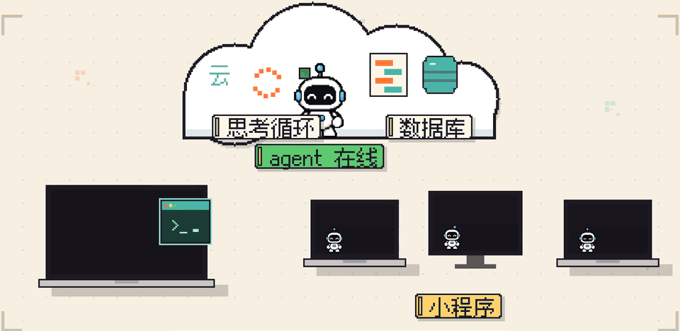

普通 agent 跟一台机器绑在一起，机器一睡，它就停，也用不了别的机器。存算分离之后，它一直在云上在线，哪台机器开着就用哪台。你合上笔记本，它照样在群里接活，在别的机器上干活。需要你笔记本才能做的，等它重新上线，再自动接着做。

## Watchdog

Worker 一直在云上跑，时间一长难免出问题，比如 Worker 陷进死循环，或者越干越偏。所以在整套系统外面再挂一个独立的 agent，定时叫醒它做一轮检查。它可以用模型检测每个 Worker 有没有实质进展，方向有没有跑偏，发现问题就及时介入修复。这个在外面盯着的 agent，就是 Watchdog。

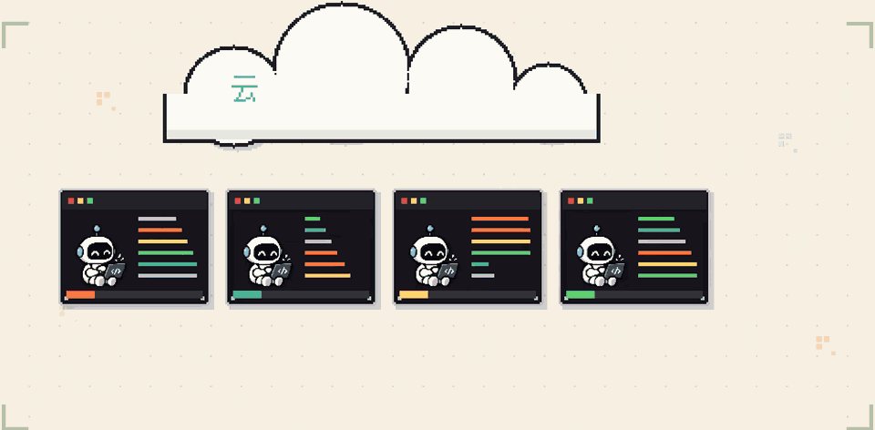

普通 agent 卡住或跑偏，只能靠你自己发现，自己拉回来。有了 Watchdog，这件事也不需要你操心了。

## Super-agent

到这里有了 Router 和 Worker 组成的双层架构，你只需要跟 Router 对接，底下好几个 Worker 同时干活，感觉始终在跟同一个 agent 说话。实现了“连续”这一特点。

在这个基础上，用事件驱动接上群、GitHub 和 CI，它能自己听到动静，主动找活干。再加上订阅和直通，同一串的后续 Trigger 直接送到对应的 Worker，Router 不会被消息堆住。这就做到了“主动”这一特点。

Worker 跑着长任务的时候，全双工让 Router 照样能接你的话，实现了“高效”这一特点。

存算分离之后，它一直在线，还能用上不同的机器。最外面还有 Watchdog 盯着，卡住或跑偏了，还能及时恢复，也就做到了“持久”这一特点。

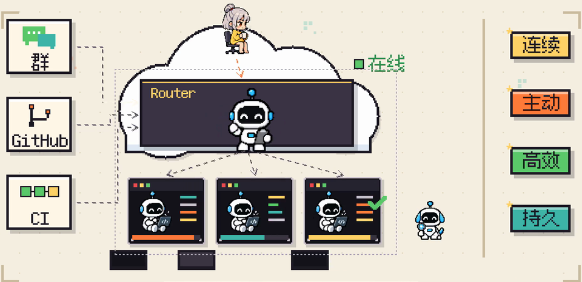

你一个人顾不过来的那些会话，现在有一个超级管家，替你管着。你只需要在关键的地方做决定、做验收。这些能力共同构成了一个能同时推进好几件事，自己找活干，还能一直在线的 agent 系统，也就是 Super-agent。

不过 DeepSeek 开源的只是一个研究原型，预期中一些设计，其实还没完全落地。完整方案还可以再等等。现在大家通了吗？

最后遗留一个问题：Watchdog 盯着 Worker，那谁来盯着 Watchdog 呢？

---

*参考视频：[Super-agent是什么](https://www.douyin.com/video/7703746638380125466)（抖音 · 小白debug）*
