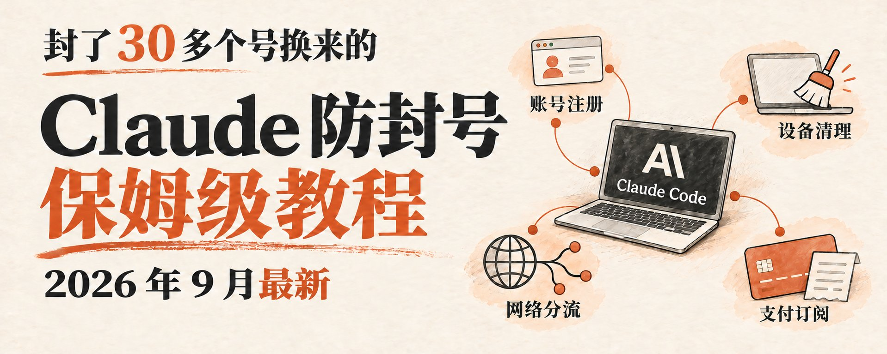

Opus 5.5 出来以后，我的感觉是又回到 Anthropic 一统天下的局面了。

这是我用过最爽的模型，协作起来有一种真的「被稳稳接住的感觉」，

可对国内用户来说，模型再好，号一被封也用不上。

**我从年初到现在，前前后后封过三十多个 Claude 号，有一部分是帮同事开的。**

苹果内购、安卓 Google Play、海外卡订阅，这些路我基本都走过，你能踩的坑我都踩过。

而现在我手上有 4 个号：三个 Max 20x、一个 Pro，其中两个在 7、8 月那两轮大封号潮都扛过来了，到今天都在正常用。

这篇把我稳定不封号的整套做法，每个细节全写出来了。

**从买 IP、注册、收拾电脑和网络、付款、接 Claude Code，一直写到升 Max 20x 和续费，KYC 如何处理都包了，关键步骤都配了我自己的截图。**

篇幅比较长，建议先收藏，做到哪一步再回来翻哪一步。

{/* truncate */}

**目录**

一、Claude 封号底层逻辑

二、提高注册时账号权重

三、指纹浏览器

四、清除设备指纹

五、不暴露自己的 IP

六、订阅 Claude 账号

七、接上 Claude Code

八、Pro 升级 Max

## 一、Claude 封号底层逻辑

踩了这么多坑下来，**我觉得网上那些防封教程，大多数都抓错了重点。**

真正决定你会不会被封的是什么？

其实 Anthropic 已经明明白白写在用户条款里了，就三条：

1. 你是不是来自他们不支持的地区；

2. 你有没有拿账号搞蒸馏、高并发，或者接到不该接的第三方工具上；

3. 你有没有发违规内容。

对大部分人来说，**后面两条你不主动作死就不会死。**

所以说白了，**Claude 封号只看一件事：你像不像来自它不支持地区的人**。

问题就变成了：注册、订阅、使用的时候，**怎么让平台觉得你就是一个它支持地区的正常用户？**

后面每一步，其实都在回答同一个问题：**一个正常的美国用户，会这么做吗？**

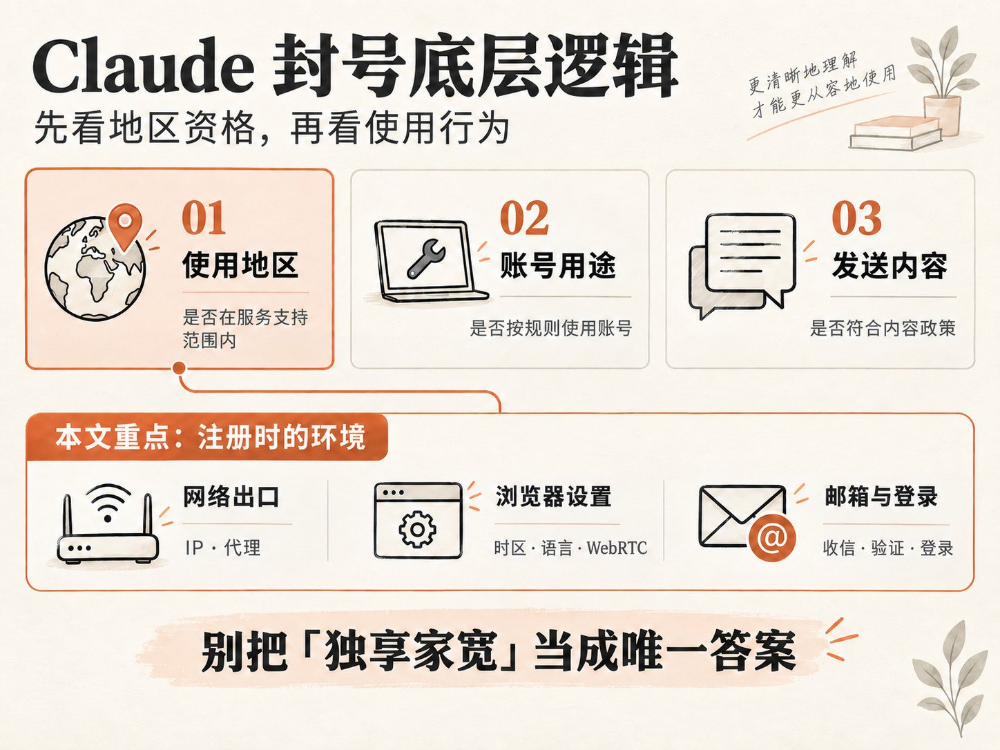

而这里面最关键的是注册。

**注册后的头几天，平台会判断你是不是高风险用户**。

看的主要是注册那一刻的环境：浏览器有没有暴露你的真实位置和 IP，注册用的 IP 在不在海外、有没有被人滥用过。

如果平台觉得你风险稍微高一点，开会员的时候就会弹 KYC 身份验证，弹了怎么处理，第三章注册那里会细说。

要是再高一点，号直接就封了。

我遇到过的一注册就封的号，基本都是环境暴露了自己来自不支持的地区。

反过来，**注册时环境干净、行为正常、用的是正经邮箱，这个号一开始就是干净的**，后面怎么用都不容易出事。

不过，IP 也不是唯一的因素。

你想想，一个美国人在咖啡店连着公共 Wi-Fi 注册 Claude，或者本来就习惯开着 VPN 上网，他就不是正常用户了吗？

## 二、提高注册时账号权重

那为什么还要单独买一个 IP？

因为你平时用的梯子节点，大多是那种万人骑的 IP，谁也不知道之前被多少人拿去注册过、封过多少号。

注册又是整个流程里平台看得最严的一步，**所以这一步最好单独用一个干净的 IP。**

说到家宽 IP，这里面的生意就复杂了。

我觉得没必要一上来就花几百块一个月，去追商家宣传的「纯净、独享、真家宽」，**几十块一个月的就够用**。

买的时候看三点：

**1. 地区选美国。**

后面浏览器的时区、语言都要跟它对上。

买的时候顺便看一眼商家写的城市，比如 IP 在加州，后面时区就选洛杉矶；在纽约，就选纽约。

**2. 选静态，不选动态。**

静态 IP 的出口地址是固定的；动态（也叫轮换）IP 会按时间或者按连接换出口，具体怎么换看商家。

一个正常的美国用户，总不会每刷新一次页面就换个城市。

选静态，注册过程里出口始终是同一个地址，配置和排查也都简单。

商家页面上一般会把这几种分开卖，像下面这家，分了动态住宅、静态住宅、静态机房三种，我选的是箭头指的「静态住宅代理」。

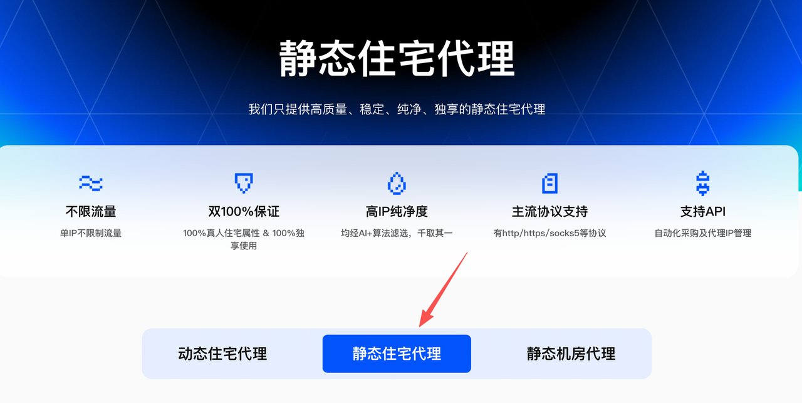

买完商家会发给你一份连接信息，下面这张是我之前随手买的一个，拿来举个例子。

里面的 IP、端口、账号、密码这四行，就是后面要填的四样东西。

这四样后面要用两次，一次填进指纹浏览器注册，一次填进手机的小火箭登录 Claude App，先存好。

至于去哪买，我就不点名推荐了，免得像在打广告。

你去 YouTube 搜「美国静态 IP」这类关键词，看看别人的教程和推荐，挑一家就行。

**价格上，请购买 60 块一个月以上的，低于这个价格的IP，可能是已经被玩烂的，非常不建议使用！！！**

注册、手机登录、订阅 Pro、升级 Max，都在这一周里做完，**之后这个 IP 就可以不续了**。

日常用 Claude 和 Claude Code，走你自己的梯子就行（但是梯子 IP 要干净，而且跟注册地是同一个国家，你总不能注册的时候在美国，但是后面跳到了新加坡，这不合理），比如我用搬瓦工的 IP，使用 Claude 就完全没问题。

因为，**海外本来就有大把人把 Claude Code 放在机房服务器上 24 小时跑，所以日常使用根本不需要家宽 IP。**


<a id="network-options"></a>

### 另一种选择：自建 VPS 或打包住宅代理


两种选择：自建VPS或者IPEqual打包服务，都是美国静态独享IP，延迟都在150-190ms直连。

前者流量较多，有回国路线优化，但是经常缺货且是机房IP，而且任何网络问题，都需要自己维护。如果想要住宅IP，还得自己去套一层（经常是大的号池），两者加起来的价格和折腾层面来说，后者是优选。

后者出了问题有技术快速修复，不需要自己操心，而且是静态住宅IP（优选IP段），有回国路线优化，不需要复杂的链式配置，有1v1专属客服，只建议上Max及以上套餐（因为是独享）。

我自用的是VPS自建服务，感兴趣的可以去看这一篇，本文不展开。

[如何用VPS搭建电脑端和移动端的稳定上网环境（文科生小白友好教程）](https://x.com/gengdaJ/status/2029570219354845577)

> 最近我的节点一直各种超时，迫不得已之下自己搭建了一个稳定的上网环境。不用不知道，一用吓一跳——原来死活用不了的Antigravity能用了，Gemini、Google ai...

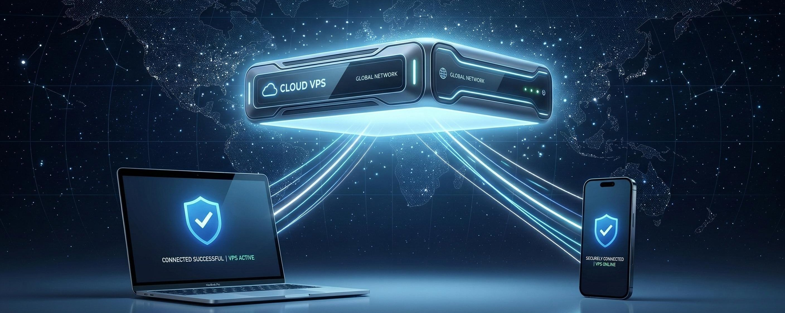

IPEqual，是我之前看YouTube大佬分享的，前段时间也推给了朋友使用，也反馈说速度不错，延迟和前者差不多，如果不想麻烦地配置、就想快速使用Claude的朋友，可以直接买这个：[https://www.equaldcdn.com](https://www.equaldcdn.com/?ref=81cfc0ce31)

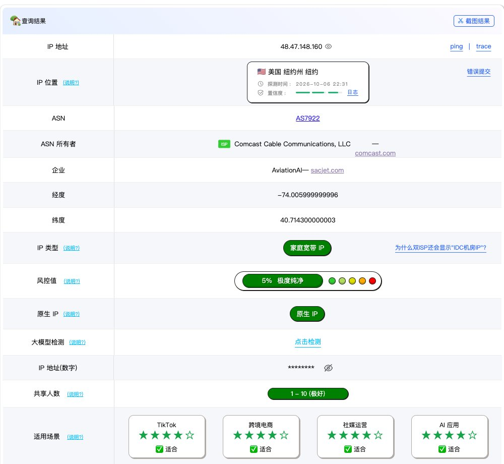


<a id="mac-iphone-tools"></a>

### Mac 与 iPhone 方案需要的工具


**由于Anthropic封禁账号的多样性和随机性，这篇文章仅分享我的真实开通流程，不承诺任何防封号保证！**

硬性门槛提前看：

- 护照（过支付和KYC）

- 一个本地Agent（Codex）

- 一台Mac（Windows设置和Mac不一样，不敢保证效果）

- 一台iPhone（可选，如需在手机使用Claude App）

- Shadowrocket（保证电脑和手机网络分流规则一致性）


<a id="gmail-account"></a>

### 准备 Gmail 邮箱


在iPhone上下载一个Chrome浏览器，然后注册一个Gmail账号——右上角头像 → 添加账号 → 创建账号。我注册的时候没有遇到需要手机号验证的情况。

但是用电脑注册，可能就会需要手机号验证，这一步虽然大陆+86手机号也能通过验证，但是如果后续Claude需要验证手机号，我个人觉得，如果两边不都是同时用美国（或其他支持地区）手机号，会有一点影响，所以在下文我也给大家准备了在国行版iPhone开通美国eSIM手机号教程。


<a id="us-apple-id"></a>

### 注册美区 Apple ID，购买 Shadowrocket


Shadowrocket，也就是常说的小火箭，需要2.99$购买，这个主要用来配置后面的干净网络以及分流规则。

同时，需要美区Apple ID才能在App Store搜索到Shadowrocket。所以，第一步，咱们先来注册一个免费的Apple ID。

来到：[https://account.apple.com/account](https://account.apple.com/account)，在这里，用中国手机号即可注册美区Apple ID。

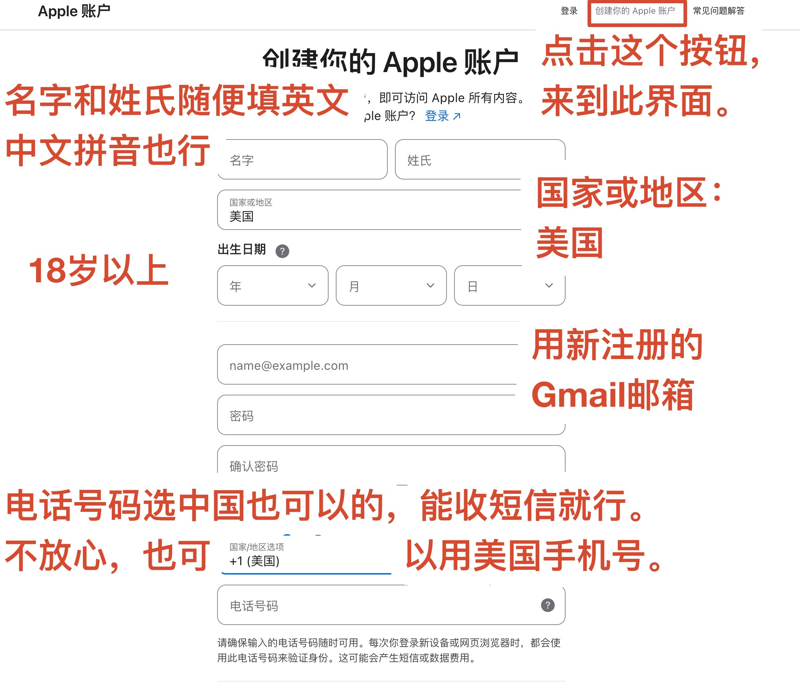

然后再用这个新注册的免费美区Apple ID分别登录Mac和iPhone的App Store，购买Shadowrocket就行，但是这一步也有个麻烦，就是没有美国银行卡不能直接充，所以需要先去支付宝充个礼品卡。

支付宝【Nidiya礼品卡】，然后来到这个界面，选择第一个Apple Gift Card US，充值3$到上面美区Apple ID绑定的Google邮箱即可，然后在App Store下载Shadowrocket。

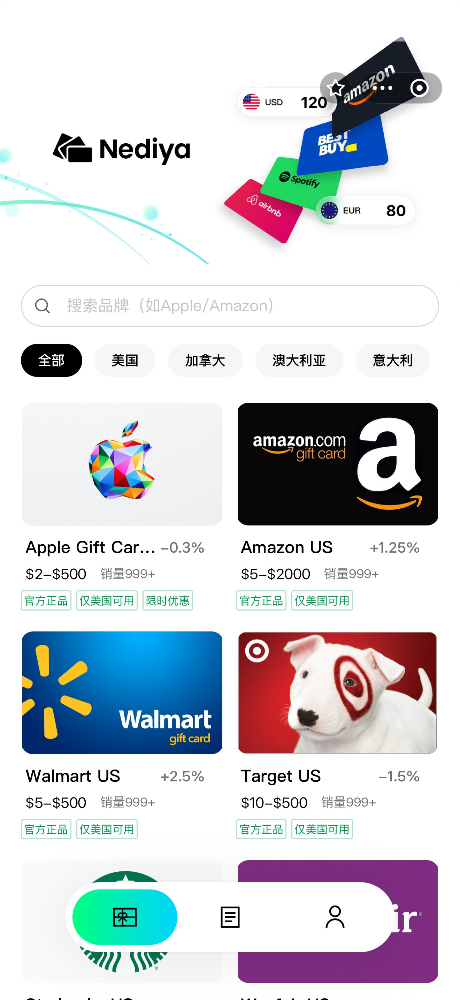

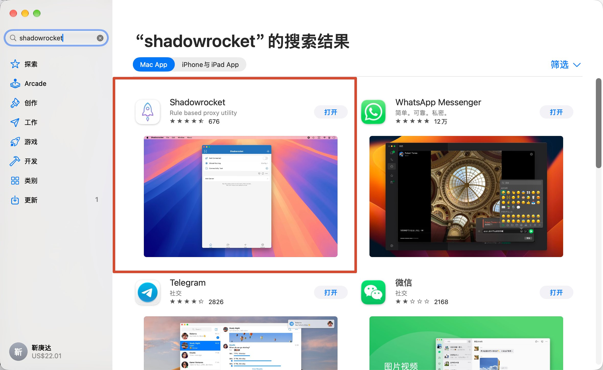


### 将节点导入 Shadowrocket

购买/搭建相关服务之后，把得到的链接导入Shadowrocket，这一步点击右上角的+，再点击导入即可，实在不会，让Codex帮忙导入也行的。然后就能得到一个稳定的出口IP了。


## 三、指纹浏览器

还是那个问题：一个正常的美国用户打开浏览器注册 Claude，他的环境长什么样？

IP 在美国，时区是美国的，浏览器语言是英文的。

比特浏览器这类指纹浏览器能把这些一次性配好，而且整个窗口的流量都强制走你填进去的代理。

**代理一断，这个窗口直接断网，不会偷偷用你的真实网络去连。**

打开比特浏览器，先点左上角的「创建窗口」。

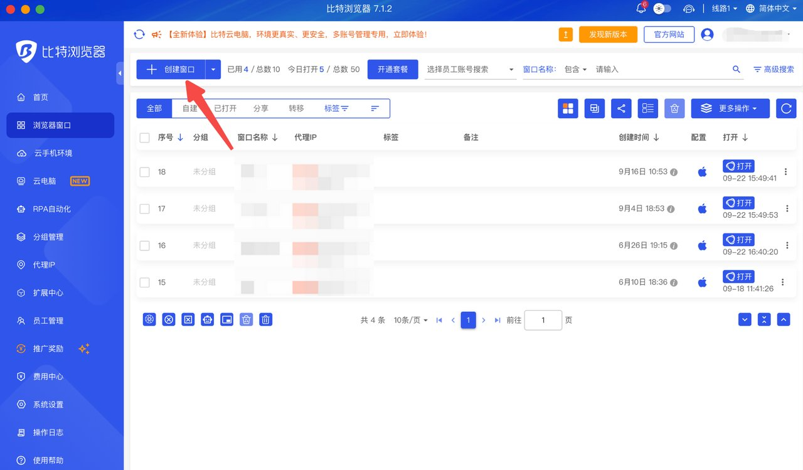

弹出来的设置页里，先看代理这一块。

「代理方式」保持默认的「自定义代理」，箭头指的「代理类型」选 Socks5，然后把上一章拿到的IP、端口、账号、密码，分别填进红框里的「代理主机」「代理端口」「代理账号」「代理密码」。

最下面的「刷新URL」空着就行。

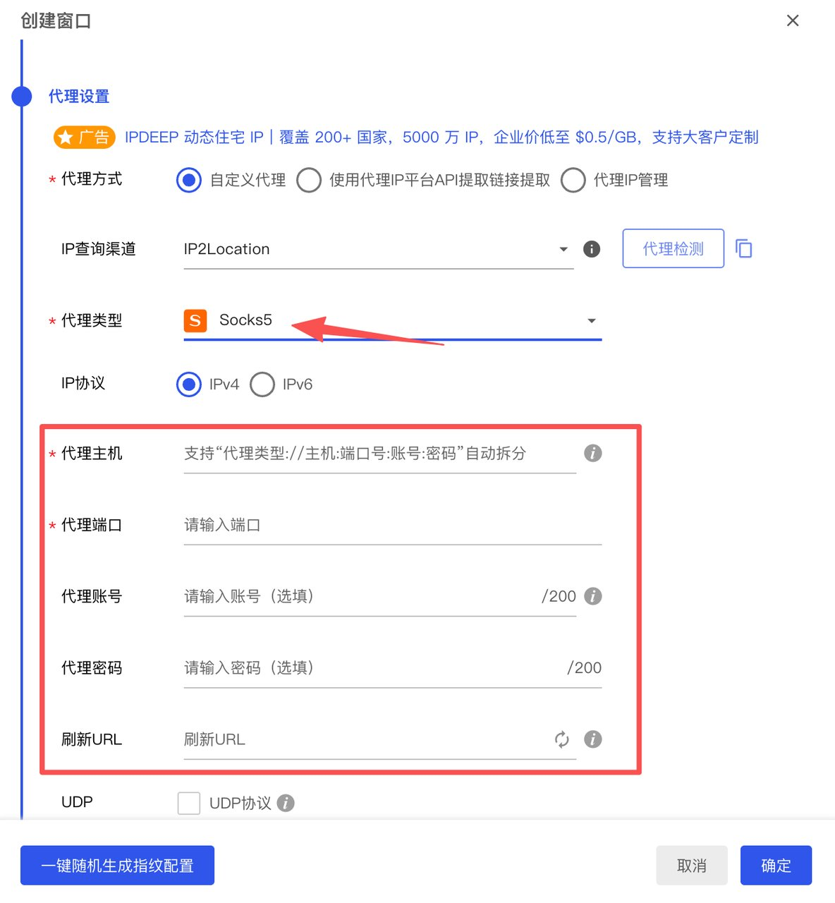

**再往下翻，有一个非常重要的点！！！**

这里的浏览器版本两个地方**都必须选 146 的，不要选 147 148或者别的，**不然没办法注册！

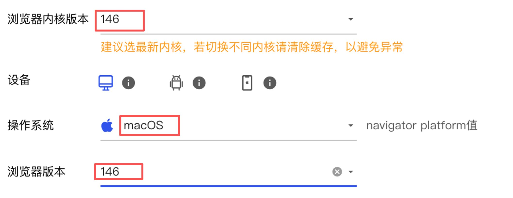

然后语言和界面语言都选英语。

时区跟着 IP 走，图里我选的是 America/Los_Angeles，对应加州的 IP；你的 IP 要是在纽约，就选 America/New_York。

WebRTC 和地理位置，都选最右边的「禁止」。

旁边那几个「基于IP生成」的开关我都关着，直接手动选，选的是什么自己心里有数。

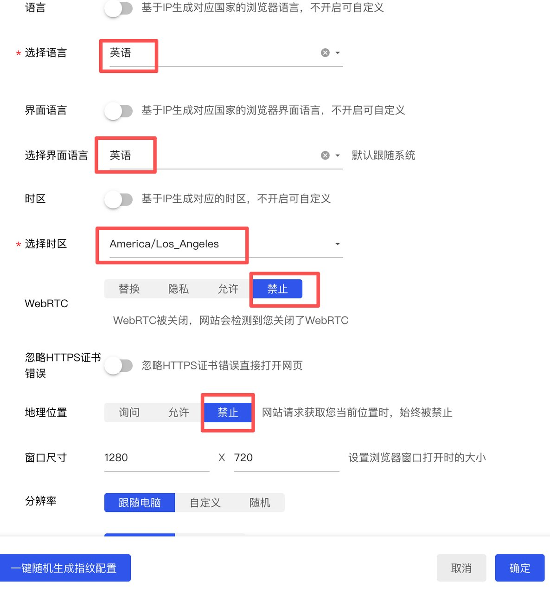

WebRTC 为什么要禁止？

它是浏览器用来做实时音视频的，**它有可能绕过代理，把你的真实 IP 暴露出去，所以直接关掉**。

你看图里选了禁止之后，下面还会提示「网站会检测到您关闭了WebRTC」。

被检测到会不会显得可疑？

海外很多注重隐私的人本来就会关，不是什么稀奇事。

剩下的硬件、设备这些指纹参数，不用一个个调，直接点左下角箭头指的「一键随机生成指纹配置」，再点右下角的「确定」保存。

配完打开任意网页，能正常加载，说明代理通了

再打开 [ipinfo.io](https://ipinfo.io/) 看一眼：出口 IP 在不在美国，城市跟你选的时区对不对得上。

窗口配好了，接下来准备一个海外邮箱。

**我推荐用 Proton，原因很简单：Anthropic 还真在邮件里放了跟踪器，而 Proton 会自动把它拦掉。**

你看下面这张图，是我在 Proton 里打开一封 Anthropic 的邮件，顶上直接提示「已屏蔽 1 个跟踪器」，来源是 [Sendgrid.com](https://sendgrid.com/)，展开的链接开头就是 [mail.anthropic.com](https://mail.anthropic.com/)。


这类跟踪器会在你打开邮件时加载，顺带就能拿到你当时的 IP

Proton 它拦的就是对方监控「您打开邮件的时间、使用的设备和所在位置」。

Proton 拦掉跟踪器，比特浏览器又全程走代理，这样就是双重保险了。

注册 Proton 选最左边的 Free 就够，一分钱不用花。

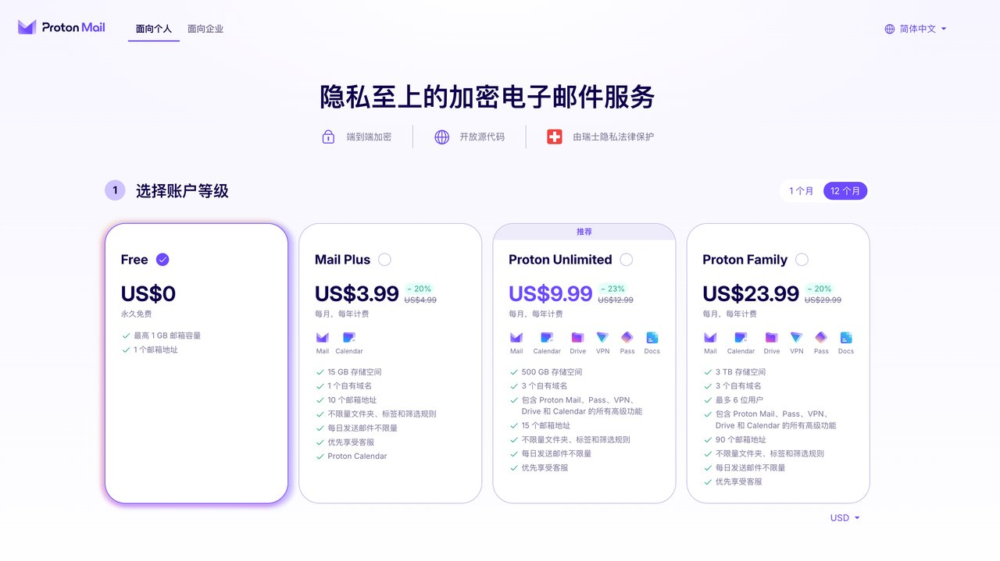

Proton 注册后，如果你收不到验证邮件的话，需要先绑定安全邮箱，这是因为Proton 防止滥用才做的拦截。

打开[https://account.proton.me/u/1/mail/recovery](https://account.proton.me/u/1/mail/recovery)，找到Email verification绑定邮箱，这样就能收到了。

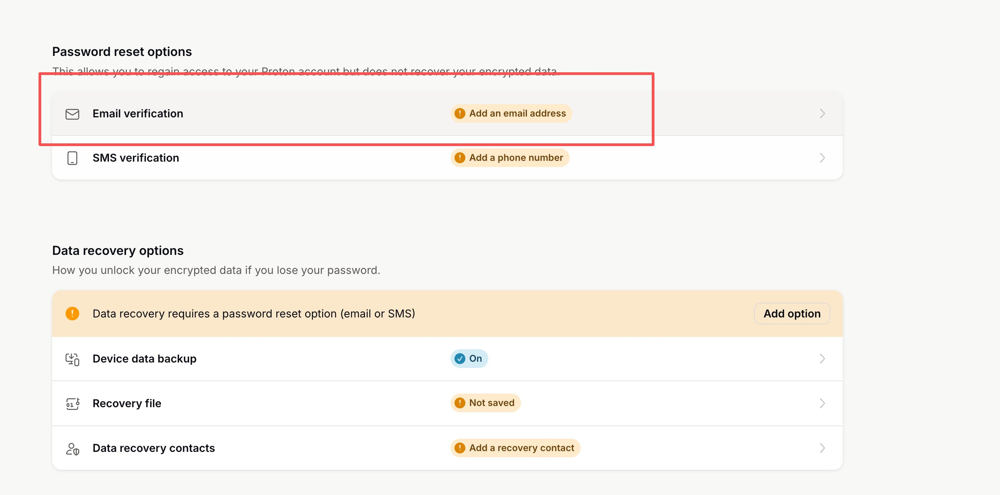

别用来路不明的野鸡邮箱，我觉得那会拉低你的账号权重。

不管用哪个，**这个邮箱只在这个比特浏览器窗口里登录、收信**，这样打开邮件时露出去的也只是代理的 IP。

还有些验证链接会发到别处，比如 Proton 发到你恢复邮箱里的验证信，这封信是在你的日常邮箱里收的。

**别在日常浏览器里直接点**，像图里这样，在「Verify email」上点右键，选红框里的「复制链接地址」，再粘到比特浏览器里打开。

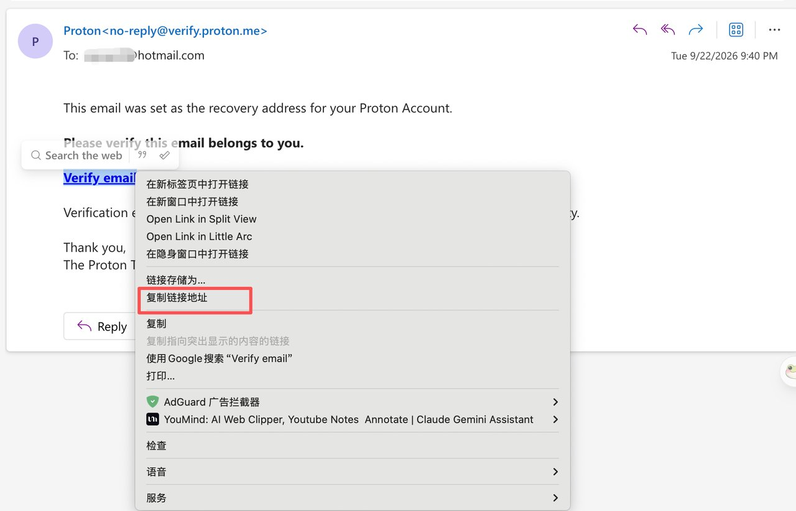

邮箱也准备好了，就可以注册 Claude 了。

在比特浏览器这个窗口里打开 [claude.ai](https://claude.ai/)，上面 Google、Apple 那两个按钮都不用管，直接在箭头指的输入框里填你的邮箱，点「Continue with email」，就是下面左边这张图。

然后回 Proton 收 Claude 发来的邮件，里面就一个黑色的 Sign in 按钮，链接 10 分钟就过期，收到了尽快点。

点完回到 Claude，就是右边这张，勾上同意条款的复选框，点「Create account」。

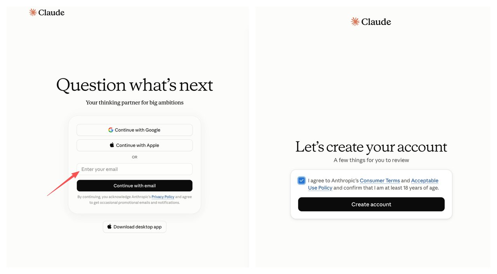

接下来它会问你几件事，都按一个普通新用户的反应来。

先是让你选套餐。

你的目标是 Max 20x，但正常人不会注册完第一分钟就掏 200 美元，大部分人都是先免费用用看，所以点最左边箭头指的「Use Claude for free」。

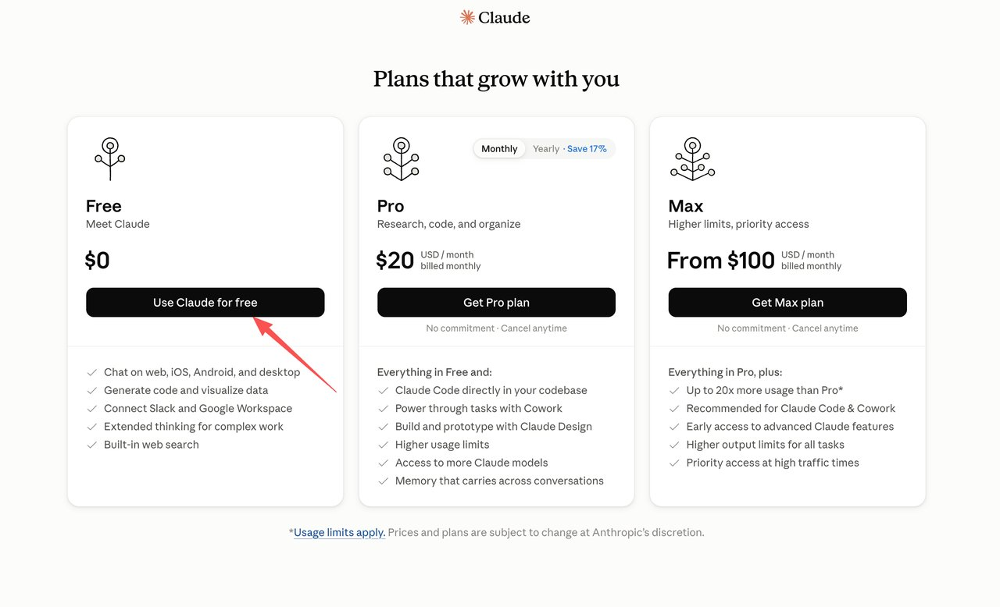

之后它会推荐你下载桌面客户端，点最下面那个很小的「Skip」跳过；问你职业，也跳过。

称呼随便写个像英文名的，我这里随手填了个重置哥大名 tibo。

角色选择也跳过，就进到首页了。

进来之后，像个新用户一样随便聊几轮。

中文英文都行，海外用简体中文的华人和留学生多的是，**不用刻意全用英文**。

这一步最容易翻车的，是**在日常浏览器里点开 Claude 的邮件链接**。

前面环境配得再好，一点开就把真实 IP 交出去了。

注册这一步做得干不干净，**直接决定后面付款时会不会弹 KYC**。

要是付款时真弹了 KYC 身份验证，说明注册时的环境不够干净，原因无非这几种：

- IP 不行，之前被人滥用过；

- 指纹浏览器哪里没配好，比如时区跟 IP 对不上、WebRTC 没关；

- 邮箱被风控了；

- 也可能刚好那会儿 Claude 把风控系数拉高了，不是你哪一步做错了。

碰到这种情况，**我的建议是直接重新注册一个新号**：新开一个指纹浏览器窗口、换个新邮箱，按前面的流程排查后再走一遍。

如果选择继续认证，可以按后面的[护照认证流程](#passport-verification)处理。


## 四、清除设备指纹

号注册好了，先别急着付钱。

后面订阅、接 Claude Code，都要在你自己的电脑和手机上完成，所以先把电脑本身收拾干净，有两件事。

第一件，把系统时区改成台北或新加坡。

台北和新加坡跟北京一样是 UTC+8。

改过去，**电脑显示的时间一分不变，但系统时区不再是中国**。

Claude Code 跑在你的电脑上，读得到系统时区，能少暴露一点是一点。

改法很简单，跟你的 Agent 说一嘴「把系统时区改成 Asia/Taipei」就行，就像下面这样，它会自己查、自己改、自己确认生效。

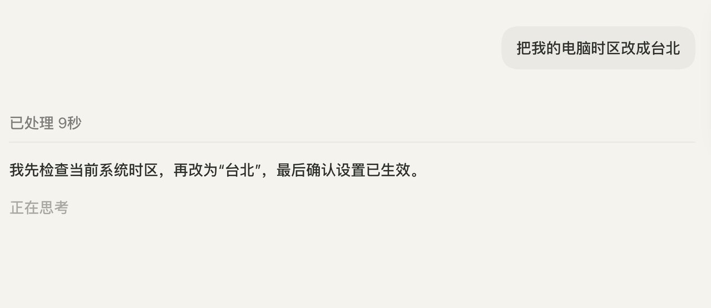

下面那个清理 Skill 里也带了这一项。

第二件，清掉本机记录。

这台电脑之前被封过 Claude 号的话，**不用换电脑，把本机残留的记录清掉就行**。

我两台封过号的 MacBook，清完都在正常用。

我把清理流程写成了一个 Skill：[https://github.com/suyuan2022/suyuan-skill/blob/main/claude-cleanup/SKILL.md](https://github.com/suyuan2022/suyuan-skill/blob/main/claude-cleanup/SKILL.md)

目前支持 macOS，Windows 我还没测试。

它是这么干活的：

- 动手之前，先完整备份 ~/.claude，你的 Skills、Hooks、会话记录都在备份里；

- 缓存和日志它会自动清。换本地 ID、清钥匙串和桌面端的登录状态、改台北时区这些改动比较大的，做不做由你自己选；

- 删掉的东西只进一个带时间戳的废纸篓目录，不会永久删除；

- 你输入一次 CONFIRM，它才开始动。

注意要让 Codex 或者普通终端来跑它，**别让正在运行的 Claude Code 清理它自己的目录**。

用起来就像下面这张图：把链接丢给 Agent，说一句「执行这个 skill 帮我清理」。

它会先做一遍只读审计，告诉你找到了哪些缓存、备份要占多大空间、哪些是高风险操作，一样都还没动。

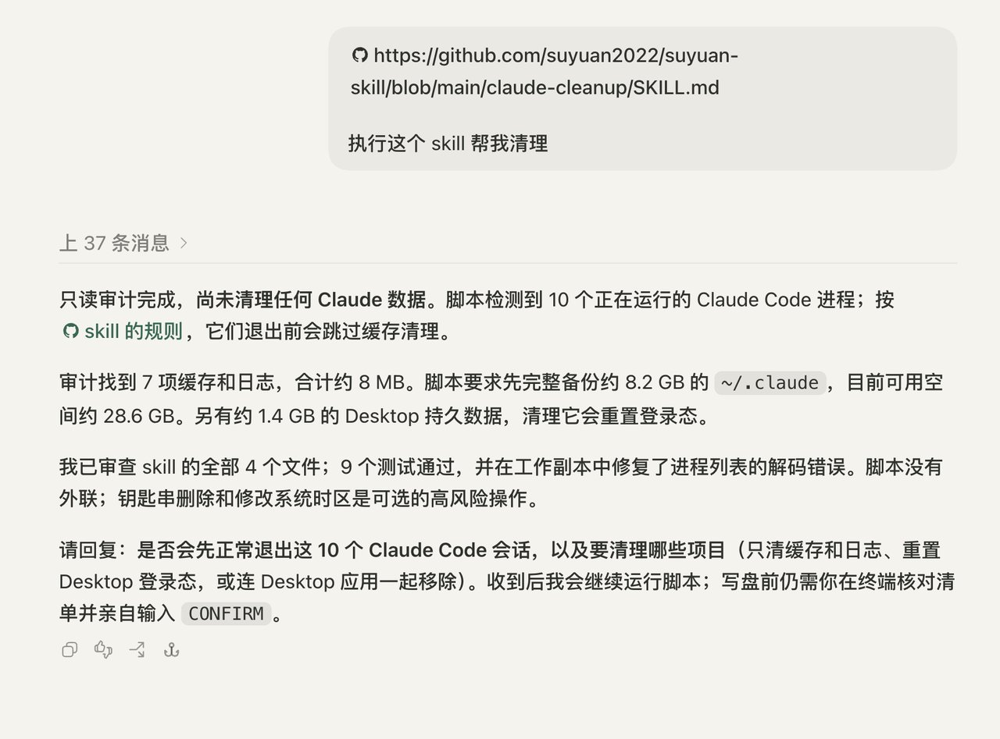

你确认要清哪些之后，还得自己在终端里输入 CONFIRM，它才真正开始清


<a id="cleanup-login"></a>

### 清理旧登录和第三方转发配置

我用的是[claude-cleanup Skill](https://github.com/suyuan2022/suyuan-skill/blob/423473db6b618c7e040f1a5a6879bc83e69e8b3b/claude-cleanup/SKILL.md)，清理时保留了Claude Code的历史会话、Skills、插件和自建配置。第三方转发配置和小火箭分流另外处理。

这一步直接交给Codex就可以，咱们非科班改代码也改不明白。。。

#### 1、先退出Claude，把下面这段复制给Codex

退出Claude桌面应用和正在运行的Claude Code会话，Codex保持打开（可能会用到Computer Use操作CC Switch）。然后发送：

> 我准备使用官方Claude账号，请检查这台Mac上的Claude Code和Claude Desktop旧配置。
> 
> 先获取并审查这份claude-cleanup Skill，参考它的白名单和保护范围做只读审计，暂不执行清理脚本：
> [https://github.com/suyuan2022/suyuan-skill/blob/423473db6b618c7e040f1a5a6879bc83e69e8b3b/claude-cleanup/SKILL.md](https://github.com/suyuan2022/suyuan-skill/blob/423473db6b618c7e040f1a5a6879bc83e69e8b3b/claude-cleanup/SKILL.md)
> 
> 请先列出简短的清理方案：
> 1. 检查旧登录凭据、账号缓存，以及Claude缓存和日志。
> 2. 检查主身份文件中的userID、machineID，说明重置这些本地标识的影响和范围。
> 3. 检查Claude Code的第三方API地址、认证覆盖项和模型映射。如果使用CC Switch，准备切回Claude Official并关闭Claude接管。
> 4. 保留历史会话、Skills、插件、Hooks、自建规则、桌面端持久数据，以及飞书等其他工具依赖的配置。不要清空整个.claude或CC Switch数据库，不要卸载应用。
> 
> 不要输出密码或令牌。先告诉我要处理什么、保留什么、有什么影响，等我确认后再执行。

#### 2、执行清理操作

把这段发给Codex：

> 按刚才列明的清单执行。先在本机完整备份相关配置，正常退出需要退出的Claude进程，再清理已确认的旧登录、账号缓存和缓存日志，重置已确认的本地标识，移除Claude Code的旧第三方转发配置。
> 
> 文件只移入废纸篓；钥匙串只删除刚才明确列出的Claude记录。保留其余数据和配置，修改后逐项核验。如果切换供应商时误清了其他设置，请从备份精确恢复。
> 
> 完成后告诉我：处理结果、备份位置，以及需要重新打开哪些应用。

如果脚本要求在终端输入CONFIRM，按Codex提示自己输入。核验完成后，按提示重新打开应用即可。

我当时做了两轮处理：先清旧登录和缓存、重置部分本地ID，后来又用这个Skill把Claude桌面应用和5项桌面端数据移入废纸篓。Claude Code历史、Skills、共享CC Switch配置和一份旧身份副本保留。

上面的提示词默认保留桌面端数据和应用。如果想连桌面端也一起清理，就在Codex列清单时明确说明，安全重新再来。


### 另一种清理方式：手动清掉 Claude Desktop 旧登录

Claude Desktop 被封后清掉旧登录、换新号的核心做法是：彻底退出应用 + 删除本地会话/登录数据，然后重新登录新账号。

#### 1、完全退出 Claude Desktop

- Windows：右键系统托盘图标退出，再打开任务管理器结束所有 `Claude.exe` 相关进程。

- macOS：菜单栏 Claude → Quit，或强制退出。

#### 2、删除本地会话/登录数据

Windows：

1. 按 `Win + R`，输入以下路径并回车（按你的安装方式试）：
   - `%APPDATA%\Claude`
   - `%LOCALAPPDATA%\Packages\Claude_pzs8sxrjxfjjc\LocalCache\Roaming\Claude`（Store / MSIX 常见）

2. 把整个 Claude 文件夹重命名（例如改成 `Claude_old`）或删除。

3. 再检查用户目录下的 `%USERPROFILE%\.claude`（Claude Code 相关），可按需清理缓存部分。

macOS：

1. 打开 Finder → 按 `Cmd + Shift + G`，依次前往并处理：
   - `~/Library/Application Support/Claude`
   - 可选：`~/Library/Caches` 里 Claude 相关文件夹
   - `~/Library/Preferences` 里 Claude 相关 `.plist`

2. 同样建议先重命名备份，再删除。

3. 检查 `~/.claude`。

#### 3、清理浏览器残留（推荐）

在浏览器里清除 `claude.ai` / `anthropic.com` 的 Cookie 和站点数据（只清这个域名即可）。

#### 4、重新登录

重新打开 Claude Desktop，登录即可。

#### 进阶/更干净的清理方式

有社区工具专门做“封号后清理”，例如 [claude-post-ban-cleanup](https://github.com/l2461090/claude-post-ban-cleanup)。

手动删除数据文件夹通常已经足够切换账号。


<a id="system-timezone"></a>

### 在 Mac 和 iPhone 上设置时区

Mac这样修改：

- 系统设置 → 搜索“时区” → 改成“台北市-台湾”

- 关掉“自动设定时区”

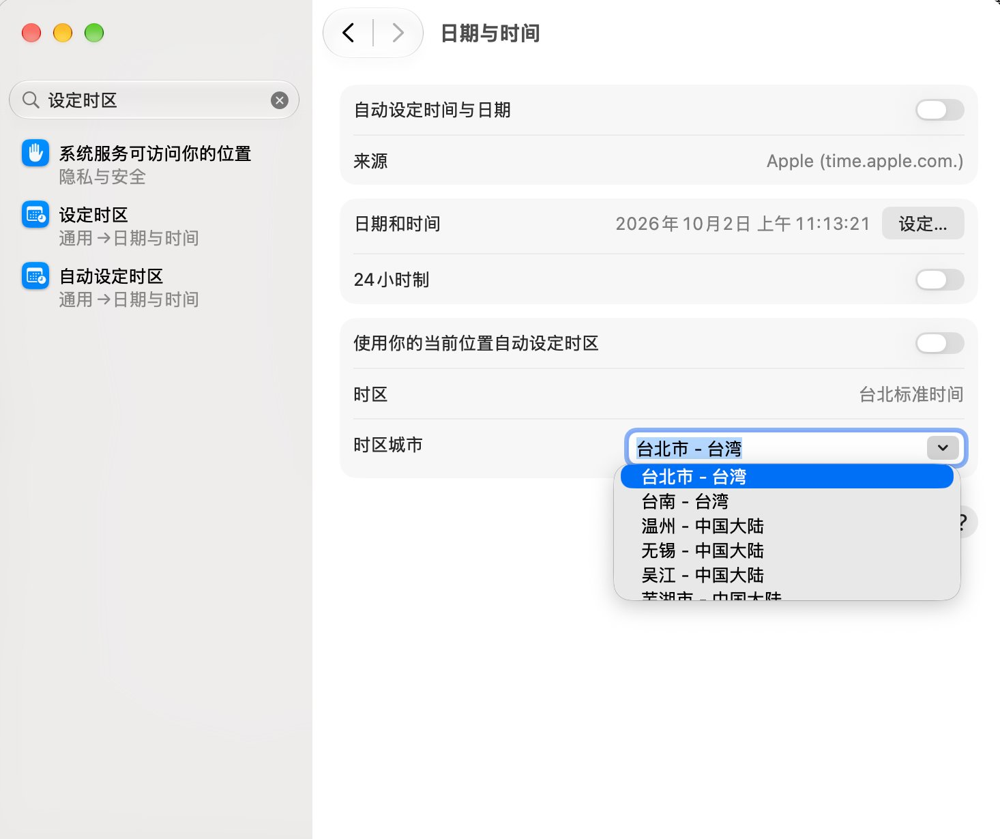

- 搜索“定位服务” → 关掉“定位服务”

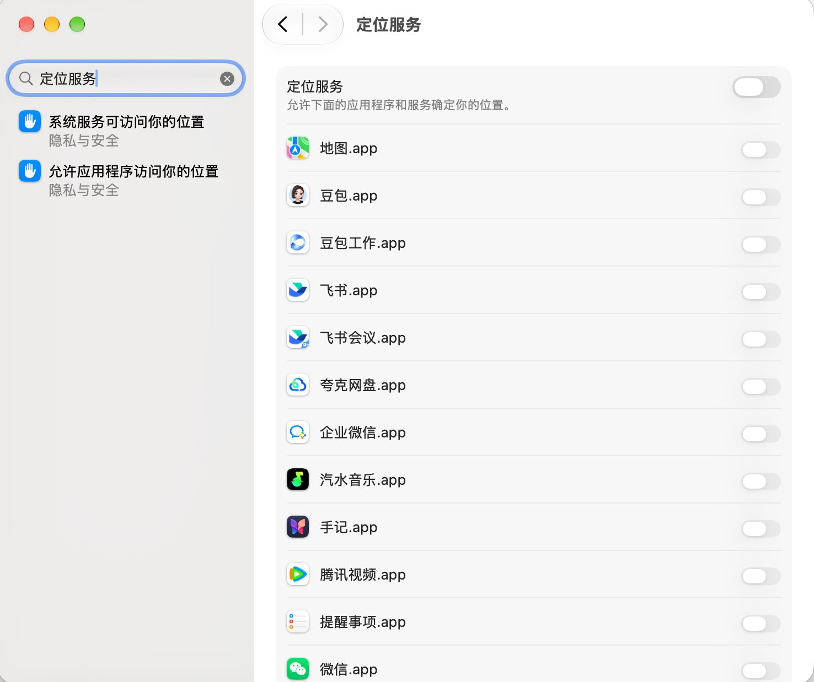

iPhone这样修改：

- 设置 → 搜索“日期与时间”，时区选“台北标准时间”，时区城市选“台北”

- 关掉“自动设定时间”

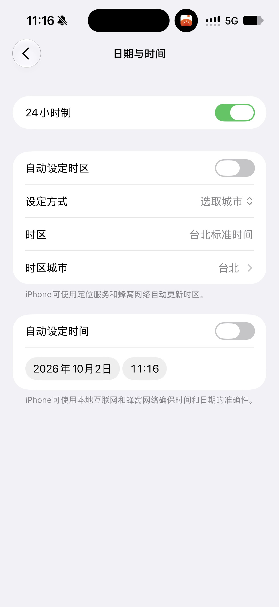

- 设置 → 搜索“系统服务”，关掉“设定时区”

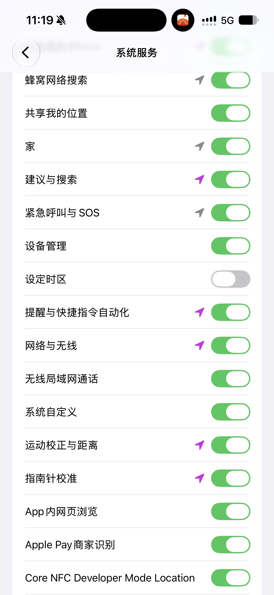


## 五、不暴露自己的 IP

电脑收拾干净了，接下来是网络。

这一章就两件事：配好分流，再让梯子一断，Claude 也跟着断网。

先说分流。

最容易让你暴露的，往往是梯子没开全局。

为什么？

Claude 收集数据不一定只走 [claude.ai](https://claude.ai/)、[anthropic.com](https://anthropic.com/) 这几个域名，它可能调用第三方服务。

**你只给这几个域名配代理，其他连接照样走你的中国 IP。**

可开了全局，国内网站又慢得没法用。

我的办法是反过来配：从 GitHub 上拉国内域名和国内 IP 段的白名单，**名单里的走直连，剩下的全部走海外出口**。

哪怕 Anthropic 再厉害，它也不可能找中国境内的数据服务商来收集数据，因为数据必须存在中国境内，它几乎不可能把数据存到中国的服务器上。

所以只要不是国内的域名和 IP，一律走海外，它再怎么检测，你也始终是个海外 IP。

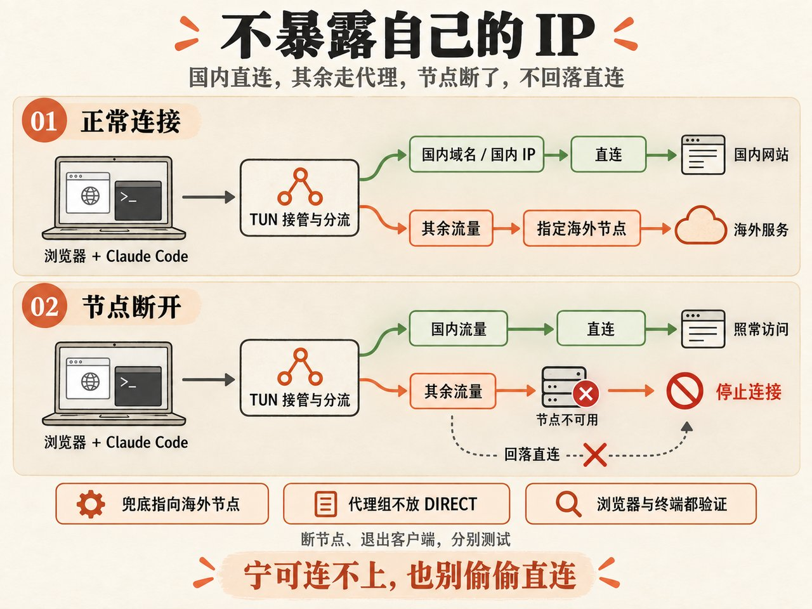

还有一点：Clash 默认的「系统代理」，终端里的命令行程序不一定走，而 Claude Code 正是跑在终端里的，所以要开 TUN 模式，让梯子把所有程序的流量都接管过去。

光配好分流还不够，**还得让梯子一断，Claude 也跟着断网**。

梯子总有掉线的时候，节点挂了、Clash 崩了、电脑睡醒还没重连上。

这时候要是流量自动改走直连，Claude 就会拿你的中国 IP 连上去，你自己还完全不知道。

**所以宁可断网，也别让它偷偷直连。**

做法是：梯子开好 TUN 模式，分流规则最后的兜底指向海外节点，代理组里也别放「直连」。

这样节点挂了，海外的流量就是连不上，而不是改走直连。

验证也简单：在 Clash 里把海外节点断掉，[claude.ai](https://claude.ai/) 打不开、国内网站照常能上，就对了。

分流和断网这两件，配置都不用自己手写，把下面这段话直接丢给你的 Agent：

````markdown
帮我改 Clash 的分流规则。目标：国内域名和国内 IP 直连，其余所有流量走我指定的海外节点；节点断了的时候宁可断网，也不要回落直连。

1. 先找到我正在用的 Clash 客户端和当前生效的配置文件，完整备份一份，告诉我备份在哪。
2. 保留我原有的节点订阅和局域网直连规则，不认识的节点不要删也不要换。
3. 加入国内域名和国内 IP 段的规则集（国内域名来源：https://github.com/pluwen/china-domain-allowlist；国内 IP 段来源：https://github.com/Loyalsoldier/clash-rules 里的 cncidr 规则集），命中的走直连。
4. 规则最后的兜底指向海外节点，不要留默认直连；海外节点所在的代理组里不要放 DIRECT。
5. 检查规则顺序和 DNS 设置，别让国外域名被国内 DNS 解析后走了直连。
6. 开启 TUN 模式，确认终端里的命令行程序也走代理。
7. 改完帮我验证：国内网站走直连；claude.ai 走海外节点；在终端里查一下出口 IP，确认在海外；再把海外节点断掉，确认 claude.ai 打不开、国内网站照常能访问。
8. 最后告诉我怎么一键恢复到改之前的配置。

缺什么信息先问我，不要猜。
````


<a id="shadowrocket-routing"></a>

### 使用 Shadowrocket 配置电脑和手机


设置一下小火箭的TUN模式：设置 → 代理 → 代理类型 → None（TUN Mode）。

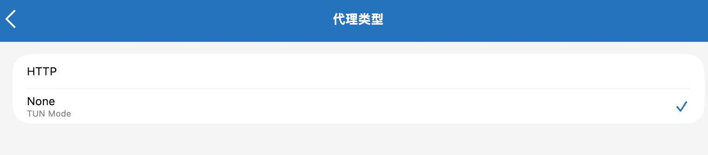

“全局路由 → 配置”负责按规则分流，这项也要打开，后续教程中，Codex会来改规则。

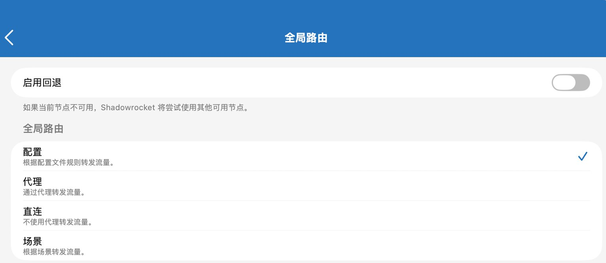

再打开「设置 → 隧道 → 包括所有网络」，Mac和iPhone都开启。这个开关会让普通应用的联网流量交给小火箭接管，再按分流规则决定走哪个节点或直连。开启后，仍需核验Claude请求是否走指定节点。

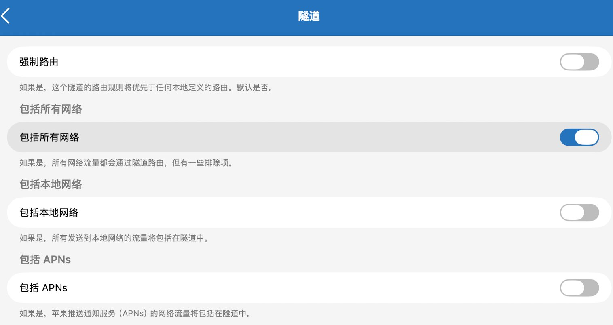

#### 1、选好节点，复制提示词给Codex

先在Mac的小火箭首页选中自己的固定节点，“全局路由”选择“配置”。

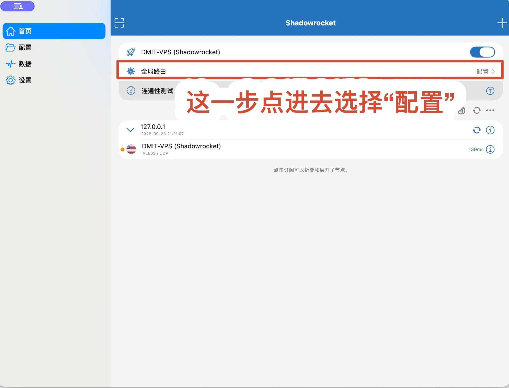

如果以前用过Clash等其他代理工具，部分程序可能还留着旧代理地址，出现浏览器能上网、Claude Code却连不上的情况。这一步不用自己找文件，把检查要求一起交给Codex即可。

随便取一个节点名称，把下面的【节点名称】替换成小火箭里显示的名字，再发给Codex：

> 请帮我配置Mac上的Shadowrocket，固定使用节点【节点名称】。
> 
> 检查并将“设置 → 代理 → 代理类型”设为None（TUN Mode），“全局路由”使用“配置”。
> 
> 开启“设置 → 隧道 → 包括所有网络”，确认开关已生效，再核验Claude请求是否命中指定节点。
> 
> 为以下4个域名添加DOMAIN-SUFFIX（域名后缀）规则，覆盖域名本身及其子域名，使用指定节点：
> [anthropic.com](https://anthropic.com/)
> [claude.ai](https://claude.ai/)
> [claude.com](https://claude.com/)
> [claudeusercontent.com](https://claudeusercontent.com/)
> 
> 修改前备份配置，保留其他分流规则。Claude相关规则不使用直连备用或自动切换节点。检查当前实际加载的规则，并验证正常连接时的真实出口。
> 
> 同时检查旧代理配置是否与当前Shadowrocket冲突，包括系统代理、环境变量、shell启动文件、npm、Git、Homebrew和Claude设置。
> 
> 逐项判断用途，只处理失效或冲突项，保留正常使用的配置。需要修改时，先列出具体改动和影响；修改前备份，修改后核验实际使用的Claude客户端是否正常联网。不要输出密码或令牌，也不要直接套用以前Clash的代理端口或代理组名。
> 
> 准备iPhone可用的相同Claude分流配置。下一步我会打开iPhone镜像，让你继续配置手机。最后说明哪些已经验证，哪些还需要操作。

#### 2、用iPhone镜像＋Codex配置手机

在Mac打开「iPhone镜像」，按提示完成首次连接。iPhone和Mac两端要登录同一个系统Apple账户（不是App Store购买账号），开启Wi-Fi和蓝牙，手机放在Mac旁边并锁屏，开启连接。

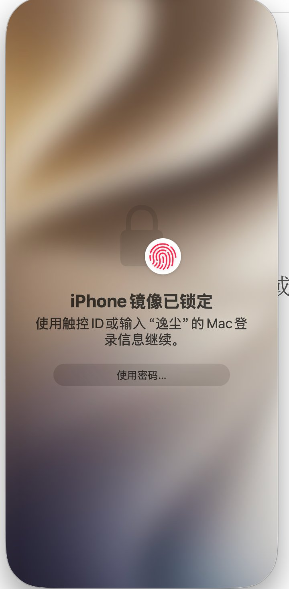

Mac上看到手机画面后，在刚才的Codex对话里发送：

> 我已打开iPhone镜像，请使用Computer Use操作镜像窗口，完成手机上的Shadowrocket配置：
> 
> 1. 先备份手机现有配置，保留其他分流规则，添加前面准备的4条Claude域名后缀规则。确认这些域名及其子域名走同一个固定节点，选择“配置”路由并连接。
> 2. 将“设置 → 代理 → 代理类型”设为None（TUN Mode），开启“设置 → 隧道 → 包括所有网络”，并开启“始终开启”，按当前版本识别对应入口并核验。
> 3. 分别核验Mac和iPhone的Claude请求是否命中指定节点，以及该节点的实际出口IP。不要只凭普通IP查询网页判断分流是否正确。
> 
> 遇到密码、Face ID或系统授权，告诉我接手。不要打开微信或改动无关设置。如果无法操作镜像，或修改VPN后镜像断开，说明停在哪一步，给我最短的接手步骤；恢复后继续核验。不要把未完成的事项写成已完成。


<a id="google-sign-in"></a>

### 另一种注册方式：Chrome 和 Google 账号

准备阶段，万事俱备，只欠东风，正式进入注册Claude阶段！
用新Gmail邮箱登录Chrome浏览器，打开claude.ai，点击“Continue with Google”。
接下来就是按照指示来做。然后到了手机号那一步，可填可不填。

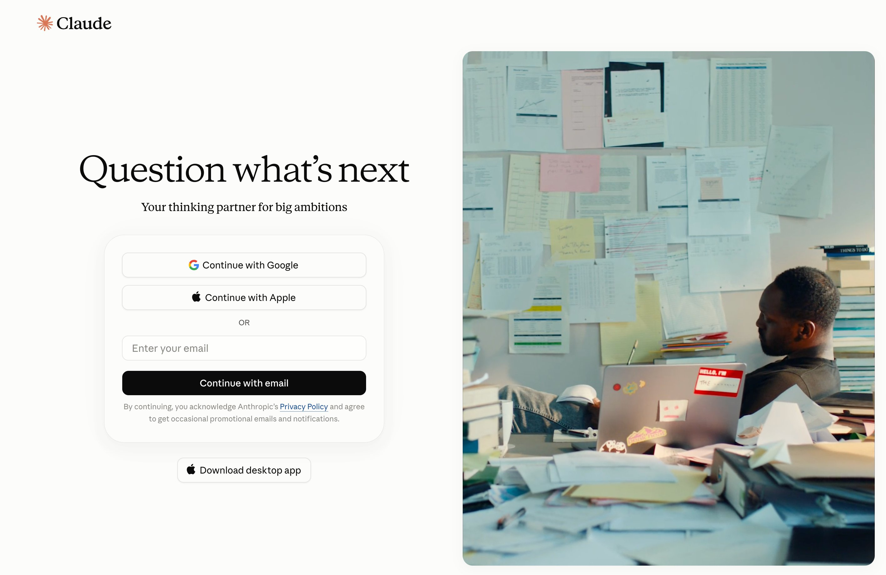


<a id="us-phone-number"></a>

### 需要验证手机号时，使用 RedPocket 和 BeeSIM

Claude要求验证手机号时，再按本节操作；没有要求的，可以直接跳到订阅章节。

关于手机号验证这一个，有些朋友遇到了，有些朋友没遇到，为了以防万一，我还是把焚决教给大家。

我选择的是**RedPocket美国手机号+BeeSIM转换卡**。（因为国行版iPhone不支持直接安装 RedPocket 的 eSIM，所以用了 BeeSIM 实体转换卡）

RedPocket是一年30美金，BeeSIM是19.9美金永久。（按照教程指导购买，用我的链接可以获取优惠价格）

这个是实体卡（要插入卡槽的，所以得预留一个卡槽位置），发货最快也要一两天才能到，所以建议提前购买。

#### 1、购买RedPocket套餐

- 直接打开eBay的RedPocket商品页

因为RedPocket官网需要美国银行卡，eBay可以直接中国PayPal支付，且价格更便宜。

商品页链接：[https://www.ebay.com/itm/136840233242](https://www.ebay.com/itm/136840233242?mkcid=1&mkrid=711-53200-19255-0&siteid=0&campid=5339217721&toolid=80009&mkevt=1)

中国PayPal很好注册，这个就不在这里展开。

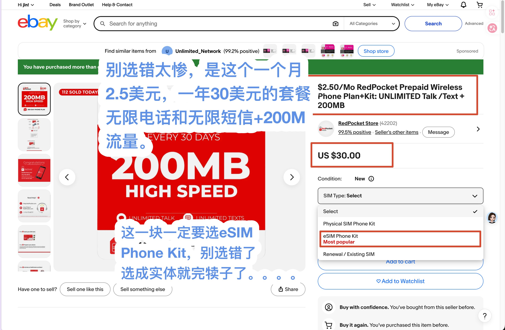

- 购买套餐

登录不登录都可以，不登录就游客购买，选择这个一个月2.5美元，一年30美元的套餐，下拉框这块选择eSIM Phone Kit（Most popular），然后点击“Buy it now”（截图中被下拉框挡住了）。

- 填写相关信息，用中国PayPal支付。

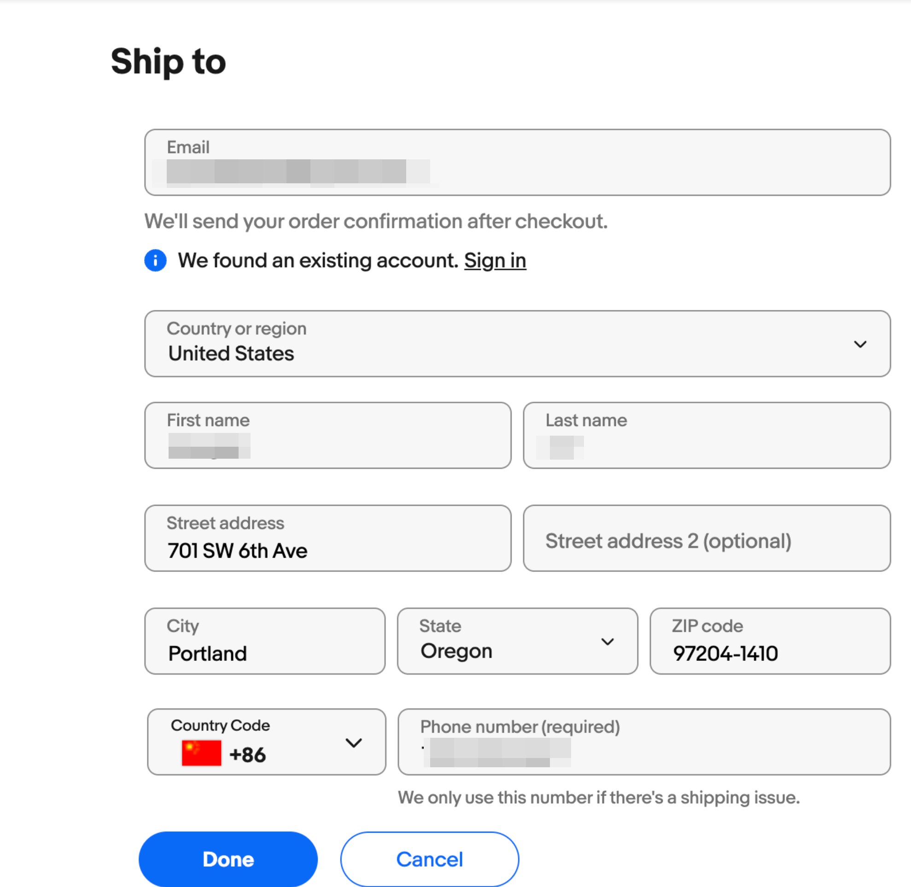

用ChatGPT或者Google地图找到一个美国免税州地址。

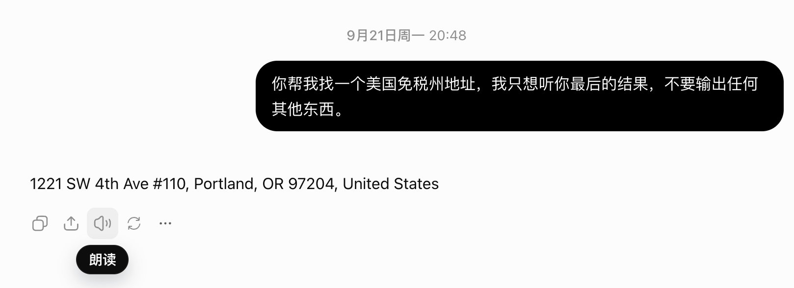

电话号的话填写中国手机号即可。

#### 2、激活并开启漫游

支付成功后，需要静静等待十几分钟，然后在上述填写的邮箱中找到一封RedPocket的邮件。

打开[redpocket.com/activate](https://redpocket.com/activate)这个网址，输入Confirmation Code。

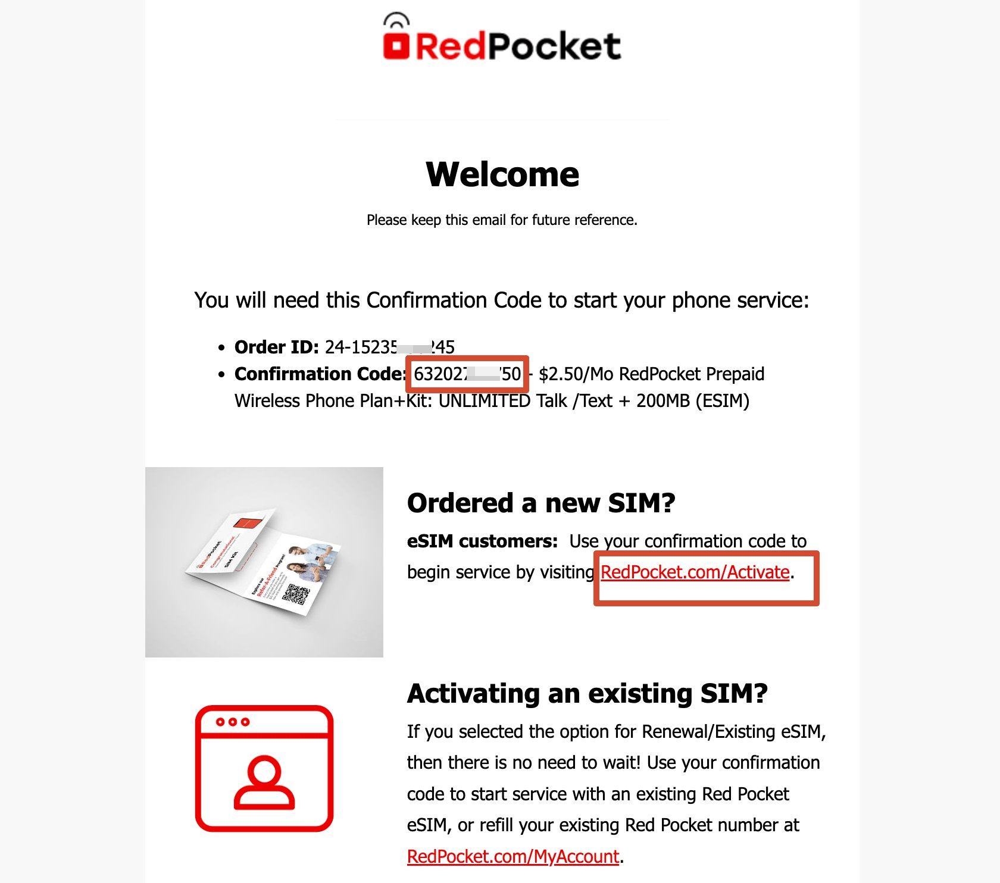

然后下方的Device MEID/IMEI，在iPhone的设置 → 通用 → 关于本机 → IMEI即可找到。

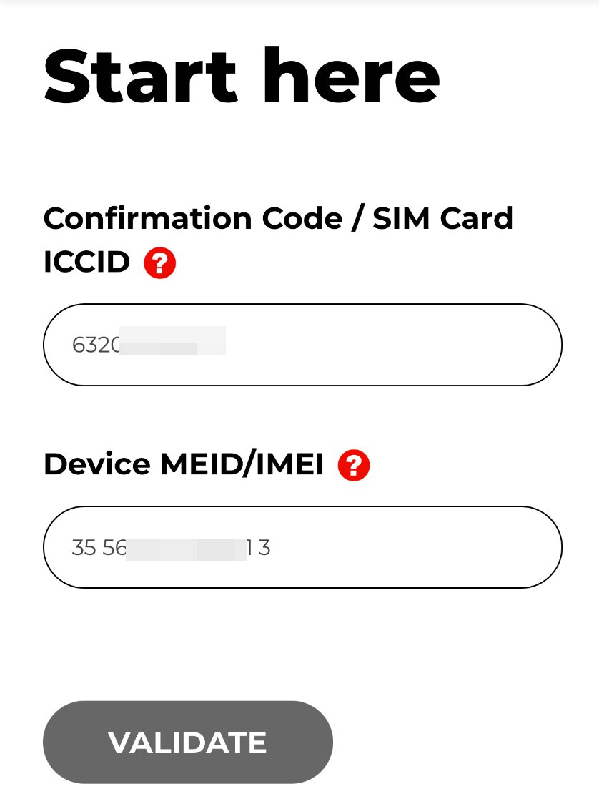

继续在“Roaming”界面（这个要在App内部找一下。因为我不知道为啥最近电脑登不上RedPocket官网，只能用手机，手机上和电脑上Roaming入口略有差距，大家仔细找找肯定能找到），开启Roaming，然后下拉框选“CHINA”，如果出现“It’s Enabled.”，即代表激活开启漫游成功。

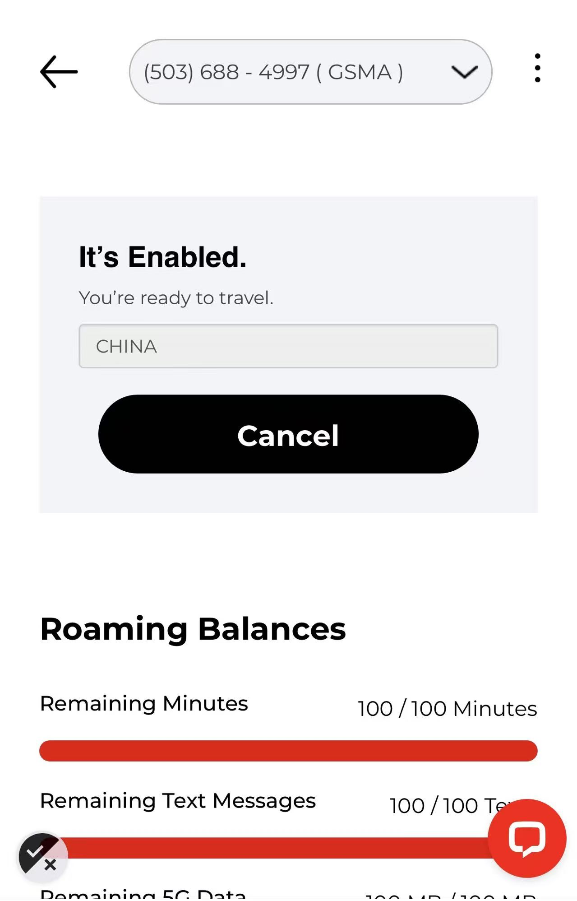

注意：有可能下方的Roaming Balances出现余额为0的情况（我遇到过），这个时候有两种解决办法：

- 法一：右下角咨询客服，让它把套餐额度加回来（有人成功过）。

- 法二：找eBay客服说明套餐额度问题，直接退款回PayPal，过一天再来重新购买套餐。

#### 3、导入eSIM到BeeSIM

如果上述操作一切正常，就需要开始把号码写入BeeSIM了。

首先，购买BeeSIM的卡，通过这个链接才能享受九折优惠：
[https://shop.beeesim.com/register?ref=7QLE2MXR](https://shop.beeesim.com/register?ref=7QLE2MXR)

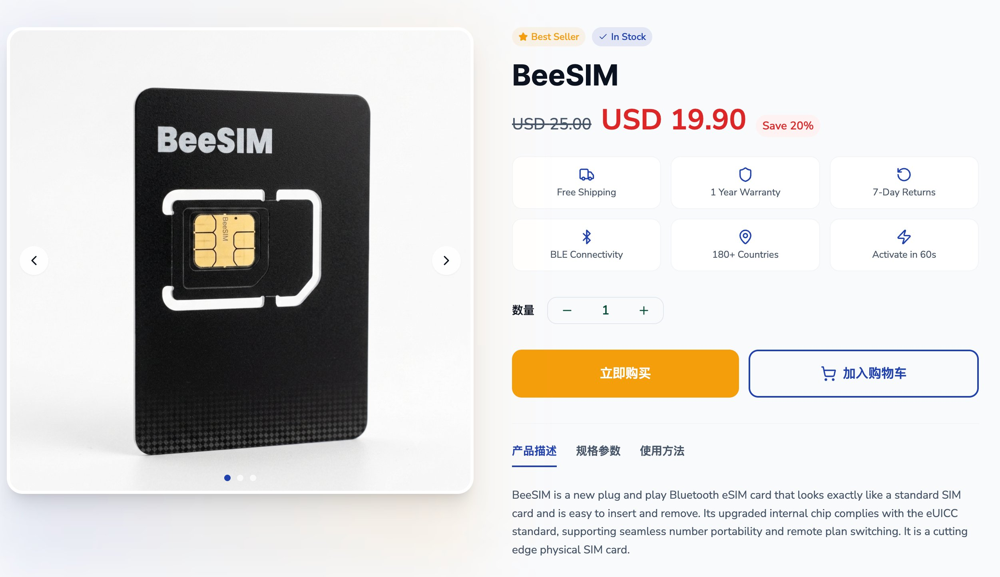

然后收到的信封上面有一个二维码，用微信扫描二维码就能跳转到BeeSIM小程序，或者直接微信搜索BeeSIM也能找到小程序。

然后开启蓝牙、连接BeeSIM。

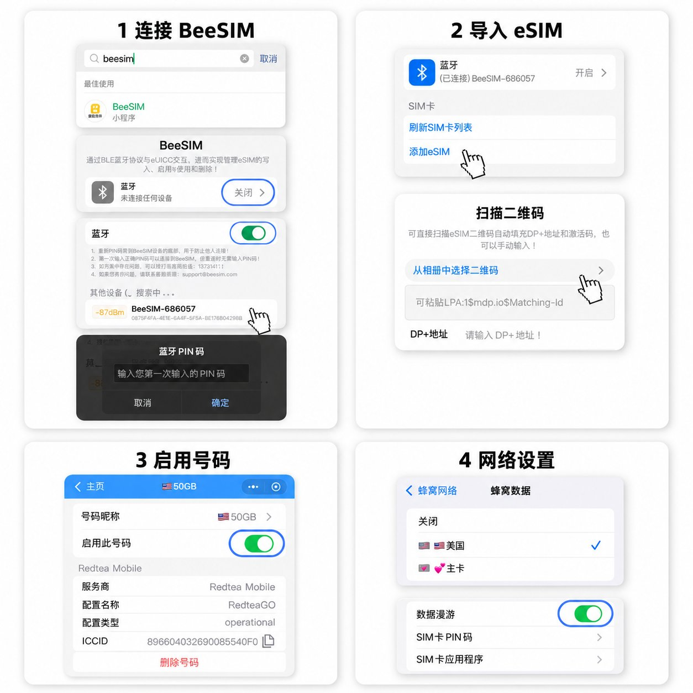

导入eSIM的时候，需要去从邮箱里面找到RedPocket发过来的带美国手机号和二维码的这封邮件。

用BeeSIM的扫描二维码即可录入相关信息，绑定即可。其余操作看图指示。

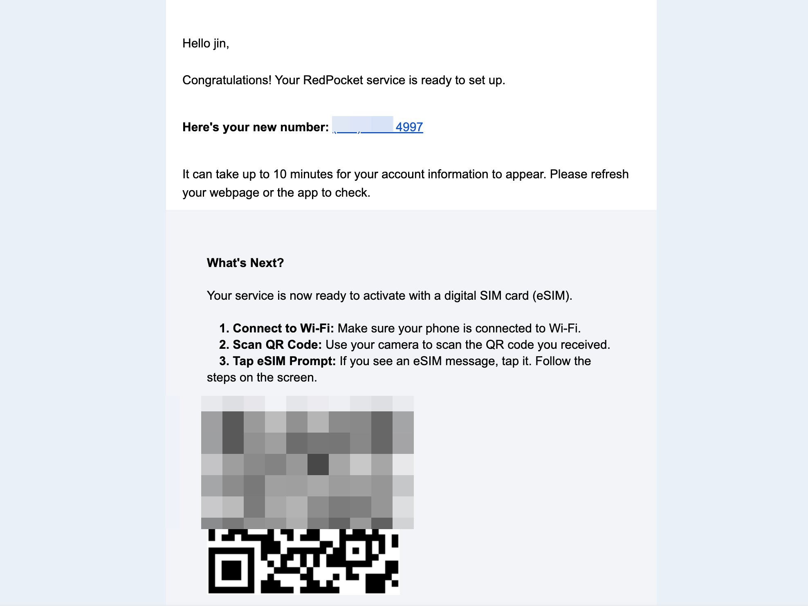

到这一步，美国手机号应该就能收发短信和接打电话了。

这个RedPocket美国手机号除了绑定Claude，也有普遍的海外手机号绑定用途，囤着不亏的。这应该是我估算了七八家之后选定的最终方案，性价比拉满。


## 六、订阅 Claude 账号

电脑和网络都收拾好了，接下来付钱。

付钱有两条路，走哪条看你手上有什么：

**网页订阅 + 海外卡**

- 你需要：一张能在海外付款的卡，我用的是 Starryblu，但是开卡要有护照才行

- Max 20x：200 美元一个月

- 被封了：不退款

- 麻烦程度：低

**苹果内购 + 美区礼品卡**

- 你需要：一台 iPhone、一个美区 Apple ID、美区礼品卡

- Max 20x：249.99 美元一个月

- 被封了：可以找苹果客服申请退款

- 麻烦程度：高，升 Max 时大概率要找苹果客服解除风控

先说网页路线。

我用的是 Starryblu，这张卡最近在 X 上挺火的，实测用于订阅 Claude 不会被拒。

**（10.19日更新，据反馈，Starryblu已有部分卡不支付绑定 Claude 订阅，已不推荐！！！）**

卡开好以后往里转钱，最方便的是有一张香港卡；没有的话，闲鱼上有人帮你入金

付款前有一件事比卡本身更重要：**你的 IP、账单地址、卡，这三样得对得上。**

比如你 IP 在加州，账单地址就填加州的。

要是 IP 在加州，账单地址却在别的州，卡又是新加坡卡，这样风险就高了不少。

**手里有干净的新加坡 IP，也可以整套换成新加坡：浏览器时区、语言按新加坡配，账单地址填新加坡的。**

然后在 Claude 里选 Pro，进到结账页。

你看左上角两张卡片，选蓝色那张「Pro monthly」，也就是月付，每月 20 美元。

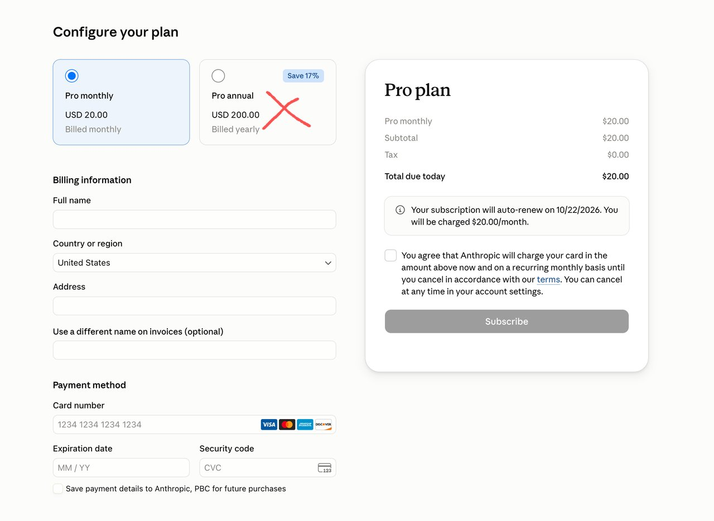

旁边我打了红叉的那张「Pro annual」是年付，网页上 Pro 年付是 200 美元一年，跟 Max 的 200 美元一个月长得很像，**买错了就是一整年的 Pro**。

付款的时候要是弹了 KYC，处理办法第三章结尾讲过：别硬过，直接重新注册一个新号。

<a id="web-billing"></a>

### 另一种网页账单填写示例


- 点击“Upgrade Plan”（哦对了，Claude没有中文界面，所以英文得好好学啊）。

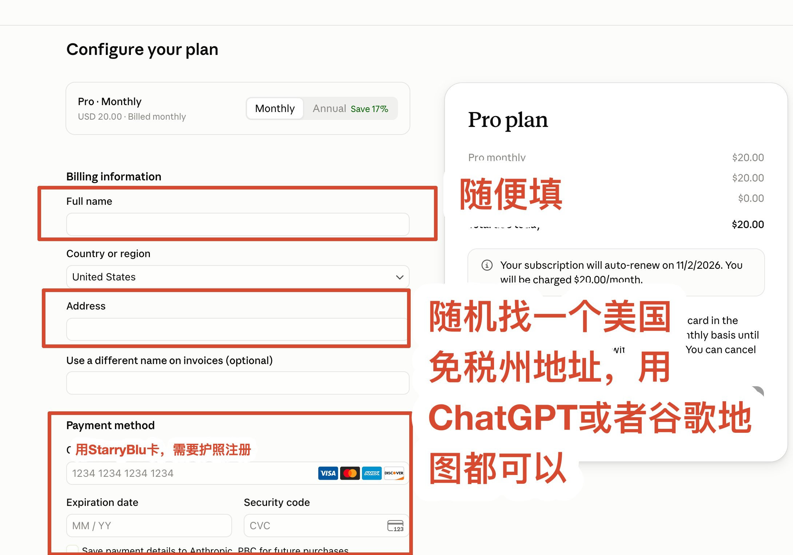

- Full name随便填一个英文名。

- Country or region选择United States。

- Address需要在ChatGPT或者谷歌地图随便找一个免税州地址（就用前面那一个就行）。

- Use a different name on invoices不填。

- 支付，我用的是StarryBlu，一张新加坡卡，成功通过了Claude订阅。

关于如何开卡，大家可以看我这个教程：

[2026年有港卡的朋友必须无脑开一张Starryblu MasterCard！绝对的神卡！零手续费，微信支付每日限额10万！！！](https://x.com/gengdaJ/status/2095746248208994671)

> 
> 大家都知道，港卡绑定微信之后，大额支付有3%手续费，花10万块钱，就要额外付3000块钱手续费！而且很多时候还要疯狂弹验证

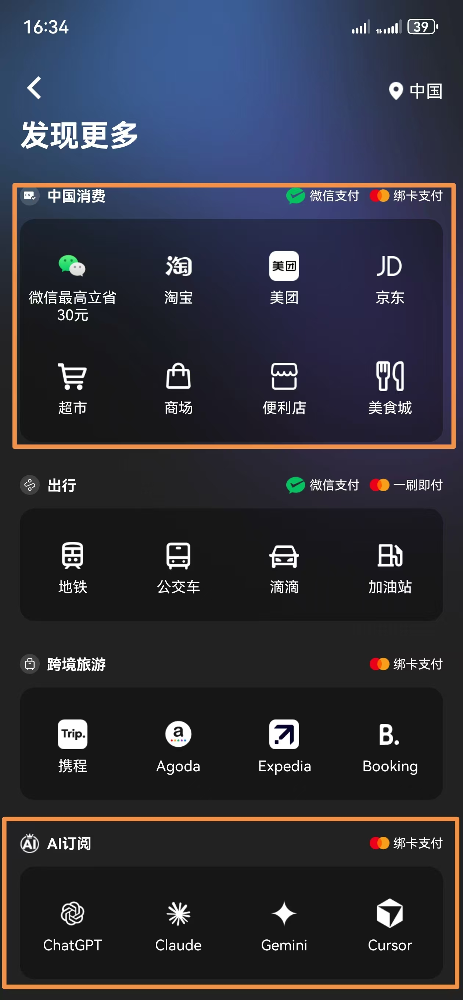

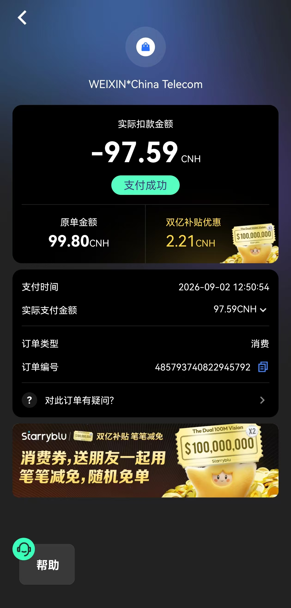

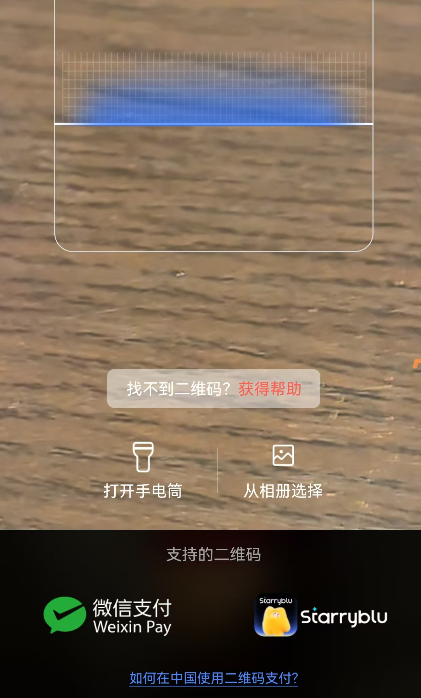

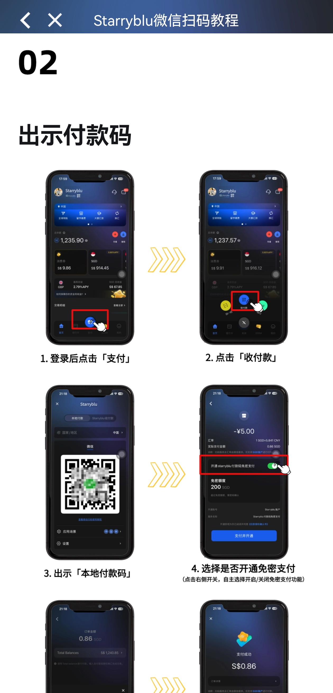

有一点点门槛：护照；港卡（如果用国内银行卡需要支付不低的手续费）9.9$买张卡，才能使用。

[https://bcn5ot9wwnew.feishu.cn/wiki/RpkuwzpHMiCoHak2gMjcuJeInFd?from=from_copylink](https://bcn5ot9wwnew.feishu.cn/wiki/RpkuwzpHMiCoHak2gMjcuJeInFd?from=from_copylink)


接下来，再说苹果 App Store 路线。

苹果那边每个月多出来的 50 美元的「苹果保护费」，换来的是不用海外卡，还有被封之后找苹果退款的机会。

退款的办法跟后面升 Max 时找苹果客服一样。

我的经验是第一次申请基本能过，第二次就难说了。

退款本身也有风险，**我有一次申请退款，苹果直接把我的 Apple ID 也封了**。

所以有能力的话，还是自己注册美区 Apple ID，真被封了，至少没白花买号的钱。

其实安卓机用**安卓的 Google Play 也是 250 美金订阅，但这个方式我不推荐，风控太严了**。

我在小米手机和谷歌安卓模拟器上都试过，号刚注册、还没怎么用就封了。

走苹果，先得有一个**美区 Apple ID**。

可以自己注册，YouTube 上搜「美区 Apple ID 注册」，教程很多；也可以去发卡网买。

买的话建议买贵一点的，**到手立刻把认证手机号改成你自己的，防止卖家申诉找回**。

买来的账号只在 App Store 里登录。

**别登 iCloud**，也别在系统设置里退出你自己的 Apple ID 去换，那样有锁机的风险。

有了账号，还得有美区礼品卡，美区账号只能用美区的。

最省事的是直接在支付宝里买，人民币付款，不用换汇。

先打开支付宝首页，点左上角，它默认显示的是你现在所在的城市。

城市列表是下面左图这样：切到上面的「国际/港澳台」，左边选「北美洲」，热门城市里点「旧金山」，美国任意一个城市都行。

切过去以后首页就变成了右图，往下翻到「超值抢购」，点第一张「大牌礼卡低至9折」下面我圈出来的「立即抢」。

进去是一整页品牌礼卡，一直往下翻到最底下的「更多大牌 折扣礼卡」，点下面左图里圈出来的 Pockyshop。

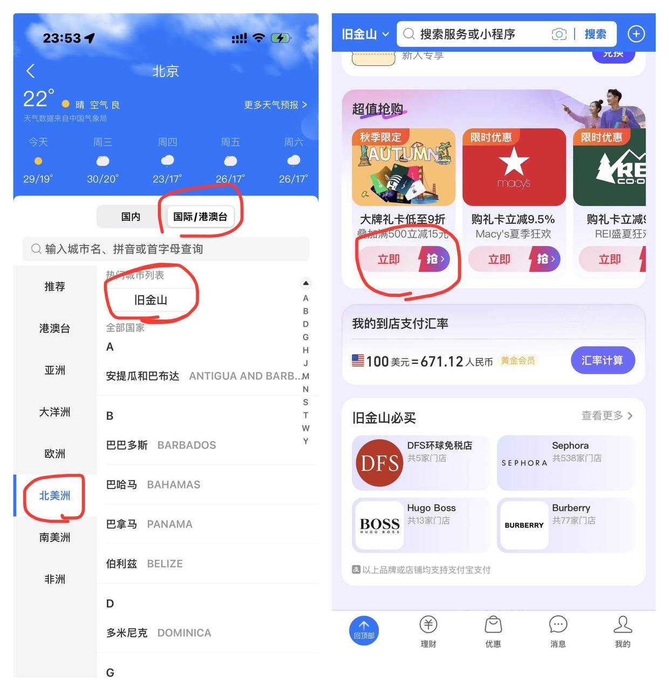

它会打开一个叫 Pockyt Shop 的小程序，地区选「美国」，右图里圈出来的「App Store & iTunes USA」和「Apple Gift Card US」都能用，充进去都是美区 Apple 账户的余额。

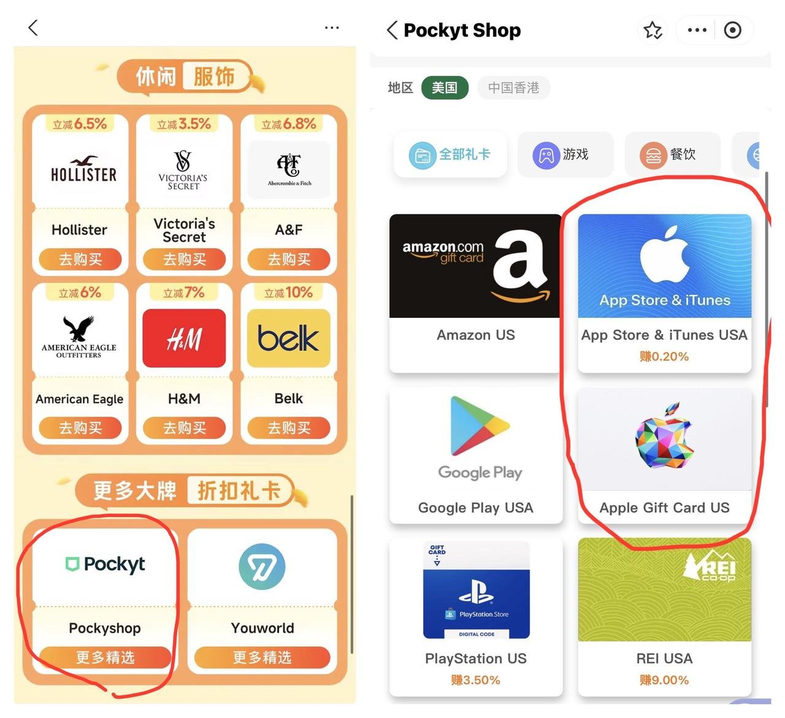

点进去选面额，用支付宝付款，付完去底部的「订单」里找卡密。

但支付宝的这个渠道买的人太多了，偶尔会缺货，如果缺货了可以在 SEAGM 平台上买，会有一些手续费，但也比闲鱼代充的便宜，而且这种大平台一般不会发黑卡给你。

注册登录之后，首页「热门游戏点卡」第一个，就是箭头指的「**iTunes 礼品卡 (美国)**」。

同一行右边的「Apple 礼品卡(美国)」也能用；中间那个土耳其区的别点错，区不对充不进美区账号。

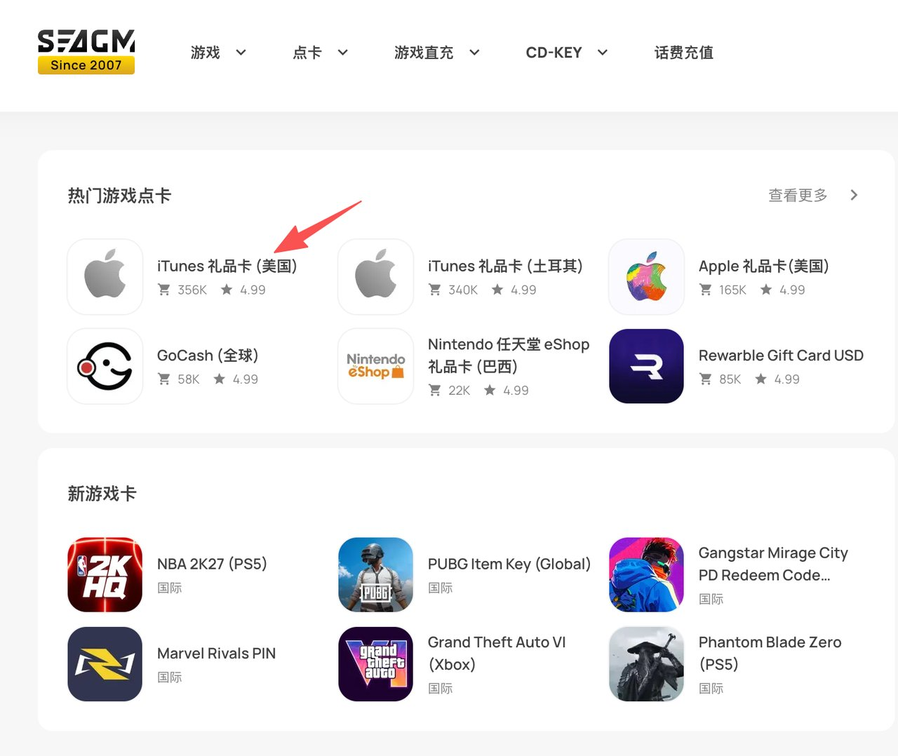

点进去选面额。

你看左边这两列，灰掉、带红色「售罄」标签的就是缺货的，我截图那天 10、20、25 美金这几档都没货，所以要用就提前买。

选好以后看右边的「总计」，这是你实际要付的钱，比如 15 美金的卡要付 15.28 美元，确认没问题再用支付宝付。

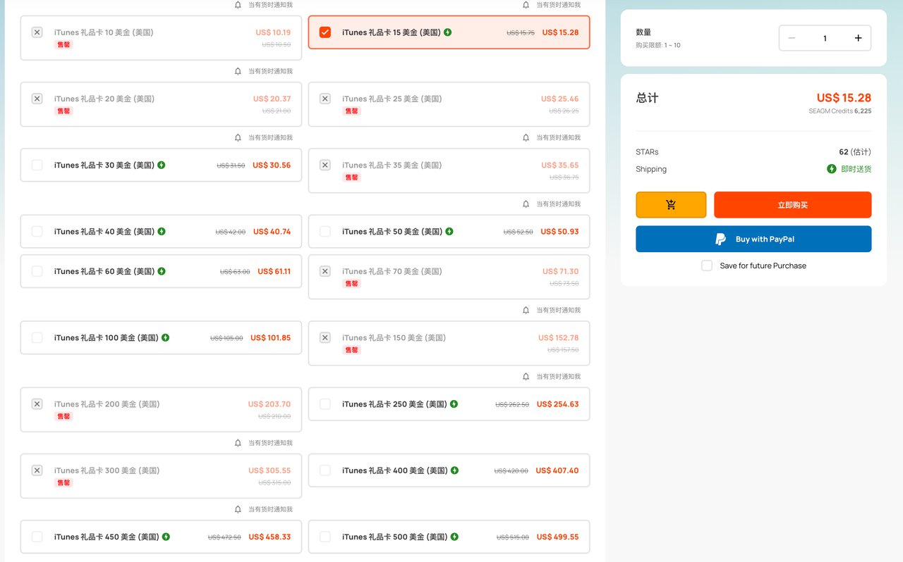

订单发货后，点「获取卡」拿到卡密。

这时要你输的是 SEAGM 的登录密码，不是 Google 密码。

卡密先存好，等手机上登好 Claude 再兑换。

**手机的梯子用跟注册时同一个出口**：在小火箭里加上你那个 SOCKS5，开全局模式，这部分也可以让 Codex 帮你创建一个配置文件。

国区 App Store 里搜不到 Claude，得先换成美区账号。

打开 App Store，点右上角头像，拉到最底下退出你自己的账号，再登录美区 Apple ID。

然后在 App Store 下载 Claude，用邮箱登录。

手机上填完邮箱，回到比特浏览器收 Claude 的登录邮件，就是下面左边这封，点中间黑色的 Sign in。

点完之后，比特浏览器里会出现右边这个 6 位数的验证码，标题下面写着让你把它填到「最初发起登录的地方」，也就是你的手机。

把它填回手机就登上了。

验证码下面那个「Sign in here instead」别点，点了就变成在电脑上登录了。

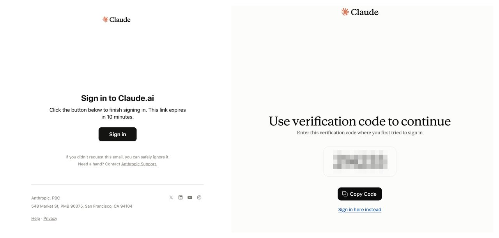

登上以后，**先充 20 美元，开 Pro**。

充值在 iPhone 的 App Store 里弄，点右上角头像，就是下面第一张图，我圈出来的「兑换充值卡或代码」，把 20 美元那张卡的卡密输进去，确认余额到账。

然后用一会儿 Claude，再在 App 里订阅 Pro。

第二张是订阅页，里面左边是月付 20 美元，右边我打了红叉的是年付 214.99 美元，**选左边的月付**，别看错。

订阅成功后进 Settings，就是第三张，Billing 这一行我画红圈的地方显示 Pro plan，就说明开好了。

苹果路线最容易翻车的，是**新号到手当天就充 200 多美元的礼品卡、马上订阅**。


苹果自己的风控在这件事上比 Claude 还恶心，大额充值紧跟着大额订阅，很容易直接被苹果限制购买。

所以才要先充 20 美元开 Pro，稳了再上 200 多美元的 Max。

## 七、接上 Claude Code

Pro 开好以后，就可以把 Claude Code 接上了。

**我建议用命令行（CLI）版的 Claude Code，不太建议用桌面客户端**。

一来 Claude 客户端也不太好用，二来客户端权限更高，能拿到的本机信息更多。

安装不用自己敲命令，直接跟 Codex 说一句「帮我安装 Claude Code 命令行版」，它会按官网 [code.claude.com](https://code.claude.com/) 上的方式帮你装好。

装好之后在终端里运行 claude，跟着浏览器提示登录。

登录方式选 Claude 账号，也就是你的 Pro 订阅。

浏览器授权那一步，跟邮件链接一个道理：**把授权链接复制到比特浏览器里打开**，在那个已经登录好 Claude 的窗口里点授权。

接上之后，日常怎么用才不出事？

回到第一章那三条红线，后两条靠你自己守住：

- 不开一堆会话高并发地跑；

- 不把订阅反代成 API，也不接各种中转站；

- 不聊违规内容。

## 八、Pro 升级 Max

什么时候升？

**Pro 正经用个五次左右，隔上一天，再升 Max 20x。**

你想想，一个正常用户会怎么升级？

他不会刚开 Pro 就立马换成 200 美元的 Max，而是先用一阵，觉得额度不够了才加钱。

这才是正常人用一款新软件的逻辑。

五次、一天都只是参考，不用卡得那么死。

走苹果路线的话，隔上一天，苹果号也不至于在短时间里连着大额充值。

网页路线最简单，在网页的订阅设置里直接升级 Max 20x 就行。

苹果路线要多几步。

走苹果的话，**先兑换 250 美元的礼品卡，余额够了再升级。**

在 App 里找不到升级按钮的话，进「管理你的订阅」，点「查看所有方案」，找 **Max 20x 月付 249.99 美元**。

认准名称和金额，别选成 Max 5x。

然后余额一定要备够，因为苹果的升级是立即生效的：**先全额扣 249.99 美元，Pro 还没用完的天数，再按比例退回原支付方式**。

不是只补个差价。

钱备好了点升级，大概率会弹出一个「无法完成购买」的提示，让你联系 Apple 支持。

这一步我没留截图，下面这张是网上找的示例，弹窗长得差不多。

这时候：

- **别反复点购买。** 点多少次都没用，等客服处理就行。

- **别点弹窗里或 App 里的 Apple 支持。** 你手机的 iCloud 登的是你自己的 Apple ID，那边显示的是你自己的账号，不是这个美区号。

要**在比特浏览器里打开苹果的在线支持**：getsupport.apple.com。


进去是一页分类，下半部分「Apps & Services」里，箭头指的就是 App Store。

点进去它问你出了什么事，选左上角第一个「Subscriptions & Purchases」。

右边紧挨着的「Gift Card & Codes」别点错。

然后在话题列表里，选左边第三个「Unable to purchase」，就是「无法购买」。

这一路全是英文。

看不懂的话，给比特浏览器装个沉浸式翻译插件，或者直接用微信截图：框住页面以后，点工具栏里箭头指的这个「翻译」按钮，整页就翻成中文了。

接着它会先推荐几个解决方案，都不用看，直接点左下角那个「Get more help」。

弹出来的「Contact Options」里只有一个选项「Live Chat」，点它，就进到苹果的在线客服了。

客服一般会先要你的 Apple 账户邮箱，再让你报一个 Support PIN。

这个 PIN 在 Apple 账户网页（[account.apple.com](https://account.apple.com/)）左侧导航的最底下，就是箭头指的那个灰色小字「Support PIN」。

点它拿到 PIN，发给客服就行。

这张图右边你也能看到，我这个号最后升上去的订阅就是「Claude Max 20x - Monthly」，249.99 美元一个月。

接下来就是怎么跟客服说。

我当时跟客服说的大概是这个意思：我就是正常在 App Store 买个订阅，不明白为什么被拒；我用了这么多年苹果，每次发布会都熬夜看，结果连个订阅都买不了，真的挺失望的。

英文不用自己憋，我是把这个意思丢给 ChatGPT 写的。

你看图里，我就跟它说了一句「跟对方动之以情」，又补了一句自己买了很多苹果设备、每次熬夜看发布会，它就写出了两段挺自然的英文，复制过去就能发。

你也照这个路子，把自己的情况跟 AI 讲清楚就行。

客服大概率会说：已经提交审查，请等 72 小时。

这时候别听完「已经在审查了」就走，**一定要追问一句：**

「So I understand that after 72 hours I will definitely be able to complete this purchase, right?」

**让他给你一个确定的答复**。

跟他多磨一下，成功率会高不少。

然后就是等。

**这 72 小时里什么都别碰**，别去反复尝试购买。

等满了，再从 Claude App 里升级。

大多数时候，等完就能买了。

但也别把 72 小时当成保证，我就遇到过连着等了四次还是买不了。

下面这张是我当时把客服聊天截图丢给 ChatGPT 的记录。


**没成就接着找客服**，别在 App 里一遍遍点购买。

升上去以后，还要注意续费别断。

苹果订阅是自动续费。

**每次扣费前 5 到 10 天，检查一下余额，提前把礼品卡买好、兑换好**。

礼品卡偶尔缺货，别等到扣款当天才想起来。

走网页的也一样，扣费前把 Starryblu 的余额充够，不然扣款失败，订阅就断了。


<a id="max5-upgrade"></a>

### 先升级到 Max5×

也有先升级到 Max5× 的使用经历：

> 等Pro用满第一个五小时之后，我就直接升级了Max5×，从注册账号到开通Max总共一天不到。但是升级20×应该也没啥问题，只要每周的周限额不要打满（留个10%-20%，封号概率就会降低不少）。


### 使用中国护照完成 KYC {/* #passport-verification */}

升级时遇到认证，也有这样的处理经历：

> 我升级Max5×的时候遇到了一个问题——KYC认证。
> 当时可给我急坏了，刚充的Pro就用不了了？？？
> 所以，我直接谷歌搜索了一波，找到别人的通过方法——直接使用中国护照。
> 
> 原理就是进行KYC认证的公司是Persona，这家公司的政策里面是允许中国护照的。
> 因为本来就有很多在美国工作的人和留学生，Anthropic也不可能一刀切中国人。
> 封号更重要的原因，可能还是在前面的出口IP和各种环境的设置。
> 
> 我当时参考的说明如下（参考资料截图）：
> 
> 
> 
> 过了KYC认证之后，我领了前段时间Claude官方赠送的250$云Claude Code额度，没出现什么问题。
> 我手机上也随时在用Claude App，也没有出现什么问题。
> 但是我没用过Claude Code CLI，所以不确定这个是否对账号有影响。。。（大家谨慎测试）

**参考资料：**
Claude 防封号教程：

[https://x.com/gkxspace/status/2101993381303820704?s=20](https://x.com/gkxspace/status/2101993381303820704?s=20)

中国护照过KYC教程：

[https://github.com/alchaincyf/zhangxuefeng-skill/issues/63](https://github.com/alchaincyf/zhangxuefeng-skill/issues/63)


## 最后

整套走下来大概一周，最磨人的是等苹果客服，其他步骤照着截图点就行。

走完以后，你就能跟我一样用上 Max 20x，Opus 5.5 敞开用。

回头看，这篇里的每一步，其实都在回答同一个问题：

**一个正常的美国用户，会这么做吗？**

以后碰到文章里没写到的情况，你也拿这句话问问自己，基本就知道该怎么做了。
