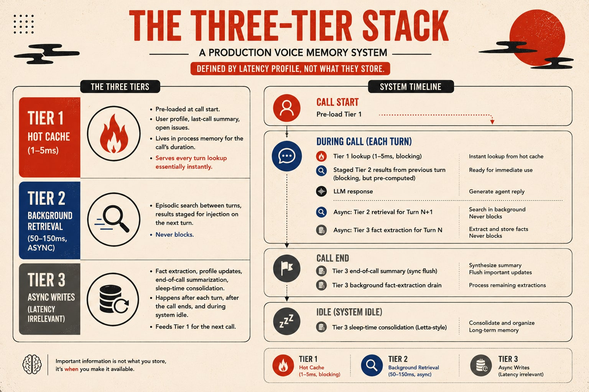

在调研语音代理的记忆模块实现时，我看到了一篇文章，讲的是为什么语音代理的记忆问题比想象中更难。作为记忆模块的开发者，我在开发语音代理的过程中也遇到了文章提到的许多问题，读来感同身受。语音代理和文本代理有很大不同，许多问题尤其棘手，其中响应速度和准确性是我面临的最大挑战。接下来，我会参考这篇文章，结合自己的实践，分享一些思考和体会。

{/* truncate */}

第一次尝试为语音代理接入记忆层时，系统从第一轮开始就慢了数百毫秒，之后再也没有恢复。只过了一个来回，原本自然的对话就变得让人想问：“电话还通着吗？”原因是我原封不动地移植了文本代理的记忆架构：先对托管存储中的记忆做同步向量检索，再做一次简单的重排序，最后才交给 LLM。在文本聊天界面上，根本没人会注意到这点延迟。但在语音场景中，每一轮都让人感觉代理开口前要先缓冲一下。

语音留给记忆的时间太紧，读写路径必须反转过来。你以为的记忆操作，大部分都不能放在响应的<Term tip="从用户说完话到听见代理回应之间必须走完的那段流程，这里多花的每一毫秒用户都得等着">关键路径</Term>上：要么提前加载，要么提前计算，要么事后写入。这一切都建立在[语音代理架构](https://manthanguptaa.in/posts/voice_agents_primer)那篇讲过的 ASR → LLM → TTS 流水线之上。

我花了不少时间研究不同项目的记忆机制，包括 [ChatGPT](https://manthanguptaa.in/posts/chatgpt_memory) 和 [Claude](https://manthanguptaa.in/posts/claude_memory) 的记忆如何运作，以及 Mem0、Hindsight、OpenClaw（小龙虾）等开源项目的记忆实现。原文作者还在 [Water](https://github.com/manthanguptaa/water) 里做过分层记忆，把 BYOM 做成了用户自己掌握、可以随身带走的记忆层，并[主张](https://manthanguptaa.in/posts/memory_is_a_mistake)大多数 AI 产品根本不该上线记忆功能。可一到语音，设计还是得换。这篇文章讨论的，就是语音场景的约束、由此带来的权衡，以及生产环境中反复出现的四类架构。

## 为何语音记忆与文本记忆截然不同

文本代理天然有一定的等待余地。用户输入文字，看到加载提示，通常可以接受等待 1–3 秒再收到回复。大多数记忆操作都可以安排在这段间隙里，包括向量检索、对过往对话的语义搜索，甚至一次快速的摘要处理。文本交互让用户习惯了等待，也给系统留下了处理记忆的时间。

语音交互没有这么多余地。预期的端到端响应时间为 500–800 毫秒，这就是全部的延迟预算，要覆盖所有环节：语音识别（ASR）输出最终转录文本、记忆检索、LLM 生成首个 Token、语音合成（TTS）生成首个音频块，以及音频传输。记忆处理能分到的时间只有大约 50–100 毫秒，超过这个范围，就会打乱对话节奏。访问一次托管向量数据库，一个来回光网络耗时通常就有 20–80 毫秒。再加上嵌入计算、近似最近邻（ANN）搜索和结果格式化，LLM 连一个 Token 都还没看到，留给记忆的预算就已经花光了。

输入形式是第二个差异。文本代理接收的是经过组织的文字，而语音代理接收的是即兴口语的流式转录，其中夹杂着口头停顿、说到一半重新起句、指代错误和自我纠正。在我的实践中，语音识别错误尤其令人头疼。即使是在文本聊天中表现很好的<Term tip="从对话内容里抽出值得记住的信息，比如用户的姓名和偏好">事实提取</Term>流程，到了语音场景也会遇到困难。

<Term tip="对话里一方连续说完的一段话算一轮">轮次</Term>密度是第三个差异。语音对话的每一轮更短、交替更快，包含的信息也更少，通常每轮只有 10–30 个词。一次 10 分钟的对话平均会产生 40–60 轮，以及 1500–2000 个 Token 的转录文本。这听起来还可控，但在<Term tip="直接输入和输出音频、不经过文字转换的模型，也就是后文的端到端语音模型">语音原生模型</Term>上，音频会把这个数字放大很多。OpenAI 的 [Realtime API 手册](https://developers.openai.com/cookbook/examples/context_summarization_with_realtime_api)就明确提到：“在实践中，同一句话用音频表示时，Token 数通常约为文本的 10 倍”，而 `gpt-realtime` 的上下文窗口上限为 32k。一次普通的客服对话，就足以超过这个上限。

第四个差异常被忽视，那就是冷启动问题。在文本聊天中，用户通常已经登录，系统知道会话属于谁。而在电话语音场景中，系统最初往往只有一个电话号码，必须在最初的几百毫秒内确认用户身份。假定“第一轮就知道用户是谁”的记忆架构很脆弱。好的架构把“不知道用户是谁”当作默认情况。

在陪伴型语音代理中，系统往往默认听到的话都来自用户。即使只面向一个用户，来自其他人的声音或背景音也可能被记到用户名下，让记忆变得一团糟。也许你从没说过自己喜欢吃麦当劳，只是电视里偶然出现了这样一句话，代理却牢牢记住了，还把它当成你的偏好。

## 真正重要的记忆层次

记忆有三个层次值得关注，综述文献讲代理记忆时，大体也是这样划分的。近期的 [From Storage to Experience](https://arxiv.org/abs/2605.06716) 综述把代理记忆的演进概括为：存储 → 反思 → 经验。Letta 的产品文档也写明了大致相同的划分：核心记忆 → 回忆记忆 → 归档记忆。叫法不同，但底层的层次划分是一致的。

对话记忆包括当前对话的转录文本及各轮的先后顺序，保存在 LLM 的上下文窗口中。现代模型名义上支持 128k 以上的 Token，但实际可用的上下文窗口只有 4–8k，一次长对话在你察觉之前就会把它撑满。将完整转录文本塞入上下文，会拖慢生成速度，也会让模型更难关注真正重要的信息。

会话事实属于工作记忆层，指当前对话中已经确认、需要在后续轮次中持续保留的信息。例如，“我叫小熊，今年 23 岁”，代理不应该过了五轮又把这些信息问一遍。没有这一层，语音代理就会像只有“金鱼记忆”一样，转眼忘记刚说过的内容。在电话里，这是破坏用户信任最快的方式。

用户档案属于长期记忆层，存放跨对话持续有效的事实，包括姓名、偏好、上次对话摘要、未解决问题以及人际关系背景。正是这一层，让再次发起对话的用户感到自己被记住了，不必每次都从头介绍。

核心的设计难题在于后两层：如何在对话过程中提取会话事实，并在需要时提供给代理？如何跨对话持久化和检索用户档案？这两件事都必须满足前面提到的延迟限制。

## 延迟究竟消耗在哪里

我们把这个延迟限制具体算一算。一个典型的语音代理响应周期如下：

1. 用户停止说话 → 语音活动检测（VAD）判定这一轮结束（约 100 毫秒）
2. 流式 ASR 输出最终转录文本（在 VAD 判定结束后约 50 毫秒）
3. 执行记忆检索（耗时多久？）
4. LLM 接收补充了记忆的提示词 → 生成首个 Token（首 Token 延迟，即 TTFT，快速模型约 300 毫秒）
5. TTS 生成首个音频块（在首个 Token 之后约 100 毫秒）
6. 总体目标：从用户停止说话到输出首个音频块，耗时控制在约 600 毫秒

第三步就是留给记忆检索的时间。要满足 600 毫秒的总体目标，这一步必须在大约 50–100 毫秒内完成。

这就直接排除了大多数容易想到的方案。如果每一轮都同步做向量检索，查询本身就要 30–100 毫秒，生成嵌入向量、排序和格式化还要再花 50–100 毫秒。Mem0 自己的[**语音代理记忆指南**](https://mem0.ai/blog/ai-memory-for-voice-agents)指出，语义搜索耗时为 *“50–200 毫秒，具体取决于你的向量数据库和基础设施”*。即使是专门为低延迟上下文检索而设计的 Zep，也[**宣称单独使用时 P95 延迟低于 200 毫秒，接入 LiveKit 语音代理时低于 250 毫秒**](https://blog.getzep.com/zep-livekit/)。

这些数字放在文本聊天里很出色。放到语音里，它们已经处于可接受范围的边缘，而且只有中位数延迟勉强达标，<Term tip="最慢的那一小部分请求的耗时，比如 P95、P99">尾部延迟</Term>根本达不到。如果每一轮都再调用一次 LLM 生成摘要，就更不可行了：主 LLM 还没开始工作，这一步就要花掉 300–800 毫秒，用光全部延迟预算。

真正可行的方案只有一个：**从高速进程内缓存或本地 Redis 中做一次键值读取**。耗时仅 1–5 毫秒，延迟稳定，用户几乎感知不到。

## 每个语音记忆架构背后的四个关键问题

一旦你真正理解了“**记忆处理不能放在关键路径上**”，架构设计就只剩四个关键决策。我考察过的每一个生产级记忆系统，包括 Letta、Zep、Mem0、A-MEM、MemoryBank 和 Generative Agents，都隐含着这四个问题，只是各自给出的答案不同。这四个问题的答案定下来，架构的大部分也就定了。

（如果你想了解厂商对这个话题的看法，Mem0 的[**语音代理记忆指南**](https://mem0.ai/blog/ai-memory-for-voice-agents)值得一读。）

### 什么时候写入

是每轮写入，也就是每次交流后提取事实，还是等对话结束后再批量写入？后者成本更低，提取结果的噪声也更少，因为模型能看到完整的对话脉络。

每轮写入成本更高、噪声也更多，但数据更不容易丢失：如果进程在对话中途崩溃、WebRTC 会话异常中断，或对话结束时的提取任务失败，结束时批量写入就会丢掉这次对话的全部记忆；每轮写入则能保住截至最后一个成功轮次写入的所有事实。

我见过的几乎所有生产级语音系统，都愿意承担这部分额外成本，采用每轮写入。因为电话语音场景中的异常中断很常见，而“转录文本丢了”这种故障，谁也不想在线上现场排查。（还有第三种方案，休眠期写入，下文单独讲。）

### 写什么

每遇到一条待写入的事实，我都会问：它真的会改变代理在未来对话中的回应方式吗？如果不会，它就是噪声。带有噪声的记忆比没有记忆更糟糕，因为它会降低重要信息的检索准确性。实际做法是：应用场景越专门，筛选就应该越严格。通用助手可以采用通用的 LLM 事实提取流程，而医疗接诊代理则应按照字段和类型明确的数据结构写入，拒绝不符合结构要求的内容。

### 如何检索

主流的模式有四种：

| 模式 | 适用场景 | 代价与局限 |
| ---- | ---- | ---- |
| 全部注入上下文 | 用户的记忆条目少于 20–30 条时 | 超过阈值后，Token 用量膨胀；上下文过长时，模型容易[忽略中间的信息](https://arxiv.org/abs/2307.03172) |
| 纯语义搜索 | 每一轮能否查到相关内容成为瓶颈时 | 每轮增加 50–200 毫秒延迟，对语音交互而言通常太慢 |
| 预加载上下文 | 用户拥有稳定、可总结的历史记录时 | 长时间会话中，预加载内容可能过时；冷启动时没有可加载的内容 |
| 混合模式（预加载 + 按需检索） | 大多数生产级语音代理 | 需要检测话题切换，但它是正确的默认选择 |

### 运行在哪

记忆处理可以在响应流程中同步执行，可以交给与语音流水线并行运行的记忆代理，也可以放到事后处理。对于语音，答案几乎总是：写入并行执行，读取靠预加载；只有最紧迫的情况，才在响应流程中同步检索。

这四个问题的答案，共同决定了系统采用哪一类架构。

## 架构全景

我将考察过的语音记忆架构大致归为四类。它们并不互斥，大多数实际系统都会结合其中至少两类。这种划分有助于理解不同方案各自解决什么问题。

### 第一类：原生框架状态

成熟的语音代理框架都会在流水线内部维护整个会话期间的对话状态。主流端到端语音 API 也会在服务端维护这些状态，通常还内置了上下文截断功能。

这类方案只解决单次会话内的问题，对话结束后不会保留状态。它应当是记忆架构的基础，但本身还算不上一套完整的记忆架构：适合存放会话事实，却无法满足跨对话的记忆需求。

端到端语音模型将 ASR → LLM → TTS 的级联流水线合并为一个有状态的会话，解决了流水线带来的延迟问题，却没有解决记忆问题。OpenAI 的 Realtime API 将会话上下文限制在 32k Token 以内，Google 的 Gemini Live 会在每次对话结束时丢弃会话状态。两者都没有内置跨会话持久化机制，需要你在外围自行实现。

换成端到端模型，原本要围绕级联流水线搭建的记忆架构，一样还得搭建。端到端方案的一个优势是，多模态模型可以直接处理音频，因此能从原始音频中提取事实，不必依赖只能近似还原语音的转录文本。如果犹豫、语调、情绪等副语言信号会影响代理的回应，这一点就尤其重要。

### 第二类：外挂记忆服务

我交流过的大多数团队都是从这里起步的：将第三方记忆服务作为一个处理组件，插入<Term tip="把用户的转录片段汇总成一条完整消息的流水线组件">用户消息聚合器</Term>与 LLM 之间，配置好用户或实体 ID，然后让它负责整个记忆读写流程。[**Mem0**](https://docs.mem0.ai/integrations/pipecat)、[**Zep**](https://blog.getzep.com/zep-livekit/)、[**Hindsight**](https://hindsight.vectorize.io/blog/2026/04/28/pipecat-voice-ai-persistent-memory) 和 [**Supermemory**](https://github.com/supermemoryai/pipecat-memory) 都为主流语音框架提供了插件。

这些方案的共同点是：**都集成在流水线层面，按用户或实体划分记忆范围，异步写入，读取靠预加载或按需检索**。它们的差异主要在于底层存储方式（向量、图或 SQL）、事实提取有多激进，以及在每次对话中用起来是否顺手。

### 第三类：知识图谱记忆

这类方案最让我感兴趣，因为它真正改变了“记忆”的含义，而不只是提高读取速度。知识图谱系统不再仅仅存储经过向量化的文本片段、按相似度检索，而是存储**实体、关系及其时间有效性**，并通过图遍历结合语义搜索来检索信息。模型得到的会是 *“John 最喜欢的歌曲是 Coldplay 的《Viva La Vida》（有效期：2024 年 1 月 15 日至今）”*，而不是三个零散的历史对话片段。

在生产环境中，我最常见到的选择是 [**Zep 的 Graphiti**](https://blog.getzep.com/zep-livekit/)；学术界最有意思的方案则是 [**A-MEM（NeurIPS 2025）**](http://arxiv.org/abs/2502.12110v7)。A-MEM 把每条记忆写成一则卡片盒笔记法（Zettelkasten）风格的笔记，后来的其他记忆还可以不断更新这些笔记，因此整个图谱会被主动重新组织，而不只是不断追加内容。

代价是复杂性：与扁平的向量索引相比，图谱更难调试，清理和淘汰记忆也更麻烦，构建成本更高。但如果语音代理要和同一用户持续对话数年，**这类方案才是长期解决之道**。

### 第四类：认知架构

第四类方案把记忆看作认知过程，而不是数据库。奠定这一思路的工作是 [**Park 等人的 Generative Agents（UIST 2023）**](https://arxiv.org/abs/2304.03442)：维护一条记忆流，通过周期性的反思提炼更高层次的认识，并在检索时根据新近程度、重要性和相关性为候选记忆评分。反思是大家最常借鉴的部分，因为正是它让代理显得越来越理解你，而不是只会复述你说过的话。

一些变体还加入了其他机制：[**MemoryBank**](https://arxiv.org/pdf/2305.10250) 引入了类似艾宾浩斯遗忘曲线的机制，让长期未使用的旧记忆逐渐淡出；[**MemR3（2025）**](https://arxiv.org/abs/2512.20237) 则把检索变成一个路由器，在每轮对话中决定是检索、反思，还是直接回答。这些方案很少做成开箱即用的产品，更值得借鉴的是其中的设计模式：反思的调度方式、按重要性加权的检索、随时间衰减的评分机制。你可以将它们叠加到“第一类 + 第二类”的基础架构之上。

## 反转记忆的读写路径

无论选择上述哪类架构，在生产环境中真正行得通的模式，都是把记忆操作分为两类：响应之前的检索，以及响应之后的写入。**关键路径上只保留绝对必要的检索，即便是这部分，也要通过预加载尽可能提速。**

在对话开始时预加载。对话刚建立、用户还没开口时，通常有几百毫秒的初始化时间，用于建立 WebRTC 连接、初始化音频、协商编解码器。利用这段时间，将用户档案、上次对话摘要和未解决问题加载到会话本地缓存中。等到第一轮对话到来时，所谓的“记忆检索”就只是一次字典查找，不再需要网络请求。如果到第一轮才去取用户档案，多花的每一毫秒，都会变成用户听到的沉默。

冷启动才是真正考验这一设计的场景。如果用户身份未知，就无法预加载任何用户专属信息。你可以在最初一两轮中确认身份，例如让用户提供账号，或在连接建立期间通过电话号码查询 CRM；也可以接受首次对话的上下文比较有限，并通过提示词让代理妥善应对这种情况。我最常见到的错误，是团队把已认证用户当作系统的默认情况，把匿名用户视为边缘情况。而在电话语音场景中，匿名来电恰恰是最常走的路径之一。

预加载是读写路径反转的一半，另一半是**异步写入**。每次响应之后，启动一个无需等待结果的后台任务，从最新一轮对话中提取新事实并持久化。这样，对话结束时，用户档案基本已经更新完毕，而这些工作没有占用任何一轮响应的延迟预算。有些短对话，提取还没完成用户就挂断了。这时可以让对话结束处理程序等一小段时间再退出，超时通常设 2–3 秒就够了，让正在执行的任务跑完。此时用户已经离开，没有延迟预算需要守了。

随后，把完整转录文本总结一遍，保存为这次对话的正式记录，包括讨论了什么、问题是否解决、关键事实以及后续待办。这份摘要就是下一次对话预加载的 `last_interaction`，也是语音记忆系统中最被低估的产物。[**ChatGPT**](https://manthanguptaa.in/posts/chatgpt_memory) 和 [**Claude**](https://manthanguptaa.in/posts/claude_memory) 的文本记忆系统也依赖同样的思路：在检索时，经过整理的摘要总是比原始转录文本更有用。

真正上线后，有两个问题很容易让你吃亏。第一个是，预加载可能赶在上一次对话的回写完成之前读取数据。假设用户在一次对话中要求代理称呼自己为 Alex，每轮提取捕获了“请叫我 Alex”并写入存储。如果下一次对话预加载时，读到的却是这次回写完成前几秒生成的<Term tip="某一时刻存下来的一份数据副本，之后的改动不会反映在里面">快照</Term>，代理仍会用旧名字问候用户。这比完全没有记忆更快地消磨信任。解决方法很直接：就算快照比较旧，也始终返回最新回写的内容。但这种故障往往要等到真实用户开始使用后才会暴露。

第二个是成本。每轮提取意味着每一轮都要额外调用一次 LLM。按每次调用几美分、一次对话 40–60 轮计算，一段 10 分钟的对话，光是事实提取就可能花掉几美元。对于高价值的客服对话，这可以接受；对于大规模提供免费服务的消费级助手，这种成本则难以承受。务实的选择是使用更便宜的提取模型，通常一个经过蒸馏的 <Term tip="B 指十亿参数，7–8B 就是 70 亿到 80 亿个参数">7–8B</Term> 模型就足够；也可以按更长的滚动窗口来提取，或者在利润空间较小的场景中，更多地采用对话结束后提取。

## 压缩单次对话中的历史记录

即使只看一次对话，你也会比预想中更快碰到实际可用的上下文上限。一段正常语速、持续 10 分钟的对话，仅转录文本就有 1500–2000 个 Token；在语音原生会话中，音频占用的 Token 数还会膨胀到约 10 倍，远远超出模型宣称的长上下文真正管用的范围。

应对方式是**滚动窗口配合摘要**：完整保留最近 N 轮，将更早的内容替换为压缩摘要。当转录文本达到某个阈值，例如 20 轮时，启动一次异步压缩，把前 10 轮浓缩成 3–4 句话。这项工作适合交给快速的小模型，例如和语音代理在同一台机器的 GPU 上运行的蒸馏版 1–3B 模型，或运行在 CPU 上、经过微调的摘要模型。每次压缩耗时 50–150 毫秒，放在异步流程中没有问题，放到响应的关键路径上就会很吃力。

另一个办法是选择性保留。并不是每一轮都同样有价值，“好的”“明白了”“嗯嗯”几乎没有带来新信息。甚至不需要专门的小型分类器，仅靠文本长度和停用词等简单规则，就能去掉信息量很低的轮次，不丢失实质内容。应该把转录文本当作需要整理的内容，而不是必须原样保留的日志。

## 长期情景记忆的检索

对于姓名、偏好、已知问题等结构化档案数据，键值存储就是合适的选择：速度快、延迟可预测，也不需要生成嵌入向量。这是记忆系统里最无聊的部分，也应该一直这么无聊。

对于非结构化的情景记忆，也就是某次具体的过往对话、详细的历史互动，最终还是需要语义检索。关键在于什么时候检索，答案是：**不要在处理某一轮的过程中检索。**

行之有效的模式是在后台提前准备相关上下文。你要持续维护一份对当前话题的描述，实际中通常是将用户最近一两轮的发言编码为一个查询向量，有时再加上小型分类器生成的话题标签。每隔 3–5 轮，或当这个向量的变化超过阈值时，就对历史对话发起一次异步检索。如果找到了相关内容，先暂存结果，留到下一轮再注入上下文。

这会让情景上下文滞后一轮，但这种权衡几乎总是值得的。话题出现后，代理稍晚一轮才提起相关的过去对话，用户不会注意到；可如果每一轮都要迟疑 200 毫秒，他们一定会察觉。

不过，快速切换话题是这一方案的短板。用户每一轮都换话题的情况，在比较随意的客服交流中比你想象的更常见，这时暂存的检索结果会不断过时。实用的补救办法是用低成本方式检测话题变化，例如观察相邻查询向量之间的余弦相似度是否下降。一旦发现话题变了，这一轮就不用情景上下文，免得把上一个话题的内容注入当前问题。**过时的上下文比没有上下文更糟糕。**

## 休眠期的记忆整合

每轮写入加上对话结束后的摘要，能够满足基本需求。更进一步的做法，是利用会话之间、系统空闲的时候处理记忆。Letta 的 [**sleep-time compute（休眠期计算）**](https://letta.com/blog/sleep-time-compute) 对这一思路讲得最清楚：它启动一个独立代理，与面向用户的代理共享记忆块，在后台重新组织和整合已有记忆。

[**支撑这一思路的论文**](https://arxiv.org/abs/2504.13171v1) 报告称，准确率相同时，<Term tip="模型实际回答问题时消耗的算力，相对于提前准备阶段而言">测试时计算量</Term>可降至约五分之一；查询可预测时，准确率可提升 13%–18%。这些是论文在自选基准测试上报告的亮点数字；对于语音场景，更有意义的理解是：即使只在两次对话之间做少量整合，也能改善下一次对话的检索质量。

放到语音场景中，这个思路很直观。每轮写入产生的是一条扁平、按时间排列的事实流。几周、几个月之后，其中就会积累矛盾信息，例如“用户更喜欢电子邮件”与“用户说请给他打电话”，也会留下过时的上下文。每晚进行一次休眠期整合，可以合并重复信息、以较新的信息为准解决矛盾、按照[**遗忘曲线机制**](https://arxiv.org/pdf/2305.10250) 清理不重要的记忆，并借鉴 Park 的 Generative Agents，提炼更高层次的认识，例如：“这个用户通常在遇到故障时才会发起对话，很少咨询一般性问题。”

这对语音尤其重要，因为这些整合工作一样都放不进响应的关键路径。休眠期是整个架构中唯一不受即时响应延迟预算约束的阶段。这里没做的事，放到响应流程里同步做，你一定会后悔。

## 干净的输入：转录文本与多说话人

前面所有设计，都假设送进记忆流水线的内容足够干净。实际上并不干净，这里藏着两个不同的问题：用户自身语音的转录文本带有噪声，以及现场经常不止一个人在说话。

先说第一个问题。语音转录文本通常很杂乱：用户会说“嗯”“呃”，会说到一半重新组织句子，还会使用指代不明的表达，例如“跟我说说我们之前聊的那个东西”。直接从原始转录文本中提取事实，很容易引入噪声。缓解办法是增加一个轻量的转录清洗步骤，在文本进入记忆流水线前，快速去掉语气词和说到一半重来的句子，并把指代说法整理清楚。这一步异步运行，不介入响应流程。负责回答的 LLM 仍然接收原始转录文本，因为等待清洗会增加无法承受的延迟；记忆提取则使用清洗后的版本。

至于第二个问题，几乎没有生产级语音代理解决得干净。家庭用户打客服电话时，配偶和孩子可能都在同一个房间；医疗咨询中，照护者可能在旁边；小企业联系技术支持时，可能有人隔着办公室大声补充情况。此时，要让记忆准确，就需要**说话人分离（speaker diarization）**，弄清楚每句话是谁说的。

如果缺少这一步，事实提取器就会不假思索地把“用户的配偶讨厌当前套餐”写进用户档案，下一次对话时，信任就毁了。[**pyannote-audio**](https://github.com/pyannote/pyannote-audio) 是这一领域的主流开源方案；较新的、以 LLM 为基础的系统，如 [**TagSpeech**](https://arxiv.org/abs/2601.06896) 和 [**DM-ASR**](https://arxiv.org/abs/2604.22467)，则在多人重叠说话较多的音频上取得了明显改进。

但延迟代价也很实在：如果放在关键路径上，每轮会额外增加 200–400 毫秒。所以我见过的大多数生产级语音代理，都没有上线能实时区分说话人的记忆功能。可行的折中方案是，在对话结束后对录音异步执行说话人分离，先将事实归属到正确的说话人，再持久化保存，同时接受对话过程中有一些归属误差。这类错误很少发生，少到可以接受；可一旦发生，后果又足够严重，因此至少应该想好怎么应对。

## 三层架构

综合起来，一个生产级语音记忆系统可以分为三层，划分依据是延迟特征，而不是存储内容。

**第一层——热缓存（1–5 毫秒）**：对话开始时预加载用户档案、上次对话摘要和未解决问题，在整个对话期间保存在进程内存中。每一轮查询都能几乎立即返回。

**第二层——后台检索（50–150 毫秒，异步）**：在轮次之间检索情景记忆，暂存结果，等待下一轮注入上下文。始终不阻塞响应。

**第三层——异步写入（不受响应延迟预算约束）**：包括事实提取、档案更新、对话结束后的摘要，以及休眠期记忆整合。这些工作在每轮之后、对话结束后和系统空闲时执行，为下一次对话的第一层缓存提供数据。

注意这里轻重的不对称：**阻塞路径上唯一保留的操作是缓存查询。** 所有昂贵的工作，包括嵌入计算、检索、摘要、回写和整合，都被移到了轮次之间的空隙、对话结束后，或系统空闲时。

## 最后的思考

语音代理的记忆问题，在很大程度上仍未解决：要跨越多次对话，实现真正接近人类的回忆能力，依然很难。但基础设施层面已经有了清晰且可落地的做法，包括高速缓存、异步提取、结构化档案、对话结束后的摘要、知识图谱和休眠期整合。Pipecat、LiveKit Agents 等成熟框架，以及 Mem0、Zep、Letta、Hindsight、Supermemory、Cognee 等众多记忆服务，让你无需从头编写整个记忆读写流程。

真正考验功力的是语义层面的工作：决定记住什么、什么时候提起，以及怎样自然地表达，避免让代理听起来像是在照着档案念。这需要精心设计提示词，并严格筛选要持久化的内容，而不是一味扩大向量数据库。

如果只记住一句话，那就是：**在语音代理中，记忆的速度取决于你提前准备好了什么，而不是你当下能检索到什么。**

这个系列的下一篇会讲[如何评估语音代理](/blog/evaluating-voice-agents)。标准 LLM 评测（甚至 LongMemEval 和 LoCoMo）完全测不到这部分，而生产环境里大多数来之不易的经验，恰恰都在这里。

---

*如果你觉得这篇文章有意思，欢迎告诉原文作者你的想法：可以在 [Twitter](https://twitter.com/manthanguptaa)、[LinkedIn](https://www.linkedin.com/in/manthanguptaa/) 上分享，或者发邮件到 guptaamanthan01[at]gmail[dot]com。*

## 参考文献

- Liu, Nelson F., et al. [Lost in the Middle: How Language Models Use Long Contexts.](https://arxiv.org/abs/2307.03172) arXiv:2307.03172, 2023.
- Park, Joon Sung, et al. [Generative Agents: Interactive Simulacra of Human Behavior.](https://arxiv.org/abs/2304.03442) UIST 2023.
- Zhong, Wanjun, et al. [MemoryBank: Enhancing Large Language Models with Long-Term Memory.](https://arxiv.org/pdf/2305.10250) arXiv:2305.10250, 2023.
- Chhikara, Prateek, et al. [Mem0: Building Production-Ready AI Agents with Scalable Long-Term Memory.](https://arxiv.org/pdf/2504.19413) arXiv:2504.19413, 2025.
- Xu, Wujiang, et al. [A-MEM: Agentic Memory for LLM Agents.](http://arxiv.org/abs/2502.12110v7) NeurIPS 2025.
- Du, Xingbo, et al. [MemR3: Memory Retrieval via Reflective Reasoning for LLM Agents.](https://arxiv.org/abs/2512.20237) arXiv:2512.20237, 2025.
- [Sleep-time Compute: Beyond Inference Scaling at Test-time.](https://arxiv.org/abs/2504.13171v1) arXiv:2504.13171, 2025.
- Luo, Jinghao, et al. [From Storage to Experience: A Survey on the Evolution of LLM Agent Memory Mechanisms.](https://arxiv.org/abs/2605.06716) arXiv:2605.06716, 2026.

---

*参考文章：[Voice Agent Memory Cannot Live on the Critical Path](https://manthanguptaa.in/posts/voice_agent_memory/)*
