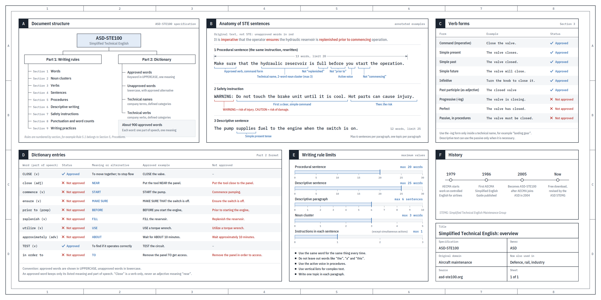

# 最佳实践

## 怎样给 Claude 写提示词

有人惊讶我居然是这样给 Claude 写提示词的，这倒让我挺惊讶。

跟 Claude 说话，就像跟同事说话一样。写提示词没什么秘诀。大多数任务都不需要搭一堆框架，也不用把每一步都规定死——给 Claude 一个目标，它自己会想办法。

在 Sonnet 3.5 那会儿，提示词怎么写影响很大。现在更重要的是跟模型讲清楚三件事：

1. 你想让它做什么。
2. 你希望它花多大力气。
3. 它该怎么确认自己做对了。

### 1. 制作交互式叙事作品

```text
Create an artifact that narrates the entire episode. Make it beautiful and interactive, and focus on communicating the nuggets of business wisdom throughout the episode. Make it really good, use lots of tokens, and iterate until you're proud of it. Maybe add watercolor illustrations and historical photos throughout. Aim for New Yorker or New York Times data visualization vibes, but better. I think you can use OpenCV for watercolor images.
```

```text
做一个把整期节目讲下来的 artifact，要好看、可交互，重点把节目里那些商业智慧的干货讲出来。一定要做好，token 尽管多用，反复迭代，直到你自己觉得拿得出手为止。可以在各处配上水彩插画和历史照片。目标是《纽约客》或《纽约时报》数据可视化那种感觉，但要更好。水彩图我觉得可以用 OpenCV 来做。
```

### 2. 改进 CLI 消息与命令队列的交互

```text
Make it so that when you send a message in the CLI, the message stays gray until the model receives it, and then turns black.

Update the behavior for queued commands so that a queued command appears in gray, rendered as normal text, and turns black once it's processed. The idea is to make it feel a little more real time.

Also add a little gray text indicating that you can press Command + Enter to send immediately. Look at what we do for chatwork on desktop and mimic that, although you might have to pick a different key combination since I don't know if Command + Enter works in a terminal. Pick something obvious and natural.
```

```text
改一下 CLI：发出去的消息先显示成灰色，等模型收到后再变成黑色。

排队的命令也照这个改：排队中的命令用灰色显示，按普通文本渲染，处理完再变黑。目的是让它感觉更实时一点。

再加一行灰色小字，提示可以按 Command + Enter 立即发送。看看我们桌面端 chatwork 是怎么做的，照着做；不过终端里 Command + Enter 不一定能用，你可能得换个组合键，挑一个直观、顺手的。
```

### 3. 复现并修复异常掉线问题

```text
We have been getting lots of reports like this across the CLI and desktop apps:

[Example report on Slack](https://anthropic.slack.com/archives/C07VBSHV7EV/p1789759211709039)

Can you fuzz the CLI and desktop apps to trigger de-auths? I think there are a bunch of bugs that can cause this even when the user should still be authenticated. Fix any cases you can reliably reproduce.
```

```text
CLI 和桌面端最近收到了很多这样的反馈：

[Slack 上的反馈示例](https://anthropic.slack.com/archives/C07VBSHV7EV/p1789759211709039)

你能不能对 CLI 和桌面端做模糊测试，想办法触发掉登录？我觉得有不少 bug 会在用户本该保持登录的时候把人踢下线。能稳定复现的都修掉。
```

### 4. 使用 Lean 验证状态机

```text
Use Lean to verify the SDK and Claude.ts state machine.
```

```text
用 Lean 验证 SDK 和 Claude.ts 的状态机。
```

### 5. 沿用同一份证明简化代码

```text
Take that same proof and simplify the code.
```

```text
用同一份证明，把代码简化一下。
```

### 6. 发布 PR 并开启自动合并

```text
Publish all PRs and mark them to merge when ready.
```

```text
把所有 PR 都发出去，并设置成条件满足后自动合并。
```

### 7. 汇总工作成果

```text
How many PRs was that in total? How many bugs were caught, how many lines were added or removed (excluding tests), and how many tests were added or removed?
```

```text
总共多少个 PR？抓到了多少个 bug？新增、删除了多少行代码（不算测试）？新增、删除了多少个测试？
```

### 8. 将结果制作成信息图

```text
Render it as a small infographic.
```

```text
把它做成一张小信息图。
```

## 怎样读懂模型的输出

我们以后会花越来越多的时间去理解语言模型的输出。分享几点想法和小技巧：

### 1. 写作

我试过一个效果不错的做法：让 LLM 用 ASD-STE100 来解释东西。ASD-STE100 是一套受控语言规范，最初是为航空航天的维修文档制定的。LLM 对这套语言很熟，它对写作风格又有严格的约束，逼着文字写得干净，我常常觉得这样写出来的东西好读得多。有时我会稍微放宽一点，比如要求“做到 ASD-STE100 的 80%”，因为这份规范相当严格。不过还有更好的：

### 2. 图表 / 图片

与其让 LLM 写文字，不如让它画一张图。图往往要好消化、好拆解、好理解得多。不过还有更好的：

### 3. 网页

要求它“用 HTML”输出，就能得到一个漂亮的交互式网页。LLM 做前端越来越厉害，能做出很漂亮的体验、动画等等。不过还有更好的：

### 4. 讲解视频

我最看好的输出形式，是针对任意主题、完全量身定制生成的讲解视频。可以试试这样的提示词：

```text
Create a 3b1b style video explainer on X. Use my ElevenLabs API key for audio narration
```

```text
做一个 3Blue1Brown 风格的讲解视频，主题是 X。旁白配音用我的 ElevenLabs API key。
```

（后半句需要一个 API key；没有的话，也可以让 LLM 帮你找些还不错的免费替代方案，用本地算力来跑。）这件事真的开始能做成了！

总的来说：

- 随着 LLM 越来越强，它们会自主完成越来越多的具体工作，我们的工作会更多地往抽象层上移，变成监督和理解。
- 好在这件事 LLM 也能帮上忙：智能和代码越来越充裕，你可以让它做一些大型的、定制的、用完即弃的软件产物（比如网页应用、讲解视频），这些东西放在以前根本不值得专门去做。在这方面大胆试探边界，结果会让你吃惊。



---

*参考原文：[Boris Cherny 在 X 上的帖子](https://x.com/bcherny/status/2107565388250874193)、[Andrej Karpathy 在 X 上的帖子](https://x.com/karpathy/status/2105819303471976479)*
