# 手机端

Android客户端下载、教程。

## Clash Meta 使用教程

*适用于Android（安卓）丶鸿蒙系统，完成下载安装到订阅导入。 · 优先推荐 · 入门 · 5 分钟 · 更新 2026/09/21*

### 说明

教程编写时最新版为2.11.24，后续版本界面可能会与图片所示内容有所差异，请以最新版为准。

### 1.获取订阅地址

登录机场官网首页下拉点“一键订阅”，“复制订阅地址”或者“导入到Clash”。

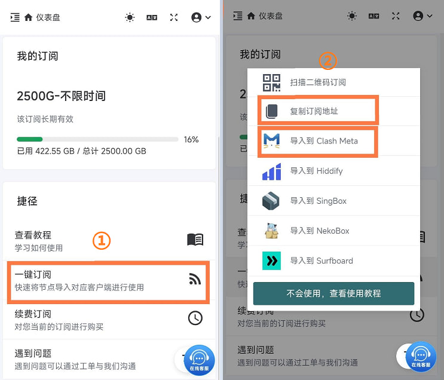

### 2.配置与使用

打开 Clash Meta，點点击「配置」选项，再点击右上角「+」，选择「URL」。将之前复制的订阅地址粘贴进去「URL」框，「自动更新」时间建议设为 1440 分钟，之后点右上角「文件」保存。

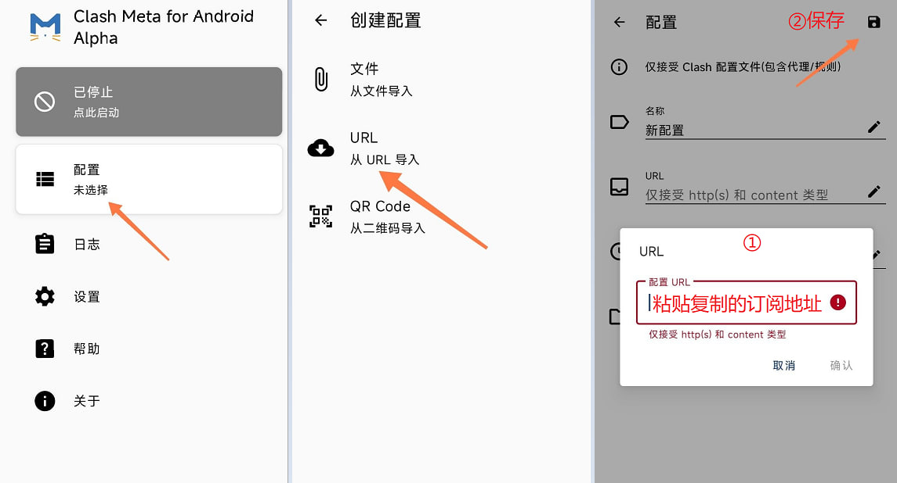

选中刚才新增的订阅，然后返回主页面。

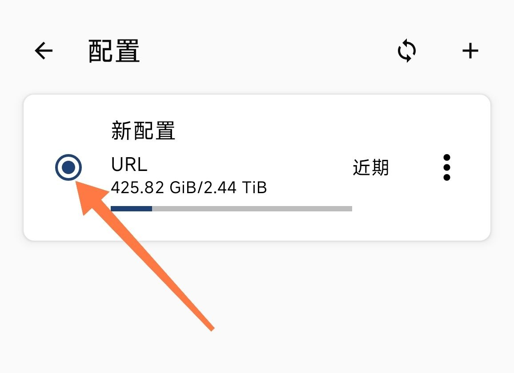

点击「启动」按钮（首次链接需点击「确定」允许授权）。

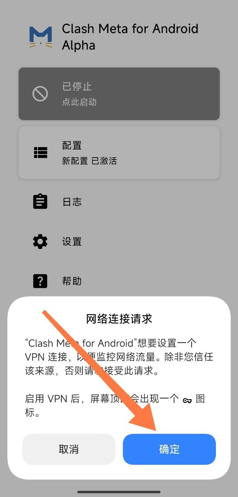

点击「代理」选择节点，点击「闪电」按钮刷新延迟。自行选择节点开始使用。

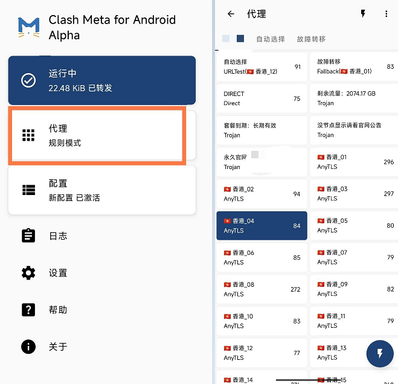

### 节点无延迟修改DNS方式

点击「闪电」按钮节点还是没延迟，返回Clash主页「设置」，打开「覆写」，往下拉点击「DNS 策略」选择「使用内置」返回再点「闪电」按钮就好了。

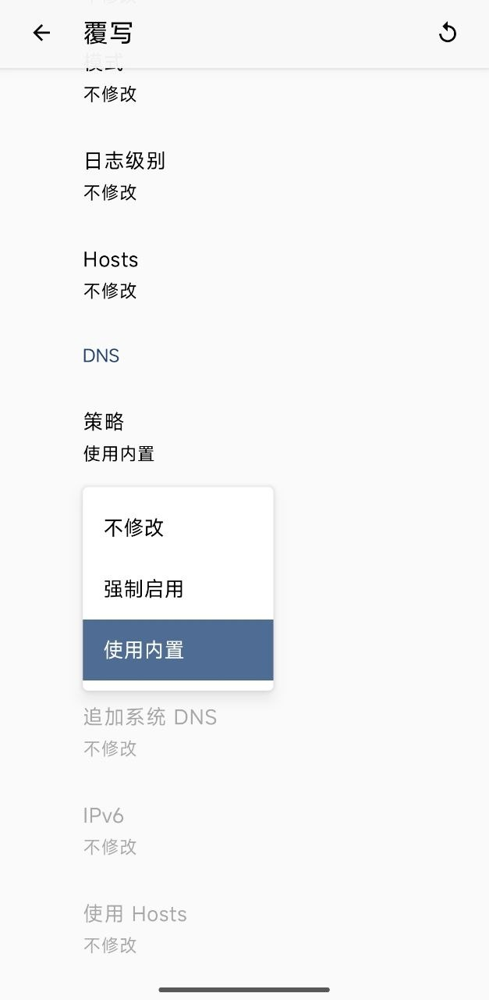

### 下载链接

- [Clash Meta](http://wwawd.zizi2.com/cl-ad)

## NekoBox 使用教程

*适用于Android（安卓）丶鸿蒙系统，完成下载安装到订阅导入。 · 入门 · 5 分钟 · 更新 2026/09/21*

### 说明

教程编写时最新版为1.4.2，后续版本界面可能会与图片所示内容有所差异，请以最新版为准。

### 1.获取订阅地址

登录机场官网首页下拉点“一键订阅”，“复制订阅地址”或者“导入到NekoBox”。

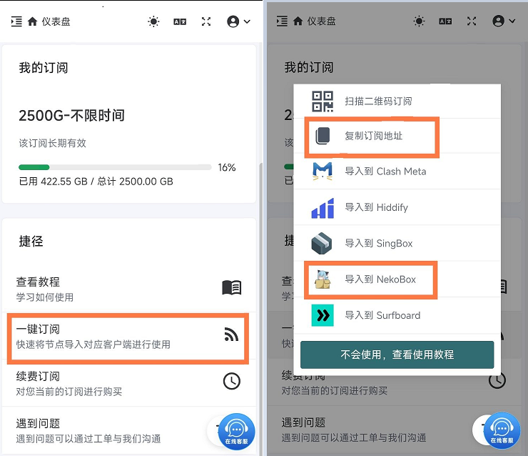

### 2.配置与使用

打开 NekoBox，點点击「文件」图标，再选择「从剪切板导入」，选择「是」，会自动下载订阅配置文件。

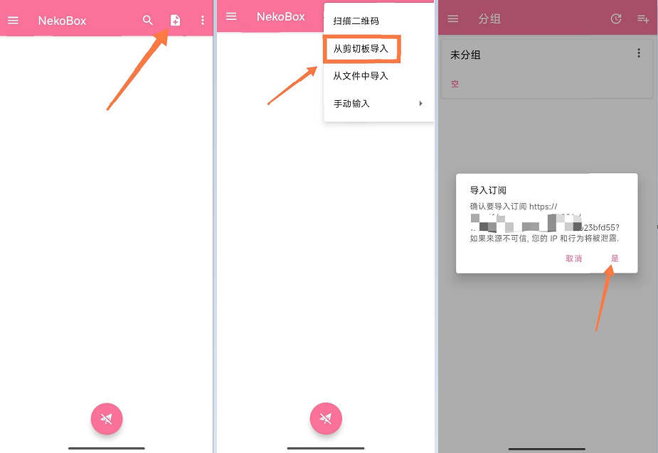

下载完成点左上角「≡≡」，选择「配置」，再点击右上角「┇」，点击「TCPing」测试延迟。

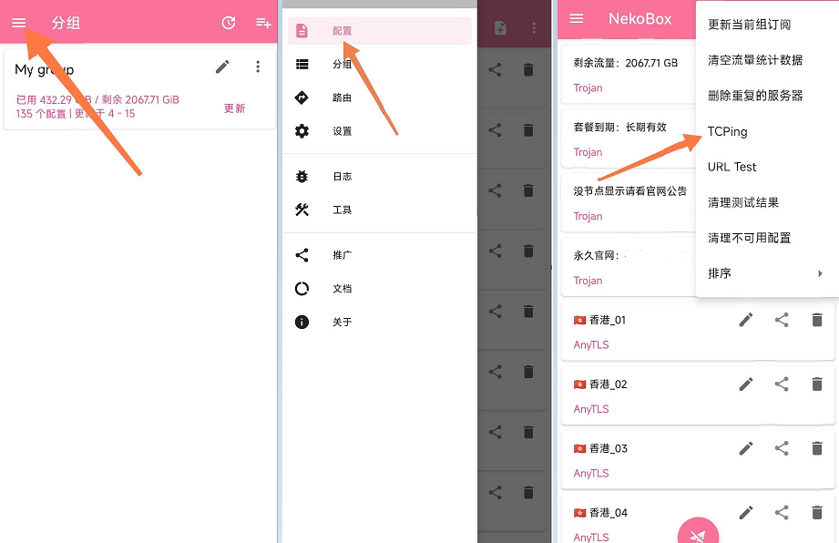

自行选择节点，点击「启动」按钮（首次链接需点击「确定」允许授权），开始使用。

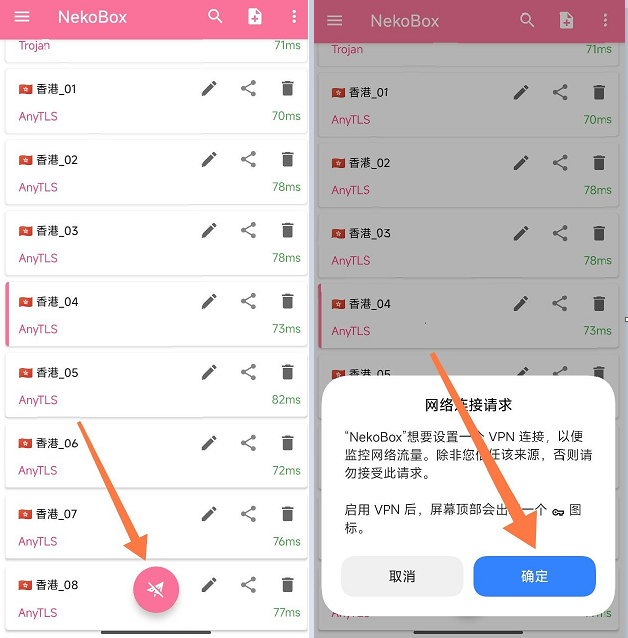

### 下载链接

- [NekoBox](http://wwawd.zizi2.com/ne-ad)

## FLClash 使用教程

*适用于Android（安卓）丶鸿蒙系统 · 入门 · 3 分钟 · 更新 2026/09/21*

### 说明

教程编写时最新版为0.8.92，后续版本界面可能会与图片所示内容有所差异，请以最新版为准。

### 1.获取订阅地址

登录机场官网首页下拉点“一键订阅”，“复制订阅地址”。

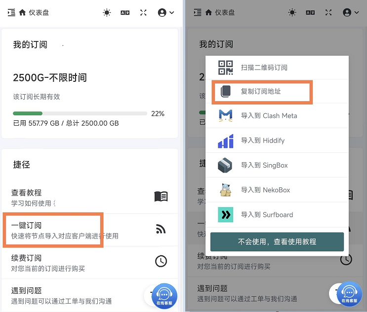

### 2.配置与使用

打开 FLClash，点击「配置」选项，再点击「添加配置」，选择「URL」。将之前复制的订阅地址粘贴进去「URL」框点「提交」

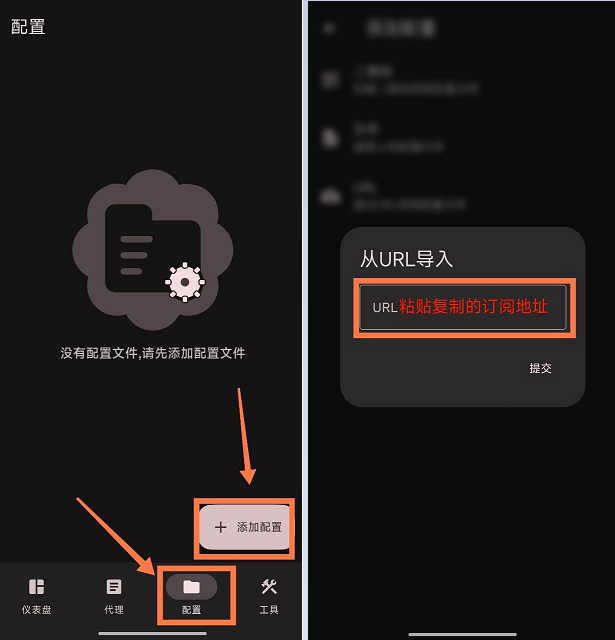

切换到「代理」点击「延迟测试」刷新节点延迟后，自行选择节点。

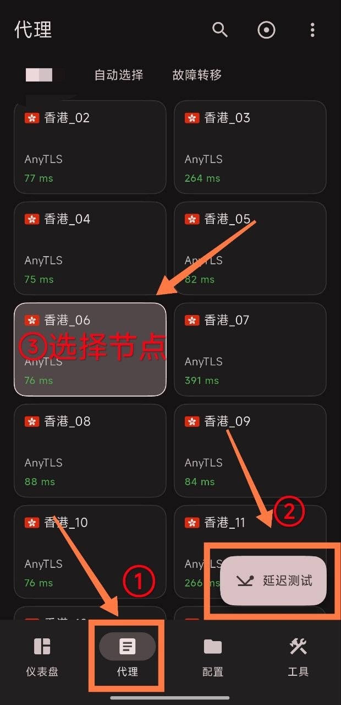

再点击「仪表盘」把「出站模式」选择成「全局」，然后点击「开启」按钮。

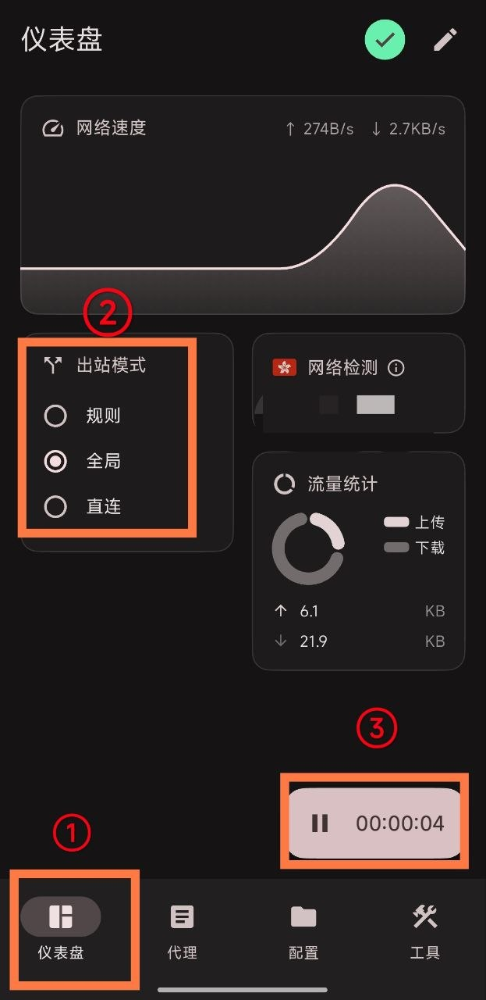

首次连接FLClash发送「网络连接请求」，点「确定」开始使用。

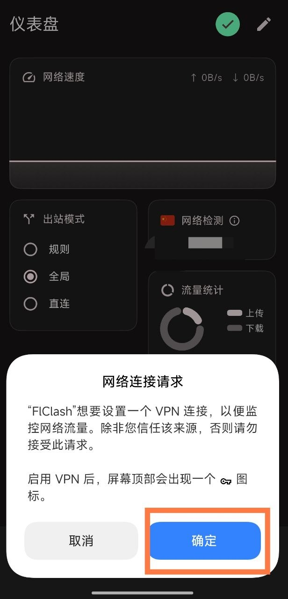

### 下载链接

- [FLClash下载](http://wwawd.zizi2.com/fl-ad)

## V2rayNG 使用教程

*适用于Android（安卓）丶鸿蒙系统，完成下载安装到订阅导入。 · 入门 · 3 分钟 · 更新 2026/09/21*

### 说明：V2rayNG不支持AnyTls协议，建议下载FLClasn

教程编写时最新版为1.4.2，后续版本界面可能会与图片所示内容有所差异，请以最新版为准。V2rayNG不支持AnyTls协议，建议下载FLClasn

### 1.获取订阅地址

登录机场官网首页下拉点“一键订阅”，“复制订阅地址”或者“导入到NekoBox”。

### 2.配置与使用

打开 NekoBox，點点击「文件」图标，再选择「从剪切板导入」，选择「是」，会自动下载订阅配置文件。

下载完成点左上角「≡≡」，选择「配置」，再点击右上角「┇」，点击「TCPing」测试延迟。

自行选择节点，点击「启动」按钮（首次链接需点击「确定」允许授权），开始使用。

### 下载链接

- [V2rayNG](http://wwawd.zizi2.com/v2n-ad)
