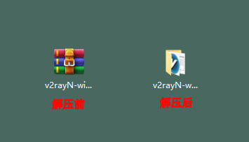
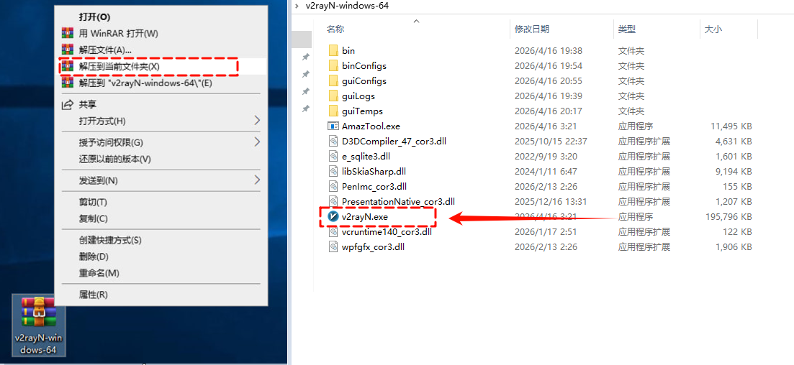
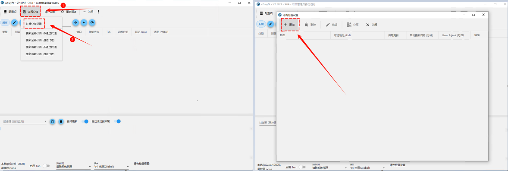
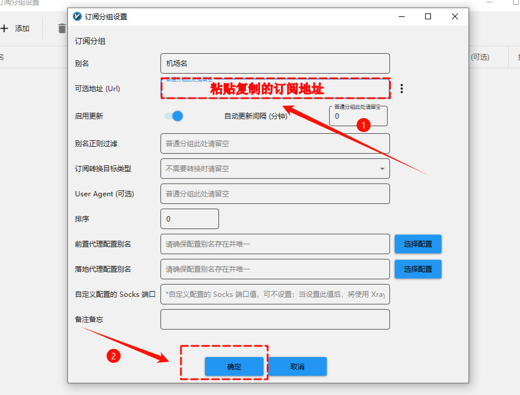
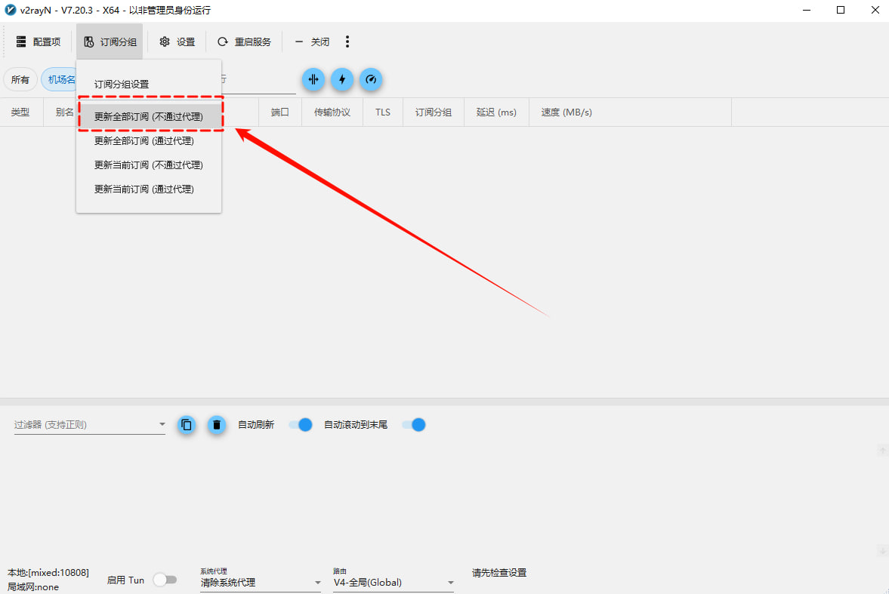
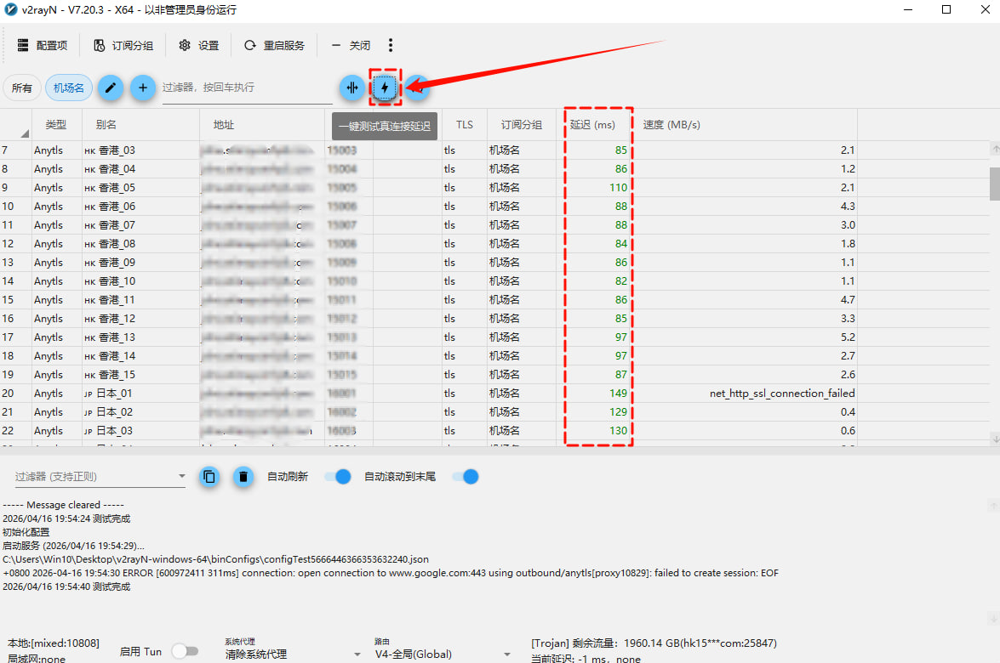
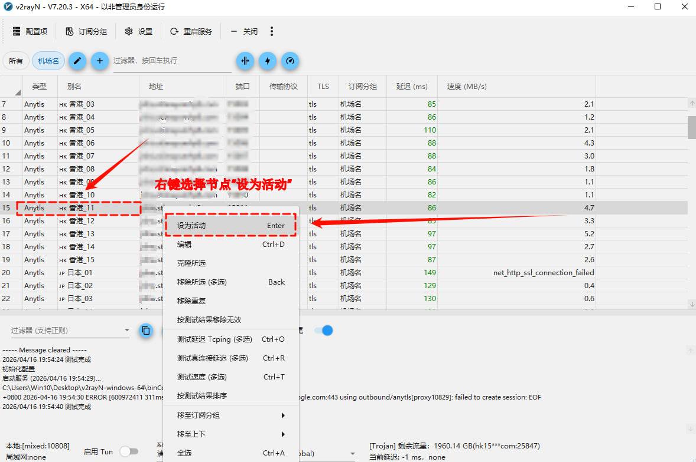
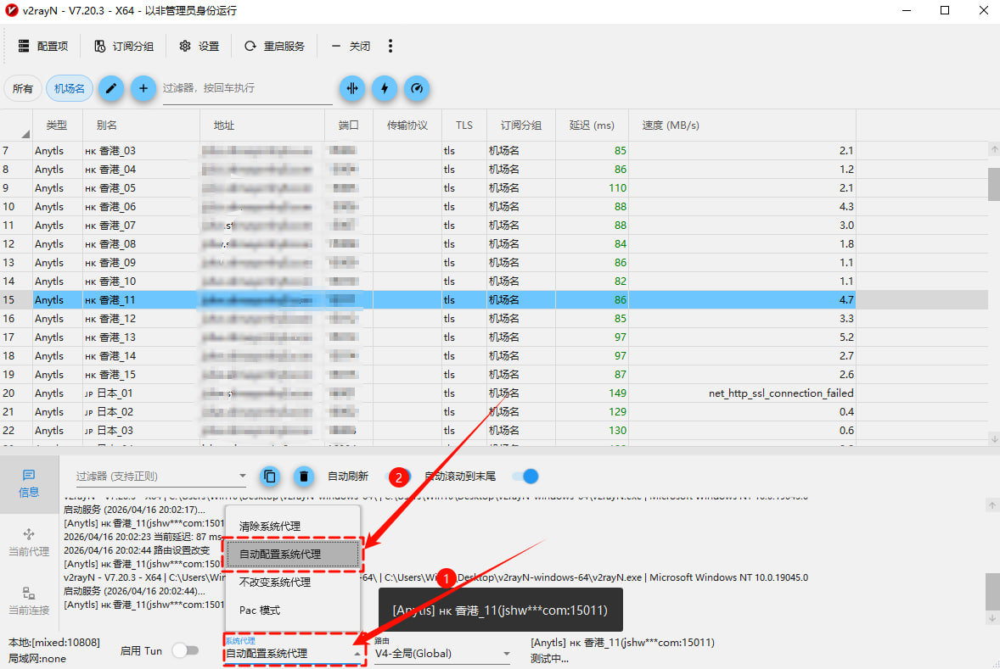

# 电脑端

Windows客户端下载、教程（推荐使用V2rayN）

## V2RayN Windows使用教程

*适合 Windows8+ 用户，完成下载安装到订阅导入。 · 优先推荐 · 入门 · 6 分钟 · 更新 2026/09/21*

### 说明

教程编写时最新版为7.20.8，后续版本界面可能会与图片所示内容有所差异，请以最新版为准。

### 1.下载/解压

下载好的软件是压缩包方式，鼠标“右键”点击下载好的压缩包，点击“解压到当前的文件夹”完成解压，打开解压后的文件，鼠标“左键”双击打开“v2rayN.exe”

### 2.获取订阅地址

登录机场官网找到“一键订阅”，“复制订阅地址”

### 3.配置

打开 V2RayN，点击「订阅分组」，再选择「订阅分组设置」，点击「添加」

把复制的订阅地址粘贴到「可选地址(Url)」，点击「确定」

返回V2RayN主页面再次点击「订阅分组」，选择「更新全部订阅(不通过代理)」订阅节点会刷新出来。

### 4.使用

点击「闪电」按钮刷新延迟

选择节点点击鼠标“右键”「设为活动」

点击下方「系统代理」选择「自动配置系统代理」开始使用。

### 下载链接

- [V2RayN](http://wwawd.zizi2.com/windows-v2)

## Clash Verge Windows使用教程

*适用于Windows8+系统，完成下载安装到订阅导入。 · 入门 · 8 分钟 · 更新 2026/09/21*

### 说明

教程编写时最新版为2.4.7，后续版本界面可能会与图片所示内容有所差异，请以最新版为准。

### 1.获取订阅地址

登录机场官网找到“一键订阅”，“复制订阅地址”或者“导入到Clash”。

### 2.配置与使用

打开 Clash Verge，点击左侧「订阅」，把复制的订阅地址粘贴到「订阅栏」，点击「导入」。

导入成功后切换到「代理」，右上角选择「全局」，自行选择节点。

切换到「设置」，把「系统代理」「IPV6」「统一延迟」按钮打开，开始使用。

### 节点超时（Timeout）处理方法

切换到「设置」，把「DNS覆写」打开，即可恢复。返回到「代理」栏，点击「wifi」图标刷新延迟。

[点击跳转](https://example.com/)

### 下载链接

- [Clash Verge](http://wwawd.zizi2.com/cl-w)

## FLClash Windows使用教程

*适用于 Windows8+ ，完成下载安装到订阅导入。 · 入门 · 3 分钟 · 更新 2026/09/21*

### 说明

教程编写时最新版为0.8.92，后续版本界面可能会与图片所示内容有所差异，请以最新版为准。

### 1.获取订阅地址

登录机场官网找到“一键订阅”，“复制订阅地址”

### 2.配置

打开 FLClash，点击「配置」，选择「添加配置」

把复制的订阅地址粘贴到「URL」选项，点击「提交」

切换到「代理」点击「延迟测试」测试节点延迟，再自行选择节点。

切换到「仪表盘」把「系统代理」按钮打开，「出站模式」建议选择「全局」，然后点击下方的「开启」按钮开始使用。

### 下载链接

- [FLClash](http://wwawd.zizi2.com/fl-w)

## V2rayN Linux使用教程

*适用于Linux系统，完成下载安装到订阅导入。 · 入门 · 5 分钟 · 更新 2026/09/21*

### 说明

教程编写时最新版为1.4.2，后续版本界面可能会与图片所示内容有所差异，请以最新版为准。

### 1.下载/解压

下载好的软件是压缩包方式，鼠标“右键”点击下载好的压缩包，点击“解压到当前的文件夹”完成解压，打开解压后的文件，鼠标“左键”双击打开“v2rayN.exe”

### 2.获取订阅地址

登录机场官网找到“一键订阅”，“复制订阅地址”

### 3.配置

打开 V2RayN，点击「订阅分组」，再选择「订阅分组设置」，点击「添加」

把复制的订阅地址粘贴到「可选地址(Url)」，点击「确定」

返回V2RayN主页面再次点击「订阅分组」，选择「更新全部订阅(不通过代理)」订阅节点会刷新出来。

### 4.使用

点击「闪电」按钮刷新延迟

选择节点点击鼠标“右键”「设为活动」

点击下方「系统代理」选择「自动配置系统代理」开始使用。

### 下载链接

- [V2rayN](http://wwawd.zizi2.com/linux-v2)

## FLClash Linux使用教程

*适用于Linux，完成下载安装到订阅导入。 · 入门 · 3 分钟 · 更新 2026/09/21*

### 说明

教程编写时最新版为0.8.92，后续版本界面可能会与图片所示内容有所差异，请以最新版为准。

### 1.获取订阅地址

登录机场官网找到“一键订阅”，“复制订阅地址”

### 2.配置

打开 FLClash，点击「配置」，选择「添加配置」

把复制的订阅地址粘贴到「URL」选项，点击「提交」

切换到「代理」点击「延迟测试」测试节点延迟，再自行选择节点。

切换到「仪表盘」把「系统代理」按钮打开，「出站模式」建议选择「全局」，然后点击下方的「开启」按钮开始使用。

### 下载链接

- [FLClash Linux](http://wwawd.zizi2.com/fl-in)
