# 苹果端

Mac、IOS客户端下载、教程。

## 海外Apple ID（下载Shadowrocket）

*最后更新: 2026年8月29日*

#### 禁止在设置里面登录

#### 禁止在设置里面登录

#### 否则后果自负

#### 禁止在设置里面登录

#### 禁止在设置里面登录

### 特别提醒

#### 小白请先学会再操作

#### 切记不要在设置里登录账号

#### 切记不要在设置里登录账号

#### 切记不要在设置里登录账号

## Clash Verge MAC使用教程

*适用于 MAC 用户，完成下载安装到订阅导入。 · 优先推荐 · 入门 · 8 分钟 · 更新 2026/09/21*

### 说明

教程编写时最新版为2.4.7，后续版本界面可能会与图片所示内容有所差异，请以最新版为准。

### 1.获取订阅地址

登录机场官网找到“一键订阅”，“复制订阅地址”或者“导入到Clash”。

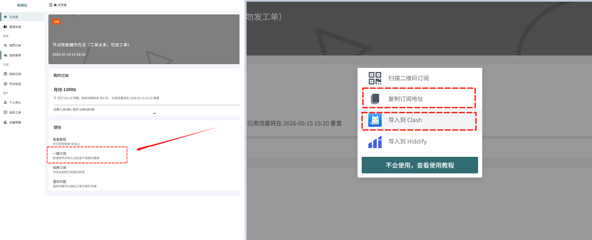

### 2.配置与使用

打开 Clash Verge，点击左侧「订阅」，把复制的订阅地址粘贴到「订阅栏」，点击「导入」。

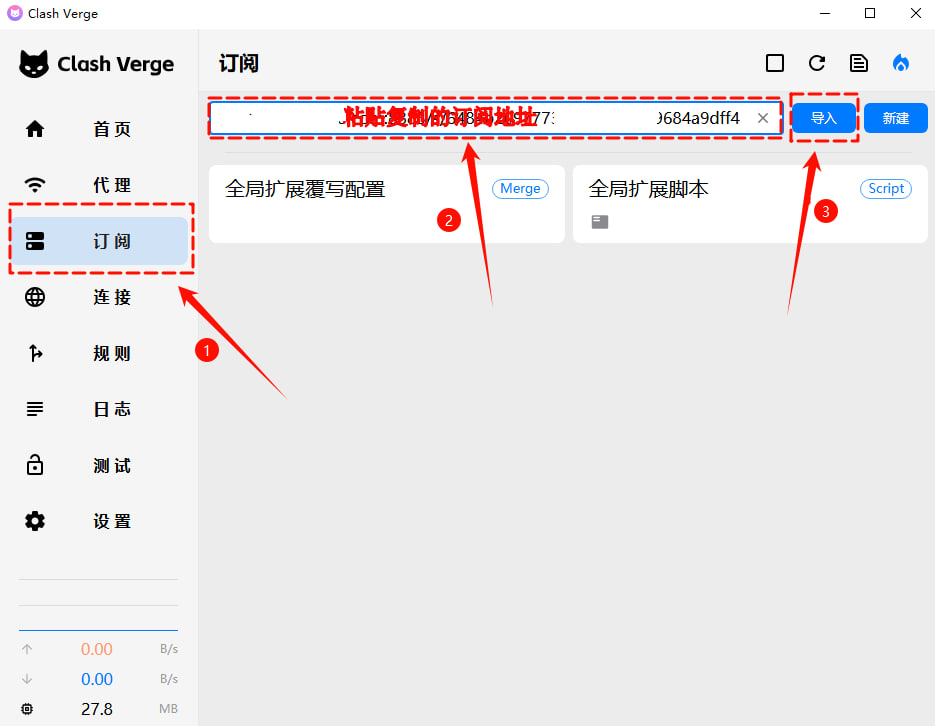

导入成功后切换到「代理」，右上角选择「全局」，自行选择节点。

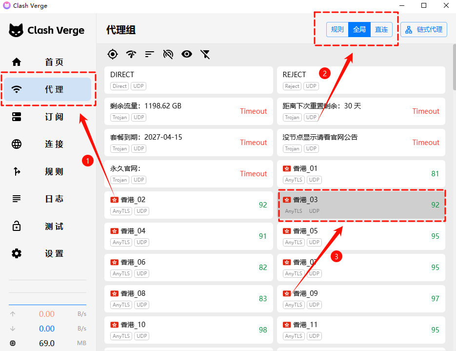

切换到「设置」，把「系统代理」「IPV6」「统一延迟」按钮打开，开始使用。

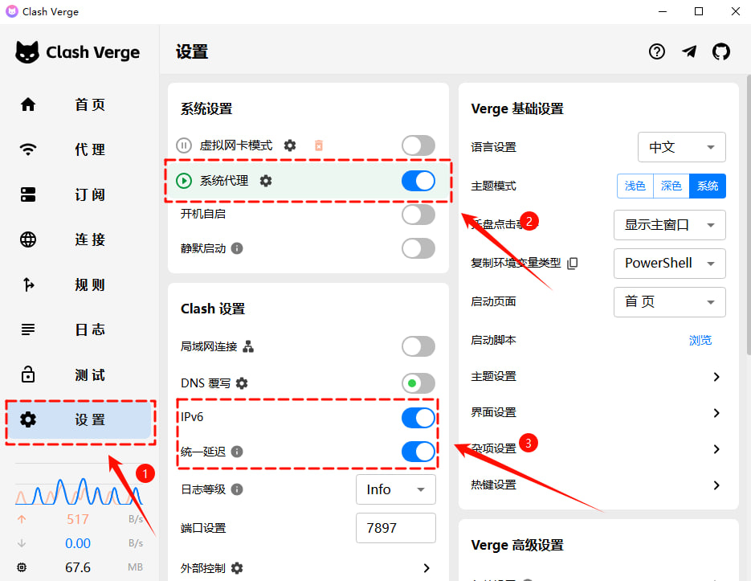

### 节点超时（Timeout）处理方法

切换到「设置」，把「DNS覆写」打开，即可恢复。返回到「代理」栏，点击「wifi」图标刷新延迟。

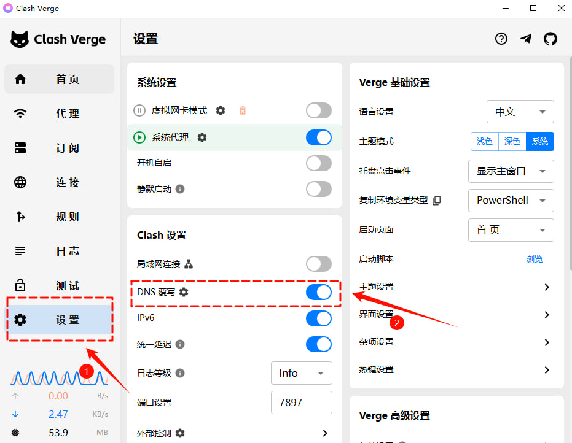

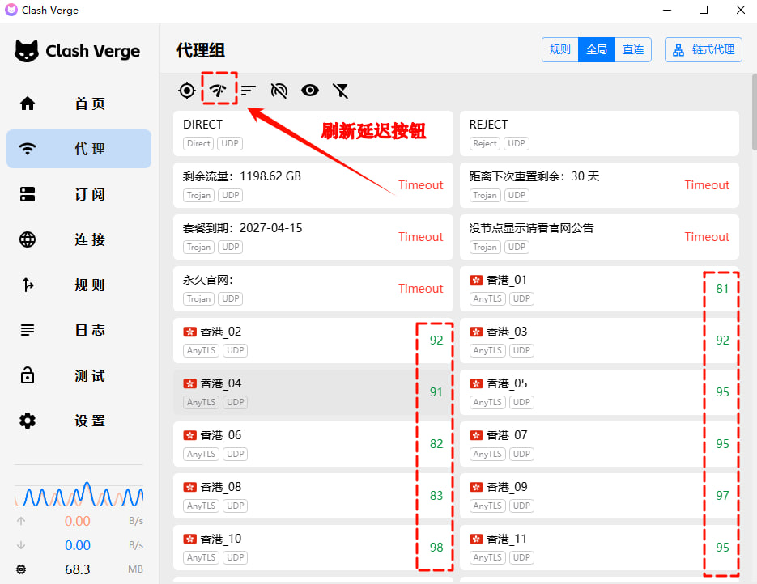

### 下载链接

- [英特尔](http://wwawd.zizi2.com/ve-in)
- [M芯片](http://wwawd.zizi2.com/ve-m)

## FLClash MAC使用教程

*适用于MAC，完成下载安装到订阅导入。 · 入门 · 3 分钟 · 更新 2026/09/21*

### 说明

教程编写时最新版为0.8.92，后续版本界面可能会与图片所示内容有所差异，请以最新版为准。

### 1.获取订阅地址

登录机场官网找到“一键订阅”，“复制订阅地址”

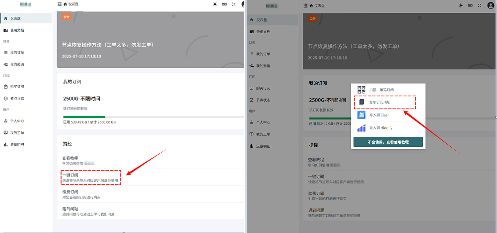

### 2.配置

打开 FLClash，点击「配置」，选择「添加配置」

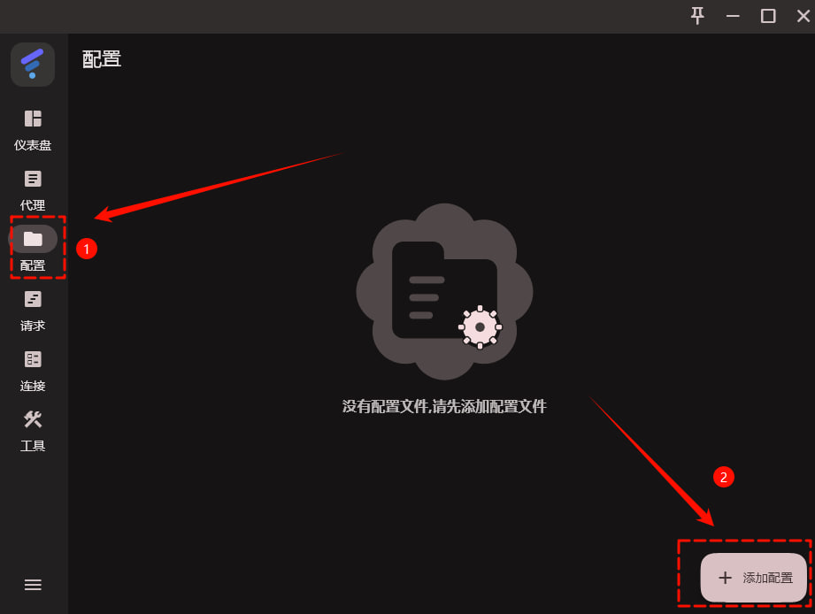

把复制的订阅地址粘贴到「URL」选项，点击「提交」

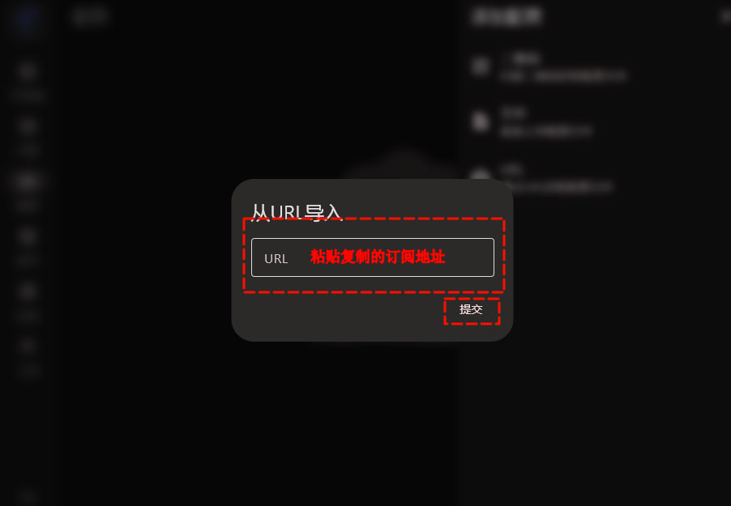

切换到「代理」点击「延迟测试」测试节点延迟，再自行选择节点。

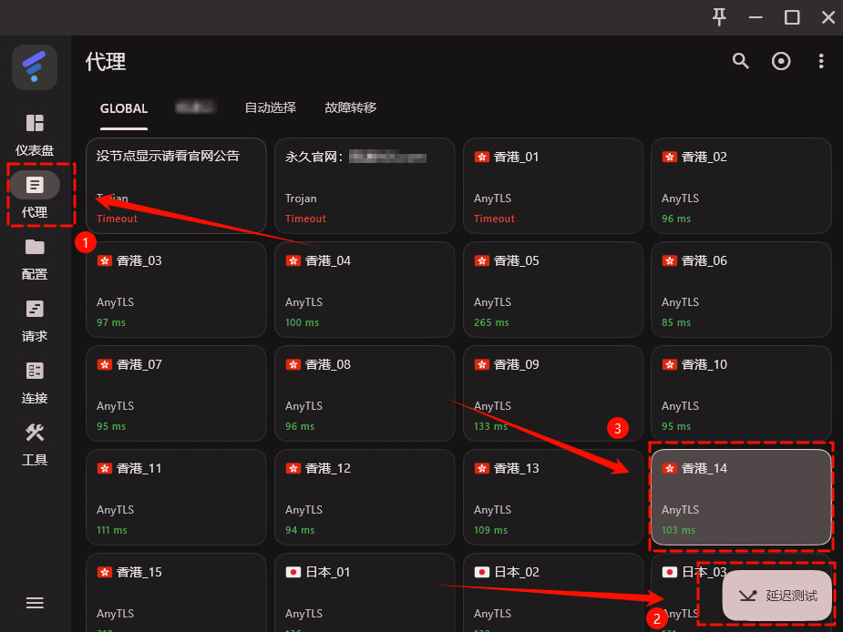

切换到「仪表盘」把「系统代理」按钮打开，「出站模式」建议选择「全局」，然后点击下方的「开启」按钮开始使用。

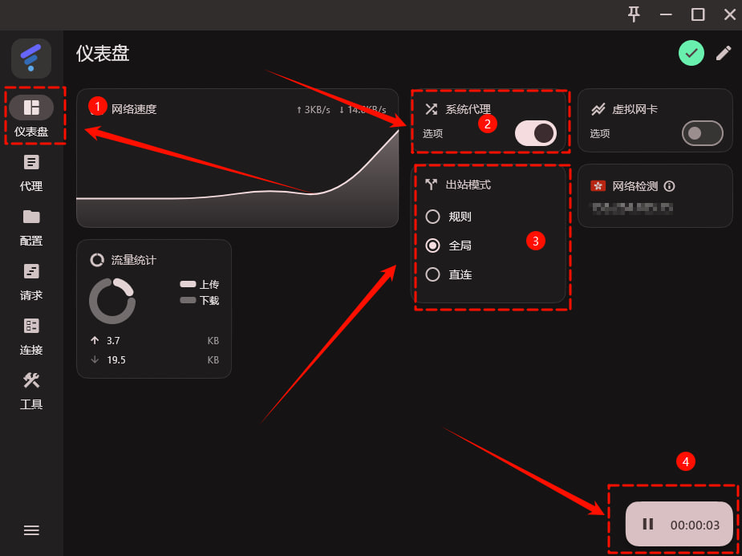

### 下载链接

- [M芯片](http://wwawd.zizi2.com/fl-dm)
- [英特尔](http://wwawd.zizi2.com/fl-int)

## Shadowrocket IOS使用教程

*适用于IOS Apple，完成下载安装到订阅导入。 · 入门 · 3 分钟 · 更新 2026/09/13*

### 说明

教程编写时最新版为2.2.80，后续版本界面可能会与图片所示内容有所差异，请以最新版为准。

### 1.下载Shadowrocket

当前页面最下方找到「共享ID」点击「打开下载」按网页要求复制账号密码。

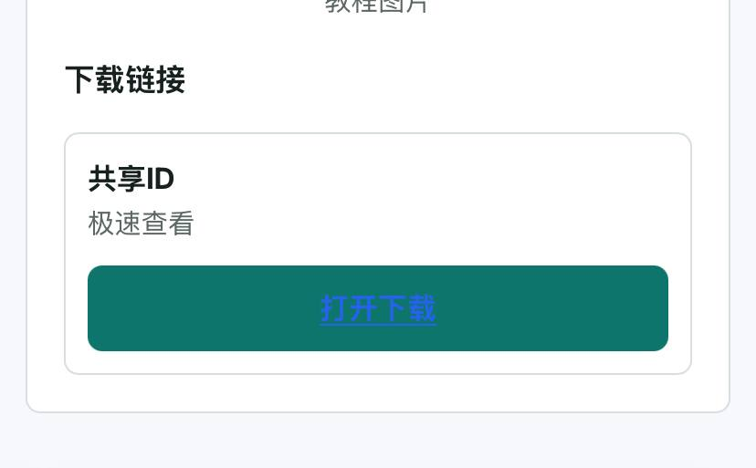

打开APP Store把个人账号退出，登录复制的共享国外Apple ID

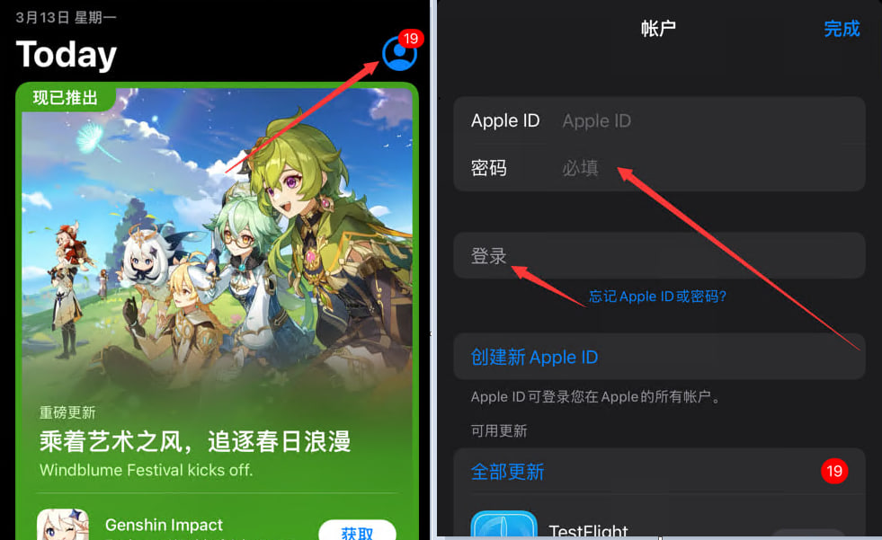

搜索「Shadowrocket」下载

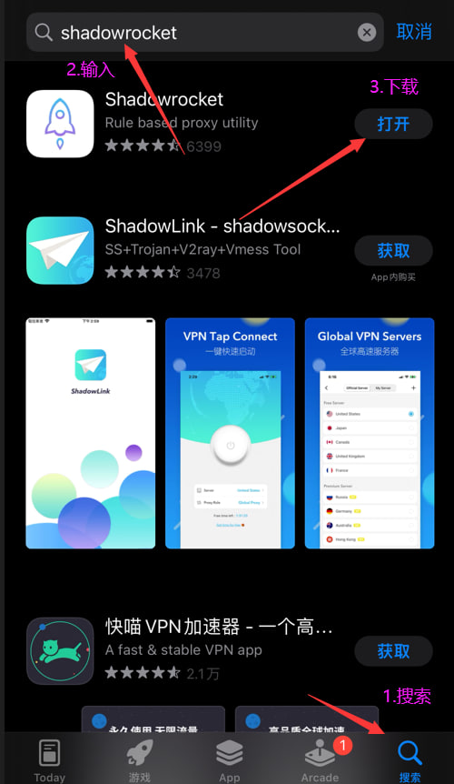

### 2.获取订阅地址

登录机场官网首页下拉点“一键订阅”，“复制订阅地址”或者“导入到Shadowrocket”。

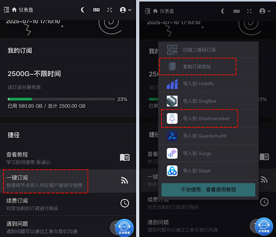

### 3.配置与使用

打开Shadowrocke点击右上角「+」按钮，把复制的订阅地址粘贴到「URL」填项，右上角点击「保存」。

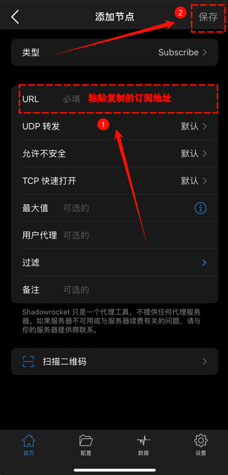

点击展开导入的订阅，点「连通性测试」测试节点延迟，自行选择节点，把「未连接」按钮开启，开始使用。

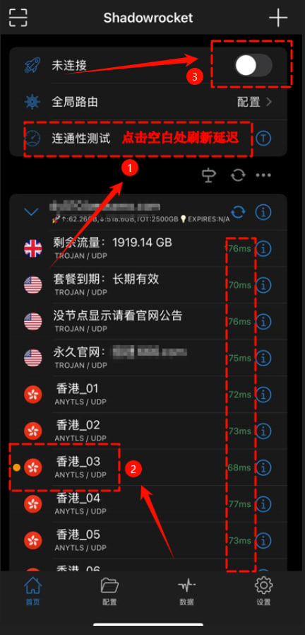

### 下载链接

- [共享ID](https://xhj.gaobb.ggff.net/)
