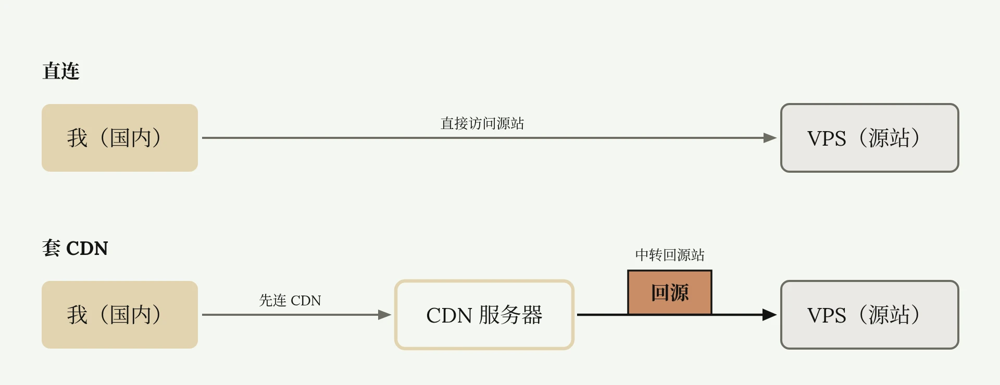
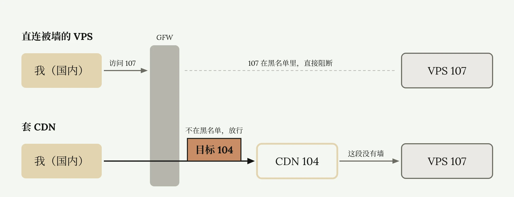
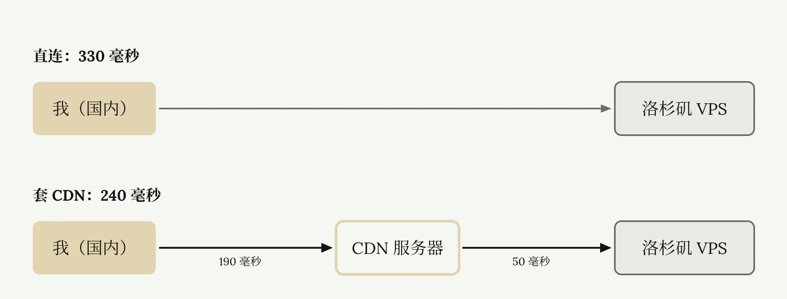

# CDN 节点原理与搭建

<ReadMore id="简介" label="简介" title="自建节点被墙怎么办？免费CDN拯救被墙节点！| CDN是什么 | CDN作用 | CDN回源加速 | VPS套CDN | Cloudflare CDN | 无限芝士">

◉ Cloudflare官网：\
[https://www.cloudflare.com/zh-cn/](https://www.cloudflare.com/zh-cn/)\
◉ 零基础自建节点教程：\
• [如何自建翻墙节点？| 从零开始VPS搭建节点教程 | 什么是VPS、协议、面板？| 自建节点有什么好处？ | 机场节点搭建全流程 | 无限芝士](https://www.youtube.com/watch?v=MuWTmEiNe1g)\
◉ 低价VPS购买：\
[https://my.racknerd.com/aff.php?aff=13129](https://my.racknerd.com/aff.php?aff=13129)\
◉ 视频中所用代码：\
[https://wise-vegetarian-da6.notion.site/VPS-2daacc0097d38077a769e8a98051fec1](https://wise-vegetarian-da6.notion.site/VPS-2daacc0097d38077a769e8a98051fec1)\
◉ 低价域名获取：\
• [为什么不推荐免费域名？免费付费域名有什么区别？如何获取低价域名？| 7元顶级域名 | Cloudflare解析 | 域名科普 | 域名羊毛 | 无限芝士](https://www.youtube.com/watch?v=gKQTtY_YQnA)\
◉ 托管与解析域名教程：\
• [如何把域名托管到Cloudflare | 享受大厂域名解析服务 | 获取Cloudflare免费CDN | Cloudflare绑定自己的域名 | 无限芝士](https://www.youtube.com/watch?v=x_-76QVuC3c)\
◉ IP2Location：\
[https://www.ip2location.com/](https://www.ip2location.com/)\
—————————\
本频道所有「软件」和「外部链接」均会发布在频道简介里的「Telegram资源发布群」，该群为本频道官方群聊，无 任 何 三 方 广 告！\
Telegram资源发布群：[https://t.me/inficheesy](https://t.me/inficheesy)\
Telegram问题交流群：[https://t.me/inficheesychat](https://t.me/inficheesychat)\
—————————\
InfiCheesy无限芝士「长期责任推广」：\
◉ 快猫IPLC专线机场：\
39元 | 600G/月 | 性价比大流量包 | 长期9折优惠券：ESY

◉ 蓝通云机场：\
全球60+地区节点 | 8折优惠专属链接\
[https://link.inficheesy.com/lty](https://link.inficheesy.com/lty)\
◉ Proxy Seller住宅代理：\
1.27U/周 | 2.55U/月 | 85折优惠码：InfiCheesy\
[https://link.inficheesy.com/proxyseller](https://link.inficheesy.com/proxyseller)\
—————————\
视频编号：78期\
[0:00](https://www.youtube.com/watch?v=NnyG3DyZbN8) 开头\
[00:20](https://www.youtube.com/watch?v=NnyG3DyZbN8&t=20s) CDN是什么\
[02:33](https://www.youtube.com/watch?v=NnyG3DyZbN8&t=153s) 获取CDN\
[03:30](https://www.youtube.com/watch?v=NnyG3DyZbN8&t=210s) 解析域名\
[04:52](https://www.youtube.com/watch?v=NnyG3DyZbN8&t=292s) 安装面板\
[06:26](https://www.youtube.com/watch?v=NnyG3DyZbN8&t=386s) 搭建节点\
[09:22](https://www.youtube.com/watch?v=NnyG3DyZbN8&t=562s) 被墙风险\
[10:00](https://www.youtube.com/watch?v=NnyG3DyZbN8&t=600s) 加速问题\
—————————\
福利资源、教程干货、科技咨询\
这里是无限芝士，一个致力于提升您上网体验的信息分享频道

</ReadMore>

如果你的节点被墙，或者需要给低端 VPS 提速，那 CDN 肯定绕不过去。什么是 CDN？它能干什么？对翻墙又有什么帮助？怎样使用 CDN？上述都不知道没关系，这篇文章用最基础的白话，讲明白它们的原理，并结合实操演示，教你用 CDN 升级自己的节点。

## CDN 中转与回源

首先，我们正常连接自建节点，是直接访问 VPS 的 IP 地址。而 CDN 是一堆分布在全球各地的服务器。如果我们使用 CDN 连接 VPS，会先把流量传输给某一台 CDN 服务器，这台服务器再把流量传给我们的 VPS。上述流程是 CDN 在自建节点中的作用。

有的读者可能搜了很多教程，都出现了 CDN 回源、Sys 回源、回源加速等等，不知道什么意思。

简单解释一下，这一整套流程中，我们要访问的最终服务器 VPS，专业术语上叫源站。直接连接就是直接访问源站。通过 CDN，就是先访问 CDN 服务器。此时数据给了 CDN 服务器，CDN 服务器再通过特殊设置，知道这些数据应该去这台 VPS，于是把数据传了过去。这样数据回到了它本应到达的源站，就叫回源。总的来看就是 CDN 在中间中转了一下流量。说回源显得专业，为了方便理解，我后面不说回源，就说中转。



## CDN 中转的两个优点

CDN 中转有两个优点。

1. 可以拯救你被墙的 VPS。假如你买了一台 VPS，IP 地址是 107.173.250.222，然后发现你的节点用不了，这就是被墙了。每次当你访问 107 时，不管你用什么加密协议，不管怎么伪装，GFW 一看是黑名单的 IP，直接阻断，无法访问谷歌、油管。

   而使用 CDN 后，你的流量会先到某台 CDN 服务器。假如 CDN 服务器的 IP 地址是 104，GFW 一看，你的流量是传输到 104 这个 IP 的，没在黑名单里，允许通过，这就过墙了。CDN 再连接你自己的 VPS，此时 CDN 到 VPS 的这条线路是没有墙的，直接访问，线路打通，由此拯救你被墙的 VPS。

   

2. CDN 还可以给垃圾 VPS 加速。你有一台美国洛杉矶 VPS，平时延迟 330 毫秒，比较慢。使用 CDN 后，你国内连接 CDN 的延迟是 190 毫秒，这台 CDN 又连接洛杉矶 VPS 的延迟是 50 毫秒，总共就是 240 毫秒，比原来快了 90 毫秒，相当于对你的 VPS 加速了。

   

   但是这个加速并不绝对。如果你 VPS 本身线路非常好，比如接入 CN2 GIA 的优质 VPS，原来延迟就 150 毫秒，现在走 CDN 240 毫秒，还变慢了，白白浪费一年大几百美金的线路。

## 获取 Cloudflare 的免费 CDN

看完上述原理都明白 CDN 是个好东西，所以肯定不是白用的。各大云服务商会在各地部署自家的 CDN 服务器，比如国内百度云、阿里云、腾讯云，通常都是收费的。而 [Cloudflare](https://www.cloudflare.com/zh-cn/)，作为全球顶级云服务商，财大气粗，给用户提供免费的 CDN 服务。只要注册 Cloudflare 账号，就能白嫖他们家的 CDN。

使用 CDN 需要借助域名，因为 CDN 本身是给网站提供服务的，没域名用不了。需要免费或低价域名可以看[这篇教程](./免费与低价域名获取.md)。然后在 Cloudflare 上托管域名，再解析到 VPS 的 IP 地址。不明白是什么意思，小白可以看我的[这篇文章](./Cloudflare域名托管与解析.md)，详细科普并演示了域名托管与解析的步骤。最后给这个解析记录打开 CDN 开关，这样你的 VPS 就套上了 CDN，没有其他复杂操作。

所以总流程就是：注册 Cloudflare 账号，托管并解析一个域名，打开 CDN 开关，连接这个域名并通过 CDN 连接到节点，测试有网，连接成功。以下是详细操作演示。

## 把域名解析到 VPS 并打开 CDN

打开 Cloudflare 官网，这是我已经托管好的域名。点击域名，点击右上角 DNS 记录。现在需要把域名，解析到自己 VPS 的 IP 地址。点击添加记录，类型为 A 记录，默认不变。名称随便填，我写个 `okk`。IPv4 地址填 VPS 的 IP。代理状态就是问你是否开启了 CDN，肯定要打开。往下滑，点击保存，需要等待 5—10 分钟解析生效。

10 分钟后打开 CMD，ping 刚才的域名。注意，这个域名是刚才设置的名称，和自己的域名结合起来的。刚才的名称是 `okk`，域名是 `inficheesylink.top`，这里就需要 `ping okk.inficheesylink.top`。可以看到有回应，但不是我的 VPS 的 IP，而是一个不认识的 IP。这就是前面说的 CDN 服务器的 IP 地址。请求到了 CDN 那里，我们服务器的 IP 就藏了起来，所以 GFW 墙不了。

## 安装 3x-ui 面板并绑定域名

### 安装面板

现在打开 VPS，安装面板，搭建节点。如果你是新人，不知道怎么连接 VPS，可以看我的[这篇零基础自建节点教程](./从零搭建VPS翻墙节点.md)。

首先输入这串命令，更新 Ubuntu 软件。

```bash
apt update -y && apt install -y curl && apt install -y socat
```

然后输入这串命令，安装 [3x-ui](https://github.com/MHSanaei/3x-ui) 面板。

```bash
bash <(curl -Ls https://raw.githubusercontent.com/mhsanaei/3x-ui/master/install.sh) v2.8.5
```

询问是否随机端口，选择 N，回车。它问我是否绑定域名，现在先不绑，稍后绑定。选择 2，回车，回车。这些是面板登录信息，复制保存到记事本里。保存完，VPS 这边输入，`x-ui`，回车，进入 3x-ui 面板的后台管理界面。

### 绑定域名

现在绑定域名，选择 SSL 证书管理功能，输入 18，回车。输入 1，获得 SSL 证书，回车。现在输入刚才的域名，`okk.inficheesylink.top`，回车。让我们选一个端口，直接回车，默认 80 端口。询问是否安装 ACME 脚本，输入 N，不安装，回车。询问是否给面板安装证书，输入 Y，表示安装，回车。看到这几行绿字，就说明域名绑定成功。

### 用 IP 地址登录面板

注意，虽然我们现在绑定了域名，它也提供了域名登录地址，但是这个地址是登录不进去的，显示错误。因为这个域名已经套了 CDN，而 Cloudflare 的 CDN，只放行[这些端口](https://developers.cloudflare.com/fundamentals/reference/network-ports/)的流量。我们登录地址是 HTTPS 开头，所以允许端口只有 HTTPS 这些端口。而我面板的登录端口是 60052，不在 HTTPS 允许端口中。所以当你通过域名 60052 端口，访问面板时，Cloudflare 的 CDN 会拒绝该请求。所以我们还是要用 IP 地址，访问面板，就不走 CDN 了。

## 搭建套了 CDN 的节点

### 搭建 VMess + WS + TLS 节点

使用 IP 地址连接 3x-ui 面板，输入账号和密码。现在开始搭建套了 CDN 的翻墙节点。点击入站列表，点击添加入站。备注随便填，协议选择 VMess。特别注意，端口选择 443，稍后解释为什么。其他都不用管，传输选择 WebSocket。主机填写刚才的域名，路径随便填数字字母。安全模块选择 TLS。

注意，当安全模块选择 TLS 时，我们的流量基于 HTTPS 类型。Cloudflare 的 CDN 对 HTTPS 类型流量，只开放 443 系端口，所以前面端口才选择 443。

SNI 填写一样的域名。这里也需要注意，这两个地方的域名作用是不一样的。WebSocket 这里的域名是用来告诉 CDN，我要访问 `okk.inficheesylink.top`，然后 CDN 会通过前面解析记录，转交给 VPS 的 IP 地址。而 SNI 这里的域名，是告诉 GFW，我访问的不是谷歌、油管，只是 `okk.inficheesylink.top` 这个小网站，你不要墙我，是用来伪装骗 GFW 的。

填完向下滑，其他都不用管，点击从面板设置证书，会自动读取刚才安装的 SSL 证书。其他都不用管，点击创建。现在由 VMess 协议代理，WebSocket 协议传输，TLS 协议伪装，并且通过 `okk` 这个域名，走 CDN 的翻墙节点就搭建好了。

### 用 v2rayN 连接 CDN 节点

点击左侧加号，点击二维码，即可复制订阅链接。打开 v2rayN，粘贴导入节点。右键节点，测试真连接延迟。注意不要用 TCP 测速。

真连接延迟为 -1，说明没有连接成功。这是因为我地址这里，还是 VPS 的 IP 地址。我现在是直连，没有用 CDN，所以肯定是 -1。

右键，点击编辑节点，将地址改成套了 CDN 的域名，`okk`。点击确定，现在重新测试真连接延迟。可以看到有延迟了，330 毫秒。可以访问谷歌，打开 [IP2Location](https://www.ip2location.com/)，IP 地址就是我 VPS 的 IP，没错。这样就通过 CDN 成功连接了被墙的 VPS。

### 搭建不带 TLS 的节点

为了充分展示原理，再添加一个不带 TLS 的节点。备注 CDN 测试-2，协议还是 VMess，端口填 8080。传输还是 WebSocket，主机填刚才的域名，路径随机数字字母，但安全模块不添加。

刚才添加了 TLS，翻墙流量基于 HTTPS，使用 443 系端口。现在不用 TLS，翻墙流量就变成了基于 HTTP 类型了，所以使用 80 端口，所以端口才填 8080。点击创建。

现在 VMess 协议代理、WebSocket 协议传输、无 TLS 伪装的翻墙节点就搭建好了。还是和刚才一样，导入 v2rayN，把地址修改成套了 CDN 的域名。再次测试真连接延迟，有延迟，可以使用。以上就是搭建 CDN 节点的全流程。

## CDN 的被墙风险

有人看完整个流程可能会想，那 CDN 的 IP 也被墙了怎么办？对，有这个风险。前面说了，很多公司在全球各地都部署了自家的 CDN 服务器。免费提供 CDN 服务的公司不多，Cloudflare 是其中一家。还有一家，[Gcore](https://gcore.com/)。前几年大家也在用 Gcore 的 CDN 中转翻墙，但因为滥用严重，GFW 把 Gcore 的绝大部分 IP 都封了。现在套他们家的 CDN 翻墙没用。

而 Cloudflare 家大业大，国内很多大公司都在用 CF 的服务。如果 GFW 把 CF 的服务器全部墙了，这些公司也会受到影响，所以一般不会墙，稳定性就要比其他 CDN 服务商高一些。

## 免费 CDN 的加速问题

可以看到刚才的例子中，我套了 CDN 延迟还是 300 多，没有像网上说的那样对速度有多大提升。其实这就是免费 CDN 的弊端，用的人太多，线路很拥堵。

于是有很多大佬不满意，又在 CDN 节点的基础上，研究出了优选 IP、优选域名、优选器、反代 IP、反代域名，等等加速技术。

我会在[后续更新相关的教程](./优选IP加速与订阅器.md)，以及技术原理，用最通俗易懂的语言，教你一步步优化自己的节点，提高网速。

好了，这篇文章就到这里。

---

*参考视频：[自建节点被墙怎么办？免费CDN拯救被墙节点！| CDN是什么 | CDN作用 | CDN回源加速 | VPS套CDN | Cloudflare CDN | 无限芝士](https://www.youtube.com/watch?v=NnyG3DyZbN8)*
