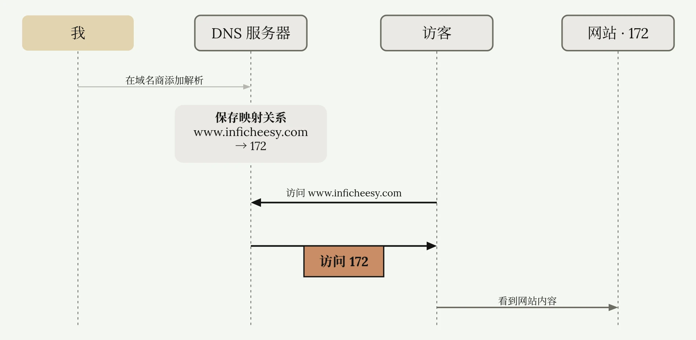
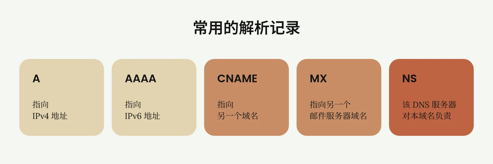
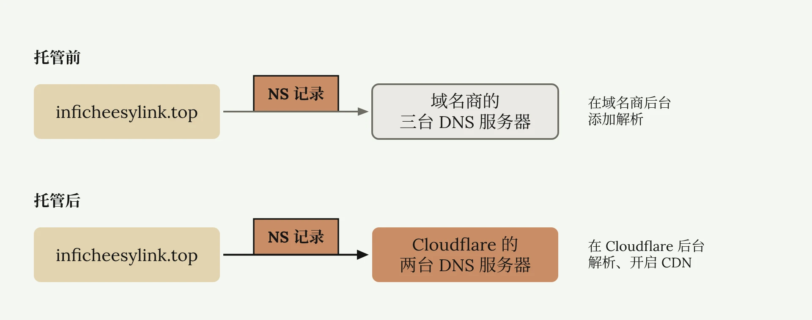

# Cloudflare 域名托管与解析

<ReadMore id="简介" label="简介" title="如何把域名托管到Cloudflare | 享受大厂域名解析服务 | 获取Cloudflare免费CDN | Cloudflare绑定自己的域名 | 无限芝士">

◉ Spaceship（顶级域名便宜）：\
xyz最低0.67美元/年 | top最低1.05美元/年\
[https://spaceship.sjv.io/esy](https://spaceship.sjv.io/esy)\
◉ Namesilo：\
1美金优惠码：ESY | 超低价域名\
[https://www.namesilo.com/?rid=40a6952hi](https://www.namesilo.com/?rid=40a6952hi)\
◉ Cloudflare官网：\
[https://www.cloudflare.com/zh-cn/](https://www.cloudflare.com/zh-cn/)\
◉ 免费与低价域名科普：\
• [为什么不推荐免费域名？免费付费域名有什么区别？如何获取低价域名？| 7元顶级域名 | Cloudflare解析 | 域名科普 | 域名羊毛 | 无限芝士](https://www.youtube.com/watch?v=gKQTtY_YQnA)\
—————————\
本频道所有「软件」和「外部链接」均会发布在频道简介里的「Telegram资源发布群」，该群为本频道官方群聊，无 任 何 三 方 广 告！\
Telegram资源发布群：[https://t.me/inficheesy](https://t.me/inficheesy)\
Telegram问题交流群：[https://t.me/inficheesychat](https://t.me/inficheesychat)\
—————————\
InfiCheesy无限芝士「长期责任推广」：\
◉ 快猫IPLC专线机场：\
39元 | 600G/月 | 性价比大流量包 | 长期9折优惠券：ESY

◉ 蓝通云机场：\
全球60+地区节点 | 8折优惠专属链接\
[https://link.inficheesy.com/lty](https://link.inficheesy.com/lty)\
◉ Proxy Seller住宅代理：\
1.27U/周 | 2.55U/月 | 85折优惠码：InfiCheesy\
[https://link.inficheesy.com/proxyseller](https://link.inficheesy.com/proxyseller)\
—————————\
视频编号：75期\
[0:00](https://www.youtube.com/watch?v=x_-76QVuC3c) 概念科普\
[2:41](https://www.youtube.com/watch?v=x_-76QVuC3c&t=161s) 域名解析\
[4:14](https://www.youtube.com/watch?v=x_-76QVuC3c&t=254s) 域名托管\
—————————\
福利资源、教程干货、科技咨询\
这里是无限芝士，一个致力于提升您上网体验的信息分享频道

</ReadMore>

这篇文章教你如何把自己的域名托管到 Cloudflare 上并解析。首先给小白科普一下什么是解析和托管。如果对这个概念清楚的读者可以直接跳转到[后面教程](#在域名商添加解析)。

## DNS 解析的原理

所谓解析，比如我把 `www.inficheesy.com` 解析到 172 这个地址，说通俗点，就相当于设置了一个路牌，告诉全网：以后任何人需要访问 `www.inficheesy.com` 这个域名，就等于访问 172 这个 IP 地址。

其工作原理也非常简单，我获取了 `inficheesy.com`，并且在域名商那里添加解析到 172 地址，此时这个域名和地址的映射关系会被保存到某个服务器里。现在另外一个人在网页内访问 `inficheesy.com`，经过一轮查询，这个访问请求会到达刚才保存映射关系的那台服务器里，服务器告诉他你应该访问 172 这个地址，他就可以看到我网站的内容了。而这台服务器就叫 DNS 服务器，我们进行的操作就叫 DNS 解析。

## 常用的解析记录类型

解析有很多种类型。知道上述原理，其他几种常用的解析类型就很容易理解了：A 记录，就是刚才那种指向某个 IPv4 地址的路牌。AAAA 记录，指向 IPv6 地址。CNAME，指向另一个域名。如果另一个域名再通过 A 记录指向 172，那访问本域名也可以访问到 172，相当于中转了一次。MX 记录，指向另一个邮件服务器域名。还有一个比较特殊，NS 记录，NS 记录表示该 DNS 服务器对本域名负责。

这么说比较抽象，回到刚才的例子，我们已经知道这台返回 IP 地址的服务器，就是 DNS 服务器。全世界有很多这样的服务器，不停地处理域名请求。我们的请求会默认分配到最近的 DNS 服务器。但是作为域名所有者，你可以设置特定的 DNS 服务器。比如我这个 `inficheesylink.top` 的域名，默认通过这三个 DNS 服务器解析。但是如果我改成其他的域名，别的用户再访问，就会通过这两台 DNS 服务器，返回给他们 IP 地址。

## 域名托管的含义

说完了解析，那托管是什么？再回到刚才我们新设置的两台 DNS 服务器里，这两台服务器通过域名就可以看出，属于 Cloudflare。也就是说，此时 Cloudflare 的服务器对我的域名负责。刚才添加解析记录，只能在我买域名的网站的后台进行操作。而现在，我可以在 Cloudflare 后台，对这个域名进行解析或者其他操作，不用再去域名商那个后台了。等于是我把域名的控制权，从原来的域名商转移到了 Cloudflare，这就叫托管。

实现托管的核心操作，就是设置 NS 记录。填写哪家云服务商的 DNS 服务器，就托管到哪家。

有小白可能会问，那托管有什么好处？不都是解析吗？不都是指向某个 IP 地址吗？简单列举几个：托管的云服务商，比如 Cloudflare，实力雄厚，解析速度更快。还可以白嫖他们家的 CDN。鉴于篇幅，这篇文章不打算深讲，会单独出一篇 DNS 科普。

## 在域名商添加解析

以下是解析与托管的详细步骤。打开你的域名管理后台，比如我这个是 [NameSilo](https://www.namesilo.com/)，1 美元买的 `inficheesylink.top`，平台不一样无所谓，所有域名商解析后台界面都差别不大。刚买的新域名，很多厂商都会自己添加一些解析，这些解析记录对我们没用，需要全部删除。

删除完后点击添加 DNS 记录，类型就是我们前面说的几种类型：我以 A 记录演示，主机名就是最常见的 `www`，你也可以设置成 A1、B2、C3，随意字母数字搭配都可以。

我随便起个主机名，`test`。IP 地址就填写你的服务器 IP。我文章里演示就填 1.1.1.1。稍后我只要访问 `test.inficheesylink.top`，就会返回 1.1.1.1。

TTL 是解析的更新时间，单位是秒，7200 TTL 就是两个小时，太慢了，设置成 3600，也就是一小时。不是我不想设置更快，而是域名商要求最低设置 3600。

现在打开 CMD 命令行，`ping` 这个域名，可以看到是找不到的。再过一段时间，等它解析生效再 `ping`，我大概等了 20 分钟，可以看到返回了解析的 IP 地址，说明解析成功了。

## 主域名与子域名

主机名很特殊。每条解析记录都可以，可以设置一个新的主机名，对应的就是全新的域名。其中，`inficheesylink.top` 是主域名，而主机名加主域名的组合就是子域名。比如 `test.inficheesylink.top`，是子域名。所以买一个域名，你可以设置无限个子域名，指向很多服务，而不是一个域名只能用于一个服务。

## 把域名托管到 Cloudflare

前面解释了 NS 记录与托管的关系，接着回到我的域名管理界面，Name Server，简称 NS。无论厂商，只要你的域名功能齐全，都可以自由修改 NS 服务器。只有一些免费域名不开放 NS 修改权限。

点击 Edit，这个 NS1，NS2，NS3，是其他公司提供的 NS 服务器。现在要托管到 Cloudflare 上，就需要 Cloudflare 提供的 NS 服务器。

打开 [Cloudflare 官网](https://www.cloudflare.com/zh-cn/)，没有账号的小白免费注册一个即可。登录后，点击左侧域注册，点击转移域，点击加入域，输入自己想要托管的域名，选择免费计划。

它提示没有找到 MX 记录，也没有找到 A 记录，AAAA 记录，巴拉巴拉。这不是报错，我们本来也没添加这些记录。点击继续前往激活，弹出一个提示。不用管，点击 Later，到达这个界面，这两串就是我们要的 NS 服务器：Cloudflare 把它翻译成了名称服务器，都是一个东西。

重点来了。现在回到刚才域名商的管理界面，一定要把旧的 NS 服务器全部删除，然后全部添加成 Cloudflare 的服务器。旧的 NS 可能有三四行，甚至七八行，但托管 Cloudflare 只需要两行。输入完成后保存。

再回到 Cloudflare，点击继续，点击立即检查名称服务器。Cloudflare 现在会等待 NS 记录更新。差不多 20 分钟更新完了。邮件提示，`inficheesylink.top` 已经添加成功。再次刷新网页，Cloudflare 已经托管了该域名。

点击右上角 DNS 记录。点击添加记录。现在你就可以在 Cloudflare 解析，也可以添加 A 记录、CNAME、MX 等等。还可以一键开启 CDN。我随便添加了一条解析记录。以上就是托管的全流程。

---

*参考视频：[如何把域名托管到Cloudflare | 享受大厂域名解析服务 | 获取Cloudflare免费CDN | Cloudflare绑定自己的域名 | 无限芝士](https://www.youtube.com/watch?v=x_-76QVuC3c)*
