# Hysteria 2 节点原理与搭建

<ReadMore id="简介" label="简介" title="0基础搭建HY2高速翻墙节点 | Hysteria强在哪？有哪些缺点？| 什么是拥塞控制？| HY2搭建全流程 | 无限芝士">

◉ 搬瓦工VPS官网 ：\
CN2 GIA顶级线路 | 三网优化高端VPS\
[https://bandwagonhost.com/aff.php?aff=81569](https://bandwagonhost.com/aff.php?aff=81569)

◉ 搭建Hysteria 2节点代码文档：\
[https://wise-vegetarian-da6.notion.site/Hysteria-2-416acc0097d38041bf1ce263d023b10c?pvs=74](https://wise-vegetarian-da6.notion.site/Hysteria-2-416acc0097d38041bf1ce263d023b10c?pvs=74)

◉ 新人自建节点教程：\
• [如何自建翻墙节点？| 从零开始VPS搭建节点教程 | 什么是VPS、协议、面板？| 自建节点有什么好处？ | 机场节点搭建全流程 | 无限芝士](https://www.youtube.com/watch?v=MuWTmEiNe1g)

◉ FinalShell官网：\
[https://www.hostbuf.com/](https://www.hostbuf.com/)

◉ Cloudflare域名托管与解析教程：\
• [如何把域名托管到Cloudflare | 享受大厂域名解析服务 | 获取Cloudflare免费CDN | Cloudflare绑定自己的域名 | 无限芝士](https://www.youtube.com/watch?v=x_-76QVuC3c)

◉ 免费/低价域名获取教程：\
• [为什么不推荐免费域名？免费付费域名有什么区别？如何获取低价域名？| 7元顶级域名 | Cloudflare解析 | 域名科普 | 域名羊毛 | 无限芝士](https://www.youtube.com/watch?v=gKQTtY_YQnA)

◉ RackNerd 低端VPS：\
[https://my.racknerd.com/aff.php?aff=13129](https://my.racknerd.com/aff.php?aff=13129)\
—————————\
本频道所有「软件」和「外部链接」均会发布在频道简介里的「Telegram资源发布群」，该群为本频道官方群聊，无 任 何 三 方 广 告！\
Telegram资源发布群：[https://t.me/inficheesy](https://t.me/inficheesy)\
Telegram问题交流群：[https://t.me/inficheesychat](https://t.me/inficheesychat)\
—————————\
InfiCheesy无限芝士「长期责任推广」：\
◉ 高速机场推荐：\
全球60+地区节点 | 88折优惠码：inficheesy\
[https://link.inficheesy.com/vpn1](https://link.inficheesy.com/vpn1)\
◉ 搬瓦工顶级VPS ：\
CN2 GIA顶级跨国线路 | 自建节点首选VPS\
[https://link.inficheesy.com/bwh](https://link.inficheesy.com/bwh)\
◉ LyCheeIP高速住宅代理：\
63元/月 | 大带宽传输稳定\
[https://link.inficheesy.com/lycheeip](https://link.inficheesy.com/lycheeip)\
◉ Proxy Seller住宅代理：\
1.27U/周 | 2.55U/月 | 85折优惠码：inficheesy\
[https://link.inficheesy.com/proxyseller](https://link.inficheesy.com/proxyseller)\
—————————\
视频编号：105期\
[00:00](https://www.youtube.com/watch?v=KpSkKZSstYA) HY2\
[00:33](https://www.youtube.com/watch?v=KpSkKZSstYA&t=33s) 简单原理\
[03:21](https://www.youtube.com/watch?v=KpSkKZSstYA&t=201s) 搭建3XUI\
[06:47](https://www.youtube.com/watch?v=KpSkKZSstYA&t=407s) 搭建HY2\
[10:42](https://www.youtube.com/watch?v=KpSkKZSstYA&t=642s) 测速评价\
[13:47](https://www.youtube.com/watch?v=KpSkKZSstYA&t=827s) 结尾\
—————————\
福利资源、教程干货、科技咨询\
这里是无限芝士，一个致力于提升您上网体验的信息分享频道

</ReadMore>

我们日常翻墙除了 [Reality 节点](./从零搭建VPS翻墙节点.md#搭建-vless--tcp--reality-节点)，还有什么值得尝试的代理协议？今天就聊聊第二热门的高速节点协议，[Hysteria 2](https://v2.hysteria.network/)，简称 HY2 节点。HY2 能有效对抗丢包和高延迟网络，改善垃圾线路。基于 HTTP/3 流量伪装，特征明显区分于传统节点，不容易被墙。内置 Brutal 拥塞控制算法，拯救速度差的 VPS。听不懂专业术语没关系，这篇文章就用最基础的白话，讲解 HY2 的节点搭建步骤、提速原理和使用场景。

## HY2 的原理与局限

### Brutal 拥塞控制的提速原理

首先需要清楚，HY2 并非所有人的万能节点。如果不了解原理，直接照教程搭建，不仅可能没提速，反而还会遇到限速、断连的问题。

HY2 节点之所以快，其最核心的优势，就是内置独家 Brutal 拥塞控制。拿 Reality 节点对比，Reality 使用传统的 TCP 拥塞控制。所谓拥塞控制，说白了就是网络堵车时，到底该不该减速。

比如你平时网速 100 兆，网络拥堵时，如果还跑 100 兆，数据就很容易丢，俗称丢包。此时应该降速，减少丢包率，让数据平稳传输。Reality 的传统 TCP 拥塞控制，就会在拥堵时自觉降速，让出一部分网络资源，优先保证稳定性。

而 HY2 的 Brutal 拥塞控制完全不同。如果发生拥堵，会尝试发送更多的数据包，积极抢占网络资源，追求极致速度。

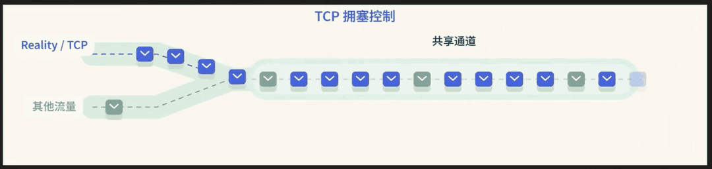

就像两台车同时遇到堵车，Reality 会放慢速度排队，保证车辆平稳行驶。而 HY2 则想办法疯狂超车、变道，尽量往前挤。

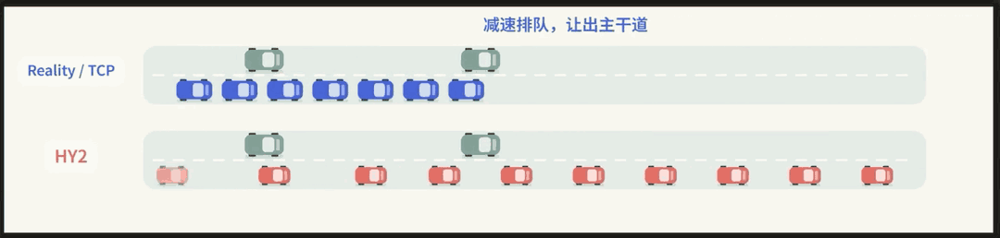

前者是一种君子协议，大家都遵守规定，有序排队。后者说直接点就是流氓协议，有带宽就抢，有空就占，主打一个力大砖飞。因此 HY2 可以理解为一种强效加速器，能榨干你服务器的物理带宽。

### UDP 节点的局限

听到这里，你可能已经想把所有 Reality 节点换成 HY2 了。但先别急，因为还有一个非常现实的问题：HY2 节点不能在所有网络里都畅通无阻。

简单科普一下，市面上的节点按传输类型，分 TCP 节点和 UDP 节点两大类。我们最常用的 VLESS + TCP + Reality 和 VMess + WS + TLS 都属于 TCP 节点，而 HY2、TUIC 属于 UDP 节点。

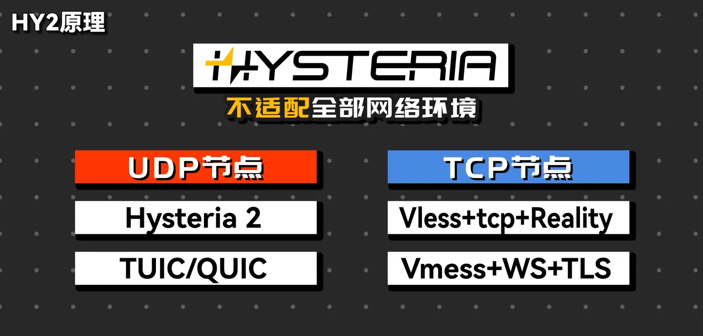

这两种节点在使用上没有太大区别，都能正常翻墙，访问谷歌、油管、推特。但 UDP 流量特别容易被网络运营商针对，比如国内某些校园网会直接禁止 UDP 流量，相当于禁止了所有 UDP 节点。结果就是传统的 Reality 节点用得好好的，换成 HY2 反而翻不了墙。

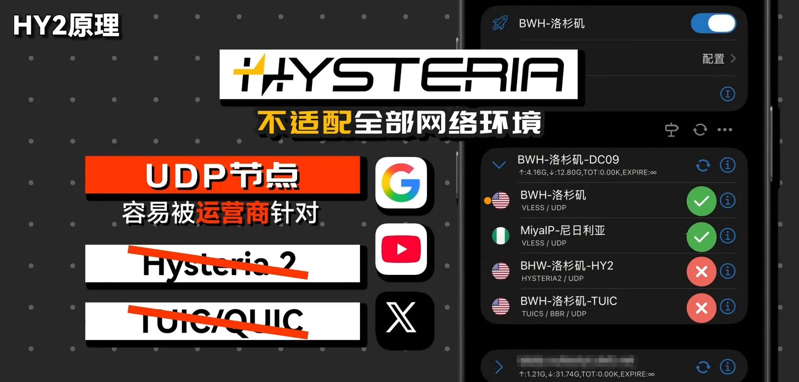

而且 UDP 丢包更严重。前面已经提到，TCP 节点会降低速度，减少丢包。而 UDP 是丢包了没事，继续发包，抢占带宽。

所以 HY2 到底适不适合你，其实就看两件事。

1. 本地网络能不能稳定跑 UDP。
2. 你更在意什么样的使用体验。像奈飞、迪士尼、YouTube 这类视频平台有提前缓存，短暂的网络波动对视频播放影响很小。但如果你需要直播、语音，更看重稳定性，就不推荐 HY2 节点。

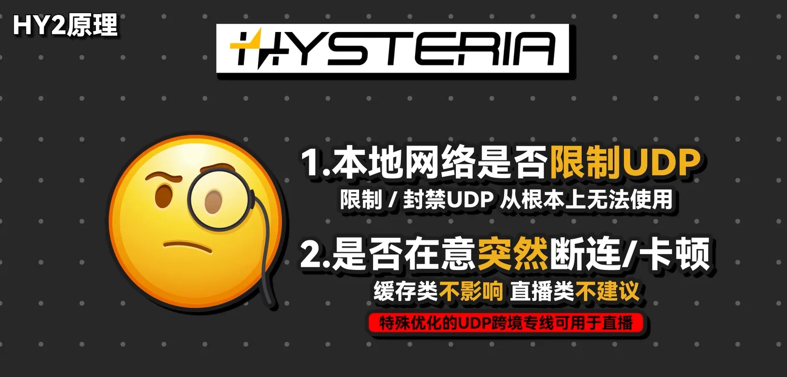

所以 HY2 不是用来全面取代 Reality 的，而是给你多一种选择。在合适的场景下，它可以成为提速利器；在不合适的场景下，它反而变成减速器。

了解这些区别后，现在再开始搭建 HY2 节点。

## 安装 3x-ui 面板并绑定域名

### 安装面板

首先准备好你的 VPS，我以[搬瓦工](https://bandwagonhost.com/)东京 VPS 示例，通过 SSH 工具 [FinalShell](https://www.hostbuf.com/) 成功连接 VPS。如果不清楚 SSH 工具是什么，可以看从 0 开始自建节点的[第一篇文章](./从零搭建VPS翻墙节点.md#用-finalshell-登录-vps)。

首先输入这串命令，更新 Linux 系统依赖。代码均在[简介](#简介)。

```bash
apt update -y && apt upgrade -y && apt install sudo curl -y
```

更新完成后，输入这串命令，回车，安装 [3x-ui](https://github.com/MHSanaei/3x-ui) 面板。

```bash
bash <(curl -Ls https://raw.githubusercontent.com/mhsanaei/3x-ui/master/install.sh)
```

选择数据库类型，输入 1，选择 SQLite 数据库即可。询问是否给面板设定端口，输入 N 回车，会自动给面板分配一个随机端口。

询问是否给面板绑定域名证书。这篇教程搭建 HY2 节点，必须绑定域名。输入 1，选择 Let's Encrypt for Domain，绑定域名证书。

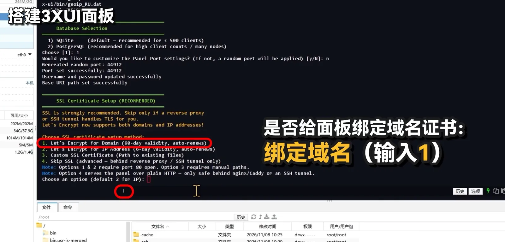

### 给 VPS 添加域名解析

提示需要输入域名，打开 Cloudflare。这是我已经在 Cloudflare 托管好的域名。如果你不会托管域名，也不懂什么意思，可以看[这篇文章](./Cloudflare域名托管与解析.md)，内容针对小白，详细讲解了域名的托管、解析全流程。

点击添加记录，这里 IPv4 地址输入你 VPS 的 IP。名称填写任意数字、字母，我就写个 `lalala`。代理状态按钮一定要关闭，TTL 保持默认，点击保存。

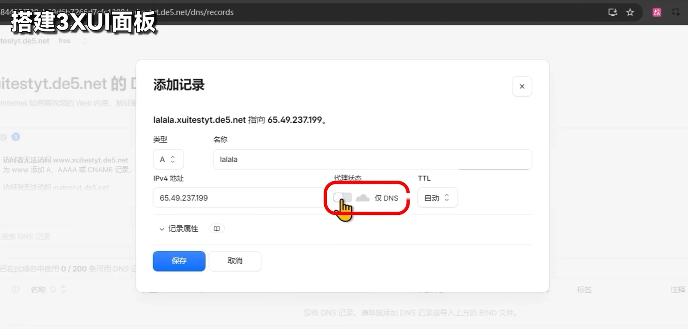

这就是我们解析的域名，lalala 这一长串。打开命令行，输入 `ping` lalala 这串域名。可以看到，返回了我搬瓦工东京 VPS 的 IP 地址，说明解析成功。

### 用 3x-ui 申请域名证书

现在回到 FinalShell 界面，输入刚才的 lalala 整串域名，回车。需要选择一个证书端口，直接回车，等待安装证书。第一次安装证书会下载一大堆依赖。

是否启用 ACME 脚本？这个脚本是帮我们续期域名证书的。域名证书一般只有 90 天有效期，到期后需要续签，ACME 可以帮我们自动续签。但是以往 3x-ui 首次安装时，启用的 ACME 会有 bug。我个人一般选择 no，先不启用，后续你熟练操作了，可以自行启用。输入 N 回车。

询问是否给面板安装证书。我们本来的目的就是申请域名证书，安装到 3x-ui 面板里，输入 Y 回车。显示这个界面就说明 3x-ui 面板安装成功。往上翻，找到这串绿色的字符，这就是面板的登录信息，全部保存到记事本。

### 开启 BBR 并检查防火墙

再次回到 FinalShell 最底部，输入 `x-ui`，呼出 3x-ui 面板的命令行界面。首先找到 Enable BBR，编号为 26，输入 26 回车。选择 Enable BBR，输入 1 回车，提示 BBR 已经开启。BBR 就是拥塞控制算法，可以提高节点速度。

还没完，再输入 0 回车，退出 3x-ui 命令行管理界面。输入 `ufw status`，查看这台 VPS 的防火墙状态。

```bash
ufw status
```

如果你的 VPS 和我一样提示 not found，找不到 UFW 这个命令，说明没有内置防火墙，可以搭建节点。如果返回了这串命令，说明有内置防火墙，就需要输入此命令，关闭防火墙，或者使用这些命令，在防火墙上单独放行端口。

```bash
sudo ufw disable        # 关闭防火墙
sudo ufw allow 12345    # 放行端口，12345 换成要放行的端口
```

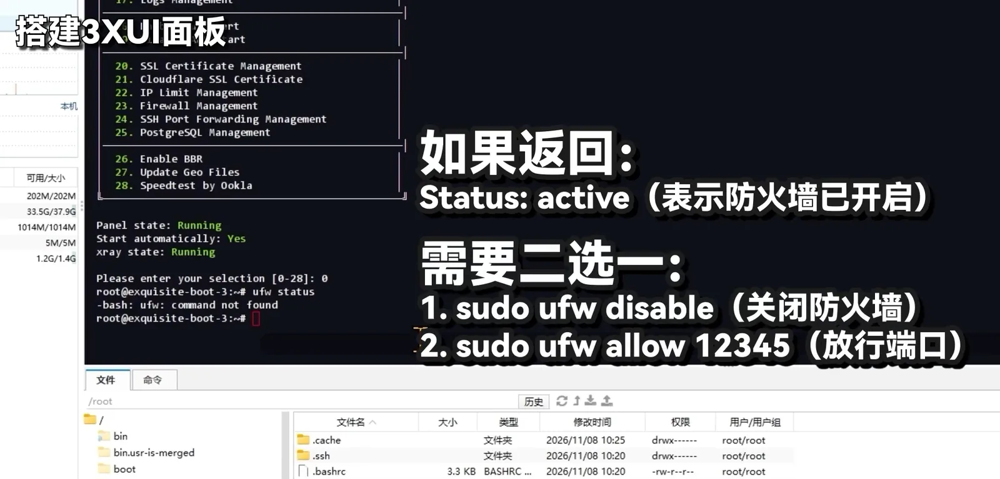

现在命令行的设置已经完成，可以打开 3x-ui 面板，开始安装节点了。

## 搭建 HY2 节点

### 入站的协议与端口

打开浏览器，输入刚才保存的 3x-ui 登录信息里的网址。输入用户名和密码，成功登录。这就是运行在东京 VPS 上的 3x-ui 面板，版本号为 3.11。如果你看这篇文章的时间，距离发布日期已经比较久了，3x-ui 的界面可能会发生较大改变。没关系，原理本质都是一样的，我会详细讲解每个操作的意义，保证无论界面如何更改，新手小白也能学会。

点击入站，因为我们需要给 VPS 开一个口子，让国内的流量能进入这台 VPS，所以叫添加入站。备注就是节点的名字，随便填。协议选择 Hysteria，端口随意，从 443 到 65535 都可以。但还是建议使用 <Term tip="指 443，以及 2053、2083、2087、2096、8443 这类常用来跑 HTTPS 的端口。">443 系端口</Term>，因为翻墙节点的本质，就是让海外服务器伪装成国内可以合法访问的网站。真正的网站一般使用 443 端口，所以节点用 443 端口伪装程度更高。

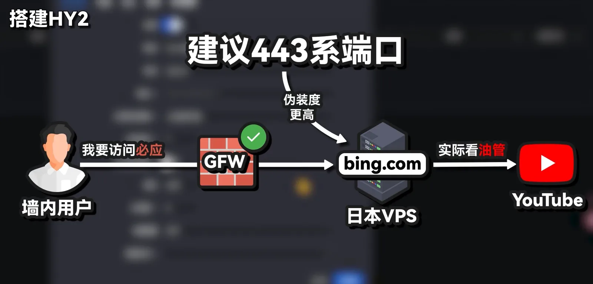

点击传输，这些保持默认。注意版本号为 2，就是 HY2 的意思。早期的 HY1 节点，发包策略过于激进，UDP 流量过大，经常引起运营商的注意，导致断流，节点不可用，已经被废弃。现在全面升级到 HY2 协议，发包策略更智能，使用更稳定。

### SNI 与证书的两种填法

点击安全，重点来了，<Term tip="Server Name Indication：客户端建立 TLS 连接时告诉服务器要访问哪个域名，这一项是明文，防火墙能看到。">SNI</Term> 必须输入当前 3x-ui 面板的域名。往下滑，点击从面板设置证书。

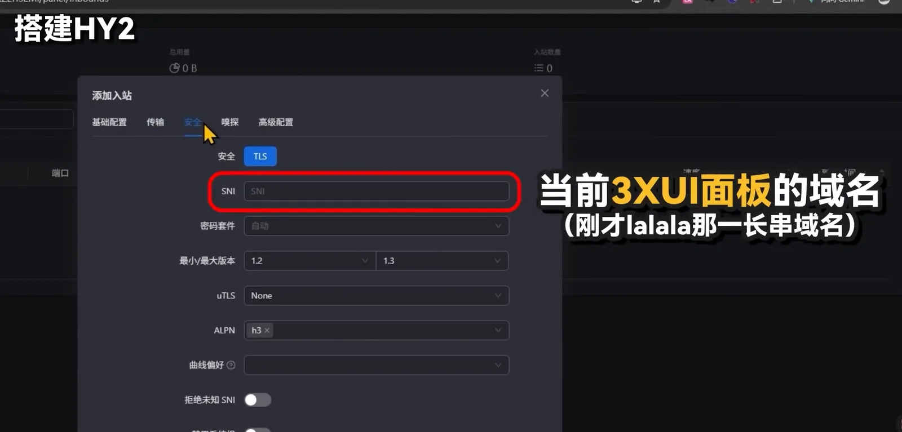

解释一下原因，HY2 节点也是伪装网站翻墙的，SNI 就填写伪装的网站，下面的证书就是伪装网站的证书。这里有两种填法。

第一种，SNI 填自己的域名，那证书也填自己的。域名和证书都是正规渠道获得的，所以置信度最高。

第二种，SNI 填别人的域名，比如必应、微软。但我们肯定没有这些大公司的合法证书，只能自己生成一个假证书。假证书也能用，但肯定不如自己域名的真证书稳定。

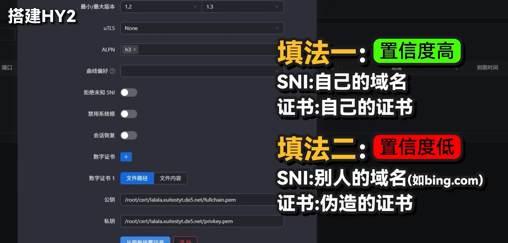

所以前面才让我们绑定自己的域名，设置自己的证书。

这里其他参数很多，没关系，都不用管，保持默认即可。嗅探和高级配置也不用管，点击创建。这样我们的 HY2 UDP 节点就成功搭建。但现在还无法导入 Clash、小火箭、v2rayN 等[代理软件](./从零搭建VPS翻墙节点.md#代理软件的选择)。

### 添加客户端并导入节点

点击客户端，3x-ui 面板本质是服务端，就是提供节点服务的。而客户端是给使用的人配置的，添加客户端。这些参数都不用管，点击最下方的关联入站，选择我们刚才搭建的节点，点击创建。

现在这个名为 9NGM 的客户端，就连接好了刚才创建的 HY2 节点。点击左侧二维码图标，通过手机扫码、粘贴链接等方式，就可以把 HY2 节点导入 v2rayN、小火箭。

现在我又创建了一个传统的 Reality TCP 节点，和 HY2 节点作为对比参考。将 Reality 节点也连接 9NGM 客户端，扫客户端二维码后，我就会直接添加两个节点。

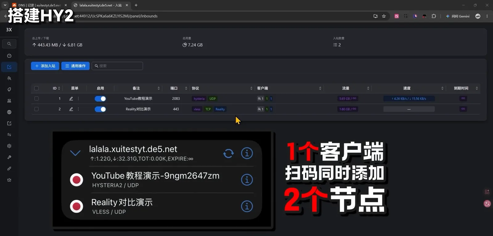

### Clash 的订阅格式

如果你用的是 Clash，这个订阅链接无法导入，会直接报错。因为 3x-ui 的订阅链接是默认订阅格式，而 Clash 需要另一种订阅格式，所以需要转化 3x-ui 的默认格式，才能导入 Clash。

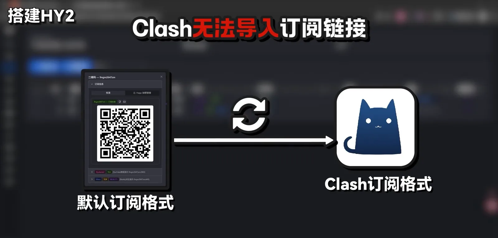

点击左侧面板设置，订阅设置，打开 Clash Mihomo 订阅。这一步就是让我们的订阅格式支持 Clash。点击左上角保存，重启面板才能生效。

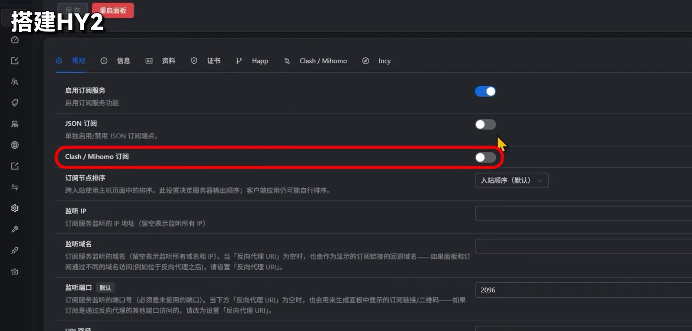

再找到左侧 Sub Formats，勾选自动识别 Clash Mihomo 客户端，点击保存，重启面板。

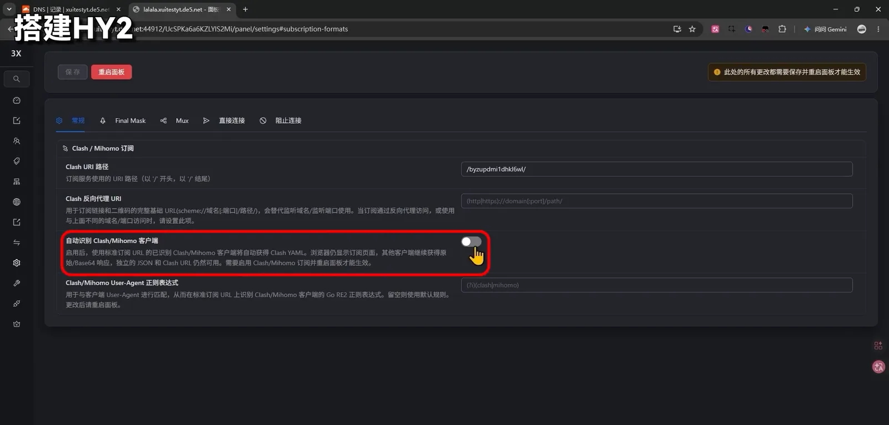

现在我们的订阅链接，就可以同时被 v2rayN、Clash、小火箭等主流代理软件订阅。可以看到，我的电脑、iPhone、Android，使用了不同的代理工具，都导入了搬瓦工东京的两个节点。

## HY2 与 Reality 的测速对比

### 高端 VPS 上的测速

接下来测试效果。这台搬瓦工东京 VPS，接入 CN2 GIA [顶级线路](./VPS线路科普与选购.md#高端线路与普通线路)，延迟低，速度快，线路好，名副其实的高端 VPS。这篇文章将其用于讲解 HY2 与 Reality 的应用差异。

首先测试一下真连接延迟，只有 60 多毫秒，非常快。打开 [IP2Location](https://www.ip2location.com/)，可以看到是东京 IP，没错。先不开节点，使用国内本地网络跑一遍[中科大测速](https://test.ustc.edu.cn/)。可以看到，我的千兆网跑了 975 兆，可以看作满带宽。

接下来就测试东京搬瓦工的速度。连接搬瓦工 HY2 节点，打开 [Fast](https://fast.com/) 的测速，直接拉满带宽，顶格速度。再换 Reality TCP 节点测速对比，最终结果 930 兆，略逊 HY2 节点。这就是 HY2 的加速效果。

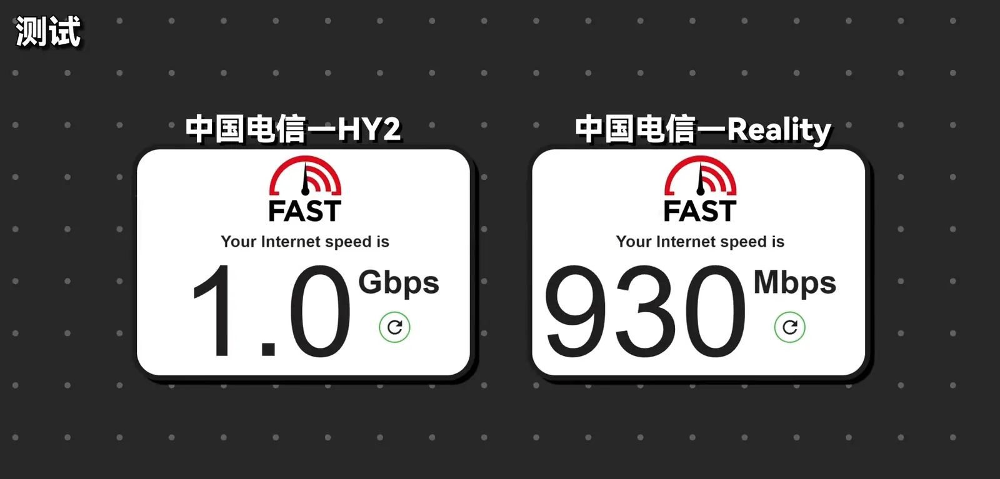

但是这个测速结果并不绝对，当前使用电信网络测速，更换为移动宽带反复测试后，HY2 节点仅有四五百兆，砍了一半多。而 Reality 节点 940 兆，依旧满带宽水平，说明我本地移动运营商可能对 UDP 流量存在恶意 <Term tip="Quality of Service，服务质量控制：运营商按流量类型分配带宽，可以单独给某一类流量限速。">QoS</Term> 限速。这种运营商侧的情况我无从考证，只能通过更换宽带对比说明。

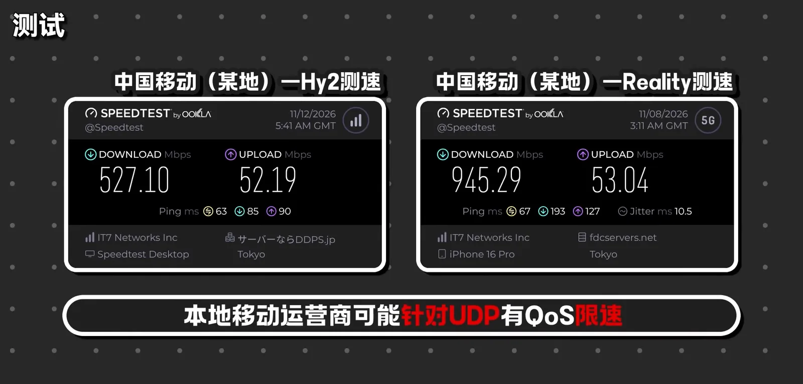

既然 HY2 和 Reality 差距甚小，且本地 HY2 存在限速，所以我个人在这台 VPS 上，优先选用 Reality 作为主要节点，HY2 节点作为备用。

### 低端 VPS 上的测速

刚才只是测试了搭载顶级线路的高端 VPS，如果拿普通 VPS 测试，结果就完全不一样。

比如这台 [RackNerd](https://www.racknerd.com/) 的洛杉矶 VPS，无任何优化线路，也是分别搭建了 Reality TCP 节点和 HY2 UDP 节点。其中 TCP 节点直接不可用，这就是中国移动臭名昭著的墙中墙。国内移动、联通、电信三大运营商，其中移动因为历史原因，它家的出海跨境线路成本较高，就需要经常限制用户。比如移动直接禁止了 RackNerd 的这类低端 VPS 机房的 TCP 连接，结果就是移动用户使用 RackNerd 的 VPS 搭建的 TCP 节点都不可用。而 HY2 UDP 节点依旧可以连通，甚至还能跑出 250M 的网速，刷 YouTube 4K 绰绰有余。

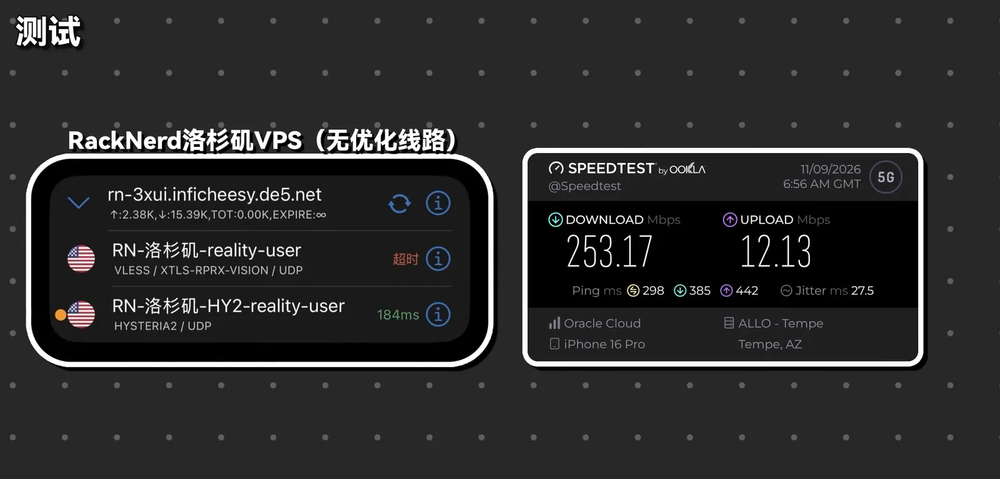

### 不同 VPS 怎样选择主力节点

在低端 VPS 中，HY2 会积极抢占普通线路的网络资源，尽可能榨干低端 VPS 的带宽，提高节点网速。而且还得益于 UDP 的特性，具有一定的防封功能。综上，HY2 节点更多建议应用在低端平价 VPS 上，可以让你 20 美元一年的 VPS，发挥出 30 美元甚至 40 美元的价值。

而对于本身就搭载优质线路、顶级线路的高端 VPS，建议保持使用 TCP 类型节点，如 VLESS 加 TCP 加 Reality，或 VMess 加 WebSocket 加 TLS。

当然，以上只是一个宽泛的笼统结论，每个人所在地区的运营商策略和网络环境都不一样，VPS 本身质量和路由情况也有较大差异。个人建议通过 VPS 搭建节点，最好是 Reality、VMess、HY2、TUIC，这四类主流协议都用上，并且使用本地网络全部测试后，择优选择主力节点。

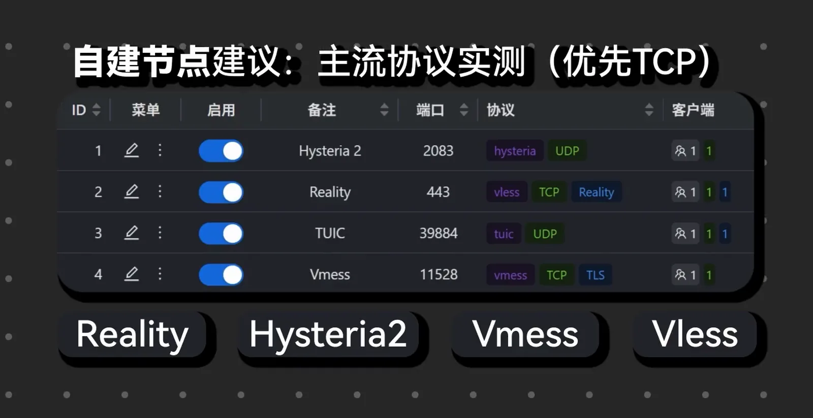

最后，HY2 节点的 UDP 限速问题，其实可以通过[端口跳跃](https://v2.hysteria.network/docs/advanced/Port-Hopping/)解决。相关教程攻略和原理科普，我会放在下期视频。

---

*参考视频：[0基础搭建HY2高速翻墙节点 | Hysteria强在哪？有哪些缺点？| 什么是拥塞控制？| HY2搭建全流程 | 无限芝士](https://www.youtube.com/watch?v=KpSkKZSstYA)*
