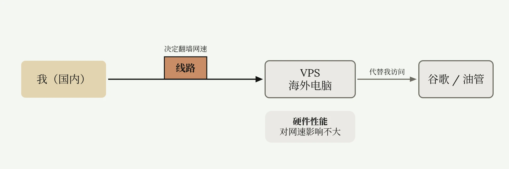
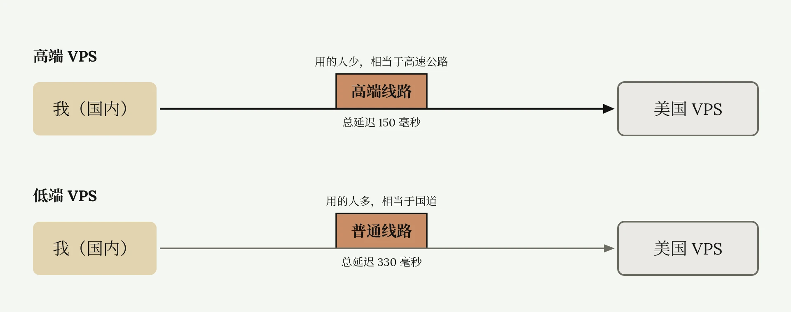
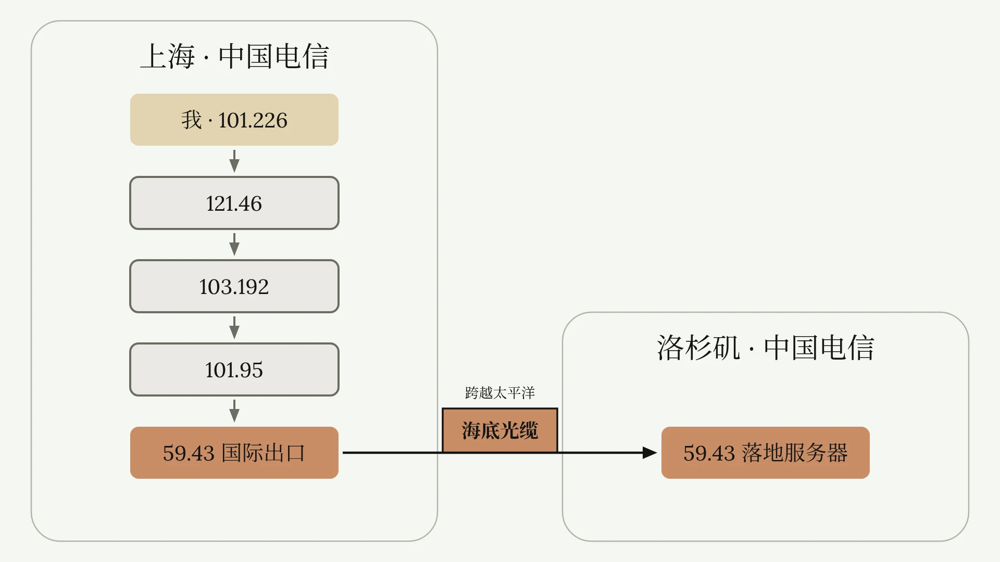
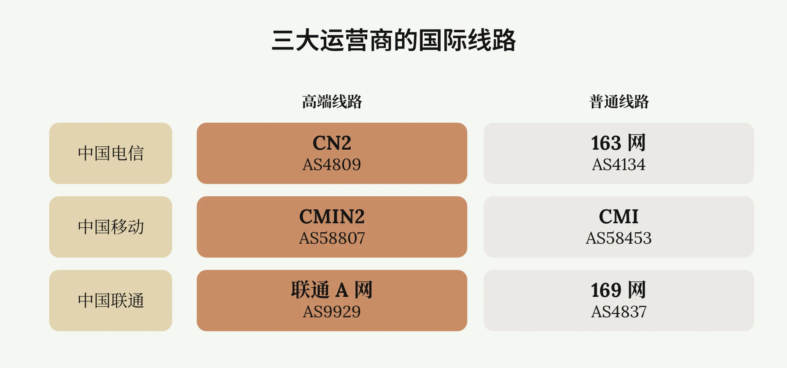
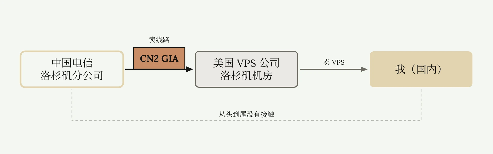
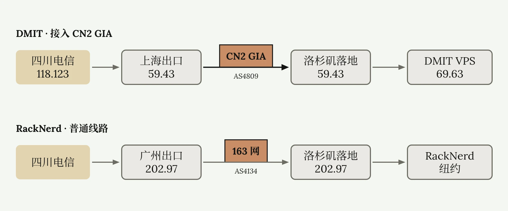

# VPS 线路科普与选购

<ReadMore id="简介" label="简介" title="自建顶级翻墙节点 | 什么是高端跨国线路？VPS质量如何判断？| VPS优化线路科普 | 自建高质量翻墙节点 | CN2 GIA 9929 CMIN2 | 高低端VPS差异 | 无限芝士">

◉ 搬瓦工VPS官网（有货）：\
50美元/3个月 | 三网顶级优化线路\
[https://bandwagonhost.com/aff.php?aff=81569](https://bandwagonhost.com/aff.php?aff=81569)\
◉ DMIT美国VPS（有货）：\
中国电信顶级优化线路CN2 GIA\
[https://www.dmit.io/aff.php?aff=18894](https://www.dmit.io/aff.php?aff=18894)\
◉ Akile香港VPS（有货）：\
最低40元/月 | 香港无稳定机建议【月付】\
[https://akile.ai/register?aff_code=e34fc906-cf0c-4dd9-a1f6-c160f4d13b01](https://akile.ai/register?aff_code=e34fc906-cf0c-4dd9-a1f6-c160f4d13b01)\
◉ Vmiss VPS官网：\
三网顶级优化线路\
[https://app.vmiss.com/aff.php?aff=5248](https://app.vmiss.com/aff.php?aff=5248)\
◉ VPS测试脚本：\
[https://wise-vegetarian-da6.notion.site/VPS-350acc0097d380b58eefd4b9034a9458](https://wise-vegetarian-da6.notion.site/VPS-350acc0097d380b58eefd4b9034a9458)\
◉ 全球优化线路VPS推荐：\
[https://wise-vegetarian-da6.notion.site/VPS-364acc0097d3804dacc4e94658ae3017?pvs=73](https://wise-vegetarian-da6.notion.site/VPS-364acc0097d3804dacc4e94658ae3017?pvs=73)\
◉ 零基础自建节点系列—第一期：\
• [如何自建翻墙节点？| 从零开始VPS搭建节点教程 | 什么是VPS、协议、面板？| 自建节点有什么好处？ | 机场节点搭建全流程 | 无限芝士](https://www.youtube.com/watch?v=MuWTmEiNe1g)\
◉ 零基础自建节点系列—第二期：\
• [自建节点被墙怎么办？免费CDN拯救被墙节点！| CDN是什么 | CDN作用 | CDN回源加速 | VPS套CDN | Cloudflare CDN | 无限芝士](https://www.youtube.com/watch?v=NnyG3DyZbN8)\
◉ 零基础自建节点系列—第三期：\
• [拯救你的垃圾VPS！优选IP加速教程 | 什么是优选IP？如何使用？ | 优选器 | 订阅转换器 | 零基础自建节点系列 | 无限芝士](https://www.youtube.com/watch?v=E5PI0LsQ43M)\
—————————\
本频道所有「软件」和「外部链接」均会发布在频道简介里的「Telegram资源发布群」，该群为本频道官方群聊，无 任 何 三 方 广 告！\
Telegram资源发布群：[https://t.me/inficheesy](https://t.me/inficheesy)\
Telegram问题交流群：[https://t.me/inficheesychat](https://t.me/inficheesychat)\
—————————\
InfiCheesy无限芝士「长期责任推广」：\
◉ 蓝通云机场：\
全球60+地区节点 | 8折优惠专属链接\
[https://link.inficheesy.com/lty](https://link.inficheesy.com/lty)\
◉ LyCheeIP高速住宅代理：\
63元/月 | 大带宽传输稳定\
[https://link.inficheesy.com/lycheeip](https://link.inficheesy.com/lycheeip)\
◉ Proxy Seller住宅代理：\
1.27U/周 | 2.55U/月 | 85折优惠码：InfiCheesy\
[https://link.inficheesy.com/proxyseller](https://link.inficheesy.com/proxyseller)\
—————————\
视频编号：89期\
[00:00](https://www.youtube.com/watch?v=NhhyCl1w-4c) 开头\
[00:34](https://www.youtube.com/watch?v=NhhyCl1w-4c&t=34s) VPS线路本质\
[07:14](https://www.youtube.com/watch?v=NhhyCl1w-4c&t=434s) VPS选购\
[10:05](https://www.youtube.com/watch?v=NhhyCl1w-4c&t=605s) VPS测试概念\
[11:42](https://www.youtube.com/watch?v=NhhyCl1w-4c&t=702s) 去程测试\
[14:25](https://www.youtube.com/watch?v=NhhyCl1w-4c&t=865s) 回程测试\
[19:44](https://www.youtube.com/watch?v=NhhyCl1w-4c&t=1184s) 稳定性测试\
[21:29](https://www.youtube.com/watch?v=NhhyCl1w-4c&t=1289s) 其他测试\
[23:33](https://www.youtube.com/watch?v=NhhyCl1w-4c&t=1413s) 选购建议\
[24:48](https://www.youtube.com/watch?v=NhhyCl1w-4c&t=1488s) 总结\
—————————\
福利资源、教程干货、科技咨询\
这里是无限芝士，一个致力于提升您上网体验的信息分享频道

</ReadMore>

哪种 VPS 好，哪种 VPS 烂，VPS 到底怎么买？新人刚入门自建节点，一堆英文字母，名词术语根本看不懂，网上教程讲的线路是什么东西？CN2，9929，ASN 这些又是什么东西？什么叫路由表，评测脚本又是什么？VPS 跑分又是什么，等等。这篇文章针对完全不懂 VPS 的小白，会用白话，把上述名词概念，业内黑话，全部掰开揉碎讲明白。保证看完后，你会对每一款 VPS 的质量有一个清晰的认知，以后选购 VPS 不吃亏。

## VPS 与线路的关系

VPS 本质就是一台海外电脑，我自己没法访问谷歌，但连接这台海外电脑，让它代替我访问谷歌油管，这就是代理翻墙。



这张图可以看出，影响我翻墙体验的主要有两点，一个是 VPS 这台电脑本身的硬件性能，另一个就是接入这台 VPS 的线路。硬件性能对翻墙网速影响不大，而线路起了决定性作用，线路越好的 VPS，翻墙网速越快越稳，反之，线路越差，翻墙速度越慢且越不稳定。

## 高端线路与普通线路

什么是线路？假如你买了两台美国 VPS，一台高端机，一台低端机，高端 VPS 接入高端跨国线路，低端 VPS 接入的是普通跨国线路，你在国内分别连接这两台 VPS，连接高端 VPS 时，网络会自动走高级线路，总延迟 150 毫秒。连接低端 VPS 时，网络自动走普通线路，延迟 330 毫秒。高级线路用的人少，非常通畅，速度快，更稳定，相当于高速公路。普通线路用的人多，时不时拥堵，速度慢，不稳定，相当于国道。



## 国际出口与落地服务器

那这些高级跨国线路具体长什么样呢？怎么分辨自己的 VPS，有没有接入高级线路？首先需要引入一个概念，ASN 自治域，新人一听专有名字懵了，没关系，我会用白话简单讲解。

我们连接美国洛杉矶 VPS，看起来是从上海出发，直接到美国两点一线。但实际情况没这么简单。假设我在上海，我的 IP 地址是 101.226。连接美国 VPS 的真实情况是：我的流量先到 121.46 这个 IP，可以看到，这是中国电信，在上海的一台服务器。是国内互联网的基础设施，然后又连到 103.192。这还是一台电信的互联网基建服务器。又连到 101.95，依旧是电信的基建服务器。最后到 59.43。还是一台电信的基建服务器。但注意，这台服务器比较特殊：它下一步就会把我们的流量，从上海通过国际海底光缆，跨越整个太平洋，送到美国西海岸洛杉矶。

此时洛杉矶有一台服务器，IP 地址为 59.43，它会全盘接收这些数据。注意，这台服务器的 IP 和刚才上海的最后一台服务器 IP 地址开头是一样的，都是 59.43。我们把刚才上海的最后一台服务器，59.43，叫做国际出口服务器。字面意思，国内的数据流量，从这里出国。而洛杉矶这台 59.43，叫做落地服务器，就是出国数据的第一个落脚点。这两台服务器都属于中国电信。



有人可能疑惑，洛杉矶这台 59.43 都在美国了，怎么还属于中国电信？这就是三大运营商的海外服务器：不止洛杉矶有，东京，首尔，伦敦，澳大利亚，全球各地都有。而且不仅中国电信在建，联通，移动也搭建了很多海外服务器。三大运营商通过这些海外节点，和国内建立网络连接，组成线路，就叫做国际线路。

## ASN 与三大运营商的线路

而这几台 59.43 的关系非常紧密，同属于一个 ASN 自治域，名为 AS4809。什么是 ASN？ASN 和 IP 地址的关系：就像母亲和孩子的关系。AS4809 是上一级，旗下管理很多 59.43，比如 59.43.1.1、59.43.1.2。这些 59.43 分布在全球各地，全部归属 AS4809。而 AS4809 又归中国电信管，他们共同组成了中国电信在全球的高端线路。

电信也不止建立了 AS4809 这个高端线路，还建立了普通线路，AS4134。AS4134 旗下的服务器也是遍布全球各地。如果你是电信用户，你基本平时上网的所有数据都会经过 AS4134 旗下的服务器。既然电信有 AS4809 高端线路，和 AS4134 普通线路，那移动联通肯定也有自家的线路，移动高端线路：AS58807；普通线路：AS58453。联通高端线路：AS9929；普通线路：AS4837。

你可能已经觉得，拿 AS 编号记线路太麻烦了，看着都眼睛花。所以大家给这些线路起了方便记忆的名字，AS4809 就是大名鼎鼎的 CN2 线路；AS4134，又名 163 网，电信普通线路；AS58807，又名 CMIN2，移动高端线路；AS58453，又名 CMI，移动普通线路；AS9929，联通 A 网；AS4837，又名 169 网，联通普通线路。



## 国际线路的商业逻辑

有读者肯定疑惑，不是说不让翻墙吗？为什么三大运营商还花钱建这些国际线路？原因很复杂，挑最简单的说，主要是国内很多跨国公司，基础设施，金融服务需要和国际建立联系，所以跨境网络线路是必须的。其次三大运营商这么大的公司，海外也要赚钱。

但我们又不是跨国公司，为啥还能用到这些跨国线路？举个例子，假如你是一个美国人，开了一家 VPS 公司。你在洛杉矶买了一些电脑，放在洛杉矶机房。我是中国人，在国内，买了你的 VPS，但速度很差。我想多花点钱提速。你为了给我提供更好的服务，赚更多的钱，你就去和中国电信的海外销售谈合作。谈成了。中国电信洛杉矶分公司给你的机房接入了 CN2 GIA 高端跨国线路。现在我用你的 VPS 搭建节点，我连接这个 VPS 时，就会自动走电信的高端线路，速度飞快。整个环节里，电信没有把线路直接卖给我，而是卖给你这个美国人注册的美国公司。这个美国公司再卖给我。从头到尾，我和电信没有进行任何接触。



## 跨网使用国际线路

有些人可能会想，我是移动联通，买了一台接入 CN2 GIA 电信顶级线路的 VPS，是不是不能用？答案是可以正常使用。即使你是移动用户，电信 CN2 GIA 的跨国线路，也同样支持移动和联通用户跨网使用，你也能享受到高端线路的优化速度。但是通常情况下，比电信宽带用户要稍微慢一点点，其他线路也是同理，电信用户可以用移动高端线路 CMIN2。联通移动用户也可以用电信 CN2 GIA。如果你觉得这些太乱了，简单说就是，这些线路虽然是不同运营商承建，但三网用户都能用，只是优化效果有差异。通常建议最好购买本家优化线路。

注意，线路的挑选比较复杂，三网用户搭配三网不同的优化线路，有很多种组合，至于哪种速度更快，价格更便宜，更有性价比，需要具体问题具体分析。建议新人多看视频，多逛论坛。以上就是国际线路的大体概念，它是我们翻墙访问外网必不可少的条件。无论你用的是 VPN，机场，还是 VPS 自建节点，都离不开这些基础设施。

## 看懂 VPS 购买页

高端 VPS 厂商不少，[DMIT](https://www.dmit.io/)、搬瓦工、[Vmiss](https://www.vmiss.com/) 等等。但因为高端 VPS 存货量小，经常售空，我以运营 15 年的业内老厂，货源充足的搬瓦工 VPS 进行演示。

注意，这篇文章不含任何厂商赞助广告。部分厂商可能会缺货，可以等待补货或者换一家厂商。这篇文章中的高端 VPS，不包含甲骨文云、谷歌云等国际大厂：因为其产品高昂的定价，对普通消费用户没有意义。搬瓦工是圈内公认的高端 VPS 厂商，在各大论坛讨论度一直不低，其高端产品同时接入电信、移动、联通三网顶级跨国线路，网络表现极其稳定，是不少高端用户的首选。

打开[搬瓦工官网](https://bandwagonhost.com/)。这就是 VPS 购买页。不同厂商的选购页面大同小异，主要分为以下几个板块，第一个是 VPS 套餐等级，搬瓦工主要分为四个等级的 VPS：基础款、进阶款、进阶强化款和顶级款。这篇文章主要介绍进阶款 VPS。第一个选国家，进阶款目前提供加拿大，日本，荷兰，沙特阿拉伯，美国的 VPS。假如我需要美国洛杉矶的 VPS，此时会弹出套餐。先选择线路，主要有三种线路套餐：USCA2、USCA6、USCA9。

这些名字五花八门，每个厂商叫法都不一样，不用管它叫什么，只看线路套餐的内容。下面这行就是线路介绍，可以看到，USCA2 套餐主要接入了 Cloudflare、Google、中国电信、中国联通、中国移动这几个线路。其中，Cloudflare 意思就是：用这台 VPS，连接 Cloudflare 托管的网站，速度会有优化。

同理，Google 就是谷歌优化线路。使用这台 VPS 搭建的节点，访问谷歌的网站比如 YouTube、Gmail 的速度也会有优化。它这里还写了中国电信、中国联通、中国移动，但是没具体写是高级线路，还是普通线路，默认接入了普通线路。

再看 USCA6 套餐，直接看后面，CN2 GIA、CMIN2，还有中国联通后面加了个 premium 线路。说明这个套餐的 VPS，同时接入了电信、移动、联通的顶级线路，速度一般会很快。再看 USCA9，也是 CN2 GIA、CMIN2、中国联通会员线路，前面还加了 Apple、Facebook、腾讯等其他优化网络，说明这款速度也不会慢。

线路套餐选好后，下面就是机器的硬件和网络配置。第一行最低配，20G 硬盘大小，1G 内存，2 核 CPU，每月 1T 流量，2.5G 带宽，价格 50 美元 3 个月，平均 16.67 美元每月。再往下，硬盘，内存，CPU 核心数，流量，带宽都会扩大，价格也会相应提高。根据自己需求选购即可。

市面上 VPS，总体表现一分钱一分货：价格低的 VPS，要么线路差，要么带宽小。反之，线路好，带宽大的 VPS，价格贵。根据自身需求选购即可。

## VPS 测试的四个方面

无论买哪种 VPS，到手第一时间必须测试，看实际购买的产品，是否和厂商宣传一致。VPS 主要测四个方面：线路，硬件，网络稳定性，IP 质量。高端 VPS 最重要的就是线路，一般需要测试路由表。科普一下什么是路由：假如你在山东，访问一台香港的 VPS，你的流量会先经过 A 服务器，再经过 B 服务器，最后到达香港整个数据传输的流程，就叫做路由。只要拿到路由表，就知道中间经过了哪些服务器。如果经过顶级线路的服务器，就说明流量通过顶级线路传输，我们买的 VPS 就没有问题。

硬件就是测 CPU，内存条，硬盘，网卡，这些好不好？硬件太垃圾的话，跑 Emby 服务端，或者 Docker 容器可能就比较卡。测硬件主要是帮你判断，你的 VPS 除了搭建节点，还能不能做一些其他海外远端业务。

网络稳定性。顾名思义，就是看你连接 VPS，中间会不会丢包，如果丢包严重，说明稳定性太差，可能没法用，一般高端线路的 VPS，没有这个问题，主要集中在低端性价比的 VPS 上。走普通线路的 VPS，晚高峰容易卡顿，丢包，甚至无法使用。

IP 质量。买 VPS 肯定会自带一个 IP 地址，如果不是专门的住宅 VPS，自带的 IP 地址都是机房 IP，对纯净度没有要求。测试主要是看这个 IP，能否解锁奈飞，迪士尼等流媒体，对为了看海外影视的用户很有必要。测试有助于发现，并及时更改 VPS 的问题。买高端 VPS，肯定是追求更高的体验，钱花出去了，测试就是要确保这笔钱花的值。

## 去程路由测试

我已经购买了一台，接入 CN2 GIA 的美国洛杉矶高端 VPS，IP 地址为 69.63.209.231。

首先测试去程路由，所谓去程路由，就是看流量从国内到洛杉矶 VPS，中间经过哪些服务器。去程测试很简单，打开 IPIP 的[去程路由测试官网](https://tools.ipip.net/traceroute.php)。假如我在四川，我家用的是电信宽带，在 IPv4 这里选择四川电信，类型保持 ICMP 不变，地址输入 VPS 的 IP 地址，点击查看。接下来这个网站展示从四川电信，到美国洛杉矶中间经过的所有服务器，等它跑完。跑完后这就是去程路由结果。

可以看到，我们的流量从 118.123 这个四川电信的骨干节点出发，经过 18.2.20.2.两个四川电信节点，此时三个节点都属于 AS4134，也就是电信的 163 网。都属于电信在国内的基础设施。然后跳到了上海 59.43，在上海又经过两台 59.43，这三台 59.43 归属为上海电信。最后从上海的一台 59.43 出国，又跳转到美国洛杉矶的一台 59.43。不难察觉，这四台服务器都是 59.43，它们同属于 AS4809。前面已经提到，这是中国电信建立的 CN2 GIA 高端跨国线路。注意，组成 CN2 GIA 的服务器不只有这四个，还有很多，只是我的线路里只出现了这四个。

通过这个路由情况可以看出，如果你家在四川，且使用电信宽带连接这台美国洛杉矶 VPS，去程线路将通过 CN2 GIA，速度肯定不会差。证明线路没有问题。最后，流量从中国电信的 59.43 跳转到美国洛杉矶当地网络：可以看到，这四个节点都是 DMIT 自己运营的，最后送到 69.63 我们自己的 VPS 上，完成中美的跨国连接。去程测试的主要目的，就是看有没有出现 CN2 GIA 的节点。

为了展示差异，我拿 RackNerd，没有任何优化线路的低端 VPS 对比演示。这是 RackNerd 的去程路由结果。依旧从四川电信出发，先到广州，然后从广州到洛杉矶。注意最后的这台国际出口服务器 IP 地址为 202.97，落地到美国的服务器，IP 地址也是 202.97，都属于 AS4134，是电信 163 网普通线路。和刚才 59.43 顶级线路有明显区别。经过美国本土网络辗转，最终到达纽约。所以高端 VPS 最核心的优势就是这一段跨国线路，它可以保证你即使在晚高峰时段，依旧高速稳定不丢包。



频道整理了各自接入电信，移动，联通优化线路的 [VPS 链接](https://wise-vegetarian-da6.notion.site/VPS-364acc0097d3804dacc4e94658ae3017)。

## 回程路由测试

既然去程测试，是测从国内到洛杉矶的路由情况。那回程测试，就是测从洛杉矶发到国内的路由情况。有人可能想，怎么去就怎么回来呗？现实里路可以这样走，但在网络中不一样。由于各种因素，网络路径非常复杂，导致数据回国线路和出国线路有所差异，有时甚至差异很大。所以 VPS 需要再测一次回程线路。

测试回程必须打开 VPS，VPS 我已经买好了，首先使用 [FinalShell](https://www.hostbuf.com/t/988.html) 连接 VPS。这篇文章是线路科普的进阶教程，如果你还不会连接 VPS，建议看[第一篇文章](./从零搭建VPS翻墙节点.md#用-finalshell-登录-vps)。回程测试，只需要在 FinalShell 输入这串代码，一键运行测试脚本。

```bash
bash <(curl -Ls https://Check.Place) -N
```

首次运行脚本，询问是否下载依赖组件，输入 Y，确认下载。正在下载依赖组件。

下载完成后，自动弹出脚本选项，选择完整模式。回车。询问检测类型，我只检测 IPv4，不测 IPv6，按 Tab 键切换，选择 IPv4。回车。脚本继续运行，出现这个选框，不用管，默认选择 No。回车。然后等它测试，需要半个小时。半个小时后结果如图。

## 读懂网络测试报告

这就是 VPS 的网络测试报告。在各种 VPS 评测中，你都会看到此类报告。所以我详细讲解，你以后直接看别人的评测报告，一眼就能判断 VPS 符不符合需求。看起来复杂，其实很简单。顶头标题是报告时间，IP 地址，和我们刚才使用的脚本命令。都是一些基础信息，不用管。BGP 信息也不用管，一般只看属地，这台 VPS 位于洛杉矶。本地策略也不用管。再进阶了以后慢慢讲，只需要知道这里无 NAT 是好的意思。如果有 NAT 就不好。

接入信息这个板块很重要，比如显示 AS2914，就是说这台 VPS 接入了 AS2914 线路。AS2914 又名 NTT，是一种国际骨干网。它不是中国运营商的线路，而是海外运营商建立的线路。该线路针对香港，日本的优化效果较好。简单说就是这台接入了 NTT 线路的 VPS，访问日本香港的网速较快。其他 GTT、AT&T、PCCW，也是各类国际优化线路。有的针对欧洲优化，有的针对香港优化，还有的对美国本土优化。

对比 RN，可以看到 RN 低端 VPS，没有专门接入优化网络。完全使用普通国际线路。所以 RN 的节点，访问香港，日本，欧洲等国的网站，速度就慢一些。

再看 TCP 延迟，京津冀、陕甘宁，这些不难看出是国内省份的缩写，意思是，从我这台美国 VPS，到国内北京电信的延迟是 148 毫秒。为什么会有三个延迟？注意，它这里依次标了电信，联通，移动。所以第一个是洛杉矶到北京电信的延迟；第二个是到北京联通的延迟；第三个是到北京移动的延迟。以此类推，可以看到，从洛杉矶回国延迟，基本在 130-170 毫秒之间。这个水平在北美 VPS 里表现很不错。

其中，浙江，上海，江苏，江西，湖北表现最好，普遍在 130 毫秒。这是因为跨国线路的出入口都在上海，洛杉矶到上海的网络拓扑距离最近，延迟最低。如果你家在这几个省，连接美日 VPS 有天然的地理优势。同样因为深圳有面向香港的国际出口，广东等南方省份的用户，连接香港的 VPS 也有天然的地理优势。所以买 VPS 还要看你的所在地区，离哪儿近买哪儿的 VPS。

再看 RackNerd 的，这边差距就非常明显，一片红，延迟基本在 230 毫秒以上，有的甚至丢包测不出结果。高端线路的优势就体现在这里。

下面是回程测试，也是最主要的数据。先看第一行，从洛杉矶到北京电信。这里写 AS906 到 CN2 GIA。意思就是流量通过 AS906 北美当地线路，转移到 CN2 GIA 电信高端线路，最后回国到北京电信。也就是说流量通过了 CN2 GIA，走的是高端线路。说明回程测试也没有问题。

其他就很好理解了，从洛杉矶到北京联通，走 CN2 GIA 回国，这也恰恰证明了，虽然 CN2 GIA 是电信的高端线路，但联通用户也能用，而且速度不差。北京移动同理。下面都是从洛杉矶回国的路由：从美国到上海，从美国到广州，回程路径都经过了 CN2 GIA。

再看 RackNerd 的，对比依旧明显，有的线路甚至都没测出来：拿测出来的讲解。从美国到广州电信，流量通过 Allan 美国本土线路，转移到 163 电信普通线路，最终到达广州电信。也就是回国电信走的 163 网，而非 CN2 GIA 高级线路。如果是回到广州移动，走 CMI 移动普通线路，而非 CMIN2 高端线路。两款 VPS 的线路对比中，谁用高端线路，谁用普通线路，哪个线路好，哪个线路差，一目了然，非常直观。

测速这个板块，不用看，直接忽略，没有参考性。国际互联板块，就是说这台 VPS 连接其他海外地区的速度，有多快。比如香港，延迟 239，东京 107，纽约 57。也就是说这台 VPS，访问纽约的网速非常快。很好理解。因为它本来就在美国，还接入了美国本土优化网络。就像你在云南，访问北京的网站一样，速度肯定不会慢。如果经常浏览北美网站，或者需要搭建北美的业务，就适合购买美国的 VPS。以上就是 VPS 的回程网络测试。

## 用 ITDOG 测稳定性

稳定性测试很简单。只需要打开这个测速网站，[ITDOG](https://www.itdog.cn/ping/)。虽然 ITDOG 界面很丑，广告非常多，但功能齐全还免费，用起来还行。输入需要测试的 VPS IP 地址，点击持续测试。往下滑，我们这台 VPS 在洛杉矶，但它认为在德克萨斯。它搞错了不用管。只看这几列，需要等待测试完成。大概半个小时。

第一行，是从四川电信到这台洛杉矶 VPS 的 ping 值延迟。而且不是 ping 一次，而是持续 ping。所以这个绿线就会一直往后跑，绿线的高度越低，延迟越低，速度越快。ITDOG 会通过，每个省会城市的三大运营商服务器，持续 ping 这台美国洛杉矶的 VPS。最终结果如图。可以看到，全绿，丢包率为零，说明稳定性很好。结果显示，安徽的绿线高度较低，说明延迟很低。安徽电信用户连接这台 VPS 的速度，就要比四川电信用户速度快。

再拿 RackNerd 的对比，可以看到红绿交错，红线代表丢包。数据没发送过去，连接不稳定。一片红绿交错，说明连接质量很差。但如果换成联通，红线大幅减小，说明联通用户用这台 VPS 的稳定性比电信用户强。也就是说，虽然 RN 这种低端 VPS，在部分人手里用的不舒服，但你如果是联通就可以放心购买。

再看移动。一片红黄交错，基本看不到绿，这就是断连。原因来自移动臭名昭著的墙中墙，移动用户有两层网络审查，连接某些海外 VPS 会被这样阻断。所以强烈建议移动用户，在购买一些低价 VPS 前，先找找其他人的评测。或者拿一个测试 IP，跑一次稳定性测试，看有没有被阻断。防止踩坑。

## 硬件测试与 IP 测试

硬件测试跑这个脚本，回车，回车等待脚本运行完成。

```bash
bash <(curl -Ls https://Check.Place) -H
```

可以直接测出 VPS 的 CPU，硬盘读写速度，内存大小等基本信息。最终会给硬件打分，性能越强的 VPS，运行远端项目的速度越快。注意，硬件配置对节点的速度影响不大。影响翻墙节点速度的最重要因素是线路。

IP 测试只需要运行一个脚本。输入这串代码直接回车，回车。

```bash
bash <(curl -Ls https://Check.Place) -I
```

IP 报告很直观。IP 归属地的 ASN，坐标，城市，IP 类型为原生机房 IP，风控值显示大概是一个中风险 IP。VPS IP 大多都是这类机房 IP，表现正常。流媒体全部解锁，没有功能缺陷。邮箱检测可以直接忽略。其实 IP 检测脚本也只能看个大概，仅作为参考。更专业的检测工具还有很多。

注意，无论高端还是低端 VPS，只要没说明住宅 VPS，默认分配的 IP 都是机房 IP。如果你有电商运营需求，必须住宅 IP，可以使用接入 CN2 GIA 的机器作为中转机，再买一个静态住宅 IP，设置 SOCKS5 出站连接住宅 IP 即可。这是搭建一般电商运营线路的基本原理，具体教程我会在[后续文章](./自建住宅IP节点.md)发布，教你零基础部署电商线路。

## 早晚分时段测速

为了体现优化线路的优势，需要分时段测速。我分别在早上 10 点和晚上 10 点两个时间段，使用 Speedtest 测试一下速度。可以看到在早上 10 点，高端 VPS 和低端 VPS 的速度差异不大。这是因为此时优质跨国线路和普通跨国线路使用的人都不多，线路都比较通畅，没有拥堵。

而到晚上 10 点，经典的晚高峰时段，可以看到 RackNerd 的速度相比早上，有明显下降。而接入高端线路的 VPS 几乎没有差异。因为晚高峰时期，普通线路用的人多，网络拥堵。而高端线路使用的人远比普通线路少，依旧通畅。

## 选购 VPS 的四个要点

评测完 VPS 就该讲讲如何选购 VPS。首先看 VPS 厂商给的线路参数，特别留意线路有哪些，是否只对电信优化，还是只对移动，或者只对联通优化？除了对国内运营商优化，还有没有对国外运营商优化？

2.看流量带宽。有的机器虽然线路顶级，还宣称无限流量，但带宽给的特别小。可能只有 100M、50M，线路再好，延迟再低，晚高峰再稳定，但下载速度的理论上限就那么高，快不起来。如果有人就是要延迟低，网速稳定的 VPS，50M、100M 的小带宽，对它来说也完全够用，那很适合这类产品。

3.看硬件配置。主要看 CPU 型号，CPU 核心数，内存大小，硬盘大小，硬盘类型，是固态硬盘还是机械硬盘，等等。硬件配置主要影响你 VPS 跑软件、脚本、项目的速度。如果是用来搭建翻墙节点，硬件性能影响不大。可以忽略。

4.购买前最好查一查 VPS 厂商的口碑。有的 VPS 服务器厂商运营时间短，甚至就是某个之前跑路的老板，换皮运营的。建议对知名度较低的厂商，提前做好背景调查。我这里推荐几家运营 5 年，甚至 10 多年的老厂，质量，口碑，热度，稳定性，都经得起时间考验。

## 高端 VPS 与低价 VPS 的取舍

VPS 这类产品是一分钱一分货。在多数情况下，价格越高，线路越好，网速越快越稳定。但并不是说，接入普通线路的 VPS 就不能用。RackNerd 的一定不好吗？每个月 2、3T 流量，一年才十几二十美元。相比 DMIT、搬瓦工，十几美元月费，便宜了十多倍。价格摆在那儿，这就是两种产品。

前者流量多，内存硬盘便宜，线路差。适合跑一些小项目；后者流量少，内存硬盘贵，线路好。适合日常翻墙。受众不同，需求不同，我自己一般会选择，接入优化线路的高端 VPS，搭建节点日常使用。普通 VPS 下载 BT，搭 Emby 服，CPA 反代，或者跑其他项目，一切看需求而定。VPS 中没有最好的机器，只有最适合你的机器。

## 线路知识的适用范围

最后，这篇文章属于零基础，自建节点系列的第四篇。虽然是自建节点教程，但这篇文章同样适用于机场、国内 VPN、TikTok 专线等其他海外代理业务需求。这些代理服务都需要线路知识，和 VPS 海外服务器，本质是一样的。

比如机场、VPN 的内部技术人员，必然熟悉各类线路知识，才能搭建通向全球的节点。TikTok 专线服务商，也肯定熟悉，东南亚、巴西、沙特、尼日利亚等地到国内的 TK 线路搭建。所以这篇文章内容，不只是教你怎么买 VPS，更重要的是，帮大家深入了解国内访问国际互联网的技术原理。买机场，买一键式 VPN，做跨境电商，都可以用这套线路知识，判断好坏。

当然，线路很复杂，VPS 厂商也很复杂。这篇文章只是粗略的讲一些皮毛。

---

*参考视频：[自建顶级翻墙节点 | 什么是高端跨国线路？VPS质量如何判断？| VPS优化线路科普 | 自建高质量翻墙节点 | CN2 GIA 9929 CMIN2 | 高低端VPS差异 | 无限芝士](https://www.youtube.com/watch?v=NhhyCl1w-4c)*
