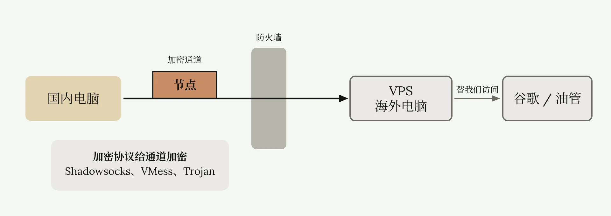
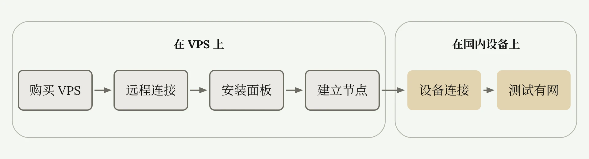
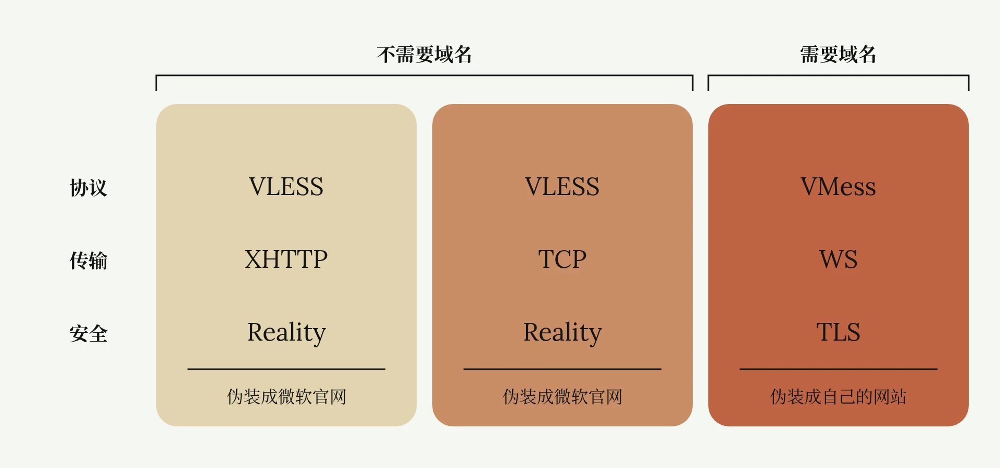

# 从零搭建 VPS 翻墙节点

<ReadMore id="简介" label="简介" title="如何自建翻墙节点？| 从零开始VPS搭建节点教程 | 什么是VPS、协议、面板？| 自建节点有什么好处？ | 机场节点搭建全流程 | 无限芝士">

◉ RackNerd低价VPS：\
[https://my.racknerd.com/aff.php?aff=13129](https://my.racknerd.com/aff.php?aff=13129)\
◉ 搬瓦工高端美国VPS：\
[https://bandwagonhost.com/aff.php?aff=81569](https://bandwagonhost.com/aff.php?aff=81569)\
◉ Cloudcone低价VPS：\
[https://app.cloudcone.com/?ref=12184](https://app.cloudcone.com/?ref=12184)\
◉ FinalShell官网：\
[https://www.hostbuf.com/](https://www.hostbuf.com/)\
◉ 无法登录VPS文档：\
[https://wise-vegetarian-da6.notion.site/SSH-2daacc0097d38037ab42fc64acb6c92c?pvs=74](https://wise-vegetarian-da6.notion.site/SSH-2daacc0097d38037ab42fc64acb6c92c?pvs=74)\
◉ 搭建节点代码文档：\
[https://wise-vegetarian-da6.notion.site/VPS-2daacc0097d38077a769e8a98051fec1](https://wise-vegetarian-da6.notion.site/VPS-2daacc0097d38077a769e8a98051fec1)\
◉ 免费/低价域名获取教程：\
• [为什么不推荐免费域名？免费付费域名有什么区别？如何获取低价域名？| 7元顶级域名 | Cloudflare解析 | 域名科普 | 域名羊毛 | 无限芝士](https://www.youtube.com/watch?v=gKQTtY_YQnA)\
◉ Cloudflare域名托管教程：\
• [如何把域名托管到Cloudflare | 享受大厂域名解析服务 | 获取Cloudflare免费CDN | Cloudflare绑定自己的域名 | 无限芝士](https://www.youtube.com/watch?v=x_-76QVuC3c)\
◉ IEPL 专线机场（长期9折优惠券：ESY）：

—————————\
本频道所有「软件」和「外部链接」均会发布在频道简介里的「Telegram资源发布群」，该群为本频道官方群聊，无 任 何 三 方 广 告！\
Telegram资源发布群：[https://t.me/inficheesy](https://t.me/inficheesy)\
Telegram问题交流群：[https://t.me/inficheesychat](https://t.me/inficheesychat)\
—————————\
InfiCheesy无限芝士「长期责任推广」：\
◉ 快猫IPLC专线机场：\
39元 | 600G/月 | 性价比大流量包 | 长期9折优惠券：ESY

◉ 蓝通云机场：\
全球60+地区节点 | 8折优惠专属链接\
[https://link.inficheesy.com/lty](https://link.inficheesy.com/lty)\
◉ Proxy Seller住宅代理：\
1.27U/周 | 2.55U/月 | 85折优惠码：InfiCheesy\
[https://link.inficheesy.com/proxyseller](https://link.inficheesy.com/proxyseller)\
—————————\
视频编号：76期\
[0:00](https://www.youtube.com/watch?v=MuWTmEiNe1g) 开头\
[0:20](https://www.youtube.com/watch?v=MuWTmEiNe1g&t=20s) 总流程\
[1:14](https://www.youtube.com/watch?v=MuWTmEiNe1g&t=74s) 购买VPS\
[4:18](https://www.youtube.com/watch?v=MuWTmEiNe1g&t=258s) 登录VPS\
[6:09](https://www.youtube.com/watch?v=MuWTmEiNe1g&t=369s) 安装面板\
[8:08](https://www.youtube.com/watch?v=MuWTmEiNe1g&t=488s) 搭建节点\
[11:57](https://www.youtube.com/watch?v=MuWTmEiNe1g&t=717s) 搭建节点(带域名)\
[15:48](https://www.youtube.com/watch?v=MuWTmEiNe1g&t=948s) 使用节点\
[16:21](https://www.youtube.com/watch?v=MuWTmEiNe1g&t=981s) 节点被墙\
[18:17](https://www.youtube.com/watch?v=MuWTmEiNe1g&t=1097s) 安全事项\
—————————\
福利资源、教程干货、科技咨询\
这里是无限芝士，一个致力于提升您上网体验的信息分享频道

</ReadMore>

VPN 太贵用不起，机场不稳定会跑路，本系列文章教你从零开始搭建属于自己的翻墙节点。VPS、面板、协议、域名，这些看不懂都没关系。我会用白话，从最基础的概念到实操演示，一步步讲解怎么设置，以及为什么这样设置，保证即使从未接触过自建节点的读者也能一遍学会。

## 自建节点的原理与流程

所有翻墙节点的原理，就是我们用国内的电脑连接一台国外的电脑，国外电脑替我们浏览谷歌油管。这台国外电脑就叫做 VPS，我们只需要购买一台 VPS，通常不会很贵。一台普通的美国 VPS 按时间流量计费，每年只需 10-30 美元，每个月会给 1-6T 流量。然后在这台 VPS 上面搭建一个加密通道，也就是节点，能让国内设备在不被防火墙察觉的情况下翻墙传输数据。

给这个通道加密的就是加密协议。买的机场经常能看到 Shadowsocks、VMess、Trojan 的标识，这些都是加密协议的名称，因为经常用来翻墙，所以统称为翻墙协议。搭建通道一听感觉很麻烦，其实非常简单，通过翻墙面板点击一下就可以搭建一条通道。



所以总体流程就是：购买一台海外 VPS，远程连接这台 VPS，给这台 VPS 安装翻墙面板，通过面板建立翻墙节点，使用国内设备连接节点，测试有网，成功自建节点。



## 购买 VPS

### VPS 的地区与线路

你想搭建哪个国家的节点，就买哪个国家的 VPS。不同国家的 VPS 翻墙速度是不一样的，比如大陆用户连接美国 VPS，通常就要比连接香港 VPS 慢，因为香港距离更近，这很好理解。同一个国家不同线路的 VPS 翻墙速度也有差异。比如同样是美国洛杉矶的 VPS，有的接入了 CN2 GIA 高端跨国线路，延迟最低可以到 130 毫秒；有的接入的是最基础的普通线路，延迟可能就有 230、330。所以 VPS 这类东西是一分钱一分货，线路好流量多，速度快的 VPS 贵；线路差，流量少，速度慢的 VPS 便宜。

对于新人，我不推荐购买 CN2 GIA 的高端 VPS，东西太好，不会用也是一种浪费。可以先买个便宜、功能齐全的 VPS 练练手。我这里推荐 [RackNerd](https://www.racknerd.com/) 或 [CloudCone](https://cloudcone.com/) 的美国洛杉矶 VPS，每年不到 20 美元，链接在[简介](#简介)。注意，这篇文章不含任何广告。这两家是目前几个 VPS 论坛公认的价格低、流量大、功能全的入门级 VPS，个人感觉很适合新手入门。这篇文章是一个长期教程，如果以后他们涨价或者功能阉割，不适合作为入门 VPS 了，我会更换链接，所以如果需要购买留意一下简介。

### 在 RackNerd 下单

以下是购买 VPS 的流程。打开 VPS 官网，我以 RackNerd 示例。我进入了 RackNerd 黑色星期五特卖活动页，这种 KVM VPS 就是我们需要的。VPS 有很多其他种类，KVM VPS 通常是最便宜的，新人买这种就行。能看到价格非常便宜，10.6 美元一年，1G 带宽，每个月有 2T 流量，比机场划算多了。价低量大就是 VPS 的优势。当然这个是黑五活动价，VPS 厂商会在每年黑色星期五、圣诞节推出价格非常低廉的 VPS。如果你看这篇文章的时候，没在这个时间段也没关系，厂商们为了营销，偶尔也会推出其他低价 VPS，在官网多找找。

回到 RackNerd，我选这个 18.66 美元的。这就是我们的订单，这里有 VPS 的配置，以及这台 VPS 的公网 IP 地址。这个是主机名，就和你 Windows 设置的电脑名称一样。这个选框可以再额外选一个 IP 地址，我们一台 VPS 只需要一个 IP 地址就够了。2.5G 内存、2 核 CPU，系统是 Ubuntu 系统。

注意，VPS 不是我们一般的家用电脑，不用 Windows 系统，大部分都是 Linux 各种发行版系统，比如 Ubuntu、Debian、CentOS。新手没用过 Linux 没关系，实际操作搭建节点非常简单，这篇文章包教包会。

最后一个选项是重点，选择你 VPS 所在的地区，稍微大点的厂商都会有这个选项。我们在中国，如果购买美国 VPS，最好选择距离最近的美国西部地区，尽量别选纽约这些美国东部地区。RackNerd 我最推荐洛杉矶机房的 VPS。选好后点击继续，点击结账。支付方式有 PayPal、银行卡、USDT，甚至还有银联支付宝，根据自己的情况选就行。点击完成订购，这是购物发票，最后支付就行。

支付完成后回到 RackNerd，可以看到这就是我的 VPS，IP 地址在这里，目前为在线状态，每个月有 3T 流量。厂商还会发一个包含 VPS 登录信息的邮件，最重要的三行：IP 地址、用户名密码，以及 SSH 端口。这封邮件需要保存好。

## 用 FinalShell 登录 VPS

前面提到，VPS 一般是 Linux 系统。我们登录 Windows 云服务器，需要用到远程桌面，输入账号密码就可以远程操控。而登录 Linux 系统，需要使用 SSH，而 SSH 是另一种远程桌面，使用方法也是输入账号密码。要使用 SSH，需要下载 SSH 软件，网上有很多相关软件，这篇文章用对新手友好的 FinalShell 演示。

首先打开 [FinalShell 官网](https://www.hostbuf.com/)，Windows 用户点击此链接下载，按照正常安装流程，一直点下一步。打开 FinalShell，现在连接 VPS。点击上方文件图标，再点击这个白色文件图标，选择 SSH 连接。现在输入你的 VPS 信息，名称随便，就是个备注。主机填写刚才邮件里的 IP 地址，端口默认是 SSH 连接端口 22，备注不用管，方法选择密码登录。用户名和密码就是刚才邮件里的，直接复制即可。勾选启用 EXEC，这个智能加速可选可不选，点击确定。

显示正在连接主机，弹出是否接受密钥。密钥就是一种连接凭据，表示你的电脑和这台海外 VPS 建立的信任。点击接受并保存，出现这个界面就说明连接成功了。上方是这台 Ubuntu VPS 的各类信息，比如系统版本、IP 地址、硬盘容量等等。如果一直卡在连接中，可以看[这个文档](https://wise-vegetarian-da6.notion.site/SSH-2daacc0097d38037ab42fc64acb6c92c)，我列举了几种无法连接的情况，以及解决方法。

这个是我的主机名，类似于 Windows 中 CMD 命令行的开头，是我输入命令的地方。我随便打几个字母，系统有反应，连接没有问题。左侧界面是该 VPS 的内存、CPU、网络占用，下方这些文件是这台 VPS 的根目录，就和 Windows 的 C 盘一个道理。现在开始使用 VPS 搭建节点。

## 安装 3x-ui 面板

我演示的 VPS 是 Ubuntu 系统，有的 VPS 是其他系统，比如 Debian、CentOS 等等。我建议新人最好用 Ubuntu，因为 Ubuntu 的生态是最大的，兼容性比较强。如果你本来就比较熟悉其他 Linux 发行版，可以选用资源占用更低的 Debian。

首次登录 VPS，需要更新或安装一些软件，只需要这样一行命令即可。这篇文章用到的所有命令，我会放在简介的[文档](https://wise-vegetarian-da6.notion.site/VPS-2daacc0097d38077a769e8a98051fec1)中。回车，软件正在自动更新。再次出现我的主机名，说明上一个命令已经执行完毕，软件已经更新。

```bash
apt update -y && apt install -y curl && apt install -y socat
```

现在输入框输入这行安装 [3x-ui](https://github.com/MHSanaei/3x-ui) 面板的命令，回车。询问是否给面板分配随机端口，回答 Y 或者 N，Y 代表 Yes，N 代表 No。我选择是，回车。看到这个界面就说明 3x-ui 面板已经搭建成功。这几行绿色文本就是登录信息，有账号密码和登录路径，可以看到它随机给 3x-ui 面板分配了一个 53540 的端口，全部保存在记事本里。

```bash
bash <(curl -Ls https://raw.githubusercontent.com/mhsanaei/3x-ui/master/install.sh) v2.8.5
```

### 开启 BBR 并登录面板

现在在命令行输入 `x-ui`，回车。这是 3x-ui 面板后台的管理界面，你可以在这里设置面板的各种信息，也可以看到面板的开启状态。目前状态为 Running，说明面板正在运行。Start Automatically 状态为 Yes，说明面板开启了自动启动。

现在我们需要开启面板的 BBR 功能，输入 23，回车，输入 1，Enable BBR，开启 BBR。显示 BBR 已经成功开启。BBR 是一种 TCP 拥塞控制算法，新人不需要理解它的原理，只需要知道开启这个功能，能让你的节点网速更快。

现在 VPS 这边就没什么事，我们打开 3x-ui 面板。打开刚才的登录信息，这个链接就是 3x-ui 面板的登录网址。输入账号和密码，成功进入 3x-ui 面板。这是 3x-ui 面板的系统信息页，有运行时间、硬件信息、网络速度等。

## 搭建翻墙节点

### 入站的协议、传输与安全

搭建节点在入站列表页，我们通常把搭建节点叫做添加入站。前面讲了，访问外网的流量，要从你的电脑先进入这台海外 VPS，添加入站就是给这台 VPS 开一个能让其他设备流量进入的通道。

点击添加入站。新人一看，怎么这么多字，太麻烦了。没关系，大部分选项平时都用不到，只需要记住这三个最关键的选项：协议、传输和安全。协议用来给流量加密，不让 GFW 知道你在访问谷歌。协议有很多种类，VLESS、VMess、Shadowsocks，在机场列表里经常能看到。用什么协议搭建的节点就叫什么节点，比如这家快猫机场的节点，全都是 Shadowsocks 节点。

传输是流量传输的方式，和协议搭配使用可以欺骗防火墙。安全，目前只有 Reality 和 TLS 两个可选项，可以让你伪装成没被墙的合法网站，逃过 GFW 封锁。上述三种选项，我们只需要像配菜一样合理搭配，就可以成功骗过防火墙，访问外网。目前推荐的搭配有三种，逐个演示。



### 搭建 VLESS + XHTTP + Reality 节点

第一种是 VLESS+XHTTP+Reality 节点。备注随便填，协议选择 VLESS，端口给我随机分配了一个 34283。每次创建节点分配的端口都不一样。这块是设置流量的，不设置就无上限，可以不用管。这块可以设置一个多余的身份验证，也不用管。传输选择 XHTTP，路径填写正斜杠+随机数字字母，这是为了设置一个网络访问路径。这些都可以不用管，保持默认。

往下滑，安全选择 Reality。Reality 是一个伪装合法网站的协议。弹出了很多框，只需要留意这几个：Target 和 SNI，需要填写不被 GFW 封锁的合法网站，要让 GFW 以为我们访问的是墙内网站。这里就不能填写默认的 `google.com`，建议改成微软官网或者苹果官网。我填写 `microsoft.com`，微软官网。

全部更改后，这块也不用管。下面需要创建公钥和私钥，相当于身份验证。点击 Get New Cert，自动生成了公钥和私钥，然后点击创建。好了，这样一个由 VLESS 协议加密、XHTTP 协议传输、Reality 协议伪装成微软官网的翻墙节点就创建好了。现在点击左侧这个加号，点击二维码，用你的 V2ray、小火箭或者 Clash 直接扫码添加节点。也可以点击二维码图片自动复制订阅链接，手动导入代理节点。

### 搭建 VLESS + TCP + Reality 节点

现在搭建第二个常用协议的节点，VLESS+TCP+Reality。再次点击添加入站，备注测试节点 2，协议选择 VLESS，端口随机分配了一个新端口，还是其他都不用管。不一样的就是传输，选择 TCP，这些都不用管。安全继续选择 Reality，将 Target 和 SNI 还是和刚才一样改成 `microsoft.com`。点击 Get New Cert，创建公钥私钥，点击创建。现在第二个由 VLESS 协议加密、TCP 协议传输、Reality 协议伪装成微软官网的节点就搭建好了。

### 添加客户端分享节点

如果你要把节点分享给别人，还可以设置其他用户。点击这三个点，点击添加客户端，这就是添加的一个新的用户。你可以给它设置流量限制，我设置 300G 流量，到期日期填写 2025 年 12 月 31 日，点击添加客户端。现在扫描这个二维码的用户，就会获得一个 2025 年 12 月 31 日到期的 300G 流量的洛杉矶节点。

一台 VPS 可以搭建无数个节点，这些节点共用这台 VPS 的流量和带宽。越多人用，流量就掉得越快，带宽就越拥挤，网速就越慢。只有你一个人用，它就是独享的。上述就是 VPS 从购买到搭建节点的全流程。如果你没有域名，那这篇文章就到这儿了，只需要往下翻，了解自建节点的注意事项即可。

## 带域名搭建节点

### 带域名的好处

但是建议还是花几块钱买一个低价域名，或者白嫖一些免费域名，用域名搭建节点。带域名搭建节点有以下几个好处：避免 VPS 的 IP 地址泄露，可以搭建更多种类的节点，可以使用域名套 CDN，给非常垃圾的 VPS 提高网速。需要免费或低价域名可以看我的[这期教程](https://www.youtube.com/watch?v=gKQTtY_YQnA)。首先肯定先需要准备一个域名，确保你的域名已经托管进了 Cloudflare。如果不明白托管是什么，也不会托管的小白，可以看我的[这篇教程](./Cloudflare域名托管与解析.md)，详细科普并演示了 Cloudflare 托管和解析的全流程。

### 给 VPS 添加域名解析

这是我已经在 Cloudflare 上托管好的域名，`inficheesylink.top`。点击这个域名，点击 DNS 记录。现在需要添加一个指向 VPS IP 地址的解析记录。点击添加解析，类型就是 A 记录，名称随意字母数字，我起个 test。IPv4 填写 VPS 的 IP 地址，后面的代理状态关闭，向下滑点击保存，等待 5 分钟解析生效。

打开 CMD 命令行，ping 刚才的域名。注意，这个域名是刚才设置的名称和域名的组合。刚才的名称是 test，域名是 `inficheesylink.top`，这里就需要 `ping test.inficheesylink.top`。可以看到有回应了，是我的 VPS IP 地址，说明解析成功。

### 用 3x-ui 申请 SSL 证书

现在回到 VPS 这边，需要通过 3x-ui 面板安装 SSL 证书。SSL 证书涉及 HTTPS 加密，不是这篇文章的内容，以后单独讲解。只需要知道 SSL 可以把你的域名绑在这台 VPS 上，然后这台 VPS 可以借助这个域名搭建更多不同协议的节点，还能让你的节点和 VPS 都变得更安全。

输入 18，选择 3x-ui 的 SSL 管理，回车。我们需要获得 SSL 证书，选择 1，回车，它就开始自动申请证书了。需要填写自己的域名，回车。需要选择一个端口，如果你不选就是默认的 80 端口，建议就用默认 80 端口，回车。

这里问你要不要 ACME 这个脚本，不要也不会影响你的 VPS，选择 N，回车。询问是否要对面板设置证书，我们本来就是要给面板安装证书，选择 yes，回车。看到这几行绿字就说明 SSL 证书申请成功。这两行是证书在 VPS 里的保存路径，最关键的是这一行：前面我们用 IPv4 地址登录 3x-ui 面板，以后可以用域名登录 3x-ui 面板。把这一行也保存到记事本里。

### 搭建 VMess + WS + TLS 节点

现在通过域名进入 3x-ui 面板，账号和密码没变。绑定域名后我们就可以搭建前面搭建不了的节点了。刚才搭建的两个节点，VLESS+XHTTP+Reality 和 VLESS+TCP+Reality，都是由 Reality 协议进行伪装的。前面提到 Reality 协议可以伪装成微软、苹果这些国际大厂的合法网站，现在可以选另一个安全模块，TLS 协议。TLS 可以伪装成自己域名的小网站，因为是一个新域名，GFW 没拉黑它，所以伪装成它就不会被墙。

搭建 TLS 节点，最常见的协议搭配是 VMess+WS+TLS。名称：测试节点 3。VMess，传输选择另一个传输协议，WebSocket，简称 WS。主机填我们自己的域名，`test.inficheesylink.top`。路径还是随意字母搭配，其他都不用管。安全选择 TLS，SNI 填写自己的域名，其他都保持默认。公钥和私钥点击从面板设置证书，它会自动读取域名的 SSL 证书，其他都不用管，点击创建。现在我就搭建了一个由 VMess 协议加密、WebSocket 协议传输、TLS 协议伪装成自己网站的翻墙节点。

这里有一个错误，使用 TLS 节点一般建议这些端口。我刚才用的是随机端口，现在改成 443。好了，大功告成。

## 代理软件的选择

成功搭建节点后，客户端这边通过代理软件扫码，或导入剪贴板添加就行。如果是机场节点，我一般会推荐 Clash Verge 或其他 Clash 变体。很多人后续可能会尝试比较新的代理协议，比如最近流行的 XHTTP，一些 Clash 变体或小众代理软件更新比较慢，不支持新协议，节点就导不进去。我个人建议用那些开发者更新快、自定义程度高的代理软件，可以最大程度适配各种新协议。Windows 推荐 v2rayN，macOS、iOS 推荐 Shadowrocket 小火箭，Android 推荐 v2rayNG 或 sing-box。

## 节点被墙的原因与对策

### 被墙的表现与解决方法

自建节点并不是一劳永逸的，绕不开被墙的风险。什么叫被墙？就是因为各种各样的原因连不上节点。明明 VPS 流量还剩很多，明明 SSH 还可以连接 VPS，面板 Xray 核心一切运行正常，但使用客户端连接节点就是没网，就是看不了谷歌油管。节点被墙后解决方法也很简单，要么花 3-5 美元给 VPS 更换一个 IP 地址，这个价格因厂商而异；要么按照上述教程，用域名搭建节点，然后通过 Cloudflare [给域名套 CDN](https://www.youtube.com/watch?v=NnyG3DyZbN8)，这样就能使用 Cloudflare 的官方节点 IP 绕过 GFW，成本只有几块钱。这两种方法频道会单独出视频讲解。

### 被墙的原因

可能有人想问，前面那么多加密协议，那么多伪装，都已经天衣无缝了，为什么还会被 GFW 发现？被墙的原因很复杂，并不是说它破解了加密协议，发现你访问谷歌了，而是加密协议里面有一些微小的特征，或者你伪装苹果官网的流量，和正常人访问苹果官网的流量有差异，这些差异被 GFW 捕捉到了，然后对你进行阻断。可能阻断的是端口，给节点换一个端口就行，也可能直接封掉你 VPS 的 IP。

加密协议里，最早 SS 横空出世，造福万千网友，后来被 GFW 精准识别。再到后来，VMess、VLESS、Trojan、Hysteria 等协议不断推出更新，GFW 也进化出各种识别方法。前几年还宣传永不被墙的协议组合，这两年不断有网友发文表示自己无法连接。所以自建节点并不是一劳永逸的事情，加密协议和 GFW 就像军备竞赛一样，随着时代发展、技术进步，也在不断迭代升级。

当你从一个普通机场或者一键式 VPN 的用户，转移到自建节点这个方向时，就没办法再像以前那样，节点不行了就骂骂机场，从消费者的角度思考问题，而是需要站在与 GFW 对抗的网络工程师角度思考问题。为什么被墙？GFW 对我做了什么？我应该怎样应对？新 GFW 需要新技术来突破，这是一条需要不断学习的路线。核心目的只有一个，追求最完美的科学上网。

## 新手教程的安全隐患

这篇文章是新手教程，通过上述教程搭建的节点，并不能达到当下最完美的状态。比如 SNI 的选择，教程里直接选 Microsoft、Apple 这些热门网站伪装，实际上并不推荐。因为热门网站的流量特征非常固定，伪装它们用来翻墙的话，可能会被 GFW 识破。建议选择地理区位靠近 VPS 的小众网站，伪装更真实。

还有 SSH 登录，默认都是 22 端口。但就是因为全球 VPS 都默认是 22 端口，黑客就会专门扫描 22，哪台服务器还开放 22 端口。建议把 SSH 登录端口切换到其他高位端口。这些问题产生的原理和方法，本频道以后会单独出视频讲解，链接会放在简介。目前不修改它们也能用，如果你比较在意，可以先搜索其他人的博客教程。

最后如果你实在觉得太麻烦，也可以回坑买别人的机场。简介里有频道推荐的 IEPL 专线机场和低价北美 VPS。好了，这篇文章就到这里。

---

*参考视频：[如何自建翻墙节点？| 从零开始VPS搭建节点教程 | 什么是VPS、协议、面板？| 自建节点有什么好处？ | 机场节点搭建全流程 | 无限芝士](https://www.youtube.com/watch?v=MuWTmEiNe1g)*
