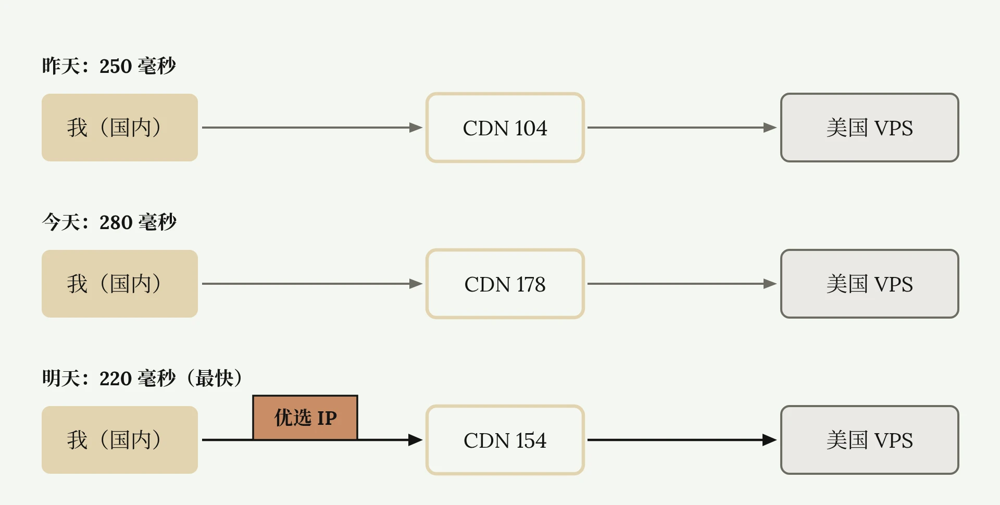
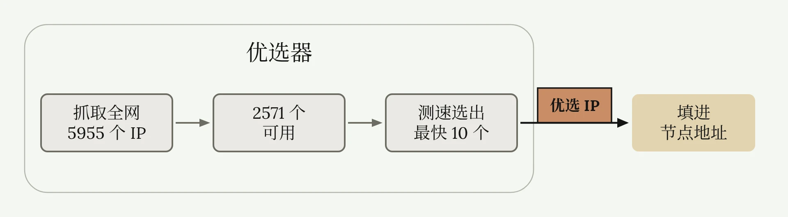
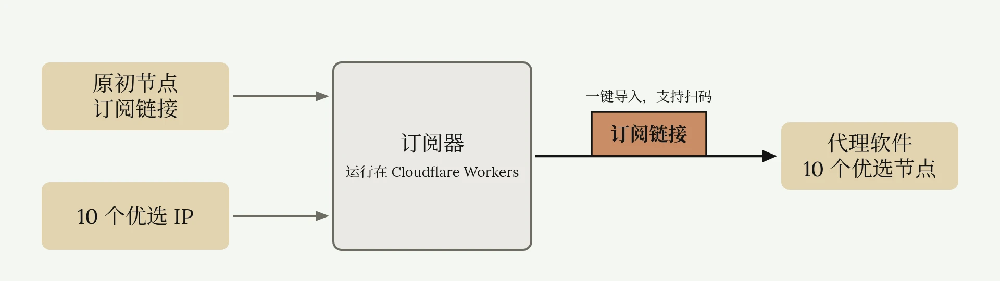

# 优选 IP 加速与订阅器

<ReadMore id="简介" label="简介" title="拯救你的垃圾VPS！优选IP加速教程 | 什么是优选IP？如何使用？ | 优选器 | 订阅转换器 | 零基础自建节点系列 | 无限芝士">

◉ 零基础自建节点系列—第一期：\
• [如何自建翻墙节点？| 从零开始VPS搭建节点教程 | 什么是VPS、协议、面板？| 自建节点有什么好处？ | 机场节点搭建全流程 | 无限芝士](https://www.youtube.com/watch?v=MuWTmEiNe1g)\
◉ 零基础自建节点系列—第二期：\
• [自建节点被墙怎么办？免费CDN拯救被墙节点！| CDN是什么 | CDN作用 | CDN回源加速 | VPS套CDN | Cloudflare CDN | 无限芝士](https://www.youtube.com/watch?v=NnyG3DyZbN8)\
◉ RackNerd美国VPS：\
11u/年 | 性价比机型 | 量大管饱\
[https://my.racknerd.com/aff.php?aff=13129](https://my.racknerd.com/aff.php?aff=13129)\
◉ DMIT美国VPS：\
10u/月 | 高端机型 | 优质高端线路\
[https://www.dmit.io/aff.php?aff=18894](https://www.dmit.io/aff.php?aff=18894)\
◉ 优选器Github仓库地址：\
[https://github.com/XIU2/CloudflareSpeedTest](https://github.com/XIU2/CloudflareSpeedTest)\
◉ 订阅器Github仓库地址：\
[https://github.com/InfiCheesy/cloudflaresub](https://github.com/InfiCheesy/cloudflaresub)\
◉ CloudFlare官网：\
[https://www.cloudflare.com/](https://www.cloudflare.com/)\
◉ 优选IP订阅器-成品展示：\
[https://link.inficheesy.com/cloudflaresub](https://link.inficheesy.com/cloudflaresub)\
◉ 优选IP订阅器-KV参数：\
[https://wise-vegetarian-da6.notion.site/2bfacc0097d3804cbb28fe8a2ec59e7d](https://wise-vegetarian-da6.notion.site/2bfacc0097d3804cbb28fe8a2ec59e7d)\
—————————\
本频道所有「软件」和「外部链接」均会发布在频道简介里的「Telegram资源发布群」，该群为本频道官方群聊，无 任 何 三 方 广 告！\
Telegram资源发布群：[https://t.me/inficheesy](https://t.me/inficheesy)\
Telegram问题交流群：[https://t.me/inficheesychat](https://t.me/inficheesychat)\
—————————\
InfiCheesy无限芝士「长期责任推广」：\
◉ 蓝通云机场：\
全球60+地区节点 | 8折优惠专属链接\
[https://link.inficheesy.com/lty](https://link.inficheesy.com/lty)\
◉ LyCheeIP高速住宅代理：\
63元/月 | 大带宽传输稳定\
[https://link.inficheesy.com/lycheeip](https://link.inficheesy.com/lycheeip)\
◉ Proxy Seller住宅代理：\
1.27U/周 | 2.55U/月 | 85折优惠码：InfiCheesy\
[https://link.inficheesy.com/proxyseller](https://link.inficheesy.com/proxyseller)\
—————————\
视频编号：84期\
[0:00](https://www.youtube.com/watch?v=E5PI0LsQ43M) 开头\
[00:25](https://www.youtube.com/watch?v=E5PI0LsQ43M&t=25s) 概念解释\
[02:35](https://www.youtube.com/watch?v=E5PI0LsQ43M&t=155s) 实操演示\
[07:56](https://www.youtube.com/watch?v=E5PI0LsQ43M&t=476s) 速度测试\
[08:24](https://www.youtube.com/watch?v=E5PI0LsQ43M&t=504s) 订阅器\
[13:01](https://www.youtube.com/watch?v=E5PI0LsQ43M&t=781s) 注意事项\
[14:20](https://www.youtube.com/watch?v=E5PI0LsQ43M&t=860s) 其他加速\
—————————\
福利资源、教程干货、科技咨询\
这里是无限芝士，一个致力于提升您上网体验的信息分享频道

</ReadMore>

年付十刀的低端美国 VPS，也能跑出 750 兆的水平，这就是优选 IP。如果你也想榨干自己垃圾 VPS 的所有性能，让其物有所值，甚至物超所值，这篇文章就教怎么用优选 IP 给 VPS 提速。小白无需担心专业词汇看不懂，我会用白话详细介绍：什么是优选 IP，如何免费获得优选 IP，如何使用优选 IP。

## 优选 IP 的原理

### CDN 服务器是动态分配的

正常情况下，我们购买美国 VPS，并且成功搭建节点。如果直连该节点，网络线路通常在 330 毫秒，延迟高，速度差。于是使用 Cloudflare 的 CDN 加速，会先连接某台 CDN 服务器，CDN 服务器再连接美国节点。此时，第一段线路延迟 150 毫秒，第二段线路延迟 100 毫秒，总延迟 250 毫秒，比原来快了 80 毫秒，这就是 CDN 的加速功能。

但有一个问题，CDN 服务器属于 Cloudflare 这类厂商，他们还有很多同样的 CDN 服务器。我们在连接 CDN 的时候，Cloudflare，会自动给我们分配一台服务器。

假如你今天通过 CDN 连接美国节点，你的 CDN 服务器 IP 地址为 104。但是明天，Cloudflare 就会自动给你换一台，IP 地址为 178 的 CDN。也就是说线路发生了变化，同样延迟也会发生变化。

昨天通过 104 连接 VPS，总延迟 250 毫秒。今天通过 178 连接 VPS，总延迟 280 毫秒，比昨天慢。明天又可能通过 154 连接 VPS，总延迟 220 毫秒，比之前更快。

所以 CDN 服务器其实是动态的，我们通过 CDN 连接 VPS 的延迟也是动态的。有的 CDN 服务器能让你的速度起飞，而有的 CDN 会让你绕远路，延迟更高，速度更慢。

### 优选 IP 与优选器

因此我们需要连接能让速度跑到最快的 CDN 服务器，它对于我们就是最优秀的，它的 IP 就叫做优选 IP。顾名思义，选择最优的 IP。



那优选器就很好理解。优选器是一款软件，它可以在全球众多 CDN 服务器中，帮我们自动挑选出速度最快的 CDN。一次可以优选上千条 IP，并且进行排名，我们可以取用排名靠前的 IP，用来给 VPS 稳定加速。

优选 IP 的使用也非常简单，只要将节点的地址栏更换为获得的优选 IP，就完成了 CDN 的替换，即可使用最优线路提高节点速度。

知道原理，大体流程就很简单了：先搭建一个套了 CDN 的节点，然后下载优选器，使用优选器获得优选 IP，将优选 IP 导入套了 CDN 的节点，成功实现加速。最后我还扩展了关于订阅器的内容。如果小白还是有点懵，没关系，下面我会实操演示，并且每一步都用白话讲解。

## 准备套了 CDN 的节点

这是我使用 [RackNerd](https://www.racknerd.com/) 搭建好的节点，并且套上了 Cloudflare 的 CDN。[前两篇](./CDN节点原理与搭建.md)已经详细介绍如何搭建这种节点，这篇文章不再赘述。选择 RackNerd 是因为，低端 VPS 非常适合使用优选 IP 加速，可以更大程度发挥价值。

该节点使用 VMess 协议加密，WebSocket 协议传输，TLS 协议伪装，连接地址为 `okk` 这个域名，IP 地址为 107，端口为 443，这是非常标准的 CDN 节点配置。

现在连接此节点，测试速度和延迟。可以看到是通的，能正常使用。

使用这个节点时，其实我是先连接了 `okk` 这个域名，而该域名套了 CDN，因此 Cloudflare 自动给我，分配了一个 CDN 服务器。但我不知道该服务器的地址，假设为 176，再通过 176 连接到美国的 107，这就是整个 CDN 节点的连接路径。

## 用优选器获取优选 IP

默认 CDN 节点已经准备好，现在获取优选 IP。获取优选 IP，需要优选器。这是优选器的 [GitHub 仓库](https://github.com/XIU2/CloudflareSpeedTest)，链接在[简介](#简介)，选择适配自己的版本下载即可。

下载后解压，文件长这样。双击运行第一个 EXE 文件，它会自动调用终端开始测速。

可以看到，优选器抓取了全网，5955 个 Cloudflare 的 CDN 服务器 IP，进行测试。然后发现其中 2571 个可用，再对这 2571 个 IP 测速，最终筛选出 10 个下载速度最快的 IP。这些就是优选 IP，现在就可以给你的节点使用了。



注意，每个人地理位置、宽带运营商都不一样，这些优选 IP 只是对我而言是最快的，每个人都需要自己重新优选。

## 在代理软件里使用优选 IP

### 把优选 IP 填进节点地址

打开 V2Ray，把原来的 CDN 节点复制一份。右键，编辑，只需要将地址改为优选 IP 地址。刚才我优选了 10 个 IP，这里就填写第一名，104 这个 IP。为了区分，名称我也改成优选 1。其他不变，点击确定保存。现在这个节点就使用了优选 IP。

虽然这两个节点最终都会连接到美国 VPS 107，但线路完全不一样。原本的 CDN 节点，中间 CDN IP 今天可能分配了 176，明天就会变成 154，后天分配成 198，不断变化，延迟也跟着变化，加速效果时好时坏。

而现在的优选 IP 节点，固定了 104 这个连接最快的 CDN，延迟和速度明显优于原 CDN 节点，加速效果更好且更稳。看到这一步，你就已经会使用优选 IP 了。

### 为什么要优选 10 个 IP

有人可能会问，那刚才选了 10 个 IP，为什么只用这一个？

我们已经知道，所谓的优选 IP，就是找出一个能和你连接最快的 CDN 服务器。比如这个 104，但它不仅仅是给我用的。它由 Cloudflare 部署，用来服务万千网友和商业公司，是互联网的基础设施，就相当于一个高速公路上的公共服务区。所以很多人都会用这个 IP，一旦别人用得多，我就会卡，所以加速效果就不明显了。

所以才需要优选 10 个 IP，第一个速度不行了，就换第二个。第二个不行了，再换第三个。这次选的 10 个都不行了，就重新运行脚本，再优选一次，再挑 10 个出来。这就是大家日常使用优选 IP 的方法。

### 导入全部优选 IP 并测速

现在我把剩下 9 个 IP，全部导入节点。首先把节点复制成 9 份，然后一个一个把优选 IP，替换掉原来的地址，其他保持不变。有人肯定觉得，这样手动更换太麻烦。别着急，继续往下看，我稍后会介绍简单方法。

现在 10 个 IP 全部设置完成。注意，这些地址只是中间 CDN 的 IP 地址，虽然不同，但都指向同一个美国 VPS。也就是说，连接这些节点，IP 始终显示 107，不会跳来跳去，不用担心账号风控。

现在全部测速，先测 TCP 延迟，再测真连接延迟和下载速度。可以看到不同的优选 IP，表现速度也参差不齐。最快的三个分别是：优选 1、优选 4，和优选 7。并没有严格按照优选器的排名，所以说不要盲目选第一个，排名靠前的优选 IP 都可以用。

### 在 iPhone 和 Android 上使用

刚才我使用 Windows 的 V2Ray 进行演示，现在用 iPhone 演示。打开 Shadowrocket 小火箭，扫码添加原初 CDN 节点。可以看到速度能测通，复制粘贴该节点。对第二个节点进行编辑，同样的原理，将地址替换为优选 IP 地址，这就设置成功了。稍后再测速，先把优选 IP 按照上述方法添加进来。我手动添加了前五个优选 IP。

现在用 Android 演示，打开 v2rayNG，下载地址在简介。扫码添加原初 CDN 节点，然后复制一份，进入编辑器，把地址替换为优选 IP。测试有延迟，说明连接成功。显示 IP 地址为美国 VPS 的 IP 地址，107，没有任何问题。

## 优选 IP 的速度表现

我以 [Speedtest](https://www.speedtest.net/) 的测速演示，这是原初 CDN 节点的测速效果，519 Mbps 下行。这是套用了优选 IP 后的测速效果，我测了五个节点，其中最快的是 104，测出了 761 Mbps。相比原初节点 519 Mbps，提升了 46%。其他也分别跑出了最低 600 Mbps，最高 750 Mbps 的水平，都要比原初 CDN 节点快。

## 优选 IP 订阅器

前面优选了 10 个 IP，一个一个手动添加非常麻烦。如果优选 20 个、50 个，甚至 100 个，手动添加并不现实。这里就需要借助优选 IP 订阅器。只需要导入原初 CDN 节点的订阅链接，再在下方选框输入优选 IP，点击生成订阅，即可生成订阅链接，一键导入所有优选 IP 节点，并且支持扫码导入。iPhone、Android、Clash、小火箭都能用。



这个优选 IP 订阅器是我自己写的，已经开源并发布在 [GitHub](https://github.com/InfiCheesy/cloudflaresub)。它不是一个软件，而是一个运行在 [Cloudflare Workers](https://workers.cloudflare.com/) 上的网页。我接下来会演示如何部署。如果你是小白，不了解 Cloudflare Workers，没关系，跟着抄作业就行，我会用白话详细讲解。

如果你实在不想自己部署订阅器，也可以用我部署好的成品订阅器。但必须知悉，该订阅器因为使用了 KV，会保存你上传的所有节点信息。所以还是建议你自己部署，没有安全隐患。之所以公开我的订阅器，只是为了演示成品。

## 部署优选 IP 订阅器

### Fork 订阅器仓库

首先打开订阅器的 GitHub 仓库地址，并且登录你的 GitHub 账号，没有账号的注册一个。登录后点击右上角，Fork，就是把我的仓库代码全部复制到你自己的 GitHub 仓库。询问是否重命名，保持默认即可。点击 Create Fork，创建仓库，可以看到已经成功复制。

### 从 GitHub 部署 Worker

现在打开 Cloudflare，点击左侧 Compute，点击 Workers 和 Pages。我们现在需要创建一个 Worker，你可以理解为创建一个云端小程序。点击创建应用程序。

这个界面就是问你，这个云端小程序的代码你想怎么写。代码我已经写好了，就是刚才让你复制到自己仓库的那些代码，只需导入即可。

点击 Connect GitHub，连接 GitHub。呼出了 GitHub 连接提示，往下滑，授权连接。绿灯，说明连接成功。

点击 Continue with GitHub，选择 `cloudflaresub`，这就是刚才你复制的仓库。点击部署，此时 Cloudflare 正在从 GitHub 拉取代码，相当于安装应用，等待即可。

### 创建并绑定 KV 库

好了，到这个界面就说明部署完成，但还不能用。点击左侧，存储和数据库，下面有个 Workers KV，需要创建一个 KV 库。

小白不需要明白什么是 KV 库，但我有必要解释一下。创建 KV 库是为了生成随机密钥，缩短订阅链接的长度，降低二维码的复杂度。有大佬感兴趣可以下载源码分析。

点击 Create Instance，名称随意，我就选优选 IP 订阅器，点击创建。好了，其他不用管，

回到 Workers 和 Pages。这是刚才创建的订阅器的 Worker，点击三个点，点击查看绑定。这一步是让订阅器 Worker，和刚才创建的 KV 库相连。点击绑定，点击 KV 命名空间。

变量名称写 `SUB_STORE`。注意，全部大写，不要小写。

```text
SUB_STORE
```

KV 命名空间，选择刚才设置的优选 IP 订阅器。点击添加绑定，KV 这边就设置好了。

### 设置访问密钥

再点击上方设置，点击添加，类型选择密钥。变量名称填 `SUB_ACCESS_TOKEN`。

```text
SUB_ACCESS_TOKEN
```

只需要填写一个复杂一点的随机数字字母，你自己定。这一步是设置密码，越复杂越好，它会体现在你的订阅链接里。然后点击确定，现在订阅器就部署好了。

## 用订阅器批量导入优选节点

点击概述，这就是我订阅器的网址，成品链接在简介。点击进入订阅器，可以看到这就是已经成功部署的订阅器。

这里输入你原初 CDN 节点的订阅链接，下面输入优选 IP，每行输入一个。备注随便填，点击生成订阅。

往下滑，可以看到，一个原初节点，10 个优选 IP，也就是生成 10 个优选节点。

下面有 5 个订阅链接，第一个是通用链接，其他 4 个分别是 V2Ray、Clash、小火箭，和 Surge。全部支持手机扫码导入。

现在试试能不能用。复制通用链接，粘贴进 v2rayN。点击上方，通过代理更新订阅。可以看到，全部一键成功导入。

再用小火箭扫码，也是一次性成功导入，10 个优选节点。比刚才手动输入，就要方便很多。到这里就已经大功告成。

## 使用技巧与订阅安全

### 自动选择最快的优选节点

分享一个优选 IP 的，日常使用技巧。

每次优选 50 条 IP，使用订阅器，批量导入代理软件。这 50 个 IP，对应 50 条线路，有好有坏，有快有慢。

但借助代理软件的，策略功能，可以实现自动连接，当前最快的节点。就是在 50 个优选节点里，再选出当前最快的节点。Clash、V2Ray、小火箭都能用。

需要将你节点的策略，设置为 URL-Test、Auto、自动选择。碍于篇幅，这篇文章只提供思路，具体方法请自行搜索。

这种方法会让你一直在 50 个节点里面切换，但因为节点都指向同一个 VPS，所以落地 IP 地址不会跳来跳去，也就不会触发风控。

### 订阅链接的双重密钥

订阅链接里的 Token 字样，其实就是刚才设置的 `SUB_ACCESS_TOKEN`，是明文体现在链接里的。

如果你和别人共用一个订阅器，你们两个生成的链接，末尾 Token 是一样的，就有安全风险。

所以为了防止完全泄密，我设置了双重密钥。

每次生成的订阅链接，前面这些字段是一串随机密钥。每个链接对应单独的随机密钥，且有效期为 7 天。过期密钥自动销毁，链接失效。

最后有必要再强调一遍，这个公开订阅器，是我自己的 Workers 部署的。所有生成的链接，都会保存在我的 Cloudflare 里，后台可以看到所有链接，所以不建议使用别人的订阅器。

## 其他加速方法

很多人搜索优选 IP 的时候，会看到优选域名、反代 IP、反代域名这些。我会放在零基础自建节点系列的，第四期详细讲解。

除了优选 IP，还有其他的加速方案，例如隧道加速、反代 IP、反代域名加速、HYR 高速节点搭建教程，等等。都可以从不同的技术路线，榨干 RN、CC，等低端 VPS 的性能，发挥极致性价比。

但如果你觉得低端 VPS 设置，还是太麻烦，只是想翻墙，不想折腾这么多技术，这里我推荐 [DMIT](https://www.dmit.io/) VPS，公认的高端优质 VPS，月租 10 美元以上，非常适合不喜欢折腾，需要高速线路的用户。链接在简介，直接跳转查看配置即可。

好了，这篇文章就到这里。

---

*参考视频：[拯救你的垃圾VPS！优选IP加速教程 | 什么是优选IP？如何使用？ | 优选器 | 订阅转换器 | 零基础自建节点系列 | 无限芝士](https://www.youtube.com/watch?v=E5PI0LsQ43M)*
