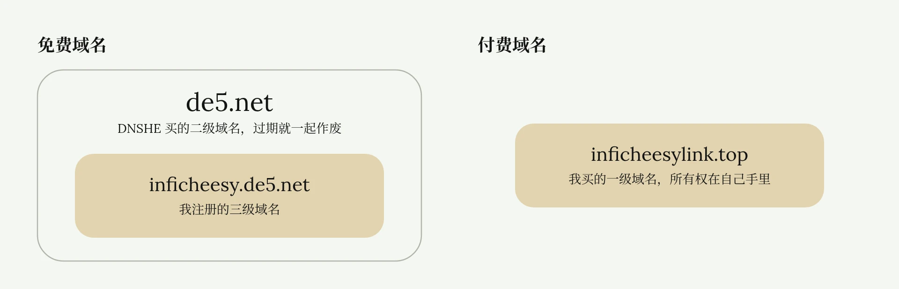
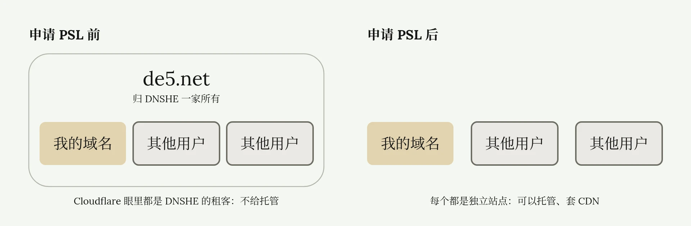
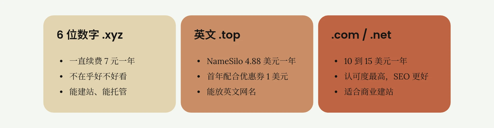

# 免费与低价域名获取

<ReadMore id="简介" label="简介" title="为什么不推荐免费域名？免费付费域名有什么区别？如何获取低价域名？| 7元顶级域名 | Cloudflare解析 | 域名科普 | 域名羊毛 | 无限芝士">

◉ Spaceship（顶级域名便宜）：\
xyz最低0.67美元/年 | top最低1.05美元/年\
[https://spaceship.sjv.io/esy](https://spaceship.sjv.io/esy)\
◉ Namesilo：\
1美金优惠码：ESY | 超低价域名\
[https://www.namesilo.com/?rid=40a6952hi](https://www.namesilo.com/?rid=40a6952hi)\
◉ 免费域名平台：\
us.kg注册：[https://register.us.kg/ ](https://register.us.kg/ )\
eu.org注册(目前暂停审批)：[https://nic.eu.org/](https://nic.eu.org/)\
ClouDNS：[https://www.cloudns.net/index/lang/chs/](https://www.cloudns.net/index/lang/chs/)\
DNSHE（邀请码可以多薅一个：UY3C235310）：[https://my.dnshe.com/register.php](https://my.dnshe.com/register.php)\
◉ PSL公共域名列表：\
[https://publicsuffix.org/list/public_suffix_list.dat](https://publicsuffix.org/list/public_suffix_list.dat)\
◉ Cloudflare域名托管解析教程：\
• [如何把域名托管到Cloudflare | 享受大厂域名解析服务 | 获取Cloudflare免费CDN | Cloudflare绑定自己的域名 | 无限芝士](https://www.youtube.com/watch?v=x_-76QVuC3c)\
—————————\
本频道所有「软件」和「外部链接」均会发布在频道简介里的「Telegram资源发布群」，该群为本频道官方群聊，无 任 何 三 方 广 告！\
Telegram资源发布群：[https://t.me/inficheesy](https://t.me/inficheesy)\
Telegram问题交流群：[https://t.me/inficheesychat](https://t.me/inficheesychat)\
—————————\
InfiCheesy无限芝士「长期责任推广」：\
◉ 快猫IPLC专线机场：\
39元 | 600G/月 | 性价比大流量包 | 长期9折优惠券：ESY

◉ 蓝通云机场：\
全球60+地区节点 | 8折优惠专属链接\
[https://link.inficheesy.com/lty](https://link.inficheesy.com/lty)\
◉ Proxy Seller住宅代理：\
1.27U/周 | 2.55U/月 | 85折优惠码：InfiCheesy\
[https://link.inficheesy.com/proxyseller](https://link.inficheesy.com/proxyseller)\
—————————\
视频编号：74期\
[0:00](https://www.youtube.com/watch?v=gKQTtY_YQnA) 开头\
[0:11](https://www.youtube.com/watch?v=gKQTtY_YQnA&t=11s) 免费/付费域名区别\
[1:29](https://www.youtube.com/watch?v=gKQTtY_YQnA&t=89s) 获取优质免费域名\
[4:15](https://www.youtube.com/watch?v=gKQTtY_YQnA&t=255s) 超低价付费域名\
[6:32](https://www.youtube.com/watch?v=gKQTtY_YQnA&t=392s) 常用顶级域\
—————————\
福利资源、教程干货、科技咨询\
这里是无限芝士，一个致力于提升您上网体验的信息分享频道

</ReadMore>

免费域名和付费域名区别是什么？如何以超低价购买顶级域名？这篇文章教你以最具性价比的方式获取自己的域名。

## 免费域名与付费域名的区别

### 域名级别与所有权

先说结论，比起免费域名，我更推荐付费域名。

新手小白可能会想，一个域名而已，如果不要求特定名称，随意字母数字搭配都无所谓，免费不要钱的岂不是更好吗？

但现实是，当下大部分容易获取的免费域名，都是二级域名。而付费域名一般都是一级域名。二级域名不适合建站，谷歌 SEO 更偏向一级域名。

两者的所有权也不一样。免费的二级域名是厂商自己花钱买的，然后再向用户免费分发，以此达到营销推广的目的。而用户在这些二级域名的基础上，生成三级域名。这些三级域名属于子级，受二级域名的限制。

比如我薅了 `inficheesy.de5.net`，这个免费的三级域名。`inficheesy` 是我自己设置的，`de5.net` 是厂商提供的二级域名。一旦 `de5.net` 过期，而且厂商因为经营不善，或者其他原因没有再续费，我的域名就会直接作废。

### 功能上的限制

两者功能也不一样。有的免费域名没有申请 PSL，稍后解释这个概念是什么意思。没有开放 NS 修改权限，就无法托管到 Cloudflare 等，第三方进行域名管理，就更别说使用 Cloudflare 的免费 CDN 了。这个限制就很大。

而在售的绝大部分付费域名，就没有上述缺陷，控制权和所有权都在自己手里。功能完备，可以托管，可以白嫖 CDN，可以转发邮件。

通俗地讲，付费域名是自己的，而免费域名是别人借给自己的。

## 获取优质免费域名

### PSL 公共后缀列表

网上随便一搜，有很多免费域名羊毛。但注意，不是什么免费域名都值得花时间薅的。有的域名表面薅到手了，但没有申请 PSL，功能就会大大受限。

所谓 PSL，[公共后缀列表](https://publicsuffix.org/)，你可以理解为转正证书。`de5.net` 被 DNSHE 这个厂商申请了，然后厂商把它分发给我，我注册了所谓的免费域名。

但 `de5.net` 此时还没有申请 PSL，它的拥有者始终只有一个，就是 DNSHE 这家厂商。而我们这些用户注册的免费域名，在 Cloudflare 这些大厂来看，只是 DNSHE 下面的租客，不是独立的站点，所以不给我们提供域名托管服务。

过段时间，DNSHE 给 `de5.net` 申请了 PSL，此时我们的域名就会被认为是一个个独立的站点，不再是租客，相当于劳务派遣转正了。Cloudflare 认可了，此时就可以接入托管，用 Cloudflare 解析，或者套他们家的 CDN。

所以薅免费域名之前，先查一查这些二级域名是否申请了 PSL，或者在设置界面，是否开放了 NS 修改权限。也就是 Nameserver，域名服务器。如果能自由设置 NS，一般就认为是申请了 PSL。

### 免费域名的时效

很多免费域名对外宣称是永久的，事实上是否永久看厂商心情，完全根本不在我们手里，厂商想收回完全可以随时收回。而且大多数免费域名的发放都是有时效性的。

截至 2025 年 12 月 12 日，目前可以免费申请，且支持 Cloudflare 等云服务厂商托管的免费域名平台，我放在[简介](#简介)。通过邀请链接可以多薅几个域名。

### 在 DNSHE 注册免费域名

我以这家 [DNSHE](https://www.dnshe.com/) 免费域名示例。打开官网注册一个账号，注册完后进入首页。点击左侧这个醒目的免费域名，可以看到我有三个额度。点击注册新域名，这里根域名选择 `de5.net`。这个二级域名已经申请了 PSL，可以放到 Cloudflare 上托管。点击确认注册即可白嫖，一个账号可以白嫖三个免费域名。

点击右上角，邀请好友解锁额度。点击使用他人邀请码，输入我的邀请码还可以再嫖一个额度，现在就可以免费薅四个域名。

选择对应域名，点击添加解析。展开记录类型，可以看到这里支持 IPv4、IPv6、CNAME、NS 等多种 DNS 解析服务。

你可以在这里解析，也可以添加 Cloudflare 的 NS 域名服务器，托管到 Cloudflare 解析。最后我把刚才注册的域名成功托管到 Cloudflare 上。

关于域名托管与解析的教程，如果你是新人不清楚的话，可以看我的[这篇文章](./Cloudflare域名托管与解析.md)。

## 超低价付费域名

### 6 位数字 .xyz 与英文 .top

付费域名到处都可以买，但怎么买到最便宜的域名呢？如果你只是需要一个功能齐全的域名，不在乎好不好看，推荐注册，6 位数字 `.xyz`。这是目前已知最便宜的通用域名方案，一年只要 7 块钱。

注意，这 7 块钱不是那些首年低价、续费高价的商业噱头，而是一直续费都是 7 块钱。没有套路，真正的便宜。而且 `.xyz` 的通用性和国际认可度都是比较高的，可以建站，各大云服务商也能托管，个人十分推荐。

但如果你对域名还有点追求，想让域名更好看一点，比如放自己的英文网名，推荐注册，英文 `.top`。在 [NameSilo](https://www.namesilo.com/) 这家老牌域名商这里，纯英文 `.top` 的域名只需要 4.88 美元一年，折合人民币 35 块钱。首年优惠 1.88 美元，配合优惠券仅需 1 美元。这在纯字母域名中价格已经很低了。`.top` 的通用性和国际认可度和 `.xyz` 一样。

其实这两种域名，有的人逛小网站的时候就可能已经发现了，很多小网站基本都是 `.xyz`、`.top`，原因就是便宜，被封域名了再换一个也不会心疼。

### 在 NameSilo 购买 .top 域名

现在购买一个 `.top` 演示。打开 NameSilo，链接在简介。首先需要注册账号，我已经注册好了，直接输入我需要的域名，比如 `inficheesylink.top`。

可以看到首年 1.88 美元，往后每年续费 4.88 美元。点击加入购物车，点击下单结算。它自动给我填了个美国地址，点击 Save 保存一下。

一般域名商都会在结算界面推广他们的增值服务，不用管，没必要。域名到时候直接托管 Cloudflare，速度也快，还不要钱。

点击 Checkout 结算，弹出付款方式。点击 Save More，查看更多。可以看到这家 NameSilo 可以直接使用支付宝。

右侧这里显示 1.88 美元，别着急付款。输入优惠码，ESY。可以看到现在只需要 1 美元，点击 Pay 支付。

支付完成后回到 NameSilo 的管理界面，这里显示我有一个已经激活的域名。点击 Manage，然后进入这个界面。这就是我刚才买的域名，可以在这里解析，设置 NS，设置邮件转发等等。可修改项就比刚才的免费域名要多一些。

## .com、.net 等常用顶级域名

看完前面的内容就可能有人有疑问，既然都是顶级域名，为什么 `.com`、`.net` 还是那么贵？为什么主流网站都不买 `.xyz`、`.top` 当官网呢？因为认可度不一样。

`.com`、`.net` 是当今互联网最主流的顶级域名，注册这样的域名，全球互联网都认可。

如果拿 `.com` 建站，就更容易获得谷歌、百度 SEO 的倾向，网站会被推得更靠前，从而获得更大的流量和收益。

所以如果你要带商业属性的建站，最好是买一个 `.com` 一步到位。`.xyz`、`.com` 和 `.top` 就更像是博客站、个人站，或者某个小型服务器，置信度肯定不如 `.com`、`.net`，运营起来更辛苦一些。

价格方面，个人经验，最近两年 Cloudflare 的 `.com` 域名相对是最便宜的，费用在 10 到 15 美元每年。缺点就是不支持支付宝，需要海外银行卡或者 PayPal。

好了，以上就是这篇文章的全部内容。

---

*参考视频：[为什么不推荐免费域名？免费付费域名有什么区别？如何获取低价域名？| 7元顶级域名 | Cloudflare解析 | 域名科普 | 域名羊毛 | 无限芝士](https://www.youtube.com/watch?v=gKQTtY_YQnA)*
