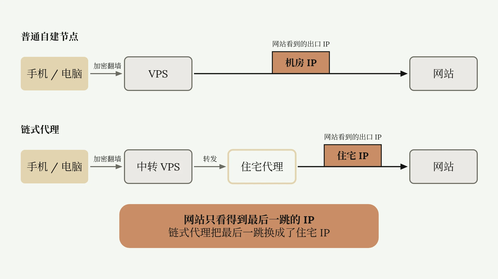
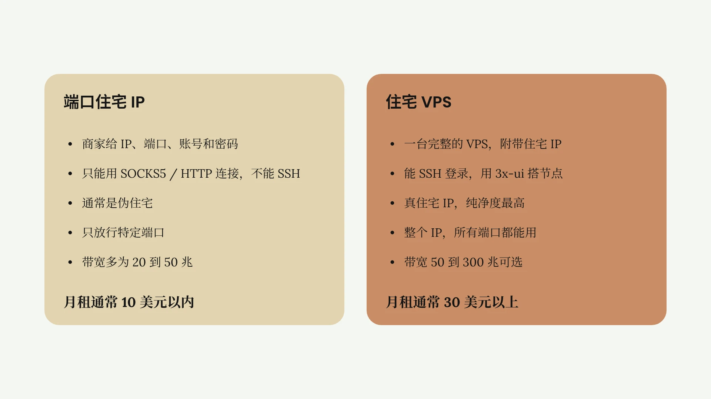
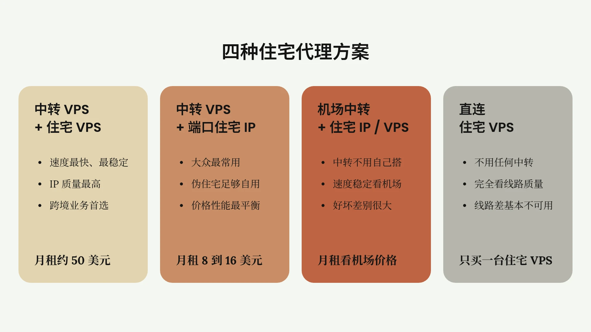
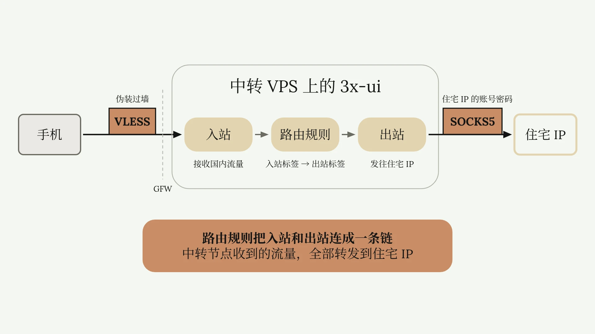

# 自建住宅 IP 节点

自建节点 IP 不够纯净，无法使用 AI，海外账号经常被封锁，运营电商没流量怎么办？其实只要把你的自建 VPS 节点连接一个住宅 IP，相当于自建独享住宅 IP 节点，即可解锁绝大部分海外服务。

这篇文章教你从零开始搭建住宅 IP 节点。针对新手小白，专业名词太多太复杂，链式代理，出站入站，共享端口这些看不懂都没关系，我会用白话结合实操演示，一条一条掰开揉碎讲明白，保证你看完文章一遍学会。

注意，这篇文章为搭建住宅 IP 节点通用教程。和市面上大部分私营电商专线的搭建原理基本相同。具有一定商业价值。

## 链式代理的原理

普通的自建节点，比如购买了一台美国洛杉矶的 VPS，然后在 VPS 上[搭建节点](./Xray-VLESS-REALITY自建代理节点.md)，我们在国内连接该节点，就可以访问谷歌油管。

而自建住宅 IP 节点略有不同。首先我们需要准备一个住宅代理。但这个住宅代理直接连接会非常卡或者连接失败。因此需要先连接一个中间节点作为中转，再连接海外住宅代理，整个链路就叫做链式代理。



## 中转节点的两种选择

其中中转可以使用自建节点，也可以使用机场节点。如果是自建节点，推荐使用搬瓦工等接入顶级线路的 VPS 作为中转机。因为绝大部分住宅 IP 本身不带优化线路。从中国发出的流量丢包率很高。使用高端线路对住宅 IP 的网速优化非常显著。

如果是机场节点，连接住宅 IP 的稳定性就各不相同。有的机场节点质量好，就可以跑满住宅 IP 的带宽。有的节点质量差，连接住宅 IP 后几乎不可用。

## 端口住宅 IP 与住宅 VPS

而住宅代理也分两种。第一种，端口住宅 IP。购买之后，商家会提供 IP 地址，端口，账号和密码。连接协议是 SOCKS5 和 HTTP。它并不是一台 VPS。也不能像 VPS 一样通过 SSH 登录。它只是商家卖给我们的一个代理入口。只能通过 SOCKS5 或者 HTTP 协议连接，唯一的功能就是让我们使用这个 IP 上网。

第二种，住宅 VPS。它和普通 VPS 一样，功能完备，可以安装软件，部署网站。但是普通 VPS 会附带一个机房 IP，而住宅 VPS 附带的是住宅 IP。购买住宅 VPS 后，你就可以像普通 VPS 一样，通过 3x-ui 面板搭建节点。

这两种产品都可以用来搭建住宅节点，但功能，适用范围，价格都有较大差异。端口住宅 IP，通常是伪住宅。住宅 VPS，会提供真住宅 IP，是市面上纯净度最高的 IP。比如 Vircs 这家，提供真实的美国 AT&T 家庭宽带运营商的 IP。

:::info
原视频简介补充：视频中的 Vircs 已不再运营住宅 VPS，作者现在推荐的真住宅 VPS 是 [SixtyNet](https://sixtynet.net/)。
:::

端口 IP 价格便宜，月租通常 10 美元以内。部分厂商，例如 ProxySeller，可以低至 2.5 美元。而住宅 VPS 的价格就贵得多，月租通常在 30 美元以上。

端口 IP 只能放行特定端口。而住宅 VPS 提供一整个 IP，可以随意访问所有端口，自由搭建节点。端口 IP 还会限制带宽，很多端口 IP 带宽只有 20 兆到 50 兆，少有能提供 100 兆带宽以上的端口住宅 IP。

而住宅 VPS 也会限制带宽，但选择就比较多，比如 Vircs，从 50 兆到 300 兆都有。100 兆就可以满足单业务所有海外网络需求。还有某些住宅 VPS，提供 1G 超大带宽，这种机器同时承载 10 条直播专线都不会卡顿。买来不仅可以自己用，甚至还能多搭几条线路卖给别人。

但这种 VPS 极其稀有，常年处于断货状态，这篇文章不展开介绍。



## 四种住宅代理方案

综合以上原理和住宅代理产品，目前市面上最主流的四种可用的住宅代理方案如下。中转 VPS 加住宅 VPS 组成的链式代理。这套方案拥有最快的速度，最稳定的网络，最高的 IP 质量，是目前市场上最可靠的自建住宅节点方案。当然价格也是最贵的。因为你既要买一台搭载优化线路的 VPS，又要买一台真住宅 VPS，得花两笔钱。拿搬瓦工和 Vircs 组合示例，月租成本约 50 美元。因为这套方案同时解决了速度和稳定性两个重要需求，所以深受市场追捧，几乎是跨境电商，海外金融，留学机构等跨境公司的出海业务首选。

第二种，中转 VPS 加端口住宅 IP 的链式代理。这套方案是大众最常用的。因为很多人本身就有一台 VPS，端口住宅 IP 也相对便宜。而且普通用户不是跨境电商，没有严格的质量要求，价格便宜的伪住宅端口 IP 足以胜任。一般 3-6 美元月租。普通 VPS 5-10 美元月租。这套方案总月租在 8-16 美元之间。综合来看，是价格和性能最平衡的一个组合。

第三种，机场节点中转加住宅 IP 或住宅 VPS 组合的链式代理。这套方案和前两种方案本质是一样的，区别只是把中转从自建节点换成了机场节点。这套方案成本因机场价格而异。在 VPN 市场中，一分钱一分货，便宜稳定的机场速度慢，便宜速度快的机场不稳定，速度快稳定的机场不便宜，这是代理市场的不可能三角。

第四种，直连住宅 VPS。就是用住宅 VPS 直接搭建一个节点，不使用任何前置中转。这个方案完全依赖你住宅 VPS 的线路质量。如果线路质量好，就和自建节点没区别。如果线路质量差，就会非常卡，基本不可用。



接下来我会演示上述四种方案的真实搭建流程。注意，即使你用不到另外三种，我也非常推荐全部学会。因为这些操作原理不仅能搭建住宅节点，还能给普通节点提速，有的甚至就是机场，VPN 商家正在使用的方案。理解后有利于你以后买机场，买代理，评估各类产品好坏。

## 方案一：中转 VPS 加端口住宅 IP

先讲解使用人数最多的方案。需要准备一台中转 VPS，并且购买一个端口住宅 IP。前面已经说了，这套方案先连接 VPS，再连接端口住宅 IP。影响网速的主要有两个因素。首先是中转 VPS 的线路和带宽，然后是端口住宅 IP 的带宽。如果中转 VPS 的带宽是 1000 兆，静态住宅 IP 的带宽是 50 兆，那你最终的网速就是 50 兆。这就像一个非常粗的水管，接了一个小水龙头，出水量也会很小。但反过来，如果你的中转 VPS 带宽是 50 兆，最终落地的端口住宅 IP 带宽有 1000 兆，那最后网速还是只有 50 兆。这就是小水管接了大水龙头，水就那么点，出水量也不会多。

方案一将全程以搬瓦工的顶级线路 VPS 和 ProxySeller 1G 超大带宽的端口住宅 IP 演示。

### 购买中转 VPS

首先购买 VPS，如果你已经有 VPS，可以跳到[连接 VPS](#连接-vps-并更新软件)。

打开[搬瓦工官网](https://bandwagonhost.com/)。选择 e-commerce VPS，这个套餐。这是搬瓦工最便宜的带有 CN2 GIA 顶级线路的套餐。

注意 如果你要搭建美国住宅代理，推荐使用美国洛杉矶 VPS 作为中转。如果要搭建东南亚住宅代理，推荐使用香港 VPS 作为中转。USCA6 和 USCA9 这两个套餐都可以用，都标记了 CN2 GIA。我以 USCA9 演示。

下面是 VPS 的 CPU，内存 流量配置，就买最便宜的，二核，1G，每月 1T 流量，2.5G 带宽这款。最低季付套餐，50 美元，平均每月 16.67 美元。

点击三个月，点击 order 下单。这里确认订单信息，往下滑，点击 add to cart，加入购物车。

点击 checkout。需要填写地址。很多 VPS 商家都是美国公司，填美国地址会加税。这里最好随便填一个中国地址。填完后往下滑。搬瓦工支持支付宝付款，勾选条款，点击 complete order，完成订单。

总共 50 美元，三个月。点击 make payment，就会弹出支付宝二维码。

### 重装 Ubuntu 系统

买完后回到搬瓦工首页，点击上方 service，就能看到我们购买的 VPS。这里还有 IP 地址。点击右侧设置，点击 Open KiwiVM，打开 VPS 的管理界面。这里会显示我搬瓦工 VPS 的运行状态，包括属地，IP 地址，硬件使用情况。这里还有开机，关机，重启，强制关机，四个按钮。

现在需要把 VPS 重装为 Ubuntu 系统，兼容性最强，避免后续操作报错。首先给 VPS 关机，点击 stop。这里显示 Stopped，已经关机。

如果点 stop 没用，就点 Hard Stop，强制关机。点击左侧 Install New OS，安装新系统。选择 Ubuntu 24，勾选条款，点击 reload，等大概一分钟，安装完成。

这里会显示 VPS 的新 root 密码，复制保存到记事本里。顺便把 IP 地址和其他登录信息一并保存。备注名就叫中转 VPS。用户名默认都是 root，ssh 端口号 22。

点击 go back。点击左侧 Main Controls，回到主界面。这里显示 Running，说明 VPS 已经开始运行。

### 连接 VPS 并更新软件

现在连接 VPS。打开 ssh 连接软件，我以 [FinalShell](https://www.hostbuf.com/t/988.html) 演示。点击左上角文件夹，点击白色图标，点击 ssh 连接。这里输入我刚才保存好的登录信息，名称，IP，用户名，密码。点击确定。双击连接。首次连接提示这个，点击接受并保存。看到这个界面就说明连接成功。

首次连接 VPS 需要更新软件。输入这行命令，回车。VPS 会自动更新，大概 10 分钟，更新完成。

```bash
apt update -y && apt upgrade -y && apt install sudo curl -y
```

### 安装 3x-ui 面板

现在安装 [3x-ui](https://github.com/MHSanaei/3x-ui) 面板。输入这串代码。注意，这串代码结尾是 V3.4.2，也就是安装 3.4.2 版本的 3x-ui 面板。如果你想安装最新版，只需要去掉 V3.4.2 即可。

```bash
bash <(curl -Ls https://raw.githubusercontent.com/mhsanaei/3x-ui/master/install.sh) v3.4.2
```

回车。提示选择数据库，选择 SQLite，输入 1，回车。输入 N，回车。询问是否绑定域名，这个时候绑定会出错，先不要绑定。输入 2，回车。是否添加这个 IP 地址，输入 Y，回车。是否添加 IPv6 地址，直接回车，不添加。

选择 ACME 的添加端口，直接回车。开始自动安装面板。看到这个界面，面板就搭建好了。往上翻。这一行明显区分出来的绿字，就是面板的登录信息，复制到记事本里。

### 给面板绑定域名

注意，这里的登录地址，还是 IP 地址，不是域名地址，需要给面板绑定域名。输入 `x-ui` 回车，呼出了 3x-ui 面板的管理界面。找到 SSL 证书管理这一行。也就是编号 20。输入 20 回车。输入 1，获得 SSL 证书。

现在需要输入域名。如果你没有购买域名，也不会托管域名，可以看 Cloudflare 的[添加域名教程](https://developers.cloudflare.com/fundamentals/manage-domains/add-site/)。推荐购买 [Spaceship](https://www.spaceship.com/) 这家 XYZ 的域名，一年仅需 5 块钱，是目前全网最便宜的域名商。

我已经提前在 Cloudflare，托管好了一个域名。点击添加记录。名称填写随意数字字母。这个域名要给中转 VPS 绑定，方便记忆就叫做中转的缩写 ZZ。地址就填写中转 VPS 的 IP 地址。注意，一定要把代理状态这个按钮关掉，会绕路走 CDN，白白浪费你的优质线路。点击保存，这就解析完成了。

把这个域名也保存到记事本。回到 VPS，输入刚才的域名，回车。询问端口，回车默认为 80 端口。询问是否调用 ACME，输入 N 回车。输入 Y 回车。看到这个界面，说明域名安装完成。

这就是 3x-ui 面板的新登录网址，复制到记事本，替换掉之前的登录网址。打开浏览器，输入网址。输入保存的 3x-ui 面板的登录账号和密码。成功进入面板。

### 搭建 VLESS + Reality 中转节点

现在开始搭建中转节点。点击入站，点击添加入站。名称随意。协议选择 VLESS，其他不变。这里随便填一个端口，我写 443 可以不用模仿。点击上方协议，保持默认。点击传输，也保持默认。点击安全，选择 Reality。Reality 只需要填写两个参数，一个目标，一个 SNI。这两个空的填写都属于进阶操作，有很多讲究，可以看[选择 REALITY 伪装目标](./Xray-VLESS-REALITY自建代理节点.md#七选择-reality-伪装目标)。但如果你是小白，不懂那么多，跟着我的操作走就行。

点击查找目标。这里给了各种国际大厂的官网。你只需要选择一个，能用国内网络访问的国际大厂官网就行。我选英特尔，点击使用。自动填写了英特尔官网，443 端口，提示可用。这就 OK 了。SNI 也会自动填好，也是 `intel.com`。

注意，如果以后你的节点没法用，很大概率是这里出了问题，把 SNI 和目标更换为其他网站即可。以下参数保持默认，往下滑，点击创建。

现在一个由 VLESS 协议代理，TCP 协议传输，Reality 协议伪装的中转节点就搭建好了。但这个节点还不能扫码，导入代理软件，需要添加客户端。点击左上角客户端，添加客户端。点击关联入站，选择刚才创建的节点。备注随意，其他保持默认。点击创建。点击左侧二维码图标，现在就可以扫码导入了。

推荐苹果设备，使用 Shadowrocket 小火箭，Windows 使用 v2rayN，Android 使用 NekoBox，或 v2rayNG。这三款软件，对 3x-ui 面板搭建的节点兼容性都比较强。

文章里，我以小火箭展示连接效果。扫码导入后，这就是搬瓦工 VPS 搭建的节点。可以看到能测出延迟，说明是通的。打开 Speedtest 的测试。现在是北京时间，晚上 8:29，晚高峰时期。这个时候很多普通线路的 VPS，都会卡顿。但这台接入了顶级电信跨国线路的 CN2 GIA 搬瓦工 VPS 跑了 699Mbps，速度很快。现在中转节点就算搭建完成。

### 购买端口住宅 IP

下一步让它连接端口住宅 IP，实现链式代理。准备好你的端口 IP。在一众端口伪住宅 IP 中，ProxySeller，这家 IP 虽然纯净度中规中矩，但静态 IP 分配了惊人的 1G 带宽。比其他厂商 50Mbps 的小水管大 20 倍，搭配顶级线路可以跑满。而且无限流量，月租仅 2.55 美元。价格只有其他厂商的一半，这个配置在市面上也很罕见。

打开 [ProxySeller 官网](https://proxy-seller.com/)，注册并登录一个账号。选择一项服务，不要选 IPv4，买 ISP 套餐。买 ISP 套餐是伪住宅 IP，买 ISP 套餐是伪住宅 IP。注意，市面上所有端口 IP 基本看不到真住宅，都是伪住宅 IP，真住宅 IP 一般会提供一整个 IP，而非一个端口。

位置选择美国。周期一个月。点击购买代理。用途随便写，谷歌，推特，TikTok 都行。支持 PayPal，USDT，万事达、Visa 卡付款。最终一个月静态 IP 的价格为 2.55U，是市面上大部分商家的一半甚至三分之一。

提交订单。点击 PayPal 或者海外卡即可支付。支付成功后，点击右上角仪表盘，找到左侧订单图标，点击 ISP。把右上角登录的账号密码端口复制到记事本里。

再往下滑，这就是我买的两个端口 IP。以 161 这个 IP 演示，复制到记事本里。

### 添加出站和路由规则

回到中转 VPS 的 3x-ui 面板。点击出站，点击出站。现在需要添加一个出站节点。什么意思呢？前面我们添加了入站节点，就是让国内的流量进入这台 VPS，现在我们要让这台 VPS 连接住宅 IP，也就是把送进 VPS 内的流量再发出去。发到住宅 IP 那里，所以就是添加出站节点。

刚才端口住宅 IP 的协议是 SOCKS5，这里就选择 SOCKS5。标签随便，我这里就写落地的缩写 LD。地址填写端口住宅 IP 地址，端口刚才也给了 50101。账号密码对应填入。点击创建。现在就添加了一个出站节点。点击右侧小闪电测速，有延迟，能测通。

点击左上角保存。点击路由，点击路由规则，点击左上角添加一个路由规则。这些参数都不用管。往下滑，只看这两个空。出站标签，选择刚才添加的端口 IP 的标签。入站标签，选择最开始搭建的中转 VPS 的节点。路由就是为了把出站和入站两个节点连接起来。

相当于告诉 VPS，中转节点接收的所有流量自动转发到端口住宅 IP 上，由此实现链式代理。点击创建，点击左上角保存。看到提示，任何规则改动都需要重启面板。点击左侧面板设置，常规，重启面板。



### 测速与实测效果

重启后回到手机这里，更新一下订阅信息。此时节点虽然表面没有任何变动，但实际已经指向了静态住宅 IP。打开 [IP2Location](https://www.ip2location.com/)，这是一家权威 IP 检测网站。可以看到，不再是搬瓦工 95 开头的 IP 地址，而是这个 161 端口住宅 IP 的地址。

打开 Speedtest 的测速。提示连接失败，不给测速。这是 ProxySeller 屏蔽的 Speedtest，你买静态 IP 也可能遇到这种情况。没关系。主流的测速网站有三家，Speedtest，Fast，和 Cloudflare。我换 [Fast](https://fast.com/) 的测速。可以看到 420 兆。前面搬瓦工中转节点直连的速度是 699 兆，套了端口 IP 后是 420 兆。

我再打开 TikTok 测试一下。以下是晚高峰 TikTok 无加速无剪辑实测。可以看到无论是视频还是直播，和国内刷抖音的体验都差不多，基本秒加载速度非常快。这就是带优化线路的 VPS，和大带宽端口 IP 组合的真实使用效果。第二天在非晚高峰时段重新测速，北京时间早上 9 点，可以跑满 1G 带宽。至此链式代理大功告成。

## 方案二：中转 VPS 加住宅 VPS

方案 1 是拿 VPS 连接端口 IP，方案 2 就是拿一台 VPS 连接另一台 VPS。这个方案是电商最常用的。很多市面上的电商直播专线，卖的就是方案 2。如果你刚好做需要真住宅 IP 的跨境业务，想省大几百甚至小几千的技术服务费，跟着下面的教程走。

还是先准备好你的中转 VPS，使用 3x-ui 面板搭建一个中转节点。方案 1 已经展示过了，此处省略流程。

### 在住宅 VPS 上搭建 Shadowsocks 入站

搭建完中转节点后，现在准备一个住宅 VPS。推荐 Vircs。这是一家美国房产公司，在加州有很多公寓。他们给公寓接入了当地的住宅宽带，IP 运营商就是 AT&T Enterprises，真正的美国家庭宽带运营商，从源头上就是真住宅 IP。价格自然也更贵。月租 35 美元。比前面的端口伪住宅 IP 贵得多。

在 Vircs 官网的产品页，选择标准版，直接下单即可。Vircs 的住宅 VPS 最低提供 50 兆带宽，够单个业务使用。如果需要大带宽，可以升级到 300 兆，月租会对应涨到 160 美元。根据你的需求选购即可。

准备好 VPS 后，依旧是通过 SSH 连接，搭建 3x-ui 面板，此处省略流程。注意，我给 VPS 绑定的域名是 LD，和之前给中转 VPS 绑定的 ZZ 域名不一样，后面注意区分。防止混淆。

有人可能注意到，我这个 IP 是一个机房 IP，因为住宅 VPS 太贵，此处用普通 VPS 演示，操作流程是一模一样的。

住宅 VPS 搭建完面板后，依旧是搭建入站节点。但是和前面不一样。点击添加入站，这里协议不选择 VLESS，选择 Shadowsocks。备注随便填。端口随机。点击协议。记住这个加密方式和自动生成的密码，稍后会用。传输、安全、嗅探，其他参数都不用管，保持默认。直接点击创建。现在我们就在住宅 VPS 上，搭建了一个 Shadowsocks 节点。

其实 GFW 前几年，就可以百分百识别 Shadowsocks 协议，阻止翻墙。这个节点根本没法用，直连会超时。那为什么还要搭建 Shadowsocks 节点呢？用中转 VPS 连接这个节点，中转 VPS 前面已经搭建了 VLESS 加 TCP 加 Reality 的节点，这个节点是经过加密的，可以翻墙。而过墙之后，两台 VPS 都在美国，不需要再翻墙了。所以住宅 VPS，只用简单的 Shadowsocks 协议传输即可，不用复杂的加密伪装。节省了计算开销，使整条链式代理的速度更快。

### 在中转 VPS 上连接住宅 VPS

现在回到中转 VPS。注意，这里我为了和之前搭建的中转节点区分，复制了一份新的中转节点。之前的叫一号中转，现在的叫二号中转。点击二号中转的三个点，添加现有客户端，添加到现有客户端。这样一会更新订阅，就能同时刷新这两个节点。

点击出站，添加出站。协议就是刚才搭建的 Shadowsocks。地址填写住宅 VPS 的域名 LD。端口就是刚才搭建的节点端口。密码就是刚刚让你记录的。加密方式注意，前面是 256-GCM，这里也应该是 256-GCM，保持一致。标签随意，我这里写落地 LD-VPS。其他参数不用管。点击创建。再测一下速，可以测通。点击保存。

点击路由，添加路由规则。入站选择二号中转节点，出站选择 LD-VPS。意思就是连接二号中转节点，会自动转入住宅 VPS。其他全部保持默认。点击创建，保存。进入面板设置重启面板。

面板重启后，在手机这边更新订阅。可以看到有两个节点，一号和二号。连接一号节点，就相当于连接前面的端口住宅 IP。连接二号节点，就相当于连接住宅 VPS。打开 IP2Location，可以看到，IP 是住宅 VPS 的 IP。测速和 Speedtest，也都是这台 VPS 的正常水平。

至此，通过中转 VPS 连接住宅 VPS 的链式代理大功告成。注意，在中转 VPS 这里，你可以再添加一个三号节点用来直连。一号节点连住宅 IP1。二号节点连住宅 IP2。三号节点直接连接，以此类推。

## 方案三：机场中转加端口住宅 IP 或住宅 VPS

方案一和方案二都使用了自建节点进行中转，而方案三使用机场节点进行中转，因为机场节点别人已经搭建好了，我们不用再搭建了，所以操作方法非常简单。苹果、安卓、Windows 端各不相同。

首先是苹果设备。打开小火箭。先导入你的住宅 IP 节点。点击右上角+号。协议类型根据你的住宅 IP 而定，如果是住宅 VPS 搭建的 Shadowsocks 节点，这里就填写 Shadowsocks。如果是端口 IP，协议就填写 SOCKS5。对应填入地址端口账号密码。导入后可以看到我这里准备了两个节点，一个香港机场节点，一个刚刚才导入的端口 IP 节点。可以看到端口 IP 节点是超时的。前面说了，这种节点必须有一个中转才能用。点击感叹号，点击代理通过，选择这个香港节点作为前置中转，可以看到现在端口 IP 就有延迟可以用了。

打开 IP2Location，是 161 这个 IP 没问题。Fast 的测速只有 990K，非常慢。前面我用搬瓦工中转，跑出了 420M 的高速。现在用香港节点中转，只有 1M 的速度。这是因为这个机场节点没有优化线路，连接卡顿。也说明前置中转节点，对住宅 IP 的网速影响非常显著。优质中转可以让你的住宅 IP 飞起来，而线路差的中转基本不可用。

所以还是推荐有海外业务、需要稳定网络的老板，使用优质线路的 VPS 进行中转。

## 方案四：直连住宅 VPS

回到住宅 VPS 的 3x-ui 面板。注意我现在打开的是住宅 VPS 的 3x-ui 面板，不要混淆。就按照普通搭建节点的思路，搭建一个 VLESS+TCP+Reality 的节点，前面已经演示过操作了，此处流程省略。搭建好并添加客户端后，直接扫码导入。打开 IP2Location，是我住宅 VPS 的 IP 地址。打开测速软件，可以看到只有 2MB。前面用搬瓦工给这台 VPS 做中转的时候，速度可以跑到 450MB。而现在直连，没有任何优化线路，就已经到了不可用的程度。

注意，有些线路不错的 VPS 也能直连使用，不用额外买中转。但是这类真住宅 VPS 非常稀有，很容易卖断货，价格也相对高昂。因此这篇文章不做过多介绍。

这里有些商家提供 9929 顶级线路，以及 G 口带宽的住宅 VPS，懂行的非小白用户可以自行选购。

## 代理软件的选择

上述所有方案全平台适配。iOS，macOS 推荐使用 Shadowrocket 小火箭，安卓推荐使用 NekoBox 或者 v2rayNG，Windows 推荐使用 v2rayN。注意，上述方案搭建的节点，不能直接导入 Clash 系的软件，因为配置文件格式不兼容。需要使用[订阅链接转换器](https://acl4ssr-sub.github.io/)，转换为 Clash 支持的 YAML 格式。

## 中转与住宅 IP 的选购建议

前面使用搬瓦工和香港机场节点，分别作为中转的例子对比，可以清晰地感受到，无论是住宅 VPS 还是端口 IP，其网速都非常依赖前置中转的表现，优质线路的加速效果非常显著。所以如果你对网速有一定要求，个人建议将预算都集中在前置中转上，买一个类似搬瓦工这种，提供顶级线路的 VPS，后续基本就不会因为网速发愁。一劳永逸。

关于住宅 IP 选购。主要看你的需求。如果对 IP 质量有非常严格的要求，必须真住宅 IP，预算也足够充足，那就购买住宅 VPS。如果预算有限，只是个人上网自用，没有复杂的海外业务，伪住宅足以胜任大部分场景。

当前住宅代理水非常深，IP 质量参差不齐，厂商鱼龙混杂，各种虚假噱头，高昂定价。对小白来说，一个好用的住宅代理方案，反复测试的过程中，厂商换了一家又一家，从端口 IP 到住宅 VPS，其中的试错成本少则大几百，多则小几千，这还不算消耗的时间成本和人力成本。

即使买到了 IP 也不知道怎么测试。比如 Ping0 这种网站是否精准，伪住宅能不能用，G 口的真住宅 VPS 哪里买，TK 直播需要多大带宽，怎么验证 IP 的真实质量等等。

---

*参考视频：[零基础自建住宅节点教程！搭建跨境高速线路 | 住宅IP使用全流程 | 住宅VPS使用 | 真伪住宅IP区分 | 静态住宅IP | 无限芝士](https://www.youtube.com/watch?v=ut3F2zhbsGI)*
