# 5分钟学会写架构设计

AI 在编程上的设计能力基本为零。举个例子，我让 AI 帮我实现一个课程报名的用例，它有可能实现成这样。先从数据库里取数据，然后写几个 `if` 判断，根据判断的结果抛出 `HTTPException`，又或者是把结果存储到数据库里面。

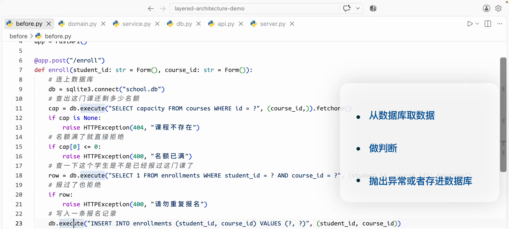

这段代码当然是能跑的，但是存在几个问题。

首先是难以理解，想要理解业务的流程，却要从 SQL 语句中去查看业务到底是怎么样的。

二是难以测试，业务和操作数据库放在一个函数里，我只是想测试一下名额满了会不会报错，却不得不新建一个数据库连接。

三是难以修改，想把数据库从 SQLite 换成 Postgres，需要修改大量的 SQL 语句。

因为 AI 的设计能力是如此之差，所以现在许多公司在面试的时候，都不再考传统的 LeetCode，而是更加侧重于设计能力。这篇文章将用 5 分钟来教会你架构设计。通过重构这个用例，你将学会如何设计一个好理解、好测试、好修改的架构。

## 四层的职责与依赖方向

首先我们需要理清这个用例存在哪些责任，然后将这些责任拆开。很显然这个用例存在一个领域规则的职责，用于说明什么情况报名可以成功，什么情况报名会失败。这一层叫 domain。然后是一个编排流程的职责，定义什么时候要调用 db，什么时候要调用领域规则。这一层叫 service。然后是一个 api 的职责，告诉前端要调用什么 endpoint。这一层叫 api。最后是一个操作数据库的职责，也就是增删改查，这一层叫 db。于是我们简单地将架构分为四层。

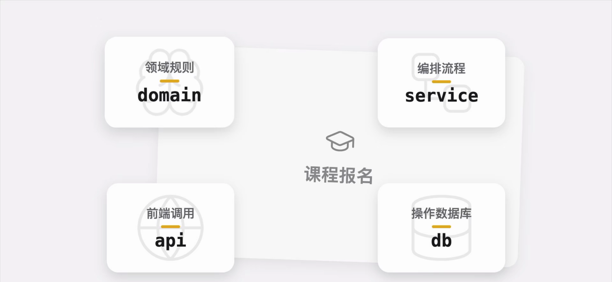

同时我们需要让这四层里容易变化的层，依赖不容易变化的层，这样我们的系统就会更好维护。

像 api 和 db 就是容易变化的层，我们很有可能哪天突然想从 Flask 换成 FastAPI，或者从 SQLite 换成 Postgres。而 domain 就是不容易变化的层，人满了就是没法报上名，这一点无论技术怎么变都不会变。

而 service 刚好在中间，没有 domain 层那么固定，但也没有 api 或者 db 那么灵活。于是我们可以得到一条依赖关系，db 和 api 依赖于 service，service 依赖于 domain。

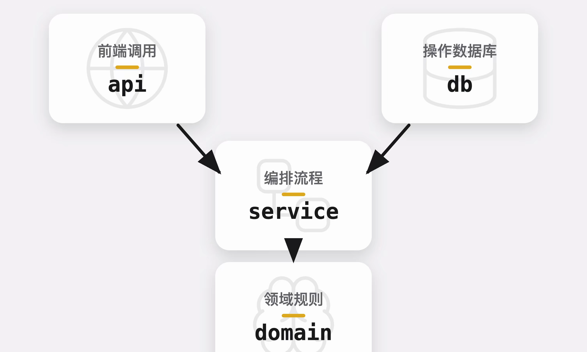

为了方便展示，这个用例比较小，所以在重构过程中，你可能会觉得似乎看起来更复杂了。但那只是因为这个用例太小了，对于现实中的用例，这样的重构肯定会是利大于弊的。接下来我们开始依次完成这几层。

## domain 层的建模

首先是 domain 层，domain 层基本就是对现实世界建模，像这个用例需要 `Student` 和 `Course` 两个模型，来表示学生和课程。学生需要有 id 和 name 两个字段。老实说 name 其实在我们这个用例用不上，写它是为了让 id 不太孤单。而课程同样需要 id、容量和选了这门课的学生，这三个字段。

接着我们再建模报名这个行为。因为这个行为主要改动的是 `course` 对象的属性，所以我们将这个行为放到 `Course` 里面。当报名学生的数量已经大于等于课程的容量的时候，返回一个课程已满的错误。这里的课程已满，我们需要另外定一个 exception 在上面。同样，当这个课程里已经有这名学生了，也抛出一个已经报名的错误，这个错误我们同样需要声明一下。如果这两者都不是，就把这个学生 `append` 到 `roster` 里，表示已经报上名了。

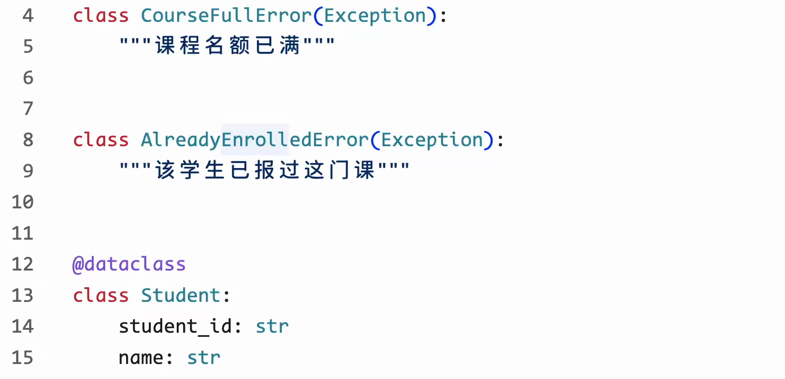

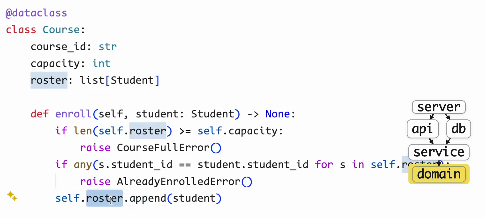

这个建模方式并不唯一。`enroll` 也可以放在类的外面，并不是所有行为都要装到类的里面，具体怎么建模取决于具体的用例。这样子我们就完成了 domain 层，非常简单。

## service 层的编排与接口

接下来是 service 层编排流程。编排流程我们需要知道具体的数据库，因此这个 service 需要一个 db 来实例化。接着编排我们报名的流程，流程很简单。从数据库里取出对应的 `student` 和 `course` 对象，然后调用 `course` 的 `enroll` 方法，也是我们刚刚写的那个方法。然后把结果存储到数据库里，这样就写好了。

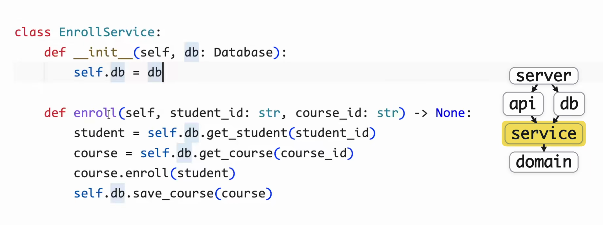

但你可能会有一个疑问，我们明明还没有实现 db，为什么就知道 db 会有这个方法呢？好问题，db 的方法并不是 db 自己定义的，而是我们的 service 定义的。

我们在这里定义了一个 `Database` 的接口，无论这个 `Database` 的实现，是用 SQLite 还是 Postgres，都应该实现这三个方法，供 service 调用。这里我们使用了 `ABC` 和 `abstractmethod`，来强制要求 `Database` 的实现，必须有这些方法。等一下你会看到我们的 `Database` 实现了这个接口。这样我们就完成了 service 层的定义。

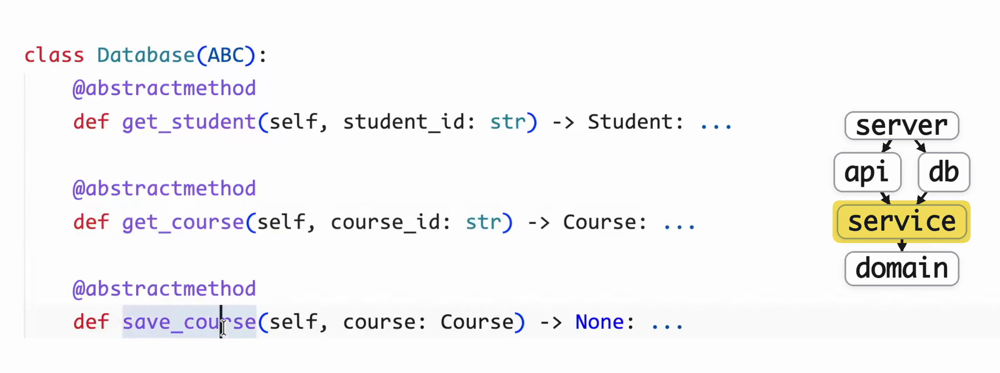

## db 层与依赖倒置

接下来我们再来实现 db 层，db 层从刚刚的 service 里 `import Database`，也就是我们刚刚定义的那个接口。然后继承这个 `Database` 实现了刚刚的三个方法，`get_student`、`get_course` 以及 `save_course`。你看我们这里的 db 和刚刚的 service 都没有依赖具体的实现，而是都依赖 `Database` 这个抽象。这样就很好地将 service 层和 db 层解耦，之后如果我们要把 SQLite 改成 Postgres，也不需要对 service 做修改。

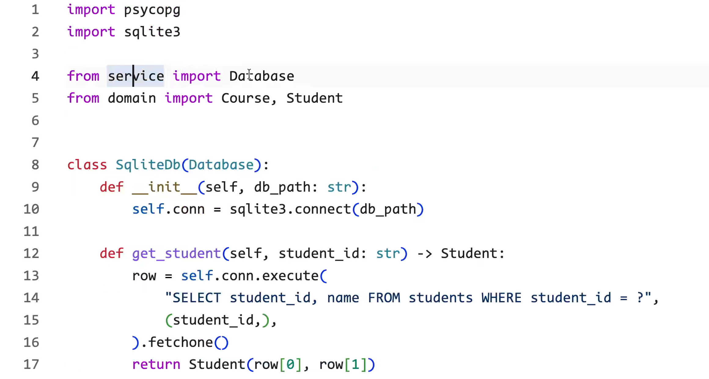

这种做法叫做依赖倒置。高层模块不应该依赖低层模块，两者都应该依赖抽象。抽象不应该依赖细节，细节应该依赖抽象。

比如说我这里又定义了一个 Postgres 实现的 db，使用不同的语句，同样实现了 `get_student`、`get_course`，以及 `save_course` 这三个接口。无论使用哪个 db 类，都不用改动 service 中的任何代码。等一会儿你会看到我们如何通过修改一行代码，来快速地将项目从 SQLite 变成 Postgres。

## api 层与依赖注入

最后是 api 层，使用 FastAPI 定义了一个叫 `enroll` 的端点，传入两个表单和 service，接着调用 service 的方法。还记得我们 domain 里定义的异常吗？在 api 层需要将它翻译成 `HTTPException`，来供我们系统外部使用。

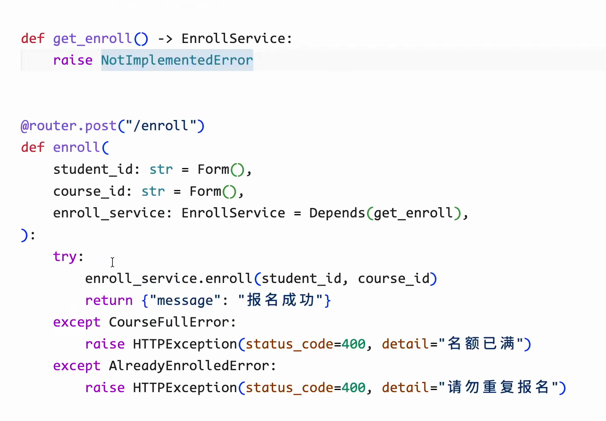

这里我们没有自己定义一个 service 实例，而是将它作为参数，因为 api 层也不知道要用哪个 db 去绑定 service，所以我们只是定义参数是一个 service 对象，而不去自己建立它。这种将要依赖的东西作为参数的做法叫做依赖注入。

## 最外层的组装器

现在我们把这四层都建立好了，我们要把它们组装起来建立依赖关系。于是来到了我们最后一个最外层的组装器。首先定义一个 db 的实例，然后再将这个 db 绑定给一个 service 实例。接着定义 api 的实例，并将绑定了 db 的 service 传给 api，最后启动我们的 API 服务。

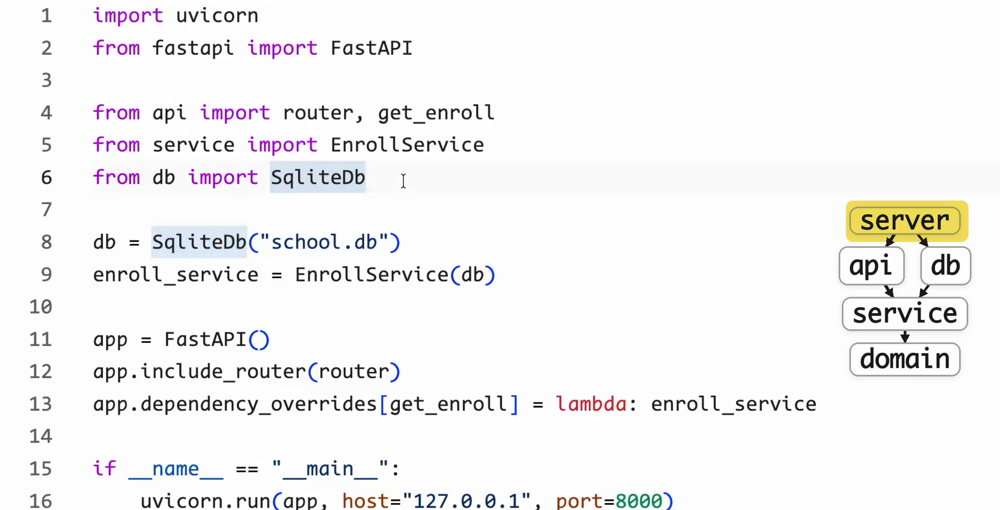

这个文件就是我们程序的入口，也是唯一一个建造对象的地方。之前那几层都只是声明有哪些类要实现哪些方法，只有在这里才是真正地把这些对象建立起来。

之后比如说我们要把 db 从 SQLite，换成 Postgres，也只需要把这里从 SQLite 换成 Postgres 就可以了，就像这样。这样我们就完成了从 SQLite 换成 Postgres，非常方便。

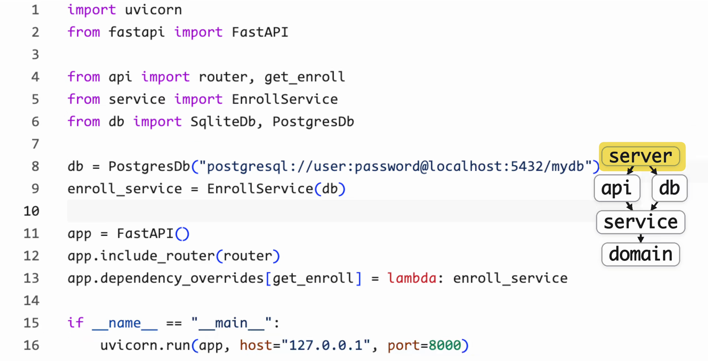

那么到这里我们就完成了我们从一团乱麻到井井有条的重构。

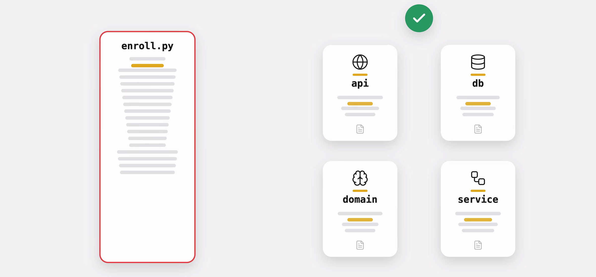

再次强调一下为了方便展示这个用例比较小，所以重构后显得代码更多，文件更多，看起来更复杂了。但在真实项目中，这样的重构绝对是值得的。

现在你已经学会了架构设计。[下一篇文章](/blog/design-agent-architecture)我们将用这一套思路，写一个现在流行的 agent 项目。你可以学到一个 agent 要怎么分层，harness 到底要放到哪一层。
