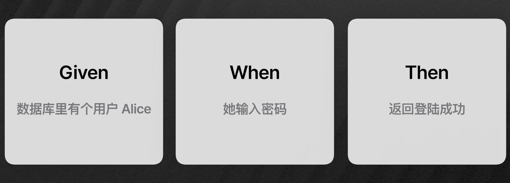
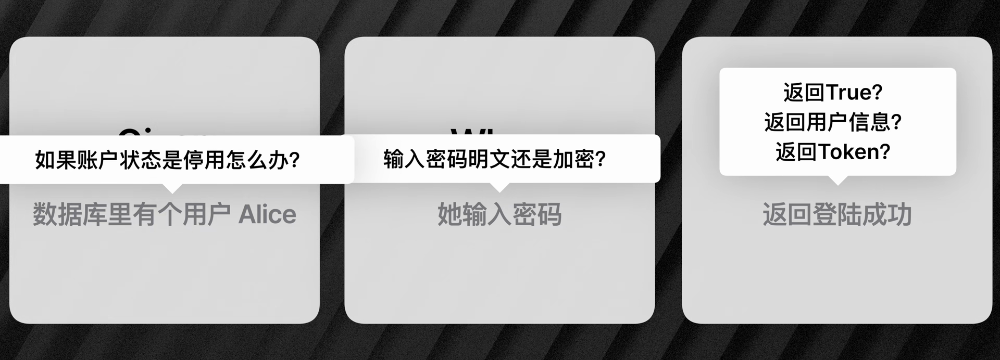
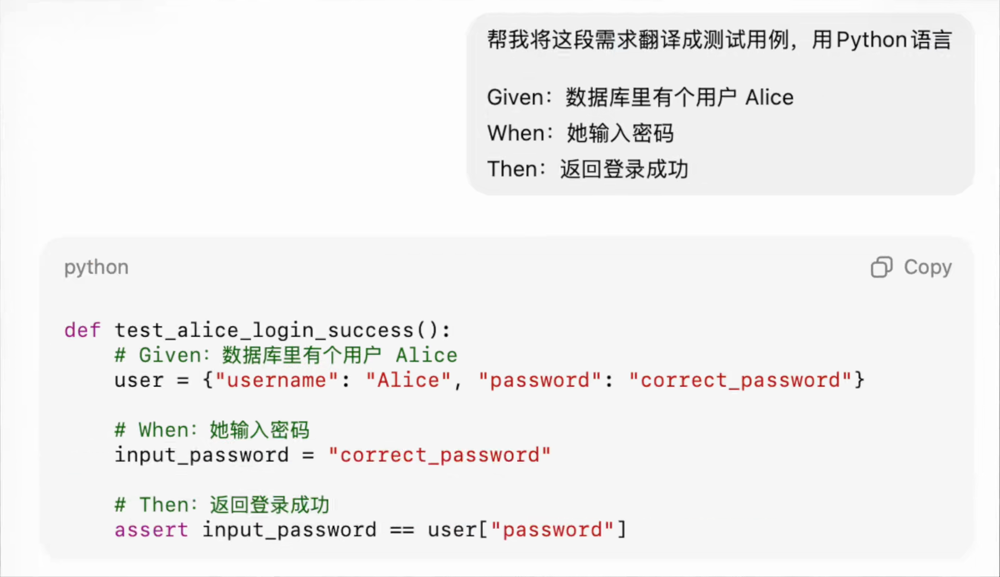
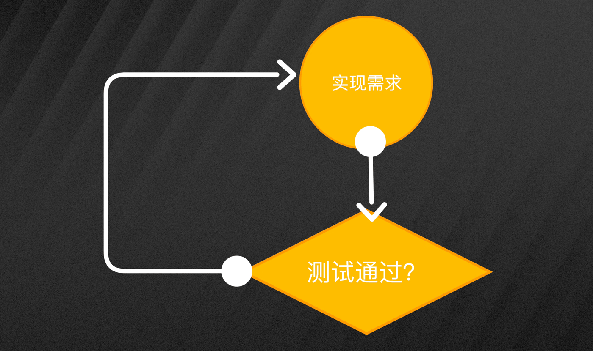
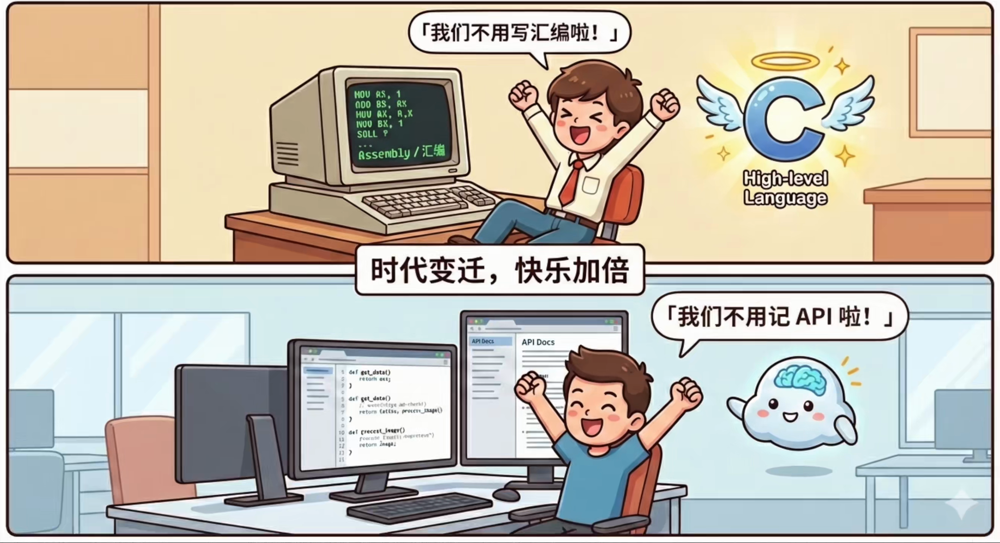

# AI毁了我的代码，直到我开始TDD

前阵子 AI 用我不熟的技术栈写了个功能。最后的结果不能说不能用，但总和我的需求差那么一点点。我想自己调整，可面对几千行陌生框架的代码，根本修不了。

后来我发现真正的工程师用 AI 的时候总会使用 TDD，既能享受 AI 的效率又不会失控。

TDD 其实是有些年头的概念了，全称是测试驱动开发。它强调在实现之前先写测试。优点是倒逼工程师明确要实现什么，到了真正实现的时候可以少出岔子。但缺点就是太费时费力了，对有死线的项目来说太奢侈，所以这个方式在很长一段时间内并不受待见。

但 AI 时代它的缺点完全不成问题，反正都是 AI 写代码，而优点却愈发突出，因为 AI 经常搞不懂需求是什么。

这篇文章将说明如何使用 TDD，对 AI 生成的代码手拿把掐。

## 用 Given、When、Then 写需求文档

首先需要明确需求，将需求写成文档。这是唯一不能交给 AI 的步骤，因为需求只有我们自己最清楚。如果让 AI 写，它总会幻想出一些多余的或者压根不存在的东西。

需求文档听起来好像挺大的，但其实很简单。一个常用的思考方式是，Given、When、Then，表示给定什么条件，当发生什么动作，然后期望什么结果。

举个例子，一个简单的登录验证功能的需求文档差不多是这样。Given，数据库里有个用户 Alice，When，她输入密码，Then，返回登录成功。几行就搞定了。

## 自然语言需求的歧义

写完需求文档，很多人就直接丢给 AI，让它去实现代码了。但这样很不安全，因为自然语言本身就是暧昧的。

就像我们刚刚写的这段，看着挺合理，但是，输入密码是明文还是加密？返回登录成功是返回 `true`，还是返回用户信息，还是返回 token？如果账户状态是停用，要怎么办？这些东西，如果我们不先都明确好，实现出来就容易跟我们想的不一样。

## 先写测试再实现

正确做法是让它先写测试，将模糊的自然语言需求翻译成精确的代码。我们只需要检查测试代码，就能看出 AI 对需求的理解对不对。没问题了，再让它按测试用例实现功能。

实现完了，就运行之前写的测试，看能不能通过测试，不能通过就让 AI 再改代码，直到测试能够通过。

到这一步，你得到的不只是能跑的代码，而是有测试保障的，可维护的代码。

## 工程师的核心价值

在这个过程中，我们不需要了解太多技术细节，要调哪个 API，参数是什么，等等等等，AI 会记住这些。我们的价值在于需求定义和架构设计。

这也是为什么 AI 不会替代或者淘汰程序员，反而是来解放我们的。就像高级语言把我们从汇编中解放出来，今天 AI 又把我们从记忆 API 中解放出来。

技术越进步，人越回归本质。工程师的核心价值从来不是怎么做，而是做什么和为什么做。
