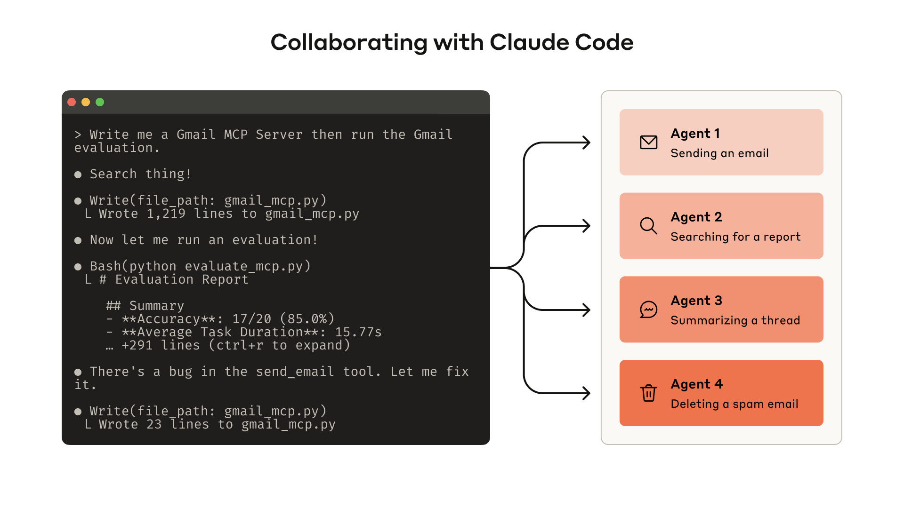
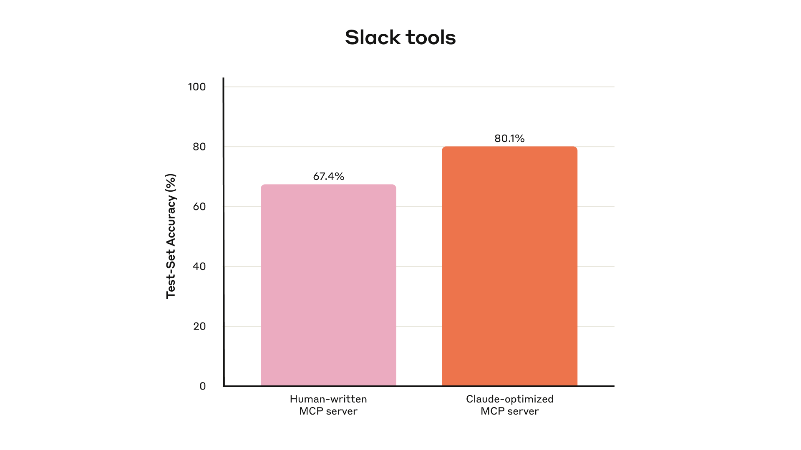
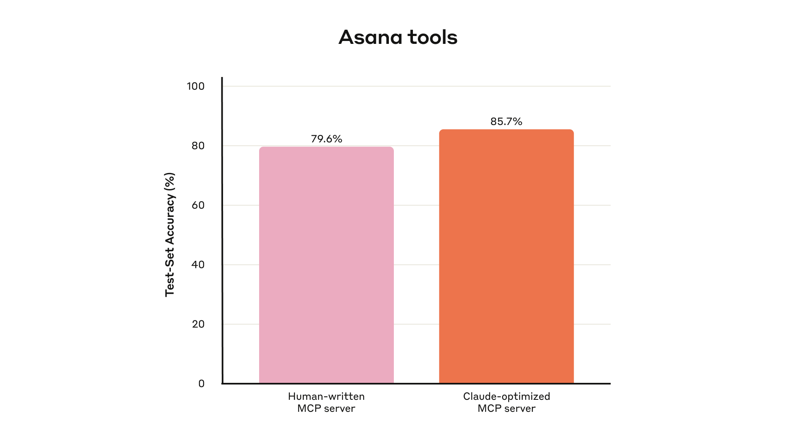
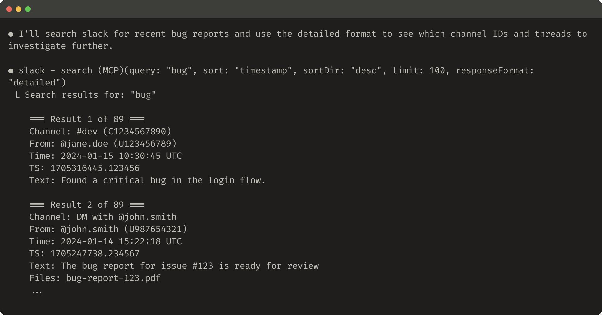
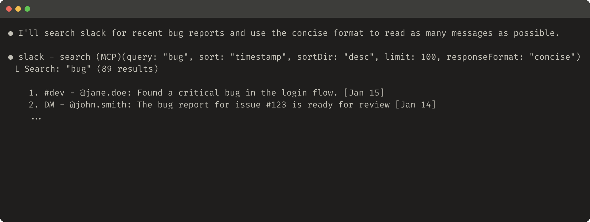
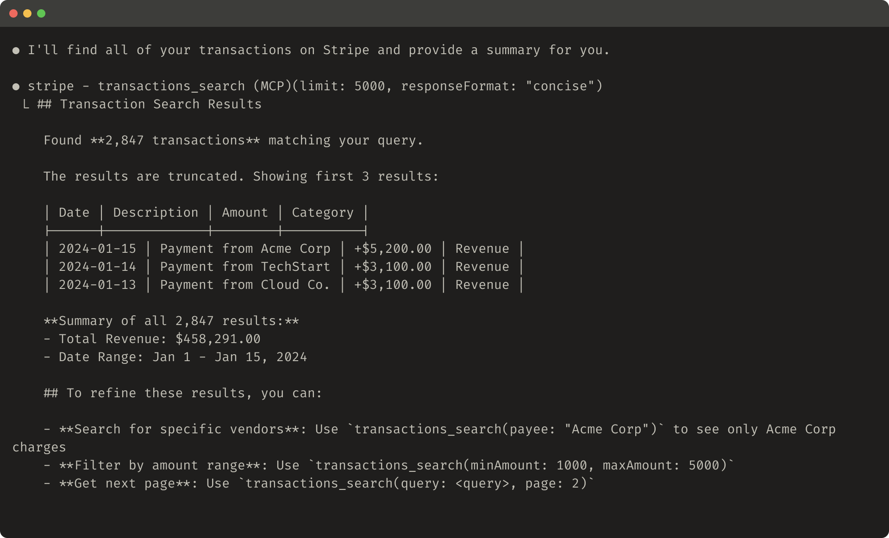
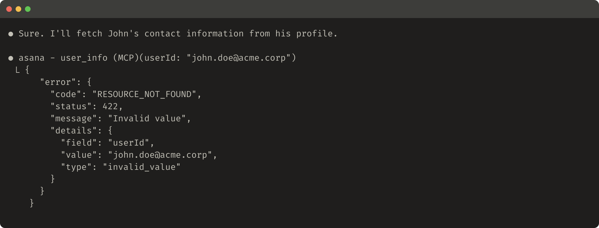
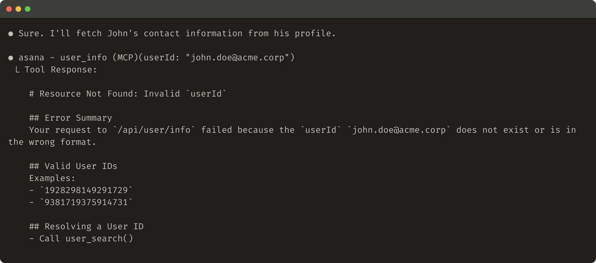

# 为 Agent 编写高效工具

[Model Context Protocol（MCP）](https://modelcontextprotocol.io/docs/getting-started/intro)可以让 LLM 智能体用上多达数百个工具，去解决现实世界中的任务。但怎样才能让这些工具发挥出最大的效用？

本文分享 Anthropic 提升各类智能体系统表现最有效的一些技巧<sup><Term tip="训练底层 LLM 本身除外。">1</Term></sup>。

首先介绍如何：

- 搭建并测试工具原型
- 借助智能体，为工具创建并运行全面的评测
- 与 Claude Code 之类的智能体协作，自动提升工具的表现

最后总结编写高质量工具的几条关键原则，都是 Anthropic 在这个过程中摸索出来的：

- 选择该实现哪些工具（以及不该实现哪些）
- 用命名空间给工具划清功能边界
- 让工具把有意义的上下文返回给智能体
- 优化工具响应，提高 token 效率
- 为工具描述和规格做提示词工程



*搭好评测后，你就能系统地衡量工具的表现，还可以让 Claude Code 对照这份评测自动优化工具。*

## 什么是工具？

在计算领域，确定性系统只要输入相同，每次都会产生相同的输出；而*非确定性*系统（比如智能体）即便起始条件相同，也可能给出不同的回答。

传统的软件开发，是在确定性系统之间订立契约。比如 `getWeather("NYC")` 这样的函数，每次调用都会以完全相同的方式获取纽约的天气。

工具则是一种新型软件，体现的是确定性系统与非确定性智能体之间的契约。用户问“今天要带伞吗？”时，智能体可能会调用天气工具，可能凭常识直接回答，甚至可能先问清楚用户在哪里。偶尔，智能体还可能产生幻觉，或者压根没弄明白某个工具该怎么用。

这意味着给智能体写软件时，要从根本上换一种思路：不能再像给其他开发者或系统写函数和 API 那样去写工具和 [MCP 服务器](https://modelcontextprotocol.io/)，而是要面向智能体来设计。

Anthropic 的目标是扩大智能体的用武之地：让它们借助工具，运用多种行之有效的策略，解决各式各样的任务。幸运的是，从 Anthropic 的经验来看，对智能体最“顺手”的工具，人理解起来也出奇地直观。

## 怎样写工具

这一节介绍如何与智能体协作，编写并改进你交给它们使用的工具。先快速搭一个工具原型，在本地测试；接着跑一轮全面的评测，用来衡量之后的改动；然后就可以和智能体一起反复评测、改进工具，直到智能体在真实任务上表现出色。

### 搭建原型

不亲手试一试，很难预料智能体会觉得哪些工具顺手、哪些不顺手。所以先快速搭一个工具原型。如果你用 [Claude Code](https://www.anthropic.com/claude-code) 来写工具（甚至可能一次就写好），把工具要依赖的软件库、API 或 SDK（可能也包括 [MCP SDK](https://modelcontextprotocol.io/docs/sdk)）的文档提供给 Claude，会很有帮助。对 LLM 友好的文档，通常可以在官方文档站的 `llms.txt` 纯文本文件里找到（比如 [Anthropic API 的这一份](https://docs.anthropic.com/llms.txt)）。

把工具包装成[本地 MCP 服务器](https://modelcontextprotocol.io/docs/develop/connect-local-servers)或[桌面扩展](https://www.anthropic.com/engineering/desktop-extensions)（DXT），就能在 Claude Code 或 Claude 桌面应用里接入并测试这些工具。

要把本地 MCP 服务器接入 Claude Code，运行 `claude mcp add <name> <command> [args...]`。

要把本地 MCP 服务器或 DXT 接入 Claude 桌面应用，分别前往 `Settings > Developer` 和 `Settings > Extensions`。

调用 [Anthropic API](https://docs.anthropic.com/en/docs/agents-and-tools/tool-use/overview) 时也可以直接传入工具，以编程方式测试。

自己先把工具试一遍，找出不顺手的地方。再收集用户的反馈，对工具要支持哪些用例、应对哪些提示词做到心里有数。

### 运行评测

接下来，你需要运行评测，衡量 Claude 用你的工具用得怎么样。先基于真实的使用场景，生成大量评测任务。Anthropic 建议与智能体协作，让它帮你分析结果、判断该怎样改进工具。完整的端到端流程可以参考 Anthropic 的[工具评测 cookbook](https://platform.claude.com/cookbook/tool-evaluation-tool-evaluation)。



*Anthropic 内部 Slack 工具在留出测试集上的表现*

**生成评测任务**

有了早期原型，Claude Code 就能快速探索你的工具，生成几十组提示词和对应的回答。提示词应当取材于真实的使用场景，并基于贴近实际的数据源和服务（比如内部知识库和微服务）。Anthropic 建议避开那些过于简单、流于表面的“沙盒”环境，它们的复杂度不够，无法对工具做压力测试。好的评测任务可能需要多次调用工具，甚至几十次。

下面是几个好任务的例子：

- 下周和 Jane 约个会，讨论我们最新的 Acme Corp 项目。附上上次项目规划会的纪要，并预订一间会议室。
- ID 为 9182 的客户反馈，自己只尝试购买了一次，却被扣了三次款。找出所有相关的日志条目，并判断是否还有其他客户受到同一问题的影响。
- 客户 Sarah Chen 刚提交了退订申请。准备一份挽留方案。需要判断：（1）她为什么要走，（2）什么样的挽留方案最有吸引力，（3）在提出方案前，我们需要注意哪些风险因素。

而下面这些任务就弱一些：

- 下周和 jane@acme.corp 约个会。
- 在支付日志里搜索 `purchase_complete` 和 `customer_id=9182`。
- 找出 ID 为 45892 的客户提交的退订申请。

每条评测提示词都要配上一个可验证的回答或结果。验证器可以简单到把标准答案与采样得到的回答做精确的字符串比对，也可以复杂到请 Claude 来评判回答。验证器不要过于严苛，别因为格式、标点或换了一种同样成立的说法这类无关紧要的差异，就把正确的回答判错。

对于每一组提示词和回答，你还可以额外注明智能体解题时预计会调用哪些工具，借此衡量智能体在评测中是否领会了每个工具的用途。不过，正确解题的路径可能不止一条，所以尽量不要把策略规定得太死，也不要针对某种策略过拟合。

**运行评测**

Anthropic 建议直接调用 LLM API，以编程方式运行评测。使用简单的智能体循环（一个 `while` 循环，在里面交替调用 LLM API 和工具），每个评测任务对应一个循环。每个评测智能体只拿到一条任务提示词，外加你的工具。

Anthropic 建议在评测智能体的系统提示词里，要求智能体除了输出结构化的回答块（用于验证），还要输出推理块和反馈块。让智能体在工具调用块和回答块*之前*先输出这些内容，可能会触发思维链（CoT）行为，从而提升 LLM 实际发挥出的智能水平。

如果你用 Claude 跑评测，可以开启[交错思考](https://docs.anthropic.com/en/docs/build-with-claude/extended-thinking#interleaved-thinking)，“开箱即用”就能获得类似的功能。这能帮你弄清智能体为什么调用或不调用某些工具，并找出工具描述和规格中具体需要改进的地方。

除了总体准确率，Anthropic 还建议收集其他指标，比如单次工具调用和单个任务的总耗时、工具调用总次数、token 总消耗量，以及工具错误。跟踪工具调用有助于发现智能体常走的工作流，也能找到一些合并工具的机会。



*Anthropic 内部 Asana 工具在留出测试集上的表现*

**分析结果**

智能体是你的好帮手，能帮你发现各种问题并给出反馈，从互相矛盾的工具描述，到低效的工具实现，再到令人困惑的工具 schema。但要记住，智能体在反馈和回答里略去的内容，往往比写出来的更重要。LLM 并不总是[心口如一](https://www.anthropic.com/research/tracing-thoughts-language-model)。

观察智能体在哪些地方卡住或犯糊涂。通读评测智能体的推理和反馈（或 CoT），找出不顺手的地方。查看原始对话记录（包括工具调用和工具响应），捕捉那些智能体没有在 CoT 里明确说出来的行为。要读懂言外之意；别忘了，评测智能体未必知道正确的答案和策略。

分析工具调用指标。大量冗余的工具调用，可能说明分页或 token 上限参数需要调到合适的大小；大量因参数无效引起的工具错误，可能说明工具需要更清楚的描述或更好的示例。Anthropic 上线 Claude 的[网页搜索工具](https://www.anthropic.com/news/web-search)时发现，Claude 会在工具的 `query` 参数末尾多此一举地加上 `2025`，使搜索结果出现偏差、效果变差（后来通过改进工具描述，把 Claude 引上了正轨）。

### 与智能体协作

你甚至可以让智能体替你分析结果、改进工具。只要把评测智能体的对话记录拼接起来，粘贴进 Claude Code 就行。Claude 很擅长分析对话记录，也擅长一次性重构大量工具，比如在做出新改动时，确保工具的实现和描述始终保持一致。

事实上，本文的大部分建议都来自 Anthropic 用 Claude Code 反复优化内部工具实现的过程。其中用到的评测搭建在 Anthropic 的内部工作区之上，还原了内部工作流的复杂程度，里面有真实的项目、文档和消息。

Anthropic 借助留出测试集，确保没有对“训练”用的评测过拟合。这些测试集表明，即便是“专家级”的工具实现（无论是研究人员手写的，还是 Claude 自己生成的），也还有进一步提升表现的空间。

下一节分享 Anthropic 在这个过程中得到的一些心得。

## 编写高效工具的原则

这一节把 Anthropic 的经验提炼成几条编写高效工具的指导原则。

### 为智能体选对工具

工具并不是越多越好。Anthropic 观察到的一个常见错误是：工具只是把现有的软件功能或 API 端点简单包一层，而不管这样的工具适不适合智能体。问题在于，智能体与传统软件的“可供性”（affordance）不同，也就是说，对于借助这些工具能采取哪些行动，两者的感知方式不一样。

LLM 智能体的“上下文”是有限的（一次能处理的信息量有上限），而计算机内存既便宜又充裕。以在通讯录里查找联系人为例。传统程序可以高效地存储并逐条处理联系人列表，检查完一条再看下一条。

但如果 LLM 智能体用的工具返回了*全部*联系人，它就得一个 token 一个 token 地读过去，把有限的上下文空间浪费在无关信息上（想象一下，在通讯录里找一个人，却把每一页都从上到下读一遍，也就是暴力搜索）。更好也更自然的做法（对智能体和人都一样）是先直接翻到相关的那一页（比如按字母顺序找到它）。

Anthropic 建议先针对几个具体的、与评测任务相符的高价值工作流，精心打造少量工具，再从这里逐步扩展。在通讯录这个例子里，你可以选择实现 `search_contacts` 或 `message_contact` 工具，而不是 `list_contacts` 工具。

工具可以整合功能，在底层处理*多个*独立的操作（或 API 调用）。比如，工具可以给响应补充相关的元数据，也可以在一次工具调用里完成经常串联在一起的多步任务。

下面是几个例子：

- 与其实现 `list_users`、`list_events` 和 `create_event` 三个工具，不如考虑实现一个 `schedule_event` 工具，由它来查找空闲时间并安排日程。
- 与其实现 `read_logs` 工具，不如考虑实现 `search_logs` 工具，只返回相关的日志行及其前后的少量上下文。
- 与其实现 `get_customer_by_id`、`list_transactions` 和 `list_notes` 三个工具，不如实现一个 `get_customer_context` 工具，一次性汇总某位客户近期的所有相关信息。

确保你构建的每个工具都用途清晰、界限分明。工具应当让智能体像一个能访问同样底层资源的人那样，去拆分和解决任务，同时减少中间输出原本会占用的上下文。

工具太多或功能重叠，也可能让智能体分心，偏离高效的策略。仔细、有选择地规划要构建（和不构建）哪些工具，会带来实实在在的回报。

### 给工具划分命名空间

你的 AI 智能体可能会接入几十个 MCP 服务器、几百个不同的工具，其中也包括其他开发者写的工具。如果工具的功能相互重叠或用途含糊，智能体就可能搞不清该用哪个。

命名空间（把相关工具归到共同的前缀下）有助于在大量工具之间划清边界；有些 MCP 客户端默认就会这么做。比如，按服务（如 `asana_search`、`jira_search`）和按资源（如 `asana_projects_search`、`asana_users_search`）给工具划分命名空间，能帮助智能体在合适的时机选中合适的工具。

Anthropic 发现，选择前缀式还是后缀式的命名空间，对工具使用评测的结果影响不小。这种影响因 LLM 而异，建议你根据自己的评测来选择命名方案。

智能体可能调错工具，可能调对了工具却传错了参数，可能调用的工具太少，也可能错误地处理工具响应。有选择地实现那些名称能反映任务自然划分的工具，既能减少加载进智能体上下文的工具数量和工具描述，又能把原本要由智能体在上下文里完成的计算，交还给工具调用本身。这会从整体上降低智能体出错的风险。

### 让工具返回有意义的上下文

同理，工具实现应当注意只把高信号的信息返回给智能体。要把上下文相关性放在灵活性之前，并避开底层的技术标识符（比如 `uuid`、`256px_image_url`、`mime_type`）。像 `name`、`image_url`、`file_type` 这样的字段，在智能体决定后续的行动和回答时，直接派上用场的可能性要大得多。

此外，比起晦涩难懂的标识符，智能体处理自然语言形式的名称、术语或标识符往往要顺利得多。Anthropic 发现，只要把一串毫无规律的字母数字 UUID 换成语义更明确、更好理解的表述（甚至只是改用从 0 开始编号的 ID），就能减少幻觉，从而显著提升 Claude 在检索任务中的精确度。

有时，智能体可能需要灵活地同时用到自然语言和技术标识符两种输出，哪怕只是为了触发后续的工具调用（比如 `search_user(name='jane')` → `send_message(id=12345)`）。要两者兼顾，可以在工具里暴露一个简单的 `response_format` 枚举参数，让智能体自己决定工具返回 `"concise"`（精简）还是 `"detailed"`（详细）的响应（见下图）。

你还可以再加几种格式，获得更大的灵活性，就像在 GraphQL 里可以精确选择要接收哪些信息一样。下面是一个控制工具响应详略程度的 ResponseFormat 枚举示例：

```typescript
enum ResponseFormat {
   DETAILED = "detailed",
   CONCISE = "concise"
}
```

下面是一个详细格式的工具响应示例（206 个 token）：



下面是一个精简格式的工具响应示例（72 个 token）：



Slack 的话题（thread）和话题回复都由唯一的 `thread_ts` 标识，获取话题回复时必须提供它。`thread_ts` 和其他 ID（`channel_id`、`user_id`）可以从 `"detailed"` 响应中取得，供后续需要这些 ID 的工具调用使用。`"concise"` 响应只返回话题内容，不含 ID。在这个例子里，`"concise"` 响应只用了约三分之一的 token。

就连工具响应的结构（比如用 XML、JSON 还是 Markdown）也可能影响评测表现：没有放之四海而皆准的方案。这是因为 LLM 是通过预测下一个 token 训练出来的，处理与训练数据相符的格式时往往表现更好。最优的响应结构会因任务和智能体而大不相同。建议你根据自己的评测来选择最合适的响应结构。

### 优化工具响应，提高 token 效率

优化上下文的质量很重要，但优化工具响应返回给智能体的上下文*数量*同样重要。

凡是可能占用大量上下文的工具响应，Anthropic 都建议从分页、范围选择、过滤和截断中挑几种组合起来实现，并设置合理的默认参数值。Claude Code 默认把工具响应限制在 25,000 个 token 以内。Anthropic 预计智能体的有效上下文长度会随时间增长，但工具仍然需要讲究上下文效率。

如果你选择截断响应，务必附上有用的说明来引导智能体。你可以直接鼓励智能体采用更省 token 的策略，比如在知识检索任务中做多次小而精准的搜索，而不是只做一次宽泛的搜索。同样，如果工具调用出错（比如输入校验失败），你可以对错误响应做提示词工程，让它清楚地给出具体、可操作的改进建议，而不是只返回晦涩的错误码或堆栈信息。

下面是一个截断后的工具响应示例：



下面是一个没什么帮助的错误响应示例：



下面是一个有帮助的错误响应示例：



工具的截断响应和错误响应，可以引导智能体采用更省 token 的工具使用方式（使用过滤或分页），也可以给出格式正确的工具输入示例。

### 为工具描述做提示词工程

接下来讲改进工具最有效的方法之一：为工具描述和规格做提示词工程。工具描述和规格会加载进智能体的上下文，因此它们合在一起，就能引导智能体更有效地调用工具。

写工具描述和规格时，可以设想自己正在向团队里的新同事介绍这个工具。想一想你可能下意识默认了哪些上下文，比如特殊的查询格式、小众术语的定义、底层资源之间的关系，然后把它们明确写出来。清楚地描述预期的输入和输出（并用严格的数据模型强制约束），避免歧义。尤其是输入参数，名称一定要明确：与其把参数叫作 `user`，不如叫作 `user_id`。

有了评测，你就能更有把握地衡量提示词工程的效果。哪怕只是对工具描述稍加打磨，也可能带来大幅的提升。Anthropic 精细调整了工具描述之后，Claude Sonnet 3.5 在 [SWE-bench Verified](https://www.anthropic.com/engineering/swe-bench-sonnet) 评测中取得了当时最先进的成绩，错误率大幅下降，任务完成率也显著提升。

关于工具定义的其他最佳实践，可以参阅 Anthropic 的[开发者指南](https://docs.anthropic.com/en/docs/agents-and-tools/tool-use/implement-tool-use#best-practices-for-tool-definitions)。如果你是在为 Claude 构建工具，还建议你了解一下工具是如何动态加载进 Claude 的[系统提示词](https://docs.anthropic.com/en/docs/agents-and-tools/tool-use/implement-tool-use#tool-use-system-prompt)里的。最后，如果你是在为 MCP 服务器编写工具，[工具注解](https://modelcontextprotocol.io/specification/2025-06-18/server/tools)可以标明哪些工具需要访问开放世界，或者会做出破坏性的修改。

## 展望

要为智能体构建高效的工具，我们需要把软件开发实践从可预测的确定性模式，转向非确定性模式。

在本文介绍的这种迭代式、评测驱动的过程中，Anthropic 发现了工具成功的一些共同规律：高效的工具目的明确、定义清晰，会审慎地使用智能体的上下文，可以在各种工作流中组合使用，并能让智能体直观地解决现实世界的任务。

未来，智能体与外部世界交互的具体机制预计还会不断演进，从 MCP 协议的更新，到底层 LLM 本身的升级。只要用系统化、评测驱动的方法来改进智能体使用的工具，就能确保随着智能体越来越强，它们所用的工具也跟着一起进化。

---

*参考文章：[Writing effective tools for agents — with agents](https://www.anthropic.com/engineering/writing-tools-for-agents)*
