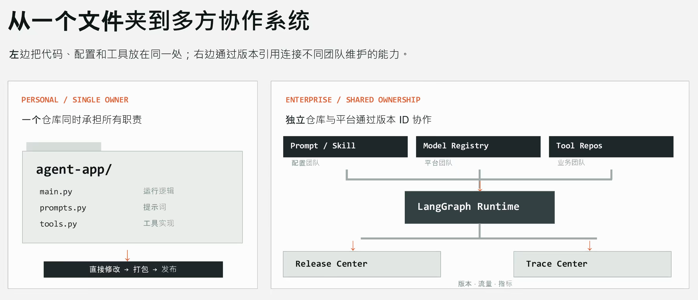
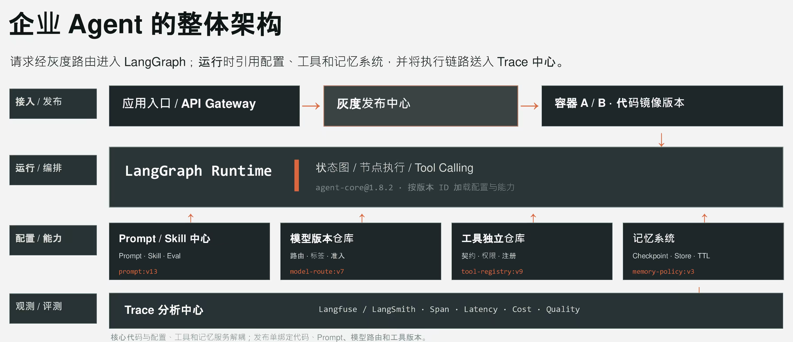
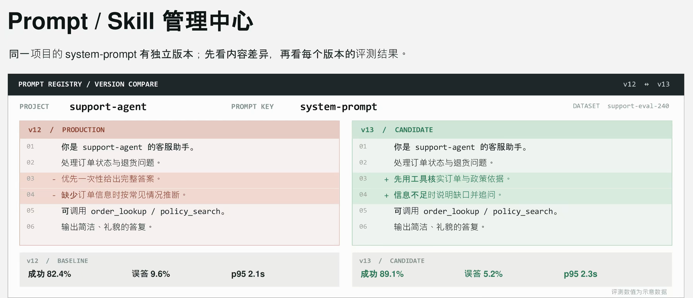
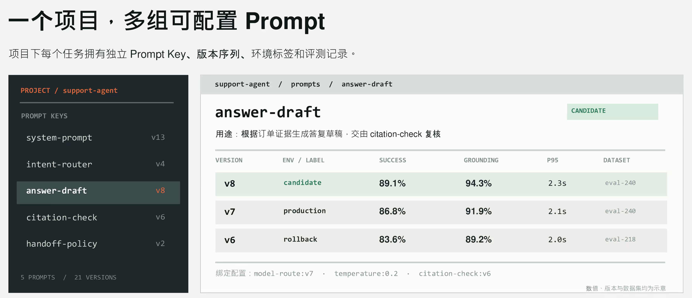
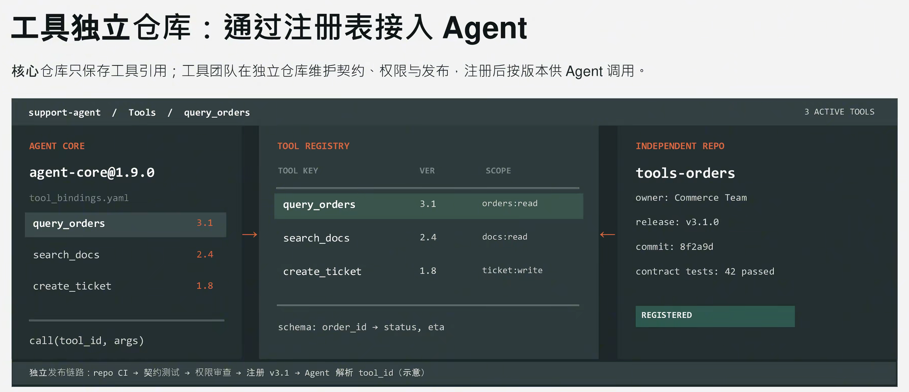
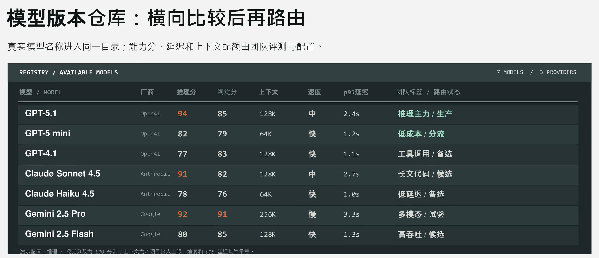
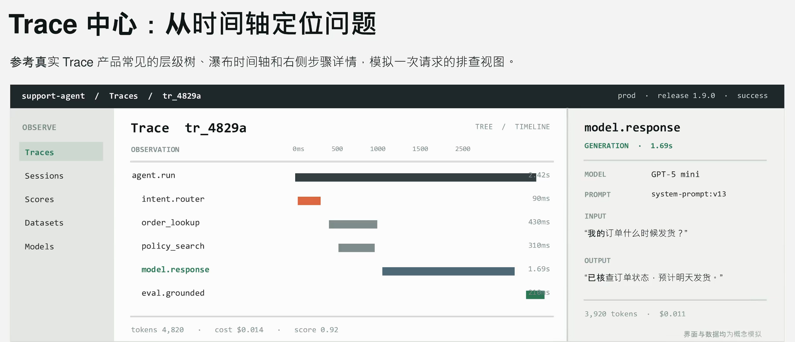

# 企业Agent项目架构设计

你是否曾在 B 站或抖音这些视频平台看到过此类标题？从零搭建企业级 Agent 项目，工业级 Agent 项目长什么样？虽然标题如此，但是这些视频通常做的依旧是个人独立项目，通常扛不住面试官细问审查、测试、发布等环节的细节。

企业级项目不代表完成度、可靠性或者代码质量一定比个人项目质量要高，其设计时的主要考量是如何在几十人乃至上百人的团队协作中被长期地运行和维护。

这篇文章希望能够帮助同为应届生和在校生的同学们，不在面试中被相关问题击垮。

## 个人项目与企业项目的架构区别

首先我们先来简单过一下个人项目和企业项目在基础架构上的一些区别。个人项目通常都是单体、非分布式、非微服务的小项目。通常 System Prompt、工具、记忆、项目代码全都保存在一个代码仓库内，即使有做基本的前后端分离，实质还是一个无团队协作需求的单体项目。

而在企业项目里，诸如 Prompt、工具等组件往往按天甚至按小时级别的频繁更新，几乎没有专业团队会将它们放在代码仓库里靠 Git 管理。Git 虽然是分布式版本管理工具，但是它的业务思路依旧是维护一个 `main` 或者 `master` 作为主分支，它天然是不适合去做灰度发布以及 A/B 测试等场景的，因此企业通常都会在运维平台中加入版本对比功能的支持。

## 企业 Agent 的抽象架构与灰度发布

这是一个举例用的企业 Agent 的抽象架构，实际企业项目可能会更加复杂。

中大型互联网企业通常都会有自己的运维发布平台，每次代码版本更新都会先打包，然后以容器形式进行发布。如果活跃用户基数比较大，直接进行全量发布，很有可能会因为一个 bug 而影响全部用户，因此大家通常都会对 5% 到 10% 左右的用户进行灰度发布。这些用户使用新版本的应用，而其余的用户依旧使用老版本，只有确认新版本没有恶性 bug 之后，才会继续增加新版本的用户比例。

每一次正式版本的 Agent 发布，都需要走完整的发布和验证流程。像 Prompt 细节和新增的模型支持这种基本和代码仓库解耦的内容，如果和 LangGraph Runtime 放在一起，灰度太慢，太浪费资源了，因此我们基本都会将这些组件进行独立化，每个组件可能会有自己的灰度发布系统。

再往后，在这所有的组件之上，是由 Langfuse 或者 LangSmith 搭建的数据分析中心，由于传递回来用于分析的信息，很多时候不只是 Agent Trace，也有可能包含业务信息，很多企业会再搭建一套自己的分析平台，结合 Langfuse 一起使用。

## Prompt 管理中心

同一个项目的 System Prompt 可能有几十个不同的版本，项目组需要知道哪个版本的实测效果最好，以及到底是什么细节造成了效果的提升。

这是一个简化的 Prompt 管理中心，图中是一个项目的两个 System Prompt 版本，以类似于 Git diff 的形式显示两者的差异，并在底下加上了 A/B 测试的指标差异。

同一个项目也可能有多个 Prompt 配置，比如 System Prompt，可能在短任务和长任务的配置是不同的，也许在特定工具被加载后，也需要有对应的 Prompt 加载。项目代码中可以以索引的形式标记对应的 Prompt，用某种 package 或者 API 将其与配置中心里的 Prompt 对应，从而在解耦两者的情况下，保证应用的正常使用和数据比较。

## 工具管理中心

一个企业内部可能有成千上万个工具，Agent 本身会通过意图识别，选择性地加载其中的一部分，但如果这些工具全都被放在主代码仓库里，其对开发复杂性的影响将是非常恐怖的。

为了将工具与代码仓库进行解耦，通常会采用注册中心或者发布中心的模式，像 DeepSeek Harness 就让 GitHub 充当了自己的半个注册中心，将这些工具全都注册在外围，而不影响自身的复杂性。

企业应用也理所应当地会这么干，为每个 Agent 项目只绑定限定数量的工具，工具的绑定也不在代码仓库进行，而是在工具管理中心中进行，尽一切可能地降低耦合度。

## 模型仓库

现在市面上至少有几百个不同的大模型版本，企业用户通常还会有自己的企业 API 接口或者自己部署的模型，如果把 API 的地址和 key 全都保存在项目的 YAML 文件里，即使有 Docker 或者云服务协作也显得太哈人了，因此模型仓库几乎是必要的。

任何一个项目只用一个内部的 API 就可以连接来自不同厂商的任何模型。如果某个项目有特定的需求，也可以在请求模型仓库时加上特定的需求字段，比如要求 GPT6.1 模型，或者要求任何一个具有推理能力的模型，或者只让图像模型收到请求。

模型版本仓库最好也对应地将各路模型 API 的 bug 和兼容性问题解决，这样开发团队就不用花很多时间对齐 Claude 和其他模型之间恶心的兼容问题了。

## Trace 分析中心

最后一环则是 Trace 分析中心，用于对 Agent Trace 进行具体的点对点的分析。通常使用 Langfuse 和 LangSmith，部分企业也会有自研的分析中心，绝大多数的分析中心都是基于 OpenTelemetry 构建的，有了 OpenTelemetry 就再也不用担心开发到一半突然发现自己 Trace 准备得不全这种倒霉的事情。个人开发时也许不需要做这么细致的 bug 研究，但在大项目中 Langfuse 或者其替代品往往是必不可少的。

