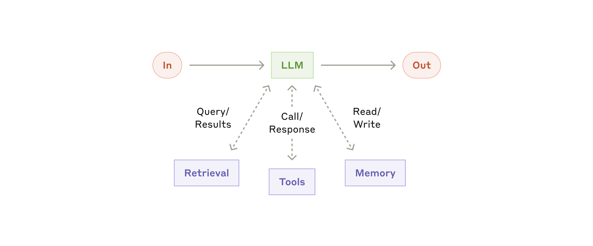
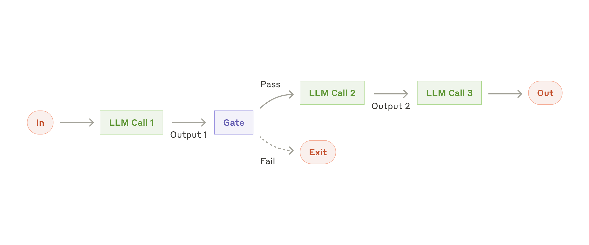
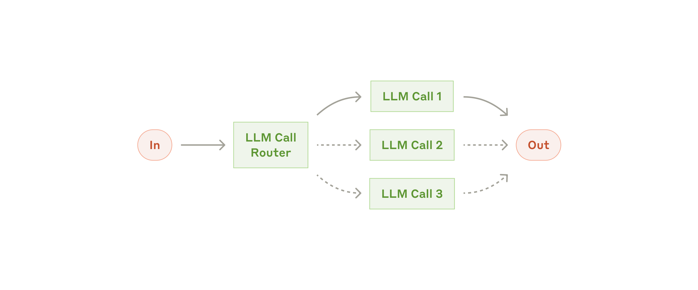
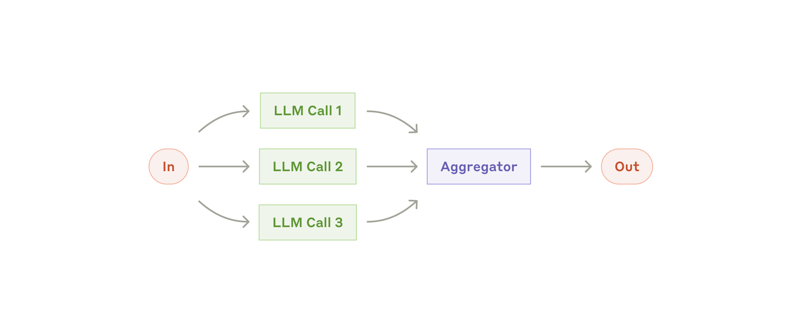
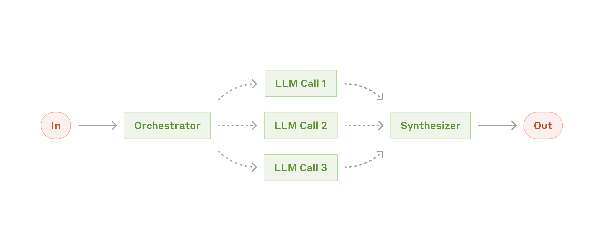
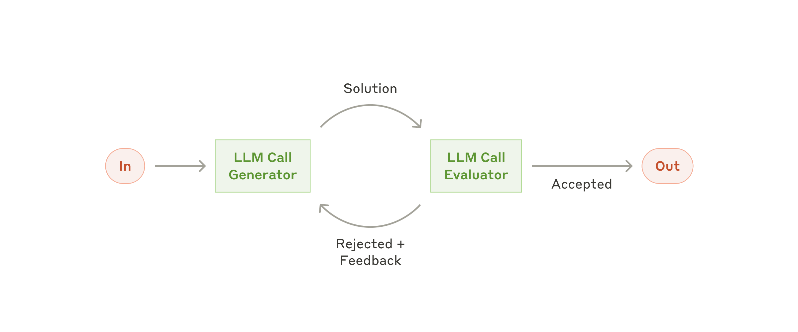
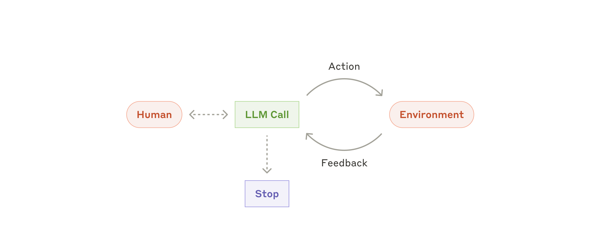
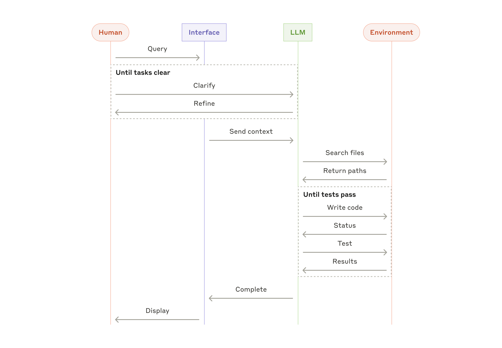

# 构建高效的智能体

:::note
自 2024 年 12 月以来，本文介绍的工具生态已有很大变化。想了解 Anthropic 现在的做法，请参阅 [Claude Managed Agents 是怎样构建的](https://www.anthropic.com/engineering/managed-agents)和 [Managed Agents 文档](https://platform.claude.com/docs/en/managed-agents/overview)。
:::

过去一年，Anthropic 与各行各业的数十个团队合作构建大语言模型（LLM）智能体。一个反复出现的规律是：最成功的实现并没有依赖复杂的框架或专门的库，而是用简单、可组合的模式搭建起来的。

本文分享 Anthropic 在与客户合作、自己构建智能体的过程中总结出的经验，并就如何构建高效的智能体，给开发者一些实用建议。

## 什么是智能体？

“智能体”（Agent）有好几种定义。有些客户把智能体定义为完全自主的系统：它们能长时间独立运行，借助各种工具完成复杂任务。另一些客户则用这个词指代更按部就班的实现，也就是遵循预先定义好的工作流。Anthropic 把这些不同形态统称为**智能体系统**（agentic systems），但在架构上对**工作流**（workflow）和**智能体**（agent）做了一个重要区分：

- **工作流**：由预先写好的代码路径来编排 LLM 和工具的系统。
- **智能体**：由 LLM 动态主导自身流程和工具使用的系统，怎样完成任务由 LLM 自己掌控。

下面会详细探讨这两类智能体系统。附录 1（“实践中的智能体”）介绍了两个领域，客户在这两个领域发现这类系统格外有价值。

## 何时该用（以及何时不该用）智能体

用 LLM 构建应用时，Anthropic 建议尽量采用最简单的方案，只在确有必要时才增加复杂度。这可能意味着根本不去构建智能体系统。智能体系统往往以更高的延迟和成本换取更好的任务表现，你需要想清楚这种取舍在什么情况下值得。

当确实需要更高的复杂度时，工作流能为定义明确的任务提供可预测性和一致性；而如果需要在规模化场景下保持灵活、由模型来做决策，智能体是更好的选择。不过对很多应用来说，用检索和上下文示例把单次 LLM 调用优化好，通常就够了。

## 何时以及如何使用框架

有很多框架能让智能体系统实现起来更容易，包括：

- [Claude Agent SDK](https://platform.claude.com/docs/en/agent-sdk/overview)；
- AWS 的 [Strands Agents SDK](https://strandsagents.com/latest/)；
- [Rivet](https://rivet.ironcladapp.com/)，一个拖拽式的图形化 LLM 工作流构建器；
- [Vellum](https://www.vellum.ai/)，另一个用于构建和测试复杂工作流的图形化工具。

有了这些框架，调用 LLM、定义和解析工具、串联多次调用这类标准的底层工作都变简单了，上手很容易。但它们往往会额外引入几层抽象，可能掩盖底层的提示词和响应，让调试变得更难。框架还容易让人忍不住增加复杂度，哪怕更简单的做法就已足够。

Anthropic 建议开发者先直接使用 LLM API：许多模式用几行代码就能实现。如果确实要用框架，务必弄懂它的底层代码。客户出错，一个常见原因就是对框架底层做了错误的假设。

一些示例实现可参考 Anthropic 的 [cookbook](https://platform.claude.com/cookbook/patterns-agents-basic-workflows)。

## 基础构件、工作流与智能体

本节介绍智能体系统的几种常见模式，都是 Anthropic 在生产环境中见过的。先从基础构件——增强型 LLM——讲起，再逐步增加复杂度，从简单的组合式工作流一直讲到自主智能体。

### 基础构件：增强型 LLM

智能体系统的基本构件，是一个用检索、工具、记忆等能力增强过的 LLM。Anthropic 当前的模型已经能主动运用这些能力：自己生成搜索查询、挑选合适的工具、决定要保留哪些信息。

*增强型 LLM*

Anthropic 建议在实现时重点关注两点：一是针对你的具体用例定制这些能力；二是确保它们给 LLM 提供简单易用、文档完善的接口。实现这些增强的方式很多，其中一种是使用 Anthropic 近期发布的 [Model Context Protocol](https://www.anthropic.com/news/model-context-protocol)：开发者只需一个简单的[客户端实现](https://modelcontextprotocol.io/tutorials/building-a-client#building-mcp-clients)，就能接入不断壮大的第三方工具生态。

本文余下部分假定每次 LLM 调用都能用上这些增强能力。

### 工作流：提示词链

提示词链（prompt chaining）把一个任务分解成一系列步骤，每次 LLM 调用都处理上一次调用的输出。你可以在任意中间步骤加入程序化检查（见下图中的“gate”），确保流程没有跑偏。

*提示词链工作流*

**适用场景：** 如果任务能轻松、清晰地拆成固定的子任务，这个工作流就再合适不过。它的主要目的是用延迟换取更高的准确率：让每次 LLM 调用只处理一个更简单的任务。

**提示词链的典型用例：**

- 先生成营销文案，再把它翻译成另一种语言。
- 先写一份文档大纲，检查大纲是否满足特定标准，再依据大纲撰写文档。

### 工作流：路由

路由（routing）先给输入分类，再把它交给专门的后续任务处理。这种工作流能做到关注点分离，也便于编写更有针对性的提示词。不做路由的话，针对某一类输入的优化可能会拖累其他输入上的表现。

*路由工作流*

**适用场景：** 路由适合这样的复杂任务：其中有几个界限分明、分开处理效果更好的类别，而且分类本身能做得准确——无论是交给 LLM，还是交给更传统的分类模型或算法。

**路由的典型用例：**

- 把不同类型的客服请求（一般咨询、退款申请、技术支持）分别导向不同的下游流程、提示词和工具。
- 把简单、常见的问题路由给 Claude Haiku 4.5 这类更小、更省成本的模型，把困难、少见的问题路由给 Claude Sonnet 4.5 这类能力更强的模型，以获得最佳表现。

### 工作流：并行化

有时可以让多个 LLM 同时处理一个任务，再用程序汇总它们的输出。这种工作流就是并行化（parallelization），主要有两种形式：

- **分段**（sectioning）：把任务拆成彼此独立、可以并行运行的子任务。
- **投票**（voting）：把同一个任务运行多次，得到多样化的输出。

*并行化工作流*

**适用场景：** 并行化在两种情况下很有效：一是拆出的子任务可以并行执行，以提高速度；二是需要多个视角或多次尝试，才能得到置信度更高的结果。对于要兼顾多个方面的复杂任务，把每个方面交给一次单独的 LLM 调用来处理，效果通常更好，因为每次调用都能专注于一个具体方面。

**并行化的典型用例：**

- **分段**：
  - 实现护栏：一个模型实例处理用户请求，另一个实例筛查这些请求里有没有不当的内容或要求。这样做往往比让同一次 LLM 调用同时负责护栏和核心回复效果更好。
  - 自动化评测 LLM 的表现：每次 LLM 调用各负责评估模型在给定提示词下某一方面的表现。
- **投票**：
  - 审查一段代码有没有漏洞：用几个不同的提示词分别审查，发现问题就标记出来。
  - 判断一段内容是否不当：用多个提示词分别评估不同方面，或者设定不同的投票阈值，以平衡误报与漏报。

### 工作流：编排器—工作者

在编排器—工作者（orchestrator-workers）工作流中，由一个中心 LLM 动态拆解任务，分派给各个工作者 LLM，再综合它们的结果。

*编排器—工作者工作流*

**适用场景：** 如果是复杂任务，又无法预知需要哪些子任务，这个工作流就很合适（以编程为例，要改几个文件、每个文件怎么改，很可能都取决于具体任务）。它和并行化在拓扑上相似，关键区别在于灵活性：子任务不是预先定义好的，而是由编排器根据具体输入来决定。

**编排器—工作者的典型用例：**

- 每次都要对多个文件做复杂修改的编程产品。
- 需要从多个来源收集并分析信息、从中找出可能相关内容的搜索任务。

### 工作流：评估器—优化器

在评估器—优化器（evaluator-optimizer）工作流中，一次 LLM 调用负责生成回复，另一次调用负责评估并给出反馈，两者循环往复。

*评估器—优化器工作流*

**适用场景：** 如果有明确的评估标准，而且反复打磨能带来可衡量的价值，这个工作流就尤其有效。适合用它的标志有两个：其一，人把反馈明确说出来之后，LLM 的回复能有明显改进；其二，LLM 自己也能给出这样的反馈。这就像人写文档时一遍遍修改，直到打磨成稿。

**评估器—优化器的典型用例：**

- 文学翻译：负责翻译的 LLM 起初可能把握不住某些细微之处，而评估器 LLM 能给出有用的批评意见。
- 复杂的搜索任务：需要经过多轮搜索和分析，才能收集到全面的信息，由评估器决定是否还要继续搜索。

### 智能体

随着 LLM 在理解复杂输入、推理与规划、可靠地使用工具、从错误中恢复这些关键能力上日趋成熟，智能体开始在生产环境中崭露头角。智能体的工作要么始于人类用户的一条指令，要么始于与用户的一段交互式讨论。任务明确之后，智能体便自主规划、独立执行，过程中可能会回头找人类要更多信息，或请人类做判断。执行期间，智能体每一步都要从环境中获取“真实情况”（ground truth，比如工具调用结果或代码执行结果）来评估进展，这一点至关重要。智能体可以在检查点或遇到障碍时暂停，等待人类反馈。任务往往在完成后结束，但为了保持可控，设置停止条件（比如最大迭代次数）也很常见。

智能体可以处理复杂的任务，但实现起来往往很简单：通常就是 LLM 在循环中根据环境反馈使用工具。因此，工具集及其文档一定要设计得清晰、周全。附录 2（“为你的工具做提示词工程”）会展开讲工具开发的最佳实践。

*自主智能体*

**智能体的适用场景：** 智能体适合用来处理开放式问题：这类问题很难甚至不可能预知需要多少步，也没法把一条固定路径硬编码下来。LLM 可能要运行很多轮，你必须对它的决策有一定的信任。智能体具有自主性，因此很适合在可信的环境中规模化地处理任务。

智能体的自主性也意味着成本更高，而且错误可能层层累积。Anthropic 建议在沙盒环境中充分测试，并配上恰当的护栏。

**智能体的典型用例：**

以下示例来自 Anthropic 自己的实现：

- 一个用于解决 [SWE-bench 任务](https://www.anthropic.com/research/swe-bench-sonnet)的编程智能体，这类任务需要根据任务描述修改多个文件；
- Anthropic 的 [“computer use”参考实现](https://github.com/anthropics/anthropic-quickstarts/tree/main/computer-use-demo)，让 Claude 操作计算机来完成任务。

*编程智能体的高层流程*

## 组合与定制这些模式

这些构件并不是硬性规定，只是一些常见模式，开发者可以根据不同用例来调整、组合。和任何 LLM 功能一样，成功的关键在于衡量表现，并不断迭代实现方案。再强调一遍：*只有*当增加复杂度能明显改善结果时，才应该考虑这样做。

## 总结

在 LLM 领域，成功不在于构建最精巧的系统，而在于构建*适合*自身需求的系统。从简单的提示词开始，用全面的评测来优化，只有更简单的方案不够用时，才引入多步骤的智能体系统。

实现智能体时，Anthropic 会尽量遵循三条核心原则：

1. 让智能体的设计保持**简单**。
2. 优先保证**透明**，明确展示智能体的规划步骤。
3. 通过完善的工具**文档与测试**，精心打造你的智能体—计算机接口（ACI）。

框架能帮你快速起步，但在走向生产时，不妨果断减少抽象层，改用基础组件来构建。遵循这些原则，你构建出的智能体不仅强大，而且可靠、易于维护，能赢得用户的信任。

## 附录 1：实践中的智能体

在与客户的合作中，Anthropic 发现了两个特别有前景的 AI 智能体应用，它们体现了上文那些模式的实际价值。这两个应用都说明，智能体在满足以下条件的任务上价值最大：既需要对话又需要行动，有明确的成功标准，能形成反馈闭环，并且融入了切实的人工监督。

### A. 客户支持

客户支持既有人们熟悉的聊天机器人界面，又能通过集成工具获得更强的能力。这个场景天然适合更开放式的智能体，因为：

- 客服交互天然遵循对话流程，同时又需要访问外部信息、执行外部操作；
- 可以集成工具来拉取客户数据、订单历史和知识库文章；
- 退款、更新工单等操作可以通过程序完成；
- 成功与否可以清晰衡量：问题算不算解决，由用户来界定。

已有多家公司证明了这种做法可行：它们采用按用量计费的定价模式，只对成功解决的问题收费，足见对自家智能体的效果很有信心。

### B. 编程智能体

在软件开发领域，LLM 功能已经展现出巨大的潜力：从代码补全起步，一路发展到能够自主解决问题。智能体在这里尤其有效，因为：

- 代码方案可以通过自动化测试来验证；
- 智能体可以把测试结果当作反馈，迭代改进方案；
- 问题空间定义明确、结构清晰；
- 输出质量可以客观衡量。

在 Anthropic 自己的实现中，如今智能体仅凭 pull request 的描述，就能解决 [SWE-bench Verified](https://www.anthropic.com/research/swe-bench-sonnet) 基准测试里真实的 GitHub issue。不过，自动化测试有助于验证功能是否正确，而要确保方案符合系统整体的要求，人工审查依然至关重要。

## 附录 2：为你的工具做提示词工程

无论你构建的是哪种智能体系统，工具都很可能是智能体的重要组成部分。借助[工具](https://www.anthropic.com/news/tool-use-ga)，Claude 能与外部服务和 API 交互：只要在 Anthropic 的 API 中写明工具的确切结构和定义即可。Claude 回复时，如果打算调用某个工具，API 响应里就会包含一个 [tool_use 块](https://docs.anthropic.com/en/docs/build-with-claude/tool-use#example-api-response-with-a-tool-use-content-block)。在工具定义和规范上投入的提示词工程精力，应当和整体提示词一样多。这篇简短的附录就来介绍如何为你的工具做提示词工程。

同一个操作往往可以用好几种方式来表达。比如，修改文件既可以写一个 diff，也可以重写整个文件；返回结构化输出时，代码既可以放在 Markdown 里，也可以放在 JSON 里。在软件工程里，这类差异只是形式上的，可以无损地互相转换。但对 LLM 来说，有些格式要比另一些难写得多：写 diff 时，得在写出新代码之前，就知道块头（chunk header）里有多少行会变化；把代码写在 JSON 里（相比 Markdown），还得额外转义换行符和引号。

在选择工具格式上，Anthropic 的建议如下：

- 给模型留出足够的 token 先“思考”，免得它写着写着走进死胡同。
- 让格式尽量贴近模型在互联网文本中自然见过的样子。
- 确保格式上没有“额外负担”，比如必须精确数清几千行代码，或者要对写出的所有代码做字符串转义。

一条经验法则是：想想人们在人机界面（HCI）上花了多少心思，然后准备在打造优秀的*智能体*—计算机接口（ACI）上投入同样多的心思。以下是一些具体思路：

- 设身处地替模型想一想。看了描述和参数，这个工具该怎么用是一目了然，还是需要仔细琢磨？如果你都得琢磨，模型多半也一样。好的工具定义通常包含用法示例、边界情况、输入格式要求，以及与其他工具之间清晰的界限。
- 怎样修改参数名或描述，才能让用法更加一目了然？可以把这当成给团队里的初级开发者写一份出色的 docstring。如果要用到很多相似的工具，这一点尤其重要。
- 测试模型如何使用你的工具：在 Anthropic 的 [workbench](https://console.anthropic.com/workbench) 里跑大量示例输入，看看模型会犯哪些错，然后迭代改进。
- 给工具做[防错设计](https://en.wikipedia.org/wiki/Poka-yoke)（poka-yoke）。调整参数，让工具更难用错。

为 [SWE-bench](https://www.anthropic.com/research/swe-bench-sonnet) 构建智能体时，Anthropic 花在优化工具上的时间，实际上比花在整体提示词上的还多。例如，Anthropic 发现智能体一旦离开根目录，模型在使用相对路径的工具时就会出错。解决办法是把工具改成始终要求绝对路径，改完之后，模型用起来再也没出过错。

---

*参考文章：[Building Effective Agents](https://www.anthropic.com/engineering/building-effective-agents)*
